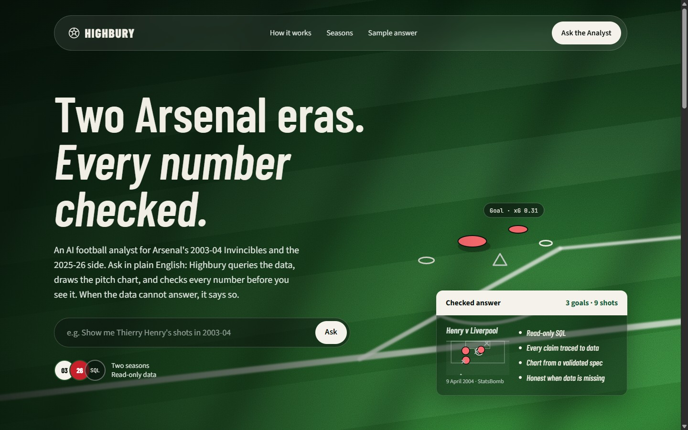
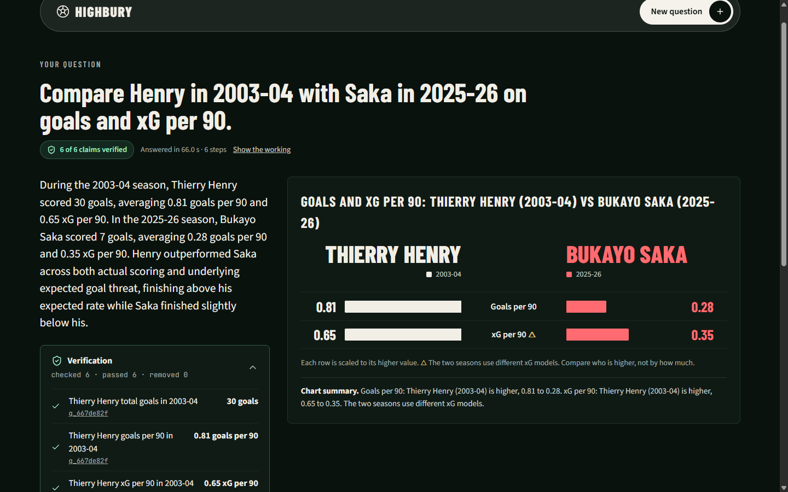
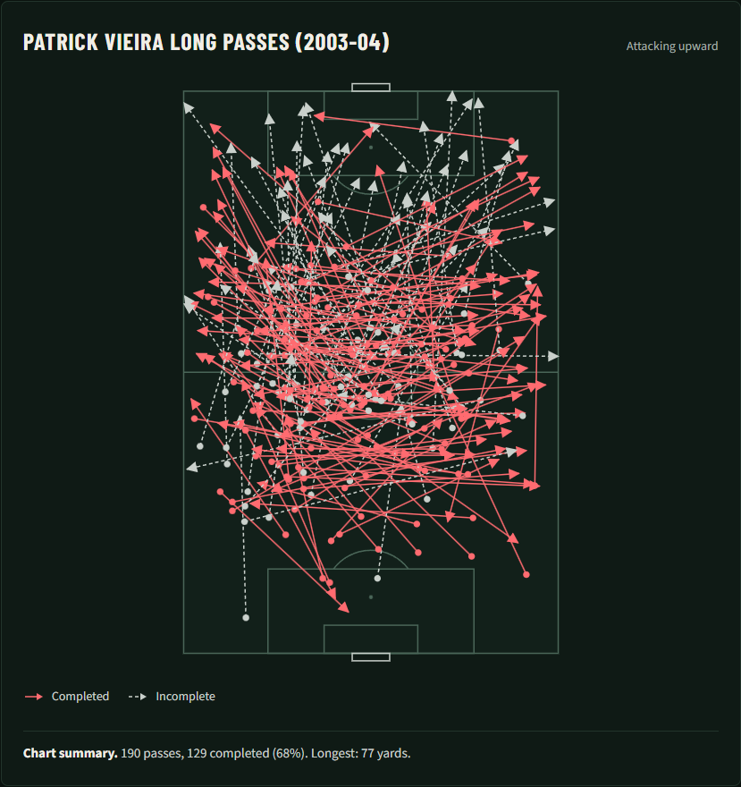
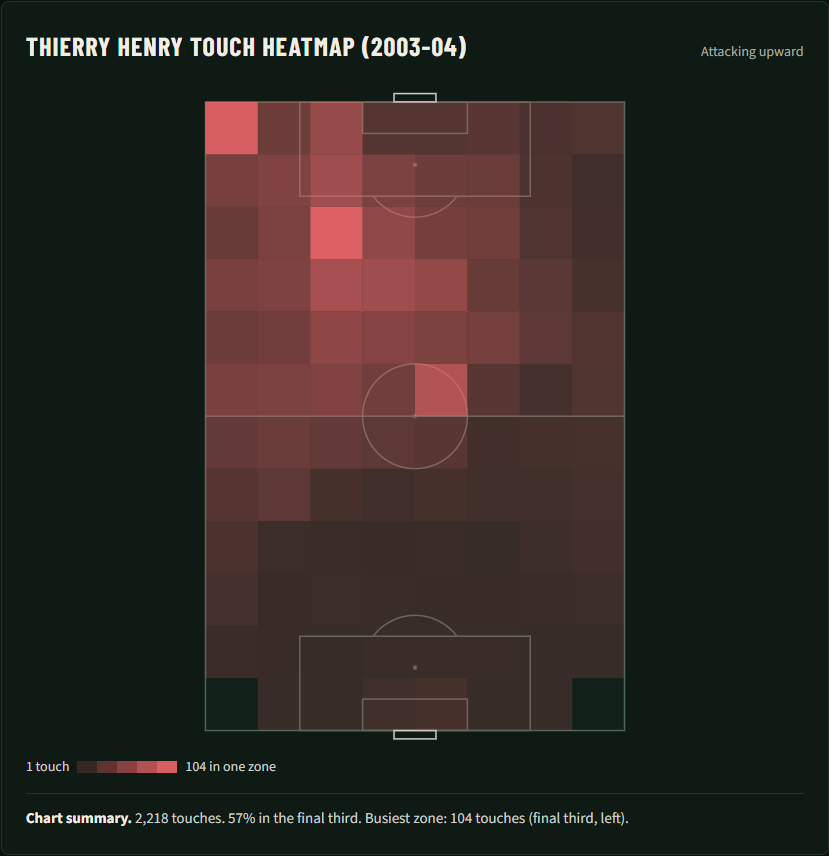
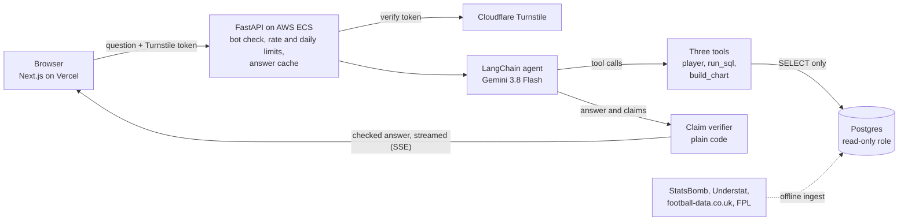

# Highbury

**An AI football analyst that shows its receipts.** Ask a question in plain
English about Arsenal's 2003-04 Invincibles or the 2025-26 side. An agent
queries a curated Postgres database, draws an interactive chart, and checks
every number against the data before you see it. When the data cannot answer,
it says so.

**Try it first, with nothing to install:** [highbury.arkaslittlemind.com](https://highbury.arkaslittlemind.com).
Click an example question to see a verified answer.

Built by Arkadipta Mojumder ([GitHub](https://github.com/arkaslittlemind),
[LinkedIn](https://www.linkedin.com/in/arkadipta-mojumder/)). MIT licensed.



## New to football data?

Two terms appear on every page:

- **xG (expected goals)** is the chance that a shot becomes a goal, from 0 to 1,
  based on where and how it was taken. A shot with an xG of 0.31 goes in about
  3 times in 10. A player's xG total shows how many goals the chances were worth.
- **Per 90** means a rate for each 90 minutes played (one full match), so a
  player who played 900 minutes and one who played 2,700 can be compared.

Different data providers use different xG models, so Highbury says so whenever it
compares the two seasons.

## Why it exists

Ask a general chatbot how many shots Thierry Henry took in 2003-04 and it gives
you a confident number with no way to check it. Highbury is built on the opposite
rule: **a number reaches the reader only if code can trace it to a database
query.**



Every answer shows:

- **A verification badge**, such as "6 of 6 claims verified". Each claim links
  to the exact query that produced it.
- **The working**: the tools the agent called and the SQL it ran.
- **A chart** when the question calls for one: a shot map, comparison bars, a
  pass network, a pass map, a touch heatmap, an xG timeline of one match, or a
  points-pace line, with a text summary under it.
- **Caveats** where they matter. For example, the two seasons use different xG
  models, so the comparison says so.

Two of the 2003-04 charts, from live answers: Patrick Vieira's 190 long passes,
and Thierry Henry's 2,218 touches counted in zones of the pitch.

<p>
  
  
</p>

## What it shows

| Capability | How it works |
| --- | --- |
| Answers from real data | An agent plans the question with the data catalog and the schema already in its prompt, then calls three tools: a player resolver, a SQL runner, and a chart builder. For 2003-04 the data has every on-ball event (shots, passes, dribbles, duels, clearances, interceptions, recoveries, blocks), lineups, and advanced metrics such as chances created, aerial duels, pass accuracy, and long balls. For 2025-26 it has shots, player match stats with chances created, and FPL player data with saves, tackles, and recoveries. Both seasons have all 380 league matches with team stats and the table. |
| Does not invent numbers | A verifier written in plain code, not another LLM, checks each claimed number against the rows of the query it cites. Unsupported claims are removed. |
| Knows what it does not know | The agent checks the data catalog in its prompt before a claim about a season. Ask for Saka's 2025-26 pass map and it says there is no pass data for that season, then offers his shot map. |
| Stays in scope | "Who will win the Champions League?" is declined with no database call. |
| Remembers the conversation | Follow-ups such as "Only the ones inside the box." refine the previous answer. A conversation ends after 20 turns. |
| Cannot change the data | Two independent locks: a SQL parser that allows one `SELECT`, and a read-only database role with a 5-second timeout and a 500-row cap. |
| Measured, not guessed | 32 golden questions with hand-written SQL answers. Flash, the production model, scored 32 of 32. Flash-Lite scored 23 of 24 on the earlier set of 24. |
| Safe to leave open | Each question carries a Cloudflare Turnstile token that the API checks before any model call, so a script with `curl` gets 403. An address can ask 5 questions a minute and 10 a day, the whole site has a daily cap, and at most 10 questions run at once. A daily refusal shows a "Daily limit" card with no retry, because a retry cannot help before midnight UTC. The example questions on the page have kept answers, which call no model and do not count toward the daily limits. |
| Readable by AI agents | `/llms.txt`, `/llms-full.txt`, and `/index.md` (also `/` with `Accept: text/markdown`) give agents a text copy of the page, from the same source as the page text. The page also has JSON-LD, Open Graph images, a sitemap, and crawler rules. |

## Results

From [`evals/results.md`](evals/results.md): 32 questions, 1 run of Flash. Flash-Lite
did not run again; its row is the 24-question refresh of 2026-10-25, 2 runs.

| Model | Correct | Verified claims | Median time | Cost per question |
| --- | --- | --- | --- | --- |
| Gemini 3.8 Flash (in production) | 32 / 32 | 100% | 24.2 s | $0.042 |
| Gemini 3.5 Flash-Lite (24 questions, 2026-10-25) | 23 / 24 | 100% | 4.7 s | $0.008 |

Flash-Lite is faster and cheaper, but it missed the xG timeline question (q16) in
both of its runs, and it failed the conversation follow-up 2 times in 9 earlier tries.
Flash has failed neither, so production stays on Flash. The full reasoning is in
the results file.

The suite has **1,050 Python tests** and **335 web unit tests**.

## Architecture



1. The browser sends the question with a Turnstile token and receives a stream
   of events: each tool step as it runs, then the final answer. A ping event
   keeps the stream open through the load balancer while the agent is quiet.
   Before the agent starts, the API verifies the token with Cloudflare and
   checks the per-minute and daily limits and the number of running questions.
2. The agent calls the tools in-process. The catalog and the schema are already
   in its prompt, so it does not spend a tool call to read them. All five data
   functions (catalog, schema, player, run_sql, build_chart) are also served as
   an **MCP server** over stdio, so any MCP client can use them.
3. Before the answer is sent, the verifier matches each claimed value to a cell
   in the rows of its cited tool call (exact for counts, within 0.01 for rates).
   It also flags any number in the text that has no claim behind it.
4. Charts are data. The agent returns a validated chart spec. The page checks it
   again with Zod and draws it, so the model decides *what* to show and the UI
   owns *how*.

### Key design decisions

- **Verifier as code, not an LLM judge.** It is deterministic, free, fast, and
  unit tested. The cost: it rejects some correct but loose phrasing such as
  "nearly double".
- **Derived numbers come from SQL.** The agent must compute per-90 rates and
  differences in the query, so every number has a row to check against.
- **Flat views for the model.** The agent queries pre-joined views such as
  `v_shots` and `v_player_season` instead of writing multi-table joins. Fewer
  wrong joins, less flexibility.
- **A chart and its claims share one filter.** The pass map and its claims
  count the same passes, so the drawing and the verified numbers cannot
  disagree. The heatmap counts its zones in SQL, so a full season fits the
  500-row cap.
- **Model as configuration.** One environment variable names the model, so the
  evals compare models on the same questions.
- **Few sources, honest catalog.** Four open sources, and a catalog that says
  what each season lacks. Each source is cross-checked against another where it
  can be: the football-data scores against the published tables, and the FPL
  goals against Understat's. A load stops on any difference.
- **One identity for every player and team.** A resolver links each source
  record to one canonical ID. A hand-written `overrides.yaml` always wins, and a
  link is made only when it is certain.
- **Spend caps in the API, in memory.** The daily counts live in the one API
  task, with no extra database or cache service. The cost: the service must run
  exactly one task, and a deploy resets the counts.
- **The bot check fails closed.** If Cloudflare cannot verify a token, the API
  refuses the question (503). Letting it through would accept any made-up token
  for as long as Cloudflare is away.
- **Locked-down web headers.** A Content-Security-Policy lets the page reach only
  its own origin, the API, Cloudflare Turnstile, and Cloudflare Web Analytics.
  The page cannot be framed.

Each feature has a study document in [`design-docs/`](design-docs/README.md)
covering its design, run-time flow, and trade-offs.

## Tech stack

| Layer | Technology |
| --- | --- |
| Web | Next.js 16 (App Router), React 19, TypeScript (strict), Tailwind CSS v4, shadcn/ui, d3-scale, Zod, Vitest |
| Agent and API | Python 3.12, FastAPI, LangChain and LangGraph, Gemini, sqlglot, psycopg 3, MCP, pytest |
| Data | Postgres 17, SQL migrations, separate admin, ingest, and read-only roles |
| Infrastructure | Vercel (web), Docker image on AWS ECS Express Mode with Amazon ECR and Systems Manager secrets (API), Neon (Postgres), Cloudflare (DNS proxy, Turnstile, Web Analytics) |
| Tooling | uv workspace, pnpm, ruff |

## How it was built

Highbury was built AI-natively with a spec-first workflow. For each feature, an
AI coding agent drafted a spec, and I approved it before any code was written.
The agent then built it in small reviewed steps, a check proved the behaviour
against the running app, and an audit recorded findings on the security-sensitive
parts (the SQL guard, the verifier, the API, the deploy). For the launch work
(the spend caps, the bot check, the security headers), a second agent with a
fresh context and no access to the builder's chat reviewed each change before it
landed. The agent wrote the code. I owned the scope, the specs, the
verification, and the judgement.

The plans are in [`project-requirement-docs/`](project-requirement-docs/), and a
study document for every finished feature and fix is in
[`design-docs/`](design-docs/README.md).

## Run it locally

You do not need this to try Highbury: the [live app](https://highbury.arkaslittlemind.com)
runs the same code. Run it locally to read, change, or extend it.

**You need:**

- [Docker](https://www.docker.com/), for the local Postgres.
- [uv](https://docs.astral.sh/uv/), which installs Python 3.12 and the Python
  packages.
- Node 20.9 or newer and [pnpm](https://pnpm.io/), for the web app.
- A [Gemini API key](https://aistudio.google.com/apikey). Each question that the
  agent answers is a paid model call, about $0.04 with the default model. The
  data loads and the tests need no key.

The first setup is mostly downloads. The loaders
cache the raw files in `ingest/raw/` (not in Git), so a re-run is fast and safe.

```bash
cp .env.example .env                 # then set GOOGLE_API_KEY
docker compose up -d                 # Postgres 17 on localhost:5433
uv sync --all-packages               # Python workspace
uv run --env-file .env python -m ingest.migrate      # tables, views, roles
uv run --env-file .env python -m ingest.statsbomb    # load 2003-04
uv run --env-file .env python -m ingest.understat    # load 2025-26
uv run --env-file .env python -m ingest.footballdata # all 380 league matches of both seasons
uv run --env-file .env python -m ingest.fpl          # FPL player data, 2025-26
uv run --env-file .env python -m ingest.curated      # nicknames and data catalog
```

If football-data.co.uk or the FPL archive does not answer, the loader says which
file to save by hand and where. [`AGENTS.md`](AGENTS.md) has the file names.

Ask from the terminal (each question calls the model and costs a little):

```bash
uv run --env-file .env ask "Show me Thierry Henry's shots in 2003-04." "Only the ones inside the box."
```

Or run the API and the web app. Both `.env.example` files carry Cloudflare's
public Turnstile test keys, so the bot check passes locally with no Cloudflare
account:

```bash
uv run --env-file .env uvicorn analyst.api:create_app --factory --port 8000
cd apps/web && cp .env.example .env.local && pnpm install && pnpm dev   # http://localhost:3000
```

Tests:

```bash
uv run --env-file .env pytest        # Python, needs the local database
cd apps/web && pnpm test             # web unit tests
```

[`AGENTS.md`](AGENTS.md) lists every command, including the evals, the MCP
server, and the deploy.

## Limitations and what is next

- **Two seasons only.** Highbury knows Arsenal in 2003-04 and 2025-26, nothing
  else. More seasons are a planned extension.
- **Different depth for each season.** 2003-04 has every on-ball event. 2025-26
  has shots, player match stats, league data, and FPL counts, but no open source
  has its events. So 2025-26 has no pass map, heatmap, pass network, duels,
  aerial duels, pass accuracy, long balls, or pressures. The agent says so and
  offers what it has.
- **The verifier checks numbers, not opinions.** It cannot judge a claim like
  "Henry was better" and it rejects some loose but correct phrasing.
- **An answer takes 20 to 30 seconds.** The latest evals give a median of 24
  seconds. The default model favours reliability over speed. The evals show a
  faster model that is less reliable.
- **Daily limits.** Each address gets 10 new questions a day, and the site has a
  daily cap that keeps the model cost bounded. The limits start again at
  midnight UTC. The example questions on the page do not count toward them.
- **A broad question can fail.** A question such as "Tell me about the 2003-04
  season" can reach the agent's limit of 10 tool calls before it answers,
  instead of asking for detail
  ([#8](https://github.com/arkaslittlemind/Highbury/issues/8)).
- **No automatic checks on pull requests yet.** The tests run locally.

## Contributing

This is a personal project, and I am not taking issues or pull requests at the
moment. You are welcome to read the code, fork it, and build on it under the
[MIT License](LICENSE). If that changes, this section will say so.

## Repository layout

| Path | What |
| --- | --- |
| `apps/web` | The Next.js web app |
| `services/analyst` | The agent, the five data tools, the verifier, the API, and the MCP server |
| `ingest` | Offline loaders for StatsBomb, Understat, football-data.co.uk, and FPL, and the entity resolver |
| `db/migrations` | SQL schema, views, and roles |
| `evals` | Golden questions, model list, and results |
| `deploy/ecs` | API service config for AWS ECS (names only, no secrets) |
| `design-docs` | One study document per finished feature or fix |
| `project-requirement-docs` | Product and build plans |

## License

The code is released under the [MIT License](LICENSE). The data keeps the
licenses and terms of its sources, listed below.

## Data and disclaimer

**Unofficial fan project.** Not affiliated with or endorsed by Arsenal FC or the
Premier League. No club crests, logos, or player photos are used.

Data:

- [StatsBomb Open Data](https://github.com/statsbomb/open-data) for the 2003-04
  events and shots.
- [Understat](https://understat.com) for the 2025-26 shots and per-match player
  stats, key passes included.
- [football-data.co.uk](https://www.football-data.co.uk) for every league match
  and team match stats of both seasons.
- The [Fantasy Premier League archive](https://github.com/vaastav/Fantasy-Premier-League)
  of vaastav for the 2025-26 per-match player data, with saves, bonus points,
  and defensive counts.

Raw data is not redistributed in this repository; the loaders download and cache
it locally.
