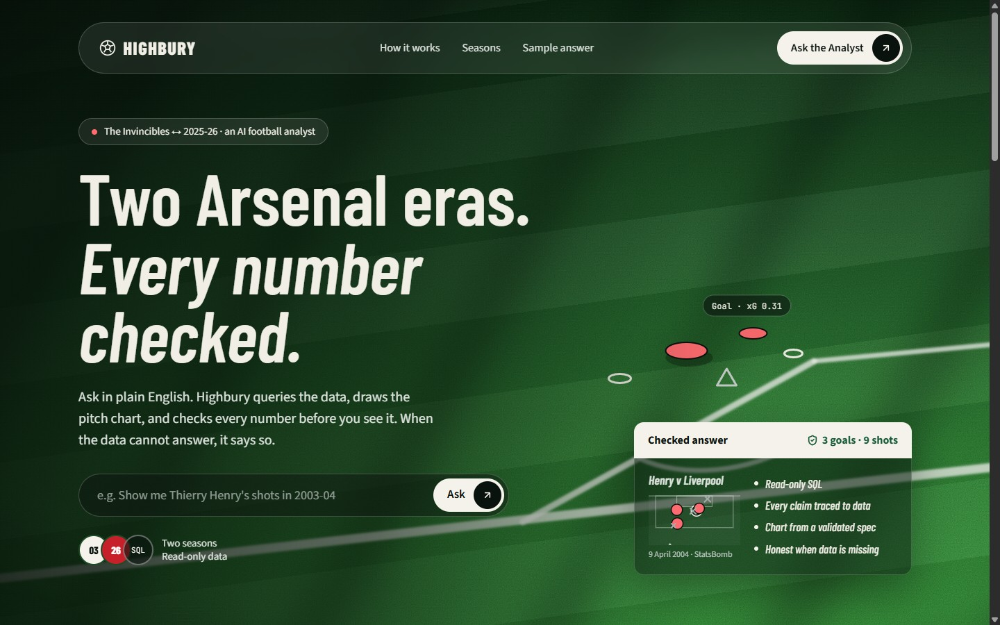
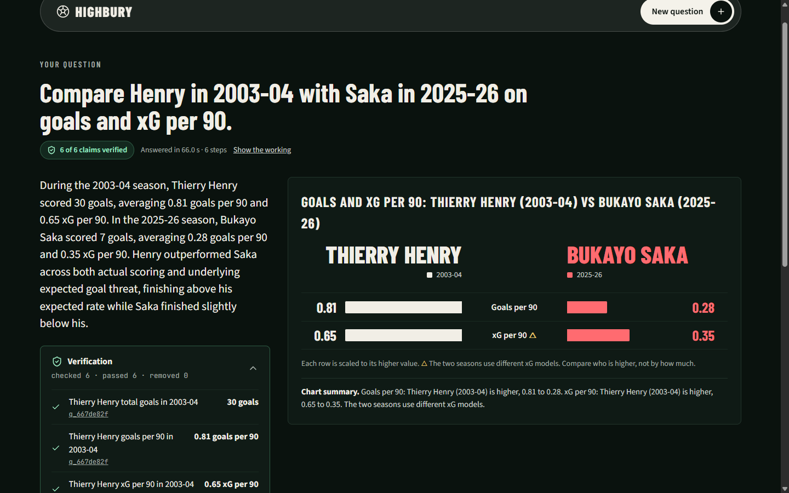
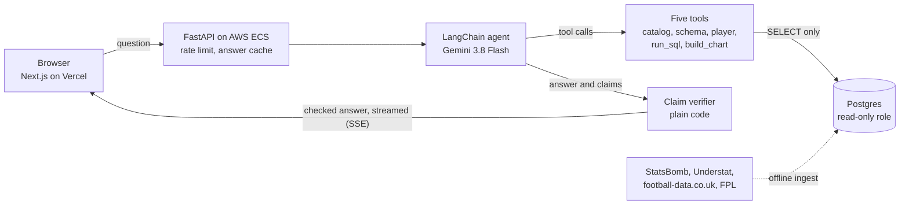

# Highbury

**An AI football analyst that shows its receipts.** Ask a question in plain
English about Arsenal's 2003-04 Invincibles or the 2025-26 side. An agent
queries a curated Postgres database, draws an interactive chart, and checks
every number against the data before you see it. When the data cannot answer,
it says so.

**Live app:** [highbury-sigma.vercel.app](https://highbury-sigma.vercel.app)



## Why it exists

Ask a general chatbot how many shots Thierry Henry took in 2003-04 and it gives
you a confident number with no way to check it. Highbury is built on the opposite
rule: **a number reaches the reader only if code can trace it to a database
query.**



Every answer shows:

- **A verification badge**, such as "6 of 6 claims verified". Each claim links
  to the exact query that produced it.
- **The working**: the tools the agent called and the SQL it ran.
- **A chart**: a shot map, comparison bars, a pass network, an xG timeline of
  one match, or a points-pace line, with a text summary under it.
- **Caveats** where they matter. For example, the two seasons use different xG
  models, so the comparison says so.

## What it shows

| Capability | How it works |
| --- | --- |
| Answers from real data | An agent plans the question and calls five tools: the data catalog, the schema, a player resolver, a SQL runner, and a chart builder. The data covers shots, passes, and lineups, all 380 league matches of both seasons with team stats and the table, and FPL player data for 2025-26. |
| Does not invent numbers | A verifier written in plain code, not another LLM, checks each claimed number against the rows of the query it cites. Unsupported claims are removed. |
| Knows what it does not know | The agent reads a data catalog first. Ask for Saka's 2025-26 pass map and it says there is no pass data for that season, then offers his shot map. |
| Stays in scope | "Who will win the Champions League?" is declined with no database call. |
| Remembers the conversation | Follow-ups such as "Only the ones inside the box." refine the previous answer. A conversation ends after 20 turns. |
| Cannot change the data | Two independent locks: a SQL parser that allows one `SELECT`, and a read-only database role with a 5-second timeout and a 500-row cap. |
| Measured, not guessed | 24 golden questions with hand-written SQL answers, run on two models. Flash scored 24 of 24, Flash-Lite 23 of 24. |

## Results

From [`evals/results.md`](evals/results.md): 24 questions, 2 runs per model.

| Model | Correct | Verified claims | Median time | Cost per question |
| --- | --- | --- | --- | --- |
| Gemini 3.8 Flash (in production) | 24 / 24 | 100% | 28.5 s | $0.037 |
| Gemini 3.5 Flash-Lite | 23 / 24 | 100% | 4.7 s | $0.008 |

Flash-Lite is faster and cheaper, but it missed the xG timeline question (q16) in
both runs, and it failed the conversation follow-up 2 times in 9 earlier tries.
Flash has failed neither, so production stays on Flash. The full reasoning is in
the results file.

The suite has **942 Python tests** and **263 web unit tests**.

## Architecture



1. The browser sends the question and receives a stream of events: each tool
   step as it runs, then the final answer. A ping event keeps the stream open
   through the load balancer while the agent is quiet.
2. The agent calls the tools in-process. The same functions are also served as
   an **MCP server** over stdio, so any MCP client can use them.
3. Before the answer is sent, the verifier matches each claimed value to a cell
   in the rows of its cited tool call (exact for counts, within 0.01 for rates).
   It also flags any number in the text that has no claim behind it.
4. Charts are data. The agent returns a validated chart spec. The page checks it
   again with Zod and draws it, so the model decides *what* to show and the UI
   owns *how*.

### Key design decisions

- **Verifier as code, not an LLM judge.** It is deterministic, free, fast, and
  unit tested. The cost: it rejects some correct but loose phrasing such as
  "nearly double".
- **Derived numbers come from SQL.** The agent must compute per-90 rates and
  differences in the query, so every number has a row to check against.
- **Flat views for the model.** The agent queries pre-joined views such as
  `v_shots` and `v_player_season` instead of writing multi-table joins. Fewer
  wrong joins, less flexibility.
- **Model as configuration.** One environment variable names the model, so the
  evals compare models on the same questions.
- **Few sources, honest catalog.** Four open sources, and a catalog that says
  what each season lacks. Each source is cross-checked against another where it
  can be: the football-data scores against the published tables, and the FPL
  goals against Understat's. A load stops on any difference.
- **One identity for every player and team.** A resolver links each source
  record to one canonical ID. A hand-written `overrides.yaml` always wins, and a
  link is made only when it is certain.

Each feature has a study document in [`design-docs/`](design-docs/README.md)
covering its design, run-time flow, and trade-offs.

## Tech stack

| Layer | Technology |
| --- | --- |
| Web | Next.js 16 (App Router), React 19, TypeScript (strict), Tailwind CSS v4, shadcn/ui, d3-scale, Zod, Vitest |
| Agent and API | Python 3.12, FastAPI, LangChain and LangGraph, Gemini, sqlglot, psycopg 3, MCP, pytest |
| Data | Postgres 17, SQL migrations, separate admin, ingest, and read-only roles |
| Infrastructure | Vercel (web), Docker image on AWS ECS Express Mode with Amazon ECR and Systems Manager secrets (API), Neon (Postgres) |
| Tooling | uv workspace, pnpm, ruff |

## How it was built

Highbury was built AI-natively with a spec-first workflow. For each feature, an
AI coding agent drafted a spec, and I approved it before any code was written.
The agent then built it in small reviewed steps, a check proved the behaviour
against the running app, and an audit recorded findings on the security-sensitive
parts (the SQL guard, the verifier, the API, the deploy). The agent wrote the
code. I owned the scope, the specs, the verification, and the judgement.

The plans are in [`project-requirement-docs/`](project-requirement-docs/), and a
study document for every finished feature and fix is in
[`design-docs/`](design-docs/README.md).

## Run it locally

Needs Docker, [uv](https://docs.astral.sh/uv/), Node with pnpm, and a Gemini API
key.

```bash
cp .env.example .env                 # then set GOOGLE_API_KEY
docker compose up -d                 # Postgres 17 on localhost:5433
uv sync --all-packages               # Python workspace
uv run --env-file .env python -m ingest.migrate      # tables, views, roles
uv run --env-file .env python -m ingest.statsbomb    # load 2003-04
uv run --env-file .env python -m ingest.understat    # load 2025-26
uv run --env-file .env python -m ingest.footballdata # all 380 league matches of both seasons
uv run --env-file .env python -m ingest.fpl          # FPL player data, 2025-26
uv run --env-file .env python -m ingest.curated      # nicknames and data catalog
```

Ask from the terminal (each question calls the model and costs a little):

```bash
uv run --env-file .env ask "Show me Thierry Henry's shots in 2003-04." "Only the ones inside the box."
```

Or run the API and the web app:

```bash
uv run --env-file .env uvicorn analyst.api:create_app --factory --port 8000
cd apps/web && cp .env.example .env.local && pnpm install && pnpm dev   # http://localhost:3000
```

Tests:

```bash
uv run --env-file .env pytest        # Python, needs the local database
cd apps/web && pnpm test             # web unit tests
```

[`AGENTS.md`](AGENTS.md) lists every command, including the evals, the MCP
server, and the deploy.

## Repository layout

| Path | What |
| --- | --- |
| `apps/web` | The Next.js web app |
| `services/analyst` | The agent, the five tools, the verifier, the API, and the MCP server |
| `ingest` | Offline loaders for StatsBomb, Understat, football-data.co.uk, and FPL, and the entity resolver |
| `db/migrations` | SQL schema, views, and roles |
| `evals` | Golden questions, model list, and results |
| `deploy/ecs` | API service config for AWS ECS (names only, no secrets) |
| `design-docs` | One study document per finished feature or fix |
| `project-requirement-docs` | Product and build plans |

## Data and disclaimer

**Unofficial fan project.** Not affiliated with or endorsed by Arsenal FC or the
Premier League. No club crests, logos, or player photos are used.

Data:

- [StatsBomb Open Data](https://github.com/statsbomb/open-data) for the 2003-04
  events and shots.
- [Understat](https://understat.com) for the 2025-26 shots.
- [football-data.co.uk](https://www.football-data.co.uk) for every league match
  and team match stats of both seasons.
- The [Fantasy Premier League archive](https://github.com/vaastav/Fantasy-Premier-League)
  of vaastav for the 2025-26 per-match player data.

Raw data is not redistributed in this repository; the loaders download and cache
it locally.
