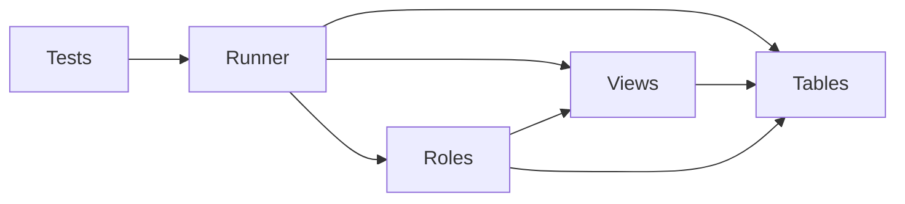
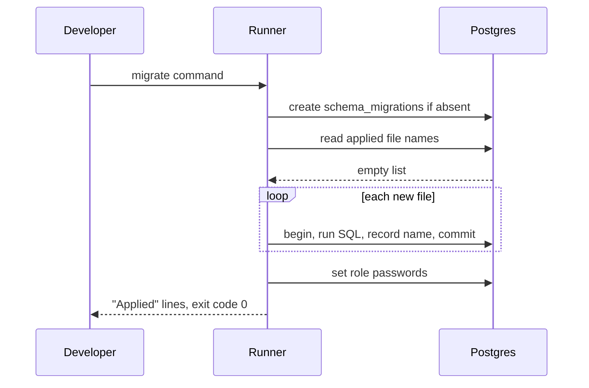

# 01 Database schema, views, roles

| | |
| --- | --- |
| Work | Feature: the database tables, the views for the agent, and two database roles |
| Change | `528f1a8` on `main`, 2026-10-10 |
| Evidence | `blueprint/history/features/01-database-schema-views-roles.md` (spec, review receipt), the findings ledger, the commit message, and the build conversation |
| Reader | A learner who can write basic code and is new to this stack |

This document obeys the rules of ASD-STE100 Simplified Technical
English. It is not a certified STE document.

## 1. Summary

This work gives Highbury its database. It adds nine tables for football data and
five views that the AI agent will query. It also adds two database roles:
`ingest` can write data, and `analyst_ro` can only read data. A small Python
program, the migration runner, applies the SQL files to a database.

The one idea to remember: the database, not the agent, stops a write.

## 2. Why this work exists

Before this work, the project had an empty folder `db/migrations` and no
database objects. The other features cannot start without tables. The loaders
need tables to fill, and the agent needs views to read.

The project also has a safety problem to solve early. The agent will run SQL
that a language model writes. A model can write a bad statement, for example a
`DELETE`. If the agent connects with a role that can write, one bad statement
can destroy the data. Thus the read-only role must exist before the agent
exists.

## 3. Design

The design has three SQL files and one program that applies them in order.

A **migration** is a file that changes the structure of a database. Each change
is a new file, so every database gets the same changes in the same order.

A **view** is a saved query that you can read like a table. This work uses views
to give the agent flat rows with names, not rows with id numbers.

A **role** is a database user with a list of permissions. A **grant** gives one
permission to one role.

| Part | Location | Job |
| --- | --- | --- |
| Tables | `db/migrations/0001_tables.sql` | Define the nine tables, their checks, and their indexes |
| Views | `db/migrations/0002_views.sql` | Define five flat views and a comment on each column |
| Roles | `db/migrations/0003_roles.sql` | Create `ingest` and `analyst_ro` and give them grants |
| Runner | `ingest/src/ingest/migrate.py` | Apply each new migration one time, then set the role passwords |
| Tests | `ingest/tests/` | Prove the tables, views, and roles on a temporary database |

Support files: `AGENTS.md` and `README.md` got the new commands. This work
removed the file `db/.gitkeep` because the folder is not empty now.



The tables hold raw facts: `seasons`, `teams`, `players`, `player_aliases`,
`matches`, `shots`, `events`, `player_match_stats`, and `data_catalog`. All pitch
positions use one system: 120 units long and 80 units wide. Checks in the `shots`
table reject a position outside the pitch.

The views are `v_matches`, `v_shots`, `v_player_match`, `v_player_season`, and
`v_passes`. Each view column has a comment. A later tool will give these
comments to the language model, so the model knows what each column means.

## 4. Workflow

Example input: a developer runs the migrate command on an empty database.

```bash
uv run --env-file .env python -m ingest.migrate
```

1. `main` reads three URLs from the environment. (`migrate.py:97`)
2. `load_settings` gets the admin URL and one password for each role. (`migrate.py:46`)
3. `apply` connects to the database as the admin. (`migrate.py:64`)
4. `apply` creates the table `schema_migrations` if it is absent. (`migrate.py:77`)
5. `apply` reads the names of the files that the table already lists. (`migrate.py:80`)
6. `migration_files` sorts the files in `db/migrations` by name. (`migrate.py:27`)
7. `pending` keeps only the files that are not in the list. (`migrate.py:35`)
8. For each file, `apply` starts a transaction. (`migrate.py:83`)
9. `apply` runs the SQL and adds the file name to `schema_migrations`. (`migrate.py:85`)
10. `apply` sets the password of each role. (`migrate.py:90`)
11. `main` prints one line for each file and returns 0.

A **transaction** is a group of changes that the database applies fully or not
at all. If the SQL in one file fails, the database removes all changes from that
file. The file name does not go into `schema_migrations`, so the next run tries
that file again.

On a second run, step 7 finds no files. The runner prints "Nothing to apply."
and returns 0.



## 5. Decisions and tradeoffs

### 5.1 Migrations are plain SQL files with a small runner

- **Choice:** Three numbered SQL files and a runner of about 120 lines.
- **Alternatives:** A migration framework such as Alembic, or an ORM that
  creates tables from Python classes.
- **Reason:** Recorded: the spec puts a migration framework and an ORM out of
  scope and adds no new dependency. Source: the spec, sections Out of scope and
  Files / areas.
- **Cost:** No file can undo a migration. To undo a change, you write a new
  migration by hand.

### 5.2 Each file runs in one transaction

- **Choice:** The runner puts each file and its log record in one transaction.
- **Alternatives:** Run each statement alone, or run all files in one transaction.
- **Reason:** Recorded: a file with a SQL error must leave no partial tables.
  Source: the spec, build step 1.
- **Cost:** Inferred from how PostgreSQL works: a statement that cannot run in a
  transaction cannot go in a migration file.

### 5.3 The agent reads views, not tables

- **Choice:** Five views join the tables and show names such as `player` and
  `opponent`.
- **Alternatives:** Let the model write its own joins on the base tables.
- **Reason:** Recorded: the views are flat and pre-joined, with column comments
  for the model. Source: the project plan, section 4.
- **Cost:** A change to a table can need a change to a view. `v_player_season`
  calculates totals on each query, which is slower than a stored table.

### 5.4 The SQL files hold no passwords

- **Choice:** The role file creates the roles without passwords. The runner then
  sets each password from the URL in the environment.
- **Alternatives:** Write the passwords in the SQL file, or create the roles by
  hand in each database.
- **Reason:** Recorded: no secrets in tracked files, and one source for each
  password. Source: the spec, build step 3 and Notes for the AI.
- **Cost:** The runner needs all three URLs on each run, not only the admin URL.

### 5.5 The absent grants are the lock, and the role defaults are a second layer

- **Choice:** `analyst_ro` gets only `SELECT`. The role also gets two defaults:
  read-only transactions and a 5-second limit for each statement.
- **Alternatives:** Rely only on the read-only default, or rely only on a SQL
  check in the application.
- **Reason:** Recorded: a session can change its own defaults, so only the absent
  write grants are a true lock. Source: the comment in
  `db/migrations/0003_roles.sql` and the test
  `test_analyst_cannot_insert_after_leaving_read_only_mode`.
- **Cost:** The 5-second limit is only a default. The SQL check in feature 5
  must reject each statement that is not a `SELECT`.

### 5.6 `analyst_ro` can read all nine tables

- **Choice:** The role can read the tables and the views.
- **Alternatives:** Give the role the views and three tables only.
- **Reason:** Recorded: the tools in feature 5 read base tables. Source: the
  spec, Open questions, item 2.
- **Cost:** The model can query raw tables with id numbers, where a wrong join
  is more likely.

### 5.7 The tables have more columns than the parent plan lists

- **Choice:** The tables add `team_id`, `recipient_id`, and source id columns.
- **Alternatives:** Use only the columns in the parent plan.
- **Reason:** Recorded: the views need a team to find the opponent. The pass
  network needs a recipient. A loader needs a stable id to run again safely.
  Source: the spec, Open questions, item 1.
- **Cost:** Each loader must supply these values for each row.

### 5.8 The tests use a temporary database and fail when Postgres is absent

- **Choice:** Each test run creates a new database, applies the migrations, and
  drops the database.
- **Alternatives:** Test on the developer database, or skip the tests when the
  database is not available.
- **Reason:** Recorded: tests must not touch the `highbury` database, and a
  skipped test must not look like a pass. Source: the spec, section Testing.
- **Cost:** The tests need Docker and the `.env` file. Roles belong to the whole
  server, so the tests and the developer database share the two roles.

### 5.9 The views match the lowercase words `goal` and `pass`

- **Choice:** `v_shots.is_goal` is true when `outcome` is `goal`. `v_passes`
  keeps events where `type` is `pass`.
- **Alternatives:** A check on the column that permits only known values.
- **Reason:** Reason not recorded. The spec does not define these values.
- **Cost:** A loader that writes `Goal` or `Pass` gets wrong results with no
  error. See section 8.

## 6. Blast radius

### 6.1 This work needs

| Dependency | Used for | If it fails |
| --- | --- | --- |
| PostgreSQL 17 (local Docker, or Neon) | All of this work | The runner prints "Migration failed" and returns 1 |
| `DATABASE_ADMIN_URL` | The runner connects as the owner | The runner names the variable and applies nothing |
| `INGEST_DATABASE_URL`, `ANALYST_DATABASE_URL` | The runner reads the role passwords | The runner names the variable and applies nothing |
| `psycopg` | The Python connection to PostgreSQL | The runner cannot start |
| `uv sync --all-packages` | Puts the `ingest` package in the environment | Python cannot find `ingest.migrate` |

### 6.2 These things use this work

No code uses this work yet. A search of the repository found only the commands
in `AGENTS.md` and `README.md`, and the variable names in `.env.example`.

The planned consumers are in the build plan:

| Consumer | Uses |
| --- | --- |
| Features 2 and 3 (loaders) | The tables, as the role `ingest` |
| Feature 4 (aliases and catalog) | `player_aliases` and `data_catalog` |
| Feature 5 (data tools) | The views, the column comments, and the role `analyst_ro` |
| Feature 10 (deploy) | The Neon database and the `analyst_ro` URL |

### 6.3 If you change this work

| If you change | Then check |
| --- | --- |
| A file in `db/migrations` that a database already applied | Nothing happens on that database. Add a new file. |
| A column name in a table | Each view that reads the column, and each loader |
| A view column | Its comment, and the SQL examples for the model in feature 7 |
| The values in `outcome` or `type` | `v_shots.is_goal` and the filter in `v_passes` |
| A new table | Add grants for both roles in a migration. No grant is automatic. |
| The role settings | The tests in `ingest/tests/test_roles.py` |

### 6.4 How to remove this work

On a database with no data, drop the database and create it again. Then revert
commit `528f1a8`. The two roles stay on the server after a drop, because roles
belong to the server. Remove them with `DROP ROLE` if you do not want them.

## 7. Code reading path

1. [`db/migrations/0001_tables.sql:44`](../db/migrations/0001_tables.sql#L44) - Look for: how the checks on `x`, `y`, and `xg` reject bad data.
2. [`db/migrations/0002_views.sql:29`](../db/migrations/0002_views.sql#L29) - Look for: how `v_shots` joins six tables into one flat row.
3. [`db/migrations/0002_views.sql:36`](../db/migrations/0002_views.sql#L36) - Look for: how the `CASE` finds the opponent from the home team and the away team.
4. [`db/migrations/0002_views.sql:64`](../db/migrations/0002_views.sql#L64) - Look for: a column comment that tells the model about a data limit.
5. [`db/migrations/0003_roles.sql:4`](../db/migrations/0003_roles.sql#L4) - Look for: how the block creates a role only when it is absent.
6. [`db/migrations/0003_roles.sql:20`](../db/migrations/0003_roles.sql#L20) - Look for: the two grant lists, and what `analyst_ro` does not get.
7. [`ingest/src/ingest/migrate.py:64`](../ingest/src/ingest/migrate.py#L64) - Look for: the transaction around each file in `apply`.
8. [`ingest/src/ingest/migrate.py:46`](../ingest/src/ingest/migrate.py#L46) - Look for: how an error names the variable but not the URL.
9. [`ingest/tests/conftest.py:35`](../ingest/tests/conftest.py#L35) - Look for: how the tests make and drop a temporary database.
10. [`ingest/tests/test_roles.py:33`](../ingest/tests/test_roles.py#L33) - Look for: the proof that a write fails after the session leaves read-only mode.

## 8. Known limits

The independent review found six points. They were open when this work landed.
A later fix closed all of them. See
[Harden roles and schema checks](2026-10-11-harden-roles-and-schema-checks.md).

- **F-01:** `analyst_ro` can create a temporary table and write to it after the
  session leaves read-only mode.
- **F-02:** `analyst_ro` can change its own role settings and remove the
  5-second limit.
- **F-03:** `ingest` has no `USAGE` grant on the id sequences. A normal `INSERT`
  still works.
- **F-04:** The runner reads `os.environ` directly. The project standard says to
  use `pydantic-settings`.
- **F-05:** The view tests use only home-team rows. No test covers the opponent
  logic for an away team.
- **F-06:** No check enforces the lowercase values `goal` and `pass`.

Other limits:

- There are no migrations that undo a change.
- No automated test covers the Neon database. One manual run confirmed the
  migrations and the role checks on Neon.
- The tables are empty. Features 2 to 4 load the data.

## 9. Self-test

1. Why does `analyst_ro` fail to insert a row after it turns off read-only mode?
2. What happens if the second statement in a migration file has an error?
3. Why does the runner need the URLs of `ingest` and `analyst_ro`?
4. What happens if you edit `0001_tables.sql` and run the command again on your
   local database?
5. Why does the agent read `v_shots` and not the table `shots`?

<details>
<summary>Answers</summary>

1. The role has no `INSERT` grant on a table. Read-only mode is only a default,
   and the absent grant is the true lock. See section 5.5.
2. The database removes all changes from that file, and the file name is not
   recorded. The next run tries the file again. See section 4.
3. The SQL files hold no passwords. The runner takes each password from its URL
   and sets it on the role. See section 5.4.
4. Nothing changes. The file name is already in `schema_migrations`, so the
   runner does not apply the file again. Add a new file. See section 6.3.
5. The view gives flat rows with names and has a comment on each column for the
   model. See section 5.3.

</details>
