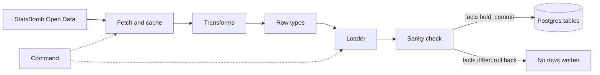
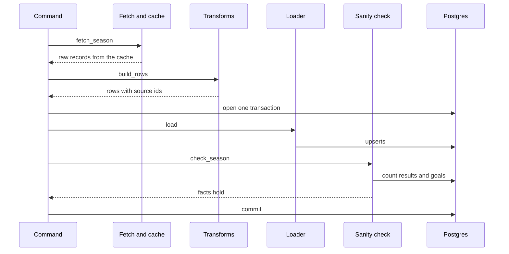

# 02 Ingest 2003-04 (StatsBomb)

| | |
| --- | --- |
| Work | Feature: one command that puts Arsenal's 2003-04 league season into the database |
| Change | `c20c3a4` on `main`, 2026-10-11 |
| Evidence | `blueprint/history/features/02-ingest-2003-04-statsbomb.md` (spec with an "As built" section, local and not in Git), the commit message, and the build conversation |
| Reader | A learner who can write basic code and is new to this stack |

This document obeys the rules of ASD-STE100 Simplified Technical
English. It is not a certified STE document.

## 1. Summary

This work adds one command that puts Arsenal's 2003-04 league season into the
database. The command gets 38 matches from StatsBomb Open Data, changes the
records into rows, and writes the rows. A developer runs the command on a local
computer. The AI agent does not run it. The agent reads the rows later through
the views.

The one idea to remember: the command proves the season facts before it
commits, thus the database cannot hold a wrong season.

## 2. Why this work exists

Before this work, the database had tables and views but no rows. The agent can
answer a question only from rows in the database. Thus no question about
2003-04 had an answer.

A loader has two quiet ways to fail. The first is a load that is wrong but
looks correct. Then the agent gives a wrong number with full confidence, and
that is the problem Highbury exists to stop. The second is a load that a
developer runs two times. If each run adds rows, each goal total doubles.

This work closes the two failures. A check stops a wrong season, and a second
run changes nothing.

## 3. Design

The design is a pipeline with a hard line in the middle. The first half gets
and shapes the data and does not touch the database. The second half writes
the data and does not touch the network.

Five terms are new in this work:

- **StatsBomb Open Data** is a free set of football match records on GitHub. It
  is the only source with event data for 2003-04.
- **`statsbombpy`** is the Python library that downloads those records. The
  build plan names it.
- **Upsert** is an `INSERT` that updates the row if the row is already there.
  The loader uses it so that a second run does not add a second copy.
- **Transaction** is a group of writes that the database applies together or
  not at all. The command uses one, so that a failed load leaves no rows.
- **Idempotent** means that a second run gives the same result as the first
  run.

| Part | Location | Job |
| --- | --- | --- |
| Fetch and cache | `ingest/src/ingest/statsbomb.py` | Downloads each raw file one time and keeps it in `ingest/raw/statsbomb/`. |
| Transforms | `ingest/src/ingest/statsbomb.py` | Change raw records into rows, with no input or output. |
| Row types | `ingest/src/ingest/load.py` | Define the shape of the rows that the loader accepts. |
| Loader | `ingest/src/ingest/load.py` | Writes the rows with upserts and does not commit. |
| Sanity check | `ingest/src/ingest/load.py` | Compares the loaded totals with the published season facts. |
| Command | `ingest/src/ingest/statsbomb.py` | Connects the parts, owns the transaction, and prints short errors. |
| Tests | `ingest/tests/` | Prove each part with small hand-written records. |

`AGENTS.md` is a support file. It got one line for the new command.

The rows use the ids of the source, not database ids. For example, a shot row
names its player as `"15516"`, the StatsBomb id of Thierry Henry. The loader
changes each source id into a database id. As a result, the transforms need no
database, and a test can call them with plain data.

## 4. Workflow

Example input: the command
`uv run --env-file .env python -m ingest.statsbomb`, and one shot from Arsenal
2-1 Everton on 2003-08-16. Sylvain Wiltord shot in minute 3 from `[91.5, 37.1]`
with outcome `Off T` and an xG of 0.028.

1. `main` reads `INGEST_DATABASE_URL` from the environment through `ingest_url`. (`statsbomb.py:374`, `load.py:108`)
2. `run` calls `fetch_season` with the raw directory and three fetch functions. (`statsbomb.py:358`)
3. `cached` finds `events/3749493.json`, reads it, and makes no network call. (`statsbomb.py:89`)
4. `build_rows` goes through each match and each event. (`statsbomb.py:254`)
5. `shot_row` calls `point`, which returns `(91.5, 37.1)` unchanged. (`statsbomb.py:212`, `statsbomb.py:139`)
6. `shot_outcome` changes `Off T` into the shared value `off target`. (`statsbomb.py:154`)
7. `build_rows` adds 0.028 to the xG total of Wiltord for this match. (`statsbomb.py:304`)
8. `run` opens one connection as the `ingest` role. (`statsbomb.py:368`)
9. `load` upserts the shot on the key `(source, source_shot_id)`. (`load.py:200`)
10. `check_season` counts 38 matches, 26 wins, 12 draws, and 30 goals for Henry. (`load.py:306`)
11. The connection block commits, and `main` prints the row counts. (`statsbomb.py:368`)

## 5. Decisions and tradeoffs

### 5.1 The sanity check runs before the commit

- **Choice:** One transaction holds the load and the check. If a fact differs,
  the transaction rolls back.
- **Alternatives:** Commit the load, then run the check as a second command.
- **Reason:** Recorded: "Nothing commits when an assert fails." Source: the
  spec, section Data / contracts.
- **Cost:** The check knows only six facts. A wrong value that keeps those six
  facts correct can pass.

### 5.2 The loader uses upserts on source ids

- **Choice:** Each table has an upsert on a key from the source, for example
  `(source, source_match_id)`.
- **Alternatives:** Delete the season and insert it again on each run.
- **Reason:** Inferred from the test
  `test_a_second_load_changes_no_row_count_and_no_id`. The views show
  `match_id`, thus the ids must stay the same between runs.
- **Cost:** A row that the source removes stays in the database. Each row is
  one statement, thus the full load takes about 12 seconds.

### 5.3 The alias row is the identity of a player

- **Choice:** The loader finds a player by the row in `player_aliases` with
  `source = 'statsbomb'` and the StatsBomb player id.
- **Alternatives:** Add a unique key to `players`, or match on the name.
- **Reason:** Recorded: "`players` has no natural key, so the `player_aliases`
  row is the identity." Source: the spec, section Data / contracts.
- **Cost:** The loader does not update a player that is already there. Two
  StatsBomb players with one full name stop the load.

### 5.4 Shot outcomes use five shared values

- **Choice:** Eight StatsBomb outcomes become `goal`, `saved`, `blocked`,
  `off target`, and `post`.
- **Alternatives:** Keep the StatsBomb names in lowercase, for example `off t`.
- **Reason:** Recorded: "so that both seasons can share one legend." Source:
  the spec, section Data / contracts.
- **Cost:** This choice loses some detail: `Saved to Post` becomes `saved`. The Understat
  loader must use the same five values.

### 5.5 Minutes come from three places

- **Choice:** The lineup gives the time on the pitch. A `Substitution` event or
  a red card in the lineup can end the minutes earlier.
- **Alternatives:** Use the lineup only, as the first spec said.
- **Reason:** Recorded: the lineup does not end at a red card, and it has no
  record of one substitution in match 3749153. Source: the spec, section As
  built.
- **Cost:** The minutes are nominal. Stoppage time does not count, and a late
  substitute gets 1 minute, thus some teams total 991.

### 5.6 The match score comes from the match record

- **Choice:** `home_goals` and `away_goals` come from the StatsBomb match
  record, not from a count of shots.
- **Alternatives:** Count the shots with outcome `goal`.
- **Reason:** Recorded: "own goals are not shots." Source: the spec, section
  Data / contracts.
- **Cost:** In five matches the score differs from the goals in `v_shots`.

### 5.7 The loader writes the two teams of each match

- **Choice:** The loader writes shots, events, and stats for Arsenal and for
  the opponent.
- **Alternatives:** Load Arsenal only.
- **Reason:** Recorded: it "lets the analyst answer questions on chances
  conceded." Source: the spec, section Open questions.
- **Cost:** `players` holds 371 players from 20 teams. A later search for a
  player name also looks at the opponents.

### 5.8 A database error shows no client text

- **Choice:** For a database error, `main` prints the message of the server or
  the class name of the error.
- **Alternatives:** Print the full text of the error.
- **Reason:** Recorded: "psycopg repeats a URL it cannot parse, password
  included." Source: the spec, section As built, and the comment in `main`.
- **Cost:** A failed connection shows only `ConnectionTimeout`, with no host or
  port.

## 6. Blast radius

### 6.1 This work needs

| Dependency | Used for | If it fails |
| --- | --- | --- |
| StatsBomb Open Data and `statsbombpy` | The first download of 77 files | `Download failed`, exit code 1, no rows written. A later run needs no network. |
| `ingest/raw/statsbomb/` | The cache of raw files | A file that is not JSON gives `Unexpected source data`. Delete the folder to download again. |
| `INGEST_DATABASE_URL` | The connection as the `ingest` role | `Settings error` with the name of the variable. |
| Postgres with migrations 0001 to 0004 | Tables, unique keys for the upserts, and grants | `Load failed`, exit code 1. A server that does not answer stops the command after 10 seconds. |
| `SettingsError` in `ingest/src/ingest/migrate.py` | The error type for a variable that is not set | The command cannot start. |

### 6.2 These things use this work

| Consumer | Uses | Found in |
| --- | --- | --- |
| The five views | The rows in the tables | `db/migrations/0002_views.sql` |
| The command line in the agent guide | `python -m ingest.statsbomb` | `AGENTS.md:70` |
| The `ingest` test fixture | `load.SEASON_TABLES` | `ingest/tests/conftest.py:59` |
| The StatsBomb module | The row types, `load`, `check_season` | `ingest/src/ingest/statsbomb.py:19` |

No application code uses this work yet. `services/analyst` holds only an empty
package.

### 6.3 If you change this work

| If you change | Then check |
| --- | --- |
| `SHOT_OUTCOMES` | `v_shots.is_goal` matches `goal` exactly. The Understat loader and the shot map use the same values. |
| The alias source name `statsbomb` | A second run finds no player and inserts 371 new players. |
| A unique key in `db/migrations/0001_tables.sql` | Each `ON CONFLICT` clause in `load.py` names one of those keys. |
| `minutes_played` | The per-90 values that the agent computes from `v_player_season.minutes`. |
| `FACTS` | The command refuses to commit when a fact does not match the data. |
| `SEASON_TABLES` | The test fixture truncates exactly these tables. |
| `SEASON_DB_ID` | A new id makes a second season row, and the matches move to it. |

### 6.4 How to remove this work

1. Revert commit `c20c3a4`.
2. Delete the 2003-04 rows by hand, because the revert does not touch data.
3. Delete in this order: `player_match_stats`, `events`, `shots`, `matches`, `player_aliases`, `players`, `teams`, `seasons`.
4. Delete `ingest/raw/statsbomb/` if you do not want the raw files.

## 7. Code reading path

1. [`ingest/src/ingest/statsbomb.py:358`](../ingest/src/ingest/statsbomb.py#L358) - Look for: the full pipeline in eight lines, and where the transaction starts.
2. [`ingest/src/ingest/load.py:29`](../ingest/src/ingest/load.py#L29) - Look for: the row types, which carry source ids and not database ids.
3. [`ingest/src/ingest/statsbomb.py:89`](../ingest/src/ingest/statsbomb.py#L89) - Look for: the rename that makes a half-finished download harmless.
4. [`ingest/src/ingest/statsbomb.py:139`](../ingest/src/ingest/statsbomb.py#L139) - Look for: a coordinate off the pitch raises an error and is not corrected.
5. [`ingest/src/ingest/statsbomb.py:173`](../ingest/src/ingest/statsbomb.py#L173) - Look for: the rule for minutes, with `left_at` as the early end.
6. [`ingest/src/ingest/statsbomb.py:254`](../ingest/src/ingest/statsbomb.py#L254) - Look for: how one pass over the events gives shots, events, goals, assists, xG, and xA.
7. [`ingest/src/ingest/load.py:116`](../ingest/src/ingest/load.py#L116) - Look for: the alias row as the identity of a player.
8. [`ingest/src/ingest/load.py:145`](../ingest/src/ingest/load.py#L145) - Look for: one upsert for each table, in dependency order, and no commit.
9. [`ingest/src/ingest/load.py:306`](../ingest/src/ingest/load.py#L306) - Look for: one error that lists each fact that differs.
10. [`ingest/tests/test_statsbomb.py:480`](../ingest/tests/test_statsbomb.py#L480) - Look for: the test that proves the command does not print a password.

## 8. Known limits

- The command loaded the local Postgres only. Neon has no 2003-04 rows yet.
- The loader does not update a player that is already there, and it does not
  delete a row that the source removed.
- The position of a player is the first position of the most matches. For a
  frequent substitute it can be wrong: Martin Keown, a defender, shows as
  `Right Midfield`.
- No automated test covers a successful run of the command. The real run
  proved it: 38 matches, 26 wins, 12 draws, 90 points, Henry 30 goals.
- `build_rows` has about 100 lines and `load` about 130. The code review named
  this length as a judgement call, and it stays open.
- No independent review ran. The completion step judged the work not
  sensitive.
- The folder `ingest/raw/statsbomb/` also holds an older `matches.json` from an
  early experiment. This work does not read it.
- Defect seen in this debrief: `temporary_database` connects with no time limit
  (`ingest/tests/conftest.py:38`). On this computer, a connection to a closed
  port did not return in 25 seconds. Thus the tests can wait with no end when
  Postgres is down, and the message "Cannot reach Postgres" does not show.

## 9. Self-test

1. Why does the sanity check run in the same transaction as the load?
2. What happens if you run the command two times?
3. Why does the loader find a player through `player_aliases` and not through the name?
4. Why does `v_shots` show fewer goals than the match score in five matches?
5. What happens if a player gets a red card, and why does the lineup not show it?

Answers

1. A fact that differs raises an error, and the error rolls back the
   transaction. Thus a wrong season cannot stay in the database. See section
   5.1.
2. Each upsert finds its row by a source id and updates it. The row counts and
   the ids stay the same. See section 5.2.
3. `players` has no natural key, and a name can change or repeat. The alias row
   holds the StatsBomb player id, which does not change. See section 5.3.
4. An own goal is not a shot in StatsBomb. The score comes from the match
   record, which counts own goals. See section 5.6.
5. The lineup time for that player runs to the final whistle. The code reads
   the card list and ends the minutes at the card. See section 5.5.

