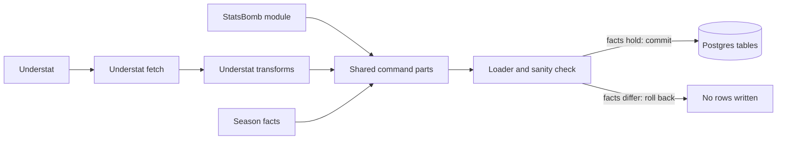
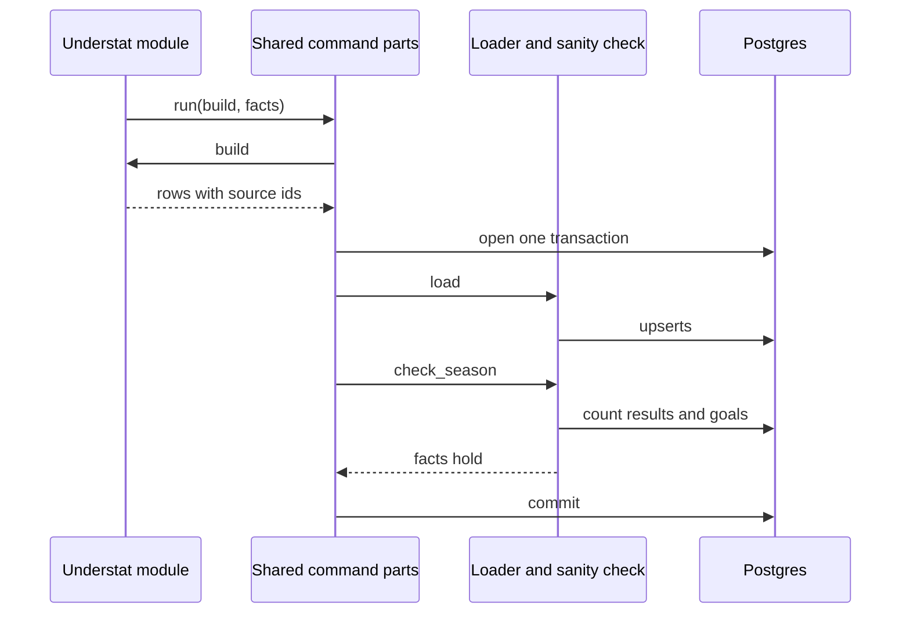

# 03 Ingest 2025-26 (Understat)

| | |
| --- | --- |
| Work | Feature: one command that puts Arsenal's 2025-26 league season into the database |
| Change | `b72940a` on `main`, 2026-10-11 |
| Evidence | `blueprint/history/features/03-ingest-2025-26-understat.md` (spec with an "As built" section, local and not in Git), the commit message, and the build conversation |
| Reader | A learner who can write basic code and is new to this stack |

This document obeys the rules of ASD-STE100 Simplified Technical
English. It is not a certified STE document.

## 1. Summary

This work adds a second season command. It gets Arsenal's 38 league matches of
2025-26 from Understat and writes the matches, shots, players, and player
stats. It uses the loader and the sanity check that the 2003-04 work made. A
developer runs the command on a local computer, and the AI agent reads the
rows later.

The one idea to remember: two sources can use the same numbers for different
things. Compare them on real data before you trust a rule.

## 2. Why this work exists

Before this work, the database held only the 2003-04 season. The product
compares two Arsenal teams that are 22 years apart. Thus it needs the second
season in the same tables and the same pitch system.

The risk is in the word "same". The plan said that Understat coordinates
become pitch coordinates with `x * 120` and `y * 80`. That rule is correct for
the size of the pitch. But it is wrong for the direction of `y`, and no test
with made-up data can show that. If the rule stayed, each 2025-26 shot map
would be a mirror image, and it would look correct.

## 3. Design

The design keeps the pipeline of the 2003-04 work and adds a second source
module in front of the same loader.

Four terms are new in this work:

- **Understat** is a website with shot data and xG for the top leagues. It is
  the source that the plan names for 2025-26.
- **`httpx`** is a Python library for HTTP requests. The project had it, so
  this work adds no dependency.
- **JSON endpoint** is a web address that returns data as JSON, not a page.
  Understat serves its data from such addresses.
- **xG** (expected goals) is the chance, from 0 to 1, that a shot becomes a
  goal. Each source has its own model.

| Part | Location | Job |
| --- | --- | --- |
| Shared command parts | `ingest/src/ingest/command.py` | Hold the raw cache, the transaction, and the error lines for the two season commands. |
| Understat fetch | `ingest/src/ingest/understat.py` | Downloads the season file and 38 match files, one each second, one time only. |
| Understat transforms | `ingest/src/ingest/understat.py` | Change raw records into the row types of the loader, with no input or output. |
| Season facts | `ingest/src/ingest/understat.py` | Hold the published table values that the load must match. |
| Loader and sanity check | `ingest/src/ingest/load.py` | Write the rows and compare the totals. This work adds the goals of the team to the check. |
| StatsBomb module | `ingest/src/ingest/statsbomb.py` | Now calls the shared command parts. Its behavior did not change. |
| Tests | `ingest/tests/` | Prove each part with small hand-written records. |

`AGENTS.md` is a support file. It got one line for the new command.

The loader did not change for the new source. It accepts a source name and a
list of rows, and Understat gives an empty list of events.

## 4. Workflow

Example input: the command
`uv run --env-file .env python -m ingest.understat`, and one shot from
Manchester United 0-1 Arsenal on 2025-08-17. Bryan Mbeumo shot in minute 5 from
`X = 0.87`, `Y = 0.376`, with result `SavedShot` and an xG of 0.071.

1. `main` gives `command.run` a function that builds the rows, and the facts. (`understat.py:276`)
2. `run` reads `INGEST_DATABASE_URL` and then calls that function. (`command.py:59`)
3. `fetch_season` reads the season file and each match file from the cache. (`understat.py:98`)
4. `build_rows` goes through each match, each side, and each shot. (`understat.py:196`)
5. `point` scales `X` to 104.4 and mirrors `Y` to 49.9. (`understat.py:140`)
6. `shot_row` changes `SavedShot` into the shared value `saved`. (`understat.py:165`)
7. `build_rows` makes sure that player goals and own goals give the score. (`understat.py:244`)
8. `load_season` opens one connection as the `ingest` role. (`command.py:38`)
9. `load` upserts the shot on the key `(source, source_shot_id)`. (`command.py:43`)
10. `check_season` counts 26 wins, 7 draws, 5 losses, and 71 goals. (`command.py:44`, `load.py:312`)
11. The connection block commits, and `run` prints the row counts. (`command.py:48`)

## 5. Decisions and tradeoffs

### 5.1 The code mirrors the y axis of Understat

- **Choice:** `y = (1 - Y) * 80`.
- **Alternatives:** `y = Y * 80`, as the plan said, and a flip in the chart for
  one season.
- **Reason:** Recorded: with `Y * 80` the right-sided Bukayo Saka had a median
  shot y of 28.6. The right back Lauren of 2003-04 has a median pass y of
  70.6. The user chose the mirror on 2026-10-11. Source: the spec, section As
  built.
- **Cost:** The code and the plan text now disagree. The plan still says
  `y * 80` until the user changes it.

### 5.2 Match xG is the sum of the shot xG

- **Choice:** The database stores no match xG. A query adds the xG of the
  shots.
- **Alternatives:** A migration that adds two xG columns to `matches`.
- **Reason:** Recorded: the user chose no schema change on 2026-10-11. Source:
  the spec, section As built.
- **Cost:** In 20 of 76 team-matches the sum is above the figure that Understat
  shows, by up to 0.66. An answer can thus differ from the Understat website.

### 5.3 The published facts come from the user, not from Understat

- **Choice:** The facts are 26 wins, 7 draws, 5 losses, 85 points, 71 goals,
  and 14 goals for the top scorer. The user gave them from the league table.
- **Alternatives:** Read the totals from the season file of Understat.
- **Reason:** Recorded: "They do not come from Understat, so that the check is
  against a second source." Source: the comment above `FACTS`.
- **Cost:** A person must supply the numbers for each new season.

### 5.4 The two commands share one module for the risky parts

- **Choice:** `command.py` holds the cache, the transaction, and the error
  lines.
- **Alternatives:** Copy the 45 lines of `main` into the new module.
- **Reason:** Recorded: "The rule that a database error never prints
  client-side text stays in one place." Source: the spec, build step 1.
- **Cost:** A change to `command.py` can break two commands.

### 5.5 A club keeps the name that the database already has

- **Choice:** A map changes `Leeds` to `Leeds United` and `Tottenham` to
  `Tottenham Hotspur`. Each other club keeps the Understat title.
- **Alternatives:** A full official name for each of the 20 clubs.
- **Reason:** Recorded: "so that one club is one row in teams." Source: the
  comment above `TEAM_NAMES`, and the spec, section Open questions.
- **Cost:** The names do not have one style. `Brighton` and `West Ham` are
  short, and `Tottenham Hotspur` is full.

### 5.6 An own goal is not a shot

- **Choice:** The code skips each of the 6 Understat rows with result
  `OwnGoal`.
- **Alternatives:** Store them as shots with outcome `goal`.
- **Reason:** Recorded: "as in 2003-04, where own goals are not shots." Source:
  the spec, section Open questions.
- **Cost:** The goals in `v_shots` are fewer than the match scores. For Arsenal
  the difference is 5 goals in the season.

### 5.7 Player stats are the values of Understat

- **Choice:** Minutes, goals, assists, xG, and xA come from the match roster of
  Understat, unchanged.
- **Alternatives:** Compute goals and xG from the shots, as the StatsBomb
  module does.
- **Reason:** Recorded: "They are not computed again from the shots." Source:
  the spec, section Data / contracts. Understat has no pass data, so the code
  cannot compute assists or xA.
- **Cost:** The two seasons use different rules for the same columns.

### 5.8 Each Understat player is a new player

- **Choice:** The loader finds a player by the alias row with
  `source = 'understat'`. It does not compare names with the StatsBomb players.
- **Alternatives:** Match players across the sources by name.
- **Reason:** Recorded: "A merge of players across the two sources" is out of
  scope. Source: the spec, section Out of scope.
- **Cost:** A player who is in the two sources would be two rows. The real data
  has no such player.

## 6. Blast radius

### 6.1 This work needs

| Dependency | Used for | If it fails |
| --- | --- | --- |
| understat.com and its two JSON endpoints | The first download of 39 files | `Download failed`, exit code 1, no rows written. A later run needs no network. |
| The header `X-Requested-With` | Understat answers a data request only with it | The same `Download failed` line. |
| `ingest/raw/understat/` | The cache of raw files | A file with the wrong shape gives `Unexpected source data` on each run. Delete the file to download it again. |
| `INGEST_DATABASE_URL` | The connection as the `ingest` role | `Settings error` with the name of the variable. |
| Postgres with migrations 0001 to 0004 | Tables, unique keys, and grants | `Load failed`, exit code 1, after 10 seconds at most for a server that does not answer. |
| The team names of the 2003-04 load | The team name map | A club gets a second row in `teams`. |

### 6.2 These things use this work

| Consumer | Uses | Found in |
| --- | --- | --- |
| The StatsBomb command | `command.run`, `command.cached_json` | `ingest/src/ingest/statsbomb.py:77`, `ingest/src/ingest/statsbomb.py:335` |
| The Understat command | `command.run`, `command.cached_json`, `command.FetchError` | `ingest/src/ingest/understat.py:104`, `ingest/src/ingest/understat.py:277` |
| The five views | The 2025-26 rows in the tables | `db/migrations/0002_views.sql` |
| The command line in the agent guide | `python -m ingest.understat` | `AGENTS.md:71` |

No application code uses this work yet.

### 6.3 If you change this work

| If you change | Then check |
| --- | --- |
| `point` in `understat.py` | Left and right in each 2025-26 shot map. The test for the mirror must still pass. |
| `SHOT_OUTCOMES`, `BODY_PARTS`, `SITUATIONS` | The values must stay the ones that `statsbomb.py` stores, or the two seasons need two legends. |
| `TEAM_NAMES` | `teams` must hold each club one time. |
| `FACTS` in either module | The command refuses to commit when a fact does not match. |
| `command.run` | The two season commands, and the test that no password shows. |
| `goals_for` in `check_season` | The two sets of facts: 73 for 2003-04 and 71 for 2025-26. |

### 6.4 How to remove this work

1. Revert commit `b72940a`. The 2003-04 command then has its own copy of the shared parts again.
2. Delete the 2025-26 rows by hand, because the revert does not touch data.
3. Delete in this order: `player_match_stats`, `shots`, `matches`, `player_aliases`, `players`, `teams`, `seasons`.
4. Keep the 12 clubs in `teams` that the 2003-04 matches also use.
5. Delete `ingest/raw/understat/` if you do not want the raw files.

## 7. Code reading path

1. [`ingest/src/ingest/command.py:48`](../ingest/src/ingest/command.py#L48) - Look for: the one place that turns each failure into a short line.
2. [`ingest/src/ingest/command.py:38`](../ingest/src/ingest/command.py#L38) - Look for: the transaction that holds the load and the check.
3. [`ingest/src/ingest/understat.py:116`](../ingest/src/ingest/understat.py#L116) - Look for: the header, the timeout, and the pause of 1 second.
4. [`ingest/src/ingest/understat.py:140`](../ingest/src/ingest/understat.py#L140) - Look for: the mirror of `Y`, and the comment that says why.
5. [`ingest/src/ingest/understat.py:49`](../ingest/src/ingest/understat.py#L49) - Look for: the three maps that give the two seasons one set of values.
6. [`ingest/src/ingest/understat.py:196`](../ingest/src/ingest/understat.py#L196) - Look for: the skip of an own goal, and the check of goals against the score.
7. [`ingest/src/ingest/understat.py:76`](../ingest/src/ingest/understat.py#L76) - Look for: the facts, and where they come from.
8. [`ingest/src/ingest/load.py:312`](../ingest/src/ingest/load.py#L312) - Look for: the goals of the team, counted from the match scores.
9. [`ingest/tests/test_understat.py:78`](../ingest/tests/test_understat.py#L78) - Look for: the test that fails if the mirror goes away.
10. [`ingest/tests/test_understat.py:384`](../ingest/tests/test_understat.py#L384) - Look for: the proof that one season does not change the rows of the other.

## 8. Known limits

- The plan text still says `y * 80`. The user must change the plans and run
  `/overview`.
- The command loaded the local Postgres only. Neon has no rows yet.
- The published match xG of Understat is not in the database.
- 90 of the 407 players have no position, because they only came on as
  substitutes.
- A response with correct JSON but the wrong shape goes into the cache. Each
  later run then fails until a person deletes that file.
- No automated test covers the real download functions. The real run proved
  the header, the timeout, and the pause.
- The `httpx` client stays open until the command ends.
- `build_rows` has 78 lines, above the guide of 50. The code review named this
  as a judgement call, and it stays open.
- `command.py` has no test file of its own. The tests of the two source modules
  cover it.
- No independent review ran. The completion step judged the work not
  sensitive.
- The defect from the 02 debrief stays open: `temporary_database` in
  `ingest/tests/conftest.py` connects with no time limit.

## 9. Self-test

1. Why does the code use `(1 - Y) * 80` when the plan said `y * 80`?
2. What happens if Understat changes the result name `SavedShot`?
3. Why do the season facts not come from Understat?
4. Why can the xG of a match in the database differ from the Understat website?
5. What happens to the 2003-04 rows if you run the 2025-26 command two times?

Answers

1. Understat counts `Y` from the right of the attacker, and the stored pitch
   counts `y` from the left. The real data showed it: Saka was on the wrong
   side. See section 5.1.
2. The map has no entry for the new name, so `shot_row` raises an error. The
   command prints `Unexpected source data` and writes no rows. See sections 4
   and 6.1.
3. A check against the same source can only prove that the code copied the
   data. A second source can also show that the data is wrong. See section 5.3.
4. The database adds the xG of each shot. Understat shows a lower figure for
   some matches. See section 5.2.
5. No row of 2003-04 changes. Each upsert finds its row by the source name and
   the source id. A test compares the rows before and after. See sections
   4 and 5.8.

