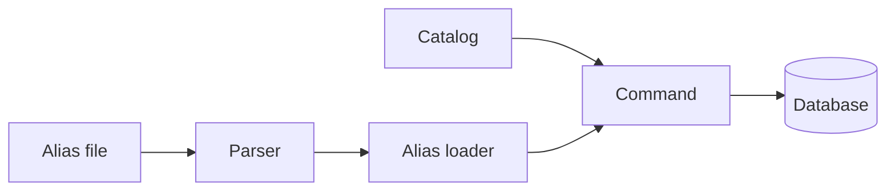

# 04 Aliases + data catalog

| | |
| --- | --- |
| Work | Feature: one command that loads the player aliases and the data catalog |
| Change | `c00385a` on `main`, 2026-10-11 |
| Evidence | `blueprint/history/features/04-aliases-data-catalog.md` (spec with implementation notes, local and not in Git), the commit message, and the build conversation with its code review |
| Reader | A learner who can write basic code and is new to this stack |

This document obeys the rules of ASD-STE100 Simplified Technical
English. It is not a certified STE document.

## 1. Summary

This work adds two small sets of reference data that a person writes by hand.
The first set gives short names and nicknames to 26 key Arsenal players. The
second set is the data catalog. It tells the AI agent which data each season
has. A developer runs one command to load the two sets, and the agent reads
them later.

The one idea to remember: a file in Git is the source of truth, and each run
makes the database equal to that file.

## 2. Why this work exists

Before this work, the database knew each player by one name from each source.
A fan writes "Titi" or "B. Saka", and no row had those names. The
`data_catalog` table was empty too.

Without the aliases, the agent cannot find a player from a common nickname.
Without the catalog, the agent cannot know that 2025-26 has no pass data. Then
it can invent an answer when the correct answer is "not available".

## 3. Design

The design is one module with a pure parser, two loaders, and one command that
puts the two loaders in one transaction.

Four terms are new in this work:

- **Alias** is a second name for a player, for example "Titi" for Thierry
  Henry. This work stores each alias as a row in `player_aliases`.
- **Manual source** is the value `manual` in the `source` column. It keeps the
  hand-written rows apart from the rows of the season loaders.
- **Data catalog** is a table with one row for each season and metric. The
  agent reads it before it makes a statement about one season.
- **YAML** is a text format for lists and key-value data. The plan names
  `aliases.yaml`, and the `pyyaml` library was in the project.

| Part | Location | Job |
| --- | --- | --- |
| Alias file | `ingest/aliases.yaml` | Holds the season, the canonical name, and the aliases of each player. |
| Parser | `ingest/src/ingest/curated.py` | Changes the file text into entries and names each problem in the file. |
| Alias loader | `ingest/src/ingest/curated.py` | Finds each player, checks each alias, and replaces the manual rows. |
| Catalog | `ingest/src/ingest/curated.py` | Holds the 14 catalog rows as a constant and replaces the table rows. |
| Command | `ingest/src/ingest/curated.py` | Runs the two loaders in one transaction and prints one line for each error. |
| Tests | `ingest/tests/test_curated.py` | Prove each part with small hand-written seasons. |



The catalog has seven metrics for each season. The 2003-04 season has all
seven. The 2025-26 season does not have `passes`, `pressures`, or
`pass_networks`. Each row without data has a note that names a different thing
to offer.

## 4. Workflow

Example input: the entry for Thierry Henry in 2003-04, with the aliases
`Henry`, `Titi`, and `T. Henry`.

1. The developer runs `python -m ingest.curated`. (`curated.py:290`)
2. `run` reads the database URL of the `ingest` role. (`curated.py:258`)
3. `parse_aliases` reads the file and makes one `AliasEntry` for Henry. (`curated.py:115`)
4. `run` opens one connection, which is also one transaction. (`curated.py:265`)
5. `load_aliases` collects each name that a player has now. (`curated.py:188`)
6. It finds the one player with that name and a stats row in 2003-04. (`curated.py:200`)
7. It checks that no different player has the name `Titi`. (`curated.py:216`)
8. It deletes all manual rows and inserts the new rows. (`curated.py:232`)
9. `load_catalog` checks the two seasons, then replaces the catalog rows. (`curated.py:240`)
10. The connection block commits, and `run` prints the counts.

```mermaid
sequenceDiagram
  participant Dev as Developer
  participant Cmd as Command
  participant Par as Parser
  participant DB as Database
  Dev->>Cmd: python -m ingest.curated
  Cmd->>Par: text of the alias file
  Par-->>Cmd: entries
  Cmd->>DB: find players, check aliases
  Cmd->>DB: replace manual aliases
  Cmd->>DB: replace catalog rows
  DB-->>Cmd: commit
  Cmd-->>Dev: counts, exit code 0
```

## 5. Decisions and tradeoffs

### 5.1 Each run replaces the rows

- **Choice:** The loaders delete the manual aliases and the catalog rows, then
  insert the full set.
- **Alternatives:** An upsert, which inserts a new row or updates a row that
  exists.
- **Reason:** Recorded: an upsert keeps an alias that a person removed from the
  file. Source: the spec, "Notes for the AI".
- **Cost:** The row ids of the manual aliases change on each run. No other
  table can point to them.

### 5.2 The season is part of the identity of a player

- **Choice:** An entry names the season and the exact `players.name`. The
  loader accepts the entry only if one player matches.
- **Alternatives:** The name only, or the source and its player id.
- **Reason:** Recorded: `players.name` is not unique in the schema, and one
  name can exist in the two sources. Source: the spec, "Data / contracts".
- **Cost:** If a canonical name changes in the database, the file must change
  too.

### 5.3 The loader does the check for letter case

- **Choice:** The Python code compares aliases with `casefold`, a string method
  that removes case differences.
- **Alternatives:** A new unique index in the database on the lower-case name.
- **Reason:** Recorded: the unique constraint that exists is case-sensitive,
  and the spec excludes new migrations. Source: the spec.
- **Cost:** A row that a person inserts by hand, without the command, gets no
  check.

### 5.4 All checks run before the first write

- **Choice:** `load_aliases` finds each problem, then writes.
- **Alternatives:** Write first and check the table after, as the spec said.
- **Reason:** Recorded: the rules are the same, and a failed load has no
  partial write to roll back. Source: the implementation notes in the archive.
- **Cost:** The check reads the rules from Python data, not from the final
  table.

### 5.5 The file tracks alias owners by season and name

- **Choice:** The parser and the loader each reject an alias that two players
  share.
- **Alternatives:** Track the owner by name only, as the first version did.
- **Reason:** Recorded: the code review found that two players with one name
  in different seasons could share an alias. Source: the build conversation.
- **Cost:** Two checks for one rule, one in the parser and one in the loader.

### 5.6 The catalog is a constant in Python

- **Choice:** The 14 rows are a tuple in `curated.py`.
- **Alternatives:** A second YAML file.
- **Reason:** Inferred: the plan names only `aliases.yaml`, and a constant needs
  no parser and no shape checks. Deduced from the plan and the code.
- **Cost:** A change to a note is a code change.

### 5.7 One transaction for the two loads

- **Choice:** The aliases and the catalog commit together or not at all.
- **Alternatives:** Two commands, or two transactions.
- **Reason:** Recorded: the spec says "All or nothing: one transaction for
  aliases and catalog".
- **Cost:** A season that is absent also stops the alias load.

## 6. Blast radius

### 6.1 This work needs

| Dependency | Used for | If it fails |
| --- | --- | --- |
| `INGEST_DATABASE_URL` | The connection as the `ingest` role | "Settings error", exit code 1, no write |
| Postgres with the migrations | The tables and the grants | "Load failed" with the server message only, exit code 1 |
| The two loaded seasons | Players and season rows | "Curated data is not valid", exit code 1, no write |
| `ingest/aliases.yaml` | The alias entries | "Cannot read the alias file" or a list of the problems |
| `pyyaml` | `yaml.safe_load` | The module does not import |
| `load.ingest_url`, `command.CONNECT_TIMEOUT_SECONDS` | Shared settings | The command does not start |

### 6.2 These things use this work

No consumers yet. A search for `curated`, `data_catalog`, and the manual
source found only the migrations, the test fixtures, and `AGENTS.md`. Feature 5
plans to read the two tables with `get_data_catalog` and `resolve_player`.

### 6.3 If you change this work

| If you change | Then check |
| --- | --- |
| A metric key in `CATALOG` | The matrix in `test_curated.py`, and later the prompt of the agent |
| A canonical name in the database | The same name in `aliases.yaml` |
| The value `manual` | `load_players` in `load.py`, which reads rows by source |
| The rows of a season loader | The collision check, because new names can equal an alias |
| The text of a catalog note | Later tests of the agent that expect a refusal |

### 6.4 How to remove this work

Revert commit `c00385a`. The rows stay in the database. To remove them, delete
the `player_aliases` rows with the source `manual` and all `data_catalog` rows.
No schema change is necessary.

## 7. Code reading path

1. [`ingest/aliases.yaml:1`](../ingest/aliases.yaml#L1) - Look for: the three fields of an entry.
2. [`ingest/src/ingest/curated.py:30`](../ingest/src/ingest/curated.py#L30) - Look for: the catalog rows and the notes for the model.
3. [`ingest/src/ingest/curated.py:110`](../ingest/src/ingest/curated.py#L110) - Look for: how `same` makes two spellings one alias.
4. [`ingest/src/ingest/curated.py:115`](../ingest/src/ingest/curated.py#L115) - Look for: how the parser collects problems and raises one error.
5. [`ingest/src/ingest/curated.py:180`](../ingest/src/ingest/curated.py#L180) - Look for: the name map, the player query, and the two collision checks.
6. [`ingest/src/ingest/curated.py:232`](../ingest/src/ingest/curated.py#L232) - Look for: the delete before the insert.
7. [`ingest/src/ingest/curated.py:240`](../ingest/src/ingest/curated.py#L240) - Look for: the season check before the catalog write.
8. [`ingest/src/ingest/curated.py:258`](../ingest/src/ingest/curated.py#L258) - Look for: the one transaction and the four error lines.
9. [`ingest/tests/test_curated.py:1`](../ingest/tests/test_curated.py#L1) - Look for: the small seasons that the tests build.

## 8. Known limits

- The aliases and nicknames are the choice of the builder. The project owner
  did not review each one before the merge.
- The catalog has no row for carries or xA, because the plan does not name
  them. The 2003-04 data has the two.
- `parse_aliases` is longer than the 50-line guide in the project standards.
  The code review recorded this, and the code did not change.
- The catalog rows are tuples. The review said that a dataclass fits the house
  style better.
- The command ran on the local database only. Neon does not have these rows
  yet.
- No independent review ran. The quality gate did not select one for this work.

## 9. Self-test

1. Why does the loader delete the manual aliases before it inserts them?
2. What happens if the 2025-26 season is not in the database when the command runs?
3. Why does an entry in the alias file name a season?
4. What happens if a person adds the alias "henry" to a second player?
5. Why does the 2025-26 `passes` row have a note but no source?

<details>
<summary>Answers</summary>

1. The file is the source of truth, and an upsert keeps a removed alias. See section 5.1.
2. The catalog load raises an error, and the transaction rolls back the aliases too. See section 5.7.
3. `players.name` is not unique, thus the season selects the player. See section 5.2.
4. The parser rejects the file, because it compares aliases without letter case. See sections 5.3 and 5.5.
5. That season has no pass data, and the note tells the agent what to offer. See section 3.

</details>
