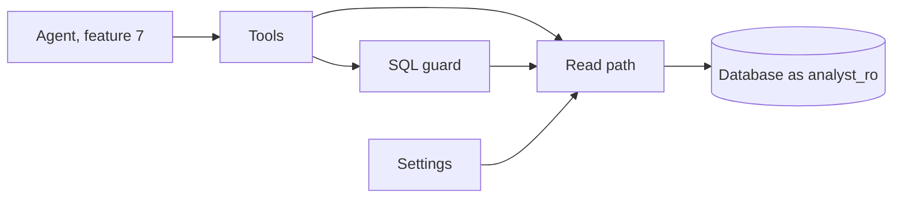
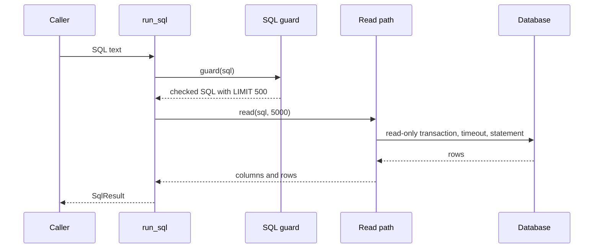

# 05 Data tools + SQL guardrails

| | |
| --- | --- |
| Work | Feature: the four data tools of the agent, and the two locks on the SQL that a model writes |
| Change | `3c6419c` on `main`, 2026-10-11 |
| Evidence | `blueprint/history/features/05-data-tools-sql-guardrails.md` (spec, implementation notes, and review receipt. Local, not in Git). `blueprint/context/findings.md` (F-01). The commit message. The build conversation with its code review. |
| Reader | A learner who can write basic code and is new to this stack |

This document obeys the rules of ASD-STE100 Simplified Technical
English. It is not a certified STE document.

## 1. Summary

This work adds the four functions that are the only path from the AI agent to
the database. Three of them run fixed queries: the data catalog, the schema of
the views, and the search for a player name. The fourth, `run_sql`, runs SQL
that a language model writes from the question of a visitor. No part of the
product calls these functions yet. The agent of feature 7 will call them.

The one idea to remember: two locks protect the database, and each lock must
hold when the other one fails.

## 2. Why this work exists

Before this work, the database had data but the analyst service had no code.
The product needs an agent that answers a question with SQL. A model writes
that SQL, and a visitor controls what the model reads. Thus the system
cannot trust the SQL, the same as text from a web form.

Without a guard, one bad statement can change data, read system tables, or run
for a long time. Without a second guard, one error in the first guard has the
same result. The plan thus asks for two independent locks.

## 3. Design

The design has three layers: a parser lock, a database lock, and the tools
that use the two locks and change each failure into text.

Six terms are new in this work:

- **sqlglot** is a Python library that parses SQL into a syntax tree. The
  guard uses it to see what a statement does before the statement runs.
- **Syntax tree** is SQL as nested objects, for example a `Select` object that
  holds `Table` objects. The guard reads the tree, not the text.
- **Allowlist** is a list of the things that a check permits. The check
  refuses all other things. The guard uses one for statement types and one for
  relations.
- **Read-only transaction** is a database transaction that refuses each write.
  The read path starts one for each call.
- **Pipeline mode** is a psycopg mode that sends each statement with the
  extended protocol. That protocol refuses a string with two statements.
- **rapidfuzz** is a library that gives a score from 0 to 100 for how close two
  strings are. `resolve_player` uses it for misspelled names.

| Part | Location | Job |
| --- | --- | --- |
| Settings | `services/analyst/src/analyst/settings.py` | Read the database URL from the environment and name a variable that is absent. |
| Read path | `services/analyst/src/analyst/db.py` | The database lock: one connection, one read-only transaction, and one timeout for each call. |
| SQL guard | `services/analyst/src/analyst/sql_guard.py` | The parser lock: accept one SELECT on the five views and put a row limit on it. |
| Tools | `services/analyst/src/analyst/tools.py` | The four functions and their result models. They return error text and do not raise. |
| Shared fixtures | `conftest.py` | Give the tests of the two packages one temporary database. |
| Tests | `services/analyst/tests/` | Prove each rule of the two locks and each result of the tools. |

The guard has four rules for a statement:

- The root is a SELECT or a set operation of SELECTs. All other roots fail.
- No node in the tree writes, locks rows, or is `SELECT ... INTO`.
- Each relation is one of the five `v_*` views or a CTE that is in scope.
- No function is in the list of functions that can do harm.

Then the guard makes sure that the outer query has a row limit of 500 at most.

## 4. Workflow

Example input: `run_sql("SELECT player, goals FROM v_player_season WHERE season = '2003-04'")`.

1. `run_sql` makes a call id of the form `q_` and 8 hex characters. (`tools.py:124`)
2. `guard` refuses a NUL character and text that is not valid UTF-8. (`sql_guard.py:61`)
3. sqlglot parses the text, and the guard requires one statement. (`sql_guard.py:70`)
4. The guard checks the type of the root against the allowlist. (`sql_guard.py:81`)
5. The guard checks each node, each function, and each relation. (`sql_guard.py:88`)
6. `cap_rows` adds `LIMIT 500`, because the statement has no limit. (`sql_guard.py:149`)
7. The guard writes new SQL from the tree and returns it. (`sql_guard.py:91`)
8. `db.read` opens a connection and makes the transaction read-only. (`db.py:58`)
9. It sets the timeout of 5000 ms and runs the statement in a pipeline. (`db.py:62`)
10. `json_safe` changes each value to a type that JSON can hold. (`tools.py:102`)
11. `run_sql` returns the rows, the SQL that ran, and the call id.

If a step fails, `run_sql` returns `ok = false` with error text. The guard
refuses before a connection opens, thus a refused statement costs no database
work.

## 5. Decisions and tradeoffs

### 5.1 Two locks that do not depend on each other

- **Choice:** The guard refuses bad SQL, and the read path refuses a write and a
  long query for all SQL text.
- **Alternatives:** One lock only: the parser, or the database role.
- **Reason:** Recorded: "Two independent SQL locks ... Either lock alone is
  enough." Source: the MVP plan, design decision 5.
- **Cost:** Two sets of rules and two sets of tests.

### 5.2 The read path does not trust the defaults of the role

- **Choice:** Each call states read-only mode and the timeout for its own
  transaction.
- **Alternatives:** Use the defaults that the migration sets on `analyst_ro`.
- **Reason:** Recorded: a role can change its own defaults, thus they are not a
  boundary. Source: the Database section of the coding standards.
- **Cost:** One more statement for each call.

### 5.3 One connection for each call

- **Choice:** `db.read` opens and closes a connection each time.
- **Alternatives:** A connection pool.
- **Reason:** Recorded: a setting that one query changes for its session cannot
  reach the next query, and no requirement needs a pool yet. Source: the spec.
- **Cost:** Each tool call pays the time to connect. This can be slow on Neon.

### 5.4 The statement that runs comes from the tree

- **Choice:** The guard writes new SQL from the parsed tree and runs that.
- **Alternatives:** Check the tree, then run the original text.
- **Reason:** Recorded: the database gets the statement that the guard checked,
  not the text that came in. Source: the implementation notes.
- **Cost:** The SQL can look different from the input, and sqlglot can write
  rare syntax wrongly.

### 5.5 An allowlist for the root, not a list of bad statements

- **Choice:** Only `Select` and set operations pass.
- **Alternatives:** Refuse a list of known bad types.
- **Reason:** Recorded: sqlglot gives a statement that it does not know a
  generic node, which a list of bad types does not catch. Source: the spec.
- **Cost:** The guard also refuses a valid form such as `VALUES` or `TABLE`.

### 5.6 Only the five views, and only a top-level WITH

- **Choice:** A relation must be one of the five views. The guard refuses a
  `WITH` below the top and `WITH RECURSIVE`.
- **Alternatives:** Permit all relations that the role can read.
- **Reason:** Recorded: a model-written SELECT could read the system catalogs
  and stop other queries. A nested CTE name is a real table outside its scope.
  Source: the spec, open question 2, and the implementation notes.
- **Cost:** The agent cannot read base tables. Pressures have no view, thus the
  agent cannot read them.

### 5.7 Names fold as in PostgreSQL

- **Choice:** The guard changes only A to Z to lowercase.
- **Alternatives:** `str.lower` from Python.
- **Reason:** Recorded: Python changes the Kelvin sign to "k" and PostgreSQL does
  not. A CTE with that sign hid the system view `pg_locks`. Source: the code
  review in the build conversation.
- **Cost:** None found.

### 5.8 A row limit of 500

- **Choice:** `MAX_ROWS = 500`. A limit that is not a plain number stays, and
  the cap goes around the statement.
- **Alternatives:** A smaller cap, or a rewrite of each limit.
- **Reason:** Recorded: the cap must hold the shots of one player for a season,
  and each row costs tokens. Henry has 194 shots. Source: the spec and the
  observed load.
- **Cost:** The cap counts rows, not bytes. The wrapped form is harder to read.

### 5.9 A tool returns error text

- **Choice:** Each tool returns a result model with an `error` field.
- **Alternatives:** Raise an exception to the agent.
- **Reason:** Recorded: the agent can read the problem and try again. Source:
  the build plan, item 5, and the MVP plan risk table.
- **Cost:** A caller that does not read `error` can use an empty result.

### 5.10 An exact match first, then a fuzzy match

- **Choice:** `resolve_player` uses rapidfuzz only if no name or alias is equal.
  The cutoff is 86.
- **Alternatives:** Fuzzy match on each call, or a lower cutoff.
- **Reason:** Recorded: on the real names "Van Persie" scored 85.5 against three
  players with "van", and a misspelled name scored 88. Source: the
  implementation notes.
- **Cost:** The cutoff comes from two seasons of names. New data can need a new
  value.

## 6. Blast radius

### 6.1 This work needs

| Dependency | Used for | If it fails |
| --- | --- | --- |
| `ANALYST_DATABASE_URL` | The connection as `analyst_ro` | Each tool returns "ANALYST_DATABASE_URL is not set" |
| Postgres and the grants of `analyst_ro` | All reads | "The database is not reachable." or the message of the server |
| The five views and their comments | `get_schema`, and the view allowlist | A view that is absent gives no entry in the schema |
| `data_catalog`, `player_aliases` (feature 4) | The catalog and the name search | Empty results, with no error |
| sqlglot 30 | The guard | A new version can parse a statement differently. Run the guard tests. |
| psycopg 3 pipeline mode | One statement for each call | The test for two statements fails |
| rapidfuzz | Fuzzy name scores | The module does not import |

### 6.2 These things use this work

No consumers yet. A search for imports of `analyst` found only the tests and
the root `conftest.py`. Features 6, 7, and 8 plan to use the four tools, the
call id, and the result models.

### 6.3 If you change this work

| If you change | Then check |
| --- | --- |
| A new view in a migration | `AGENT_VIEWS` in `sql_guard.py`, or the agent cannot read it |
| A grant for `analyst_ro` | The lists of forbidden functions, and finding F-01 |
| A field of a result model | The agent prompt and the claim verifier of later features |
| `MAX_ROWS` | The token cost for each question, and the shot map of one player |
| `FUZZY_CUTOFF` | The name tests, and names from a new season |
| The version of sqlglot | All of `test_sql_guard.py` |
| The root `conftest.py` | The tests of `ingest` and of `analyst` |

### 6.4 How to remove this work

Revert commit `3c6419c`. This moves `conftest.py` back to `ingest/tests`. The
work wrote no data and added no migration, thus the database stays the same.

## 7. Code reading path

1. [`services/analyst/src/analyst/tools.py:124`](../services/analyst/src/analyst/tools.py#L124) - Look for: the order of guard, read, and result in `run_sql`.
2. [`services/analyst/src/analyst/sql_guard.py:15`](../services/analyst/src/analyst/sql_guard.py#L15) - Look for: the five views, the cap, and the forbidden lists.
3. [`services/analyst/src/analyst/sql_guard.py:61`](../services/analyst/src/analyst/sql_guard.py#L61) - Look for: each check in `check`, from the text to the tree.
4. [`services/analyst/src/analyst/sql_guard.py:111`](../services/analyst/src/analyst/sql_guard.py#L111) - Look for: why a CTE sees only the CTEs before it.
5. [`services/analyst/src/analyst/sql_guard.py:149`](../services/analyst/src/analyst/sql_guard.py#L149) - Look for: the three results of `cap_rows`.
6. [`services/analyst/src/analyst/db.py:35`](../services/analyst/src/analyst/db.py#L35) - Look for: read-only mode, the timeout, and the pipeline.
7. [`services/analyst/src/analyst/tools.py:102`](../services/analyst/src/analyst/tools.py#L102) - Look for: how a `Decimal` and a date become JSON values.
8. [`services/analyst/src/analyst/tools.py:223`](../services/analyst/src/analyst/tools.py#L223) - Look for: the exact stage and the fuzzy stage in `rank_players`.
9. [`services/analyst/tests/test_db.py:1`](../services/analyst/tests/test_db.py#L1) - Look for: the tests that prove the database lock with no guard.
10. [`services/analyst/tests/test_sql_guard.py:1`](../services/analyst/tests/test_sql_guard.py#L1) - Look for: the list of refused statements and the limit cases.

## 8. Known limits

- **Finding F-01 (P2, open).** The guard accepts `nextval` and `setval`. The
  database lock stops them, but the parser lock does not. The repair is four
  names in the forbidden list.
- The cap counts rows, not bytes. One row can hold a very large string.
- Pressures and carries have no view, thus the agent cannot read them.
- `current_setting` passes the guard, thus a query can read server settings.
  The independent review found no secret there.
- The guard knows a list of bad functions, not a list of good ones. A new
  function that can do harm needs a new entry.
- `resolve_player` reads all names on each call. It has no cache.
- The settings load at first use. The service has no start step yet.
- The reviewer and the builder used the same model. The review context was
  new, but the model family was not different.
- `ruff format --check .` fails on `project-requirement-docs/highbury-mvp-plan.md`.
  That file is not part of this work.
- The tools ran on the local database only.

## 9. Self-test

1. Why does the read path set read-only mode when the role has that default?
2. What happens if a model sends `SELECT 1; DROP TABLE shots`?
3. Why does the guard run SQL that it wrote, and not the text that came in?
4. What happens if a statement has `LIMIT 2 + 3`?
5. Why does the guard refuse a `WITH` inside a subquery?

Answers

1. A session can change the defaults of its role, thus they are not a boundary. See section 5.2.
2. The guard refuses two statements. Without the guard, pipeline mode refuses them too. See sections 3 and 5.1.
3. Then the database gets the statement that the guard checked. See section 5.4.
4. The statement stays, and a query with `LIMIT 500` goes around it. See section 5.8.
5. Outside its scope, the CTE name is a real table that the guard did not check. See section 5.6.

