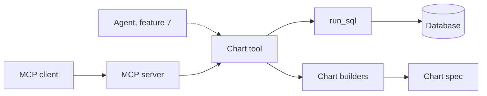
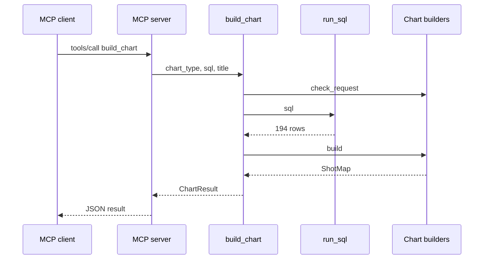

# 06 Chart specs + MCP server

| | |
| --- | --- |
| Work | Feature: the fifth data tool, which makes a chart from a query, and a server that gives the five tools to other programs |
| Change | `a0e9a63` on `main`, 2026-10-11 |
| Evidence | `blueprint/history/features/06-chart-specs-mcp-server.md` (spec and build notes. Local, not in Git). The commit message. The build conversation with its code review and its check. `blueprint/context/findings.md` (F-01). |
| Reader | A learner who can write basic code and is new to this stack |

This document obeys the rules of ASD-STE100 Simplified Technical
English. It is not a certified STE document.

## 1. Summary

This work adds `build_chart`, the fifth tool of the agent. The tool runs one
SQL statement and changes the rows into a chart spec. A chart spec is a
description of a chart as data, with no colours and no layout. The work also
adds an MCP server, which lets a program outside the service call the same
five tools.

No part of the product calls this work yet. The agent of feature 7 and the
web app of feature 11 will use it.

The one idea to remember: a chart is data from a query that passed the same
two locks as all other SQL.

## 2. Why this work exists

Before this work, the tools returned rows only. The product must show a pitch
chart with each answer. The plan says "Charts are data": the model selects
what to show, and the web app selects how to show it.

Without this work, the model must copy the rows into its answer. A model can
change a number when it copies. A locked rule of the project says that each
number in an answer comes from a recorded tool output. Thus the chart rows
must come from a tool, not from the model.

The plan also asks for a second door to the tools. The agent calls the tools
in the same process. Other agents, and the MCP Inspector, need a standard
protocol.

## 3. Design

The design has three layers: pure chart builders, one tool that gets the rows,
and one server that shows the tools to other programs.

Five terms are new in this work:

- **Chart spec** is a Pydantic model that holds the type, the title, and the
  data of one chart. The web app will draw from it.
- **Discriminated union** is one type that can be one of three models, where a
  field tells which one. Here the field is `type`.
- **Strict mode** is a Pydantic mode that does not convert values. The specs
  use it so that text in a number column is an error.
- **MCP** (Model Context Protocol) is a standard protocol that lets an AI
  program list and call tools. This work uses it to share the five tools.
- **stdio transport** is MCP through the standard input and output of a
  process. The server uses it, thus the server opens no network port.

| Part | Location | Job |
| --- | --- | --- |
| Chart builders | `services/analyst/src/analyst/charts.py` | Change columns and rows into one of three chart specs, or raise `ChartRejected` with a reason. No database access. |
| Chart tool | `services/analyst/src/analyst/tools.py` (`build_chart`) | Check the request, get the rows through `run_sql`, call the builders, and change each failure into text. |
| MCP server | `services/analyst/src/analyst/mcp_server.py` | Register the five tool functions unchanged and serve them on stdio. |
| Inspector config | `services/analyst/mcp.json` | Tell the MCP Inspector how to start the server. |

Support files: `services/analyst/pyproject.toml` and `uv.lock` (the `mcp`
library), `AGENTS.md` (two commands), and the tests. The fixture `seeded` moved
to `services/analyst/tests/conftest.py` so that two test files can use it.

The three chart types are:

- `shot_map`: one shot for each row, with position, xG, outcome, minute, and
  opponent.
- `compare_bars`: two players, and one metric for each other column.
- `pass_network`: one node for each passer and one edge for each pair of
  players.

## 4. Workflow

Example input: the MCP Inspector calls `build_chart` with the type `shot_map`,
the title `Thierry Henry shots, 2003-04`, and this SQL:
`SELECT * FROM v_shots WHERE player = 'Thierry Henry' AND season = '2003-04'`.

1. The MCP server checks the arguments against the type hints of the function. (`mcp_server.py:22`)
2. `build_chart` calls `check_request`, which checks the type and trims the title. (`tools.py:327`, `charts.py:227`)
3. `build_chart` calls `run_sql`, which guards the SQL and adds `LIMIT 500`. (`tools.py:333`)
4. The database returns 194 rows in a read-only transaction.
5. `build_chart` stops with text if the query failed, reached the limit, or returned no rows. (`tools.py:335`)
6. `build_chart` makes the chart id and calls `charts.build`. (`tools.py:343`)
7. `build` selects the `shot_map` function from `BUILDERS`. (`charts.py:224`)
8. `to_records` checks the column names and makes one record for each row. (`charts.py:106`)
9. `parse_rows` validates each record as a `Shot` in strict mode. (`charts.py:123`)
10. `build_chart` returns a `ChartResult` with the chart, the call id, and the SQL. (`tools.py:348`)
11. The MCP server sends the result to the client as JSON.

The result in the check had 194 shots, and 30 of them were goals.

## 5. Decisions and tradeoffs

### 5.1 The input of the tool is SQL

- **Choice:** `build_chart(chart_type, sql, title)` runs the statement itself.
- **Alternatives:** Fixed parameters such as a player and a season. Rows that
  the model copies into the call. The id of an earlier `run_sql` call.
- **Reason:** Recorded: demo question 4 ("Only the ones inside the box") needs
  a filter that a fixed parameter list cannot know. Copied rows break the rule
  that each number comes from a tool output. An earlier call id needs a shared
  store. Source: the spec, "Notes for the AI".
- **Cost:** The model must write SQL with the correct column names. The
  database runs the query again when `run_sql` ran it before.

### 5.2 A result that reaches the row limit is an error

- **Choice:** If `run_sql` reports `limit_reached`, the tool returns text and
  no chart.
- **Alternatives:** Draw the first 500 rows.
- **Reason:** Recorded: "A cut chart would show wrong totals." Source: the
  spec, stage 4, and the comment at `tools.py:338`.
- **Cost:** The tool also refuses a result of exactly 500 rows. A shot map of
  a full team season is not possible in one chart.

### 5.3 A comparison refuses a metric that one player does not have

- **Choice:** `compare_bars` rejects a metric that is null for one of the two
  players.
- **Alternatives:** Show the bar as empty, or as zero.
- **Reason:** Recorded: the locked rule "cross-era comparisons use only shared
  metrics". Source: the spec, and the comment at `charts.py:176`.
- **Cost:** The model gets an error and must write the query again with fewer
  metrics.

### 5.4 The specs use strict mode

- **Choice:** Each spec model refuses a value of the wrong type.
- **Alternatives:** The default Pydantic mode, which converts `"0.25"` and
  `True` to numbers.
- **Reason:** Inferred from the comment at `charts.py:26`. The spec also says
  that a builder rejects a value "of the wrong type".
- **Cost:** The tool refuses a pass count of `2.0`. Whole numbers in float
  fields become floats, thus 30 becomes 30.0. Source for the cost: the build
  notes in the archive.

### 5.5 The server uses stdio only and adds no login

- **Choice:** The MCP server reads and writes the standard streams of its
  process.
- **Alternatives:** An HTTP transport, with authentication.
- **Reason:** Recorded: "The server opens no network port, so there is no
  caller to authenticate." Source: the spec, "Trust boundary" and "Out of
  scope".
- **Cost:** Only a program on the same computer can start and use the server.

### 5.6 The server registers the same functions, with no wrappers

- **Choice:** `mcp_server.py` gives the five functions to `add_tool`
  unchanged. Their type hints become the input schemas.
- **Alternatives:** One wrapper function for each tool.
- **Reason:** Recorded: the plan wants the tools "written once" and calls MCP
  "an interface, not a hop". Source:
  `project-requirement-docs/highbury-mvp-plan.md`, section 4.
- **Cost:** A change to a function signature changes the MCP contract at the
  same time.

### 5.7 The class is `MCPServer`, and the Inspector reads a config file

- **Choice:** The server uses `mcp.server.mcpserver.MCPServer` from `mcp`
  2.3.0. The Inspector command reads `services/analyst/mcp.json`.
- **Alternatives:** Pin `mcp` below version 2 to keep the name FastMCP. Add
  the separate `fastmcp` package. Give the Inspector an inline command.
- **Reason:** Recorded: version 2 of the library renamed FastMCP, and the spec
  told the builder to use the equivalent class of the same library. The
  Inspector drops flags such as `--env-file` from an inline command. Source:
  the build notes in the archive.
- **Cost:** The plans say "FastMCP", but the code says `MCPServer`. The config
  file has a relative `.env` path, thus the Inspector must start from the
  repository root.

### 5.8 A number of any size becomes an error with text

- **Choice:** `is_chart_number` and one `except OverflowError` change a number
  that a float cannot hold into `ChartRejected`.
- **Alternatives:** Let the exception leave the tool.
- **Reason:** Recorded: the code review found that `power(10::numeric, 400)`
  made `build_chart` raise, against the rule "never raise". Source: the build
  notes in the archive, and the tests at `test_tools.py:377`.
- **Cost:** Two more code paths for an input that a correct query does not
  make.

## 6. Blast radius

### 6.1 This work needs

| Dependency | Used for | If it fails |
| --- | --- | --- |
| `run_sql`, the SQL guard, and the read path | All chart rows | `build_chart` returns the error text of `run_sql` and no chart. |
| `ANALYST_DATABASE_URL` | The database connection | The MCP server stops at the start and names the variable. In-process, each tool returns the text. |
| The `mcp` library, version 2.3.0 | `MCPServer` | Only `mcp_server.py` fails. The tools do not import it. |
| Pydantic | The spec models | The analyst package does not import. |
| Node and `npx` | The MCP Inspector only | The Inspector does not start. The server and the tests do not need it. |
| The local `.env` file | The Inspector command in `mcp.json` | `uv` reports the absent file, and the Inspector shows a closed connection. |

### 6.2 These things use this work

| Consumer | Uses | Found in |
| --- | --- | --- |
| MCP server | The five tool functions, with `build_chart` | `services/analyst/src/analyst/mcp_server.py:14` |
| Chart tool | `charts.check_request`, `charts.build`, `charts.ChartSpec` | `services/analyst/src/analyst/tools.py:327` |
| Tests | All public names of this work | `services/analyst/tests/` |

No product consumers yet. A search of `apps/web/src`, `ingest`, and `db` found
no use. The agent of feature 7 and the Zod schemas of feature 11 are the
planned consumers.

Shared ground: `tools.py` also holds the four older tools. `AGENTS.md` and
`uv.lock` belong to the full project. The fixture `seeded` now has pass events,
and the tests of the older tools also use it.

### 6.3 If you change this work

| If you change | Then check |
| --- | --- |
| A field of a chart spec | The Zod mirror in the web app (feature 11 and later) and `test_charts.py`. |
| `ChartType` | `BUILDERS`, `ChartSpec`, the docstring of `build_chart`, and `test_mcp_server.py`. |
| The docstring of `build_chart` | The agent and each MCP client read it as the tool description. |
| The signature of a tool function | The MCP input schema, in `test_mcp_server.py:10`. |
| `MAX_ROWS` in `sql_guard.py` | The limit for a chart and the text at `tools.py:23`. |
| The start command of the server | `services/analyst/mcp.json` and the Commands section of `AGENTS.md`. |

### 6.4 How to remove this work

1. Revert commit `a0e9a63`.
2. Run `uv sync --all-packages` to remove the `mcp` library.
3. Clear the check mark of item 6 in `blueprint/build-plan.md`.

No data and no migration stay behind. The four older tools do not change.

## 7. Code reading path

1. [`services/analyst/src/analyst/tools.py:314`](../services/analyst/src/analyst/tools.py#L314) - Look for: the order of the stages, and that each failure returns text.
2. [`services/analyst/src/analyst/charts.py:227`](../services/analyst/src/analyst/charts.py#L227) - Look for: the two checks that run before a query.
3. [`services/analyst/src/analyst/charts.py:25`](../services/analyst/src/analyst/charts.py#L25) - Look for: strict mode on the base model, and the limits on each `Shot` field.
4. [`services/analyst/src/analyst/charts.py:106`](../services/analyst/src/analyst/charts.py#L106) - Look for: how `to_records` and `parse_rows` name the column and the row of an error.
5. [`services/analyst/src/analyst/charts.py:154`](../services/analyst/src/analyst/charts.py#L154) - Look for: the rule for shared metrics in `compare_bars`.
6. [`services/analyst/src/analyst/charts.py:190`](../services/analyst/src/analyst/charts.py#L190) - Look for: the weighted mean of a node, and the edge that the code leaves out.
7. [`services/analyst/src/analyst/charts.py:99`](../services/analyst/src/analyst/charts.py#L99) - Look for: the union that the `type` field selects.
8. [`services/analyst/src/analyst/mcp_server.py:14`](../services/analyst/src/analyst/mcp_server.py#L14) - Look for: the five functions, and the settings check in `main`.
9. [`services/analyst/tests/test_tools.py:456`](../services/analyst/tests/test_tools.py#L456) - Look for: one table row for each way that a chart can fail.
10. [`services/analyst/tests/test_mcp_server.py:56`](../services/analyst/tests/test_mcp_server.py#L56) - Look for: the proof that a call through the server equals a direct call.

## 8. Known limits

- No part of the product calls `build_chart` or the MCP server yet.
- The tool refuses a result of exactly 500 rows, because `limit_reached` is
  also true then.
- A statement with its own `LIMIT` makes a chart of only those rows, with no
  error.
- `pass_network` leaves out an edge to a player who has no pass of their own.
  The result does not say so.
- `pass_network` uses the player name as the key of a node. Two players of one
  name in one result become one node. Seen in the code at `charts.py:194`.
- The specs hold no text summary and no era caveat. The web app must write
  them from the data.
- A shot map can hold 500 rows, and the full result goes back to the model.
  Feature 7 decides what the model sees.
- On the real data, `xa` is not null for the two demo players. Thus only the
  tests on the seeded database prove the rule of 5.3.
- The web UI of the Inspector ignores `--server highbury` and lists each
  server in the file.
- The Inspector reports one schema warning for `run_sql`: a row value can have
  any JSON type.
- Finding F-01 (P2, open) stays in the ledger. The guard accepts `nextval` and
  `setval`, and `build_chart` uses the same guard.
- `ruff format --check .` reports `project-requirement-docs/highbury-mvp-plan.md`.
  This work did not change that file.

## 9. Self-test

1. Why does `build_chart` take SQL and not the rows of the chart?
2. What happens if a query for a shot map returns 600 rows?
3. Why does the MCP server have no login?
4. What happens if the model asks for `xa` in a comparison and one player has
   no `xa`?
5. What happens to the MCP contract if you rename a parameter of `run_sql`?

Answers

1. A filter such as "inside the box" needs free SQL. Copied rows break the
   rule that each number comes from a tool output. See section 5.1.
2. `run_sql` cuts the result at 500 rows and sets `limit_reached`. The tool
   returns text and no chart. See section 5.2.
3. The server uses stdio and opens no network port, thus only a local program
   that starts it can call it. See section 5.5.
4. `compare_bars` rejects the metric and names the metric and the player. The
   model must write the query again. See section 5.3.
5. The input schema changes at the same time, because the server registers the
   function itself. See sections 5.6 and 6.3.

