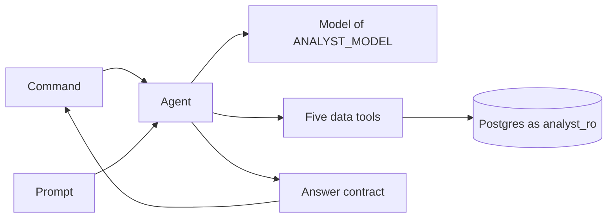
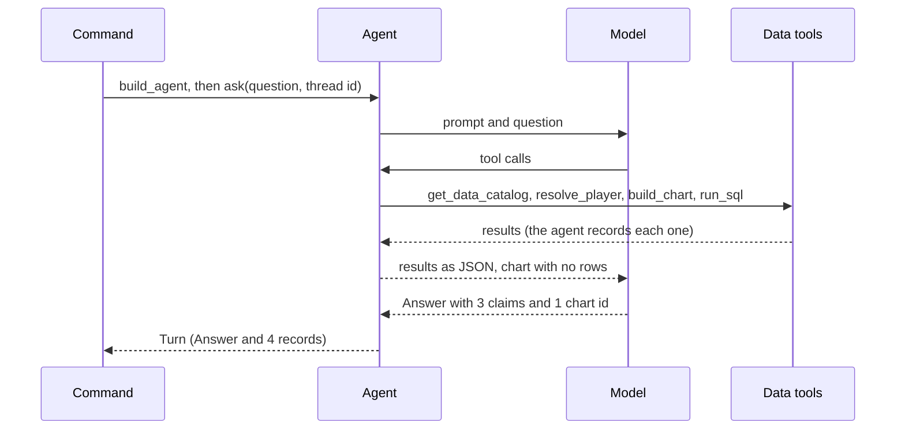

# 07 Analyst agent + CLI

| | |
| --- | --- |
| Work | Feature: a language model that answers a question with the five data tools, and a command that asks it |
| Change | `112b01b` on `main`, 2026-10-11 |
| Evidence | `blueprint/history/features/07-analyst-agent-cli.md` (spec, changes found in the build, live evidence, independent review. Local, not in Git). The commit message. The build conversation with its code review. `blueprint/context/findings.md` (F-02 to F-05). |
| Reader | A learner who can write basic code and is new to this stack |

This document obeys the rules of ASD-STE100 Simplified Technical
English. It is not a certified STE document.

## 1. Summary

This work puts a language model in front of the five data tools. A user types
a question, the model calls the tools, and the model returns one `Answer`.
Each number in the `Answer` is a claim that names the query it came from. The
command `ask` shows the answer and each tool call on the terminal.

This work makes the answer. It does not check the answer: the verifier is
feature 8.

The one idea to remember: the model writes the words, but each number comes
from a tool result that the program keeps.

## 2. Why this work exists

Before this work, the project had five tools and no program that selected
them. A person had to write the SQL and call each tool by hand.

A model with no tools answers from memory, and its numbers can be wrong. The
project plan says that each number in an answer must trace to a recorded tool
output. Thus this work gives the model the tools and keeps a record of each
call.

The plan also asks for an honest "not available" and for a follow-up question
that reads the first question. Those two needs give the `status` field and the
memory of the conversation.

## 3. Design

The design has four layers: a contract for the answer, a prompt, the agent,
and a command.

Seven terms are new in this work:

- **Agent** is a loop in which a model calls tools until it has an answer.
  This work builds it with `create_agent` from the LangChain library.
- **System prompt** is the fixed text that the model reads before each
  question. Here it holds the rules, the catalog, and the views.
- **Few-shot example** is a sample that shows the model a correct result. Here
  the samples are six SQL statements.
- **Structured output** is a model reply that must match a schema. The agent
  uses it so that the reply is an `Answer`, not free text.
- **Middleware** is code that runs before or after a step of the agent. This
  work uses it to count, to record, and to name failures.
- **Checkpointer** is the store that keeps the messages of a conversation. The
  agent uses it so that a follow-up reads the turns before it.
- **Thread id** is the name of one conversation in the checkpointer. Two
  questions with the same id are one conversation.

| Part | Location | Job |
| --- | --- | --- |
| Answer contract | `services/analyst/src/analyst/answer.py` | Defines `Answer`, `Claim`, and `ChartRef`. |
| Model name | `services/analyst/src/analyst/settings.py` | Reads `ANALYST_MODEL` and names it when it is absent. |
| Prompt | `services/analyst/src/analyst/prompt.py` | Writes the system prompt from the catalog, the views, the rules, and the SQL examples. |
| Agent | `services/analyst/src/analyst/agent.py` | Builds the agent, sets the two limits, records each tool call, and answers one question. |
| Command | `services/analyst/src/analyst/cli.py` | Reads the questions, asks them in one conversation, and prints each turn. |
| Scripted model | `services/analyst/tests/scripted.py` | Gives the tests a model that returns fixed replies and calls no provider. |

Support files: `pyproject.toml` (three libraries and the `ask` command),
`uv.lock`, `.env.example`, `AGENTS.md`, and the test files.

The diagram also shows three things that this work uses but does not own: the
model, the five data tools, and Postgres.

## 4. Workflow

Example input: `uv run --env-file .env ask "Show me Thierry Henry's shots in 2003-04."`

1. The command starts `main`, which reads the question. (`services/analyst/src/analyst/cli.py:94`)
2. `main` calls `build_agent`. (`services/analyst/src/analyst/cli.py:105`)
3. `load_model` makes the model that `ANALYST_MODEL` names. (`services/analyst/src/analyst/agent.py:176`)
4. `build_agent` reads the catalog and the views one time. (`services/analyst/src/analyst/agent.py:187`)
5. `build_system_prompt` writes the prompt from those two results. (`services/analyst/src/analyst/prompt.py:99`)
6. `main` calls `ask` with the question and a new thread id. (`services/analyst/src/analyst/cli.py:107`)
7. `ask` makes one `RunContext` for this question and starts the agent. (`services/analyst/src/analyst/agent.py:218`)
8. The model calls `get_data_catalog`, then `resolve_player` with the name.
9. `limit_tool_calls` counts each call before the tool runs. (`services/analyst/src/analyst/agent.py:131`)
10. `record_tool_call` keeps the full result of each call. (`services/analyst/src/analyst/agent.py:143`)
11. The model calls `build_chart`, and `model_text` returns the chart id with no shot rows. (`services/analyst/src/analyst/agent.py:83`)
12. The model calls `run_sql`, which returns 194 shots, 30 goals, and 23.89 xG.
13. The model returns an `Answer` with three claims that cite that query.
14. `ask` returns a `Turn`: the `Answer` and four records. (`services/analyst/src/analyst/agent.py:239`)
15. `turn_lines` prints the answer, the chart, and the four tool calls. (`services/analyst/src/analyst/cli.py:57`)

## 5. Decisions and tradeoffs

### 5.1 The model reads a short result for a chart

- **Choice:** For `build_chart`, the model reads the chart id, type, title, and
  row count. The full chart stays in the record.
- **Alternatives:** Give the model the full chart with each shot.
- **Reason:** Recorded: a shot map of one season has more than a hundred rows
  that the model does not need again. Source: the spec, "What the model reads
  from a tool".
- **Cost:** The model cannot make a claim from the chart rows. It must call
  `run_sql` for the totals.

### 5.2 The agent counts tool calls with its own middleware

- **Choice:** `limit_tool_calls` counts the data tool calls of one question.
- **Alternatives:** `ToolCallLimitMiddleware`, which LangChain supplies and the
  spec named.
- **Reason:** Recorded: the supplied middleware also counts the tool call that
  holds the answer for some models. Thus the limit of 10 changed with the
  model. Source: the spec, "Changes found during implementation", item 1.
- **Cost:** The project owns one more function and its test.

### 5.3 The call after the limit stops the turn with an error

- **Choice:** The 11th tool call does not run, and `ask` raises `AgentError`.
- **Alternatives:** Refuse the call and let the model answer from its data.
- **Reason:** Recorded: the alternative gives no upper limit on model calls
  without a second limit. Source: the spec, "Decisions made in this spec",
  item 2.
- **Cost:** A hard question gets an error, not a partial answer.

### 5.4 A second limit stops a model that never answers correctly

- **Choice:** One question gets 15 model calls at most.
- **Alternatives:** Only the tool limit and the LangChain stop at 9,999 steps.
- **Reason:** Recorded: LangChain asks the model again after an answer of a
  wrong shape, and each new call costs money. Source: the spec, "Changes found
  during implementation", item 2.
- **Cost:** A second constant that must stay above the tool limit.

### 5.5 Each question has its own record store

- **Choice:** `ask` makes a `RunContext` for each question. The middleware
  writes into it, with the place of the call as the key.
- **Alternatives:** A list on the middleware object, or a list in call order.
- **Reason:** Recorded: one agent serves many questions at the same time in
  feature 9, and the calls of one reply run at the same time. Source: the spec,
  "Notes for the AI", and item 3 of the changes.
- **Cost:** `call_place` reads the message list of LangChain to find the place.

### 5.6 The memory lives in the process

- **Choice:** `InMemorySaver` keeps the conversation. Each more argument of
  `ask` is a follow-up in the same process.
- **Alternatives:** A checkpointer in a database, or an interactive prompt.
- **Reason:** Recorded: a store in a database has no requirement yet. Source:
  the spec, "Decisions made in this spec", item 1.
- **Cost:** Two `ask` commands share no memory. A restart loses each
  conversation.

### 5.7 The text of an error holds only the class of its cause

- **Choice:** `AgentError` says "The model call failed (ConnectionError)." The
  cause stays chained to the error.
- **Alternatives:** Put the message of the provider in the text.
- **Reason:** Recorded: the providers share no error class, and the text of
  their errors can repeat the request. Source: the comment at `agent.py:170`.
- **Cost:** The user must add `--debug` to see the full cause.

### 5.8 No test calls a real model

- **Choice:** The tests use `ScriptedModel`. A person ran the five demo
  questions one time against the real model.
- **Alternatives:** Automated tests that call the provider.
- **Reason:** Recorded: a live call costs money, needs a key, and gives a
  different text each time. Source: the spec, "Testing".
- **Cost:** No test shows that the prompt gives correct answers. A prompt
  change needs a new run by hand.

## 6. Blast radius

### 6.1 This work needs

| Dependency | Used for | If it fails |
| --- | --- | --- |
| Postgres as `analyst_ro` | The catalog and the views for the prompt, and each tool call | At the start: `AgentError` "The database is not reachable." In a turn: the tool returns error text and the model can try again. |
| `ANALYST_MODEL` | The name of the model | `SettingsError` "ANALYST_MODEL is not set". The command exits with 1. |
| The key of the provider (`GOOGLE_API_KEY`) | The connection to the model | The model does not load. `AgentError` names `ANALYST_MODEL`. |
| The model service of the provider | Each model call | `AgentError` "The model call failed" with the class of the cause. |
| `langchain` 1.4.4, `langgraph`, `langchain-google-genai` | The agent, the middleware, the checkpointer, the model class | The analyst package does not import `agent.py`. The tools and the MCP server do not import them. |
| The five tools in `tools.py` | All data | Each tool returns error text. No tool raises for bad input. |

### 6.2 These things use this work

| Consumer | Uses | Found in |
| --- | --- | --- |
| The `ask` command | `cli.main` | `services/analyst/pyproject.toml:21` |
| Command | `agent.build_agent`, `agent.ask`, `Turn`, `ToolRecord`, `AgentError` | `services/analyst/src/analyst/cli.py:105` |
| Agent | `model_name`, `Answer`, `build_system_prompt` | `services/analyst/src/analyst/agent.py:37` |
| Tests | All public names of this work | `services/analyst/tests/` |

No other consumers yet. A search of `apps/web/src`, `ingest`, and the other
analyst modules found no use. The verifier of feature 8, the API of feature 9,
and the evals of feature 15 are the planned consumers of `ask` and `Turn`.

Shared ground: `settings.py` also serves the MCP server, which needs no model.
`tests/conftest.py` now holds the fixture `no_database`, and `test_tools.py`
uses it from there. `.env.example`, `AGENTS.md`, and `uv.lock` belong to the
full project.

### 6.3 If you change this work

| If you change | Then check |
| --- | --- |
| A field of a tool result in `tools.py` | `working_lines` in `cli.py:37`, `model_text` in `agent.py:83`, and each reader of a record. |
| A view comment or a catalog row | The prompt changes with it. Run `test_prompt.py`. |
| A view column | The six SQL examples in `prompt.py:42`. A test runs each one. |
| `ChartType` in `charts.py` | `CHART_MARKS` in `cli.py:17`. An unknown type raises `KeyError` there. |
| The module or the name of `Answer` | The list of permitted types for the checkpointer at `agent.py:212`. |
| The version of `langchain` | The two limits, the reset of the answer, and the structured output. Run `test_agent.py`. |
| `ANALYST_MODEL` | Run the five demo questions again. No test covers a real model. |
| The docstring of a tool | The model reads it as the description of the tool. |

### 6.4 How to remove this work

1. Revert commit `112b01b`.
2. Run `uv sync --all-packages` to remove the three libraries and the `ask` command.
3. Clear the check mark of item 7 in `blueprint/build-plan.md`.

No data and no migration stay behind. The five tools and the MCP server do not
change. `ANALYST_MODEL` and the key stay in `.env` with no reader.

## 7. Code reading path

1. [`services/analyst/src/analyst/answer.py:22`](../services/analyst/src/analyst/answer.py#L22) - Look for: the six fields of `Answer`, and what `tool_call_id` holds.
2. [`services/analyst/src/analyst/prompt.py:10`](../services/analyst/src/analyst/prompt.py#L10) - Look for: the rules that keep the model to its data.
3. [`services/analyst/src/analyst/prompt.py:99`](../services/analyst/src/analyst/prompt.py#L99) - Look for: the four sections of the prompt and where their data comes from.
4. [`services/analyst/src/analyst/agent.py:92`](../services/analyst/src/analyst/agent.py#L92) - Look for: how one function becomes a tool with a text for the model and a full result.
5. [`services/analyst/src/analyst/agent.py:131`](../services/analyst/src/analyst/agent.py#L131) - Look for: the limit, and the reason not to use the supplied middleware.
6. [`services/analyst/src/analyst/agent.py:143`](../services/analyst/src/analyst/agent.py#L143) - Look for: where a record comes from, and the key from `call_place` at line 120.
7. [`services/analyst/src/analyst/agent.py:187`](../services/analyst/src/analyst/agent.py#L187) - Look for: the order of the middleware and the checkpointer.
8. [`services/analyst/src/analyst/agent.py:218`](../services/analyst/src/analyst/agent.py#L218) - Look for: the one `RunContext` for each question, and the two ways a turn fails.
9. [`services/analyst/src/analyst/cli.py:94`](../services/analyst/src/analyst/cli.py#L94) - Look for: one thread id for all questions, and the two errors that `main` catches.
10. [`services/analyst/tests/scripted.py:22`](../services/analyst/tests/scripted.py#L22) - Look for: how a test tells the model what to reply.

## 8. Known limits

- No part checks the claims yet. A model can cite a wrong `call_id`, and the
  command prints it. Feature 8 adds the verifier.
- The middleware is synchronous. Feature 9 must run the agent in a thread or
  add async hooks.
- After `AgentError`, a thread can hold a tool call with no result. The command
  stops at the first error for that reason.
- `--debug` prints the traceback of the provider, which can hold the question
  text.
- F-02 (P3, open): `forget_last_answer` repeats what LangChain 1.4.4 does.
- F-03 (P3, open): no test uses the structured output of the provider.
- F-04 (P3, open): no test shows that the limit of model calls starts again for
  each question.
- F-05 (P3, unverified): the rows of a query go to the model again on each
  later call of the conversation. The cost is not measured.
- The independent reviewer did not repeat the five live questions. That
  evidence comes from the builder only.
- `.env.example` named `gemini-2.5-flash`, which the provider refused. It now
  names `gemini-3.8-flash`. The price of that model is not recorded.

## 9. Self-test

1. Why does the model call `run_sql` for the totals after `build_chart` returned 194 shots?
2. What happens if a model makes 11 tool calls for one question?
3. Why does `ask` make a new `RunContext` for each question?
4. What happens to a follow-up if you run `ask` two times, one question each?
5. Why does no automated test call the real model, and what does that leave open?

Answers

1. The model reads only the id, type, title, and row count of a chart. A claim
   must cite a `run_sql` result whose rows hold the value. See section 5.1.
2. The 11th call does not run. `ask` raises `AgentError`, and the command
   prints one line and exits with 1. See section 5.3.
3. One agent serves many questions at the same time. A shared list mixes their
   records. See section 5.5.
4. The second command starts a new process with a new thread id. It reads no
   earlier turn. See section 5.6.
5. A live call costs money, needs a key, and changes each time. Thus no test
   shows that the prompt gives correct answers. See section 5.8.

