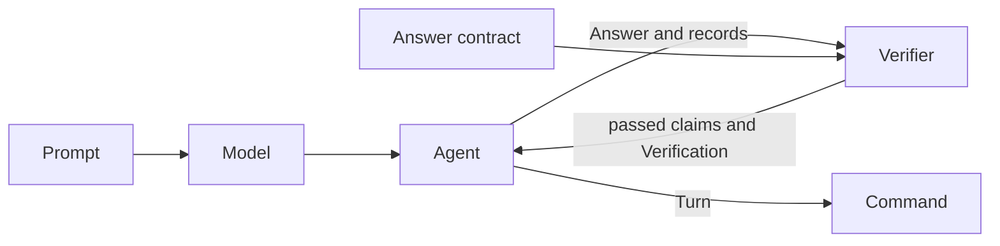
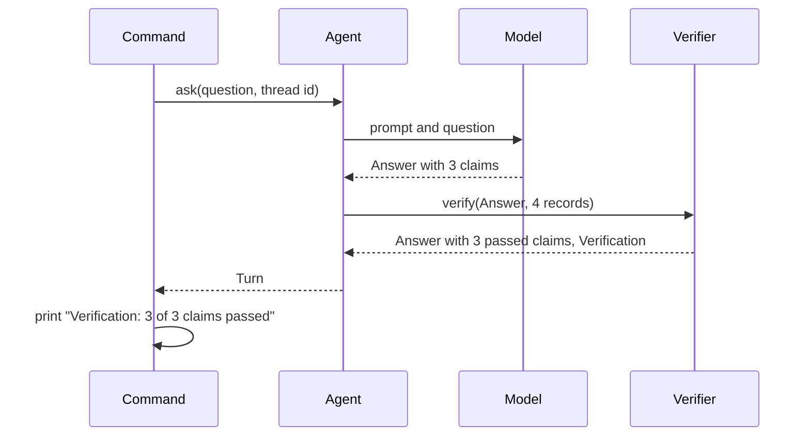

# 08 Claim verifier

| | |
| --- | --- |
| Work | Feature: code that checks each number of an answer against the recorded tool output before a reader sees the answer |
| Change | `4b1f64f` on `main`, 2026-10-13 |
| Evidence | `blueprint/history/features/08-claim-verifier.md` (spec, live observations, findings 8/F-06 to 8/F-08. Local, not in Git). The commit message. The build conversation with its audit and its probes. `blueprint/context/findings.md` (F-09). |
| Reader | A learner who can write basic code and is new to this stack |

This document obeys the rules of ASD-STE100 Simplified Technical
English. It is not a certified STE document.

## 1. Summary

This work adds the verifier. The verifier is a function that reads the `Answer`
of the model and the records of the tool calls. It removes each claim that the
records do not support. It also lists each number of the summary that no passed
claim backs. The agent runs the verifier on each turn, and the `ask` command
prints the result.

The one idea to remember: the model can write a number, but only a row from the
database can keep that number in the answer.

## 2. Why this work exists

Feature 7 gave each number of an answer a claim. A claim holds a value and the
`call_id` of the query that the value came from. But no part read that `call_id`.
A model could cite a query that did not exist, or write a wrong value, and the
command printed it.

The project plan says that the analyst checks each number against the data
before it shows the number. Without this work, a claim is a promise that no
program tests.

## 3. Design

The design has one new module with one public function, and three small changes
around it.

Five terms are new in this work:

- **Verifier** is the code that compares an answer with the tool output. This
  work puts it between the agent and each reader of a turn.
- **Pure function** is a function that reads only its arguments and changes no
  state. `verify` is pure, thus a test needs no database and no model.
- **Tolerance** is the largest difference at which two numbers are equal for a
  check. Here it is 0.01 for xG and rates, and zero for counts.
- **Binary float** is the number type that a computer uses for decimals. It
  holds 0.76 and 0.75 with small errors, thus their difference is not exactly
  0.01.
- **Regular expression** is a pattern that finds text. The verifier uses two
  patterns to find the numbers in the summary.

| Part | Location | Job |
| --- | --- | --- |
| Verifier | `services/analyst/src/analyst/verifier.py` | Checks each claim, scans the summary, and returns the answer with a `Verification`. |
| Answer contract | `services/analyst/src/analyst/answer.py` | Defines `Answer` and `Claim`, and now also `ToolRecord`. |
| Agent | `services/analyst/src/analyst/agent.py` | Calls `verify` at the end of `ask` and puts the result in the `Turn`. |
| Prompt | `services/analyst/src/analyst/prompt.py` | Tells the model to cite only a query of the current question. |
| Command | `services/analyst/src/analyst/cli.py` | Prints the counts, each removed claim, and each number with no claim. |

Support files: `tests/test_verifier.py` (new), `tests/scripted.py`,
`tests/test_agent.py`, `tests/test_cli.py`, and `tests/test_prompt.py`.

The verifier does two checks.

**The check of a claim.** The verifier finds the `run_sql` record whose
`call_id` equals the `tool_call_id` of the claim. If no such record exists, it
removes the claim with the reason `call_not_found`. Then it looks at each cell
of each row of that record:

- An integer cell must equal the value.
- A float cell must be within 0.01 of the value.
- A cell of a different type never matches.

If no cell matches, the verifier removes the claim with the reason
`value_not_found`.

**The scan of the summary.** The verifier first removes the two season labels
and the phrase `per 90`, because those numbers are not statistics. Then it
finds each number that stays. A passed claim must back each number:

- A number with no decimal part needs an equal claim value.
- A number with a decimal part needs a claim value within 0.01.

The verifier puts each number that fails into `unbacked_numbers`.

The result is a `Verification` with four fields: `checked`, `passed`,
`removed`, and `unbacked_numbers`.

The diagram also shows the model, which this work uses but does not own.

## 4. Workflow

Example input: `uv run --env-file .env ask "Show me Thierry Henry's shots in 2003-04."`

1. `main` calls `ask` with the question and a thread id. (`services/analyst/src/analyst/cli.py:127`)
2. The agent runs, and the model returns an `Answer` with three claims.
3. `ask` puts the four records of this question in call order. (`services/analyst/src/analyst/agent.py:233`)
4. `ask` calls `verify` with the `Answer` and the records. (`services/analyst/src/analyst/agent.py:234`)
5. `verify` finds the `run_sql` record that the first claim cites. (`services/analyst/src/analyst/verifier.py:83`)
6. `cells` gives each cell of the one row: 194, 30, and 23.89. (`services/analyst/src/analyst/verifier.py:41`)
7. `cell_matches` finds that the integer cell 194 equals the claim value. (`services/analyst/src/analyst/verifier.py:53`)
8. The claim of 30 goals passes in the same way.
9. The claim of 23.89 xG matches the float cell within 0.01. (`services/analyst/src/analyst/verifier.py:55`)
10. `unbacked_numbers` removes the label `2003-04` from the summary. (`services/analyst/src/analyst/verifier.py:64`)
11. It finds 194, 30, and 23.89, and a passed claim backs each one. (`services/analyst/src/analyst/verifier.py:68`)
12. `verify` returns a new `Answer` and a `Verification`. (`services/analyst/src/analyst/verifier.py:100`)
13. `ask` returns the `Turn` with the `Verification`. (`services/analyst/src/analyst/agent.py:235`)
14. `verification_lines` prints `Verification: 3 of 3 claims passed`. (`services/analyst/src/analyst/cli.py:63`)

## 5. Decisions and tradeoffs

### 5.1 The verifier is plain code, not a second model call

- **Choice:** `verify` is a pure function with fixed rules.
- **Alternatives:** Ask a second model to judge the answer.
- **Reason:** Recorded: the same answer must always get the same check. Source:
  the docstring of `verifier.py`, and the Goal of the spec.
- **Cost:** The verifier cannot read sense. It finds a number in the rows, but
  it does not know what the number is about.

### 5.2 The type of the cell selects the rule, not the unit of the claim

- **Choice:** An integer cell needs an equal value. A float cell gets the
  tolerance of 0.01.
- **Alternatives:** Read `unit` and keep a list of units that are counts.
- **Reason:** Recorded: `unit` is free text from the model, and the type of a
  cell is a fact from the tool. Source: the spec, "Decisions that the plans do
  not state".
- **Cost:** A whole decimal from SQL, for example 24.00, becomes an integer
  cell. Thus it needs an equal value.

### 5.3 The comparison allows for the error of a binary float

- **Choice:** The limit is 0.01 plus `FLOAT_SLACK` of 0.000000001.
- **Alternatives:** Compare with 0.01 only, or use the `decimal` module.
- **Reason:** Recorded: `abs(0.76 - 0.75)` is a little more than 0.01 in binary
  floats, and that difference must pass. Source: the comment at
  `verifier.py:15`, and the spec, "The edge of the tolerance".
- **Cost:** One more constant that a reader must understand.

### 5.4 A claim cites only a query of the current question

- **Choice:** `verify` gets the records of one question. A claim that cites an
  earlier query fails with `call_not_found`.
- **Alternatives:** Keep the records of the full conversation for the check.
- **Reason:** Recorded: `Turn.records` holds the calls of one question. Source:
  the spec, "Decisions that the plans do not state". The prompt rule tells the
  model to run the query again.
- **Cost:** A follow-up uses more tool calls. In the live run, the follow-up
  ran a new query for its three numbers.

### 5.5 The verifier removes claims and changes no other field

- **Choice:** The summary, the status, the caveats, and the charts stay as the
  model wrote them. No second model call repairs the answer.
- **Alternatives:** Edit the summary, change the status, or ask the model again.
- **Reason:** Recorded: the plans exclude a new answer after a failed check.
  Source: the spec, "Out of scope".
- **Cost:** The summary can still say a number whose claim the verifier
  removed. `unbacked_numbers` shows that number to the reader.

### 5.6 The scan excludes only three phrases

- **Choice:** The scan ignores `2003-04`, `2025-26`, and `per 90`. The labels
  can have a hyphen, an en dash, or a slash.
- **Alternatives:** A longer list with dates, scores, and ordinals.
- **Reason:** Recorded: the spec permits no rule for a phrase that no test
  needs. Source: the spec, "Notes for the AI", and finding F-09.
- **Cost:** The scan flags "4-2 on 9 April 2004" as four numbers with no claim.
  A flag removes no text, but a reader sees it.

### 5.7 The value can be in a cell of any row and column

- **Choice:** A claim passes when one cell of the cited result matches.
- **Alternatives:** Add a row or a column pointer to `Claim`.
- **Reason:** Recorded: a `Claim` has no pointer, and a pointer changes a
  contract of the plan. Source: the spec, "Notes for the AI". The user accepted
  finding 8/F-07 on 2026-10-13.
- **Cost:** A wrong small count can pass. The false claim "17 goals" passed
  against 90 rows with a `minute` column.

### 5.8 The verifier does not read the text of a claim

- **Choice:** `verify` compares only `claim.value` with the rows.
- **Alternatives:** Also scan `claim.text` and remove a claim whose text holds
  a different number.
- **Reason:** Recorded: that scan can remove a correct claim with two numbers,
  for example "194 shots in 38 matches". Source: finding 8/F-06, which the user
  accepted on 2026-10-13.
- **Cost:** The text "Henry scored 35 goals" with the value 30 passes. Feature
  11 must show `value` and `unit` as the checked number.

### 5.9 ToolRecord moved to the answer contract

- **Choice:** `ToolRecord` is now in `answer.py`. The agent imports it.
- **Alternatives:** Let the verifier import `ToolRecord` from `agent.py`.
- **Reason:** Recorded: the agent imports the verifier, thus the verifier must
  not import the agent. Source: the spec, build step 1.
- **Cost:** `answer.py` now holds a type that is not part of the answer.

## 6. Blast radius

### 6.1 This work needs

| Dependency | Used for | If it fails |
| --- | --- | --- |
| The JSON form of `SqlResult` (`call_id`, `rows`) | The search for the cited result and its cells | `verify` does not raise. It removes each claim, with `call_not_found` or `value_not_found`. |
| `json_safe` in `tools.py` | An integer for a whole number, a float for the rest | The wrong rule applies: a count gets the tolerance, or a rate needs an equal value. |
| `Answer` and `Claim` | The input and the output of `verify` | The analyst package does not import. |
| The prompt rule for citations | A model that cites a query of the current question | The verifier removes the claim with `call_not_found`. The summary number goes into `unbacked_numbers`. |
| `pydantic` | The `Verification` and `RemovedClaim` models | The analyst package does not import. |

This work adds no library, no configuration key, no environment variable, no
table, and no network call.

### 6.2 These things use this work

| Consumer | Uses | Found in |
| --- | --- | --- |
| Agent | `verify`, `Verification` | `services/analyst/src/analyst/agent.py:234` |
| Command | `Verification`, `Turn.verification` | `services/analyst/src/analyst/cli.py:63` |
| Tests | `verify`, `Verification`, `RemovedClaim` | `services/analyst/tests/test_verifier.py:5` |

No other consumers yet. A search of `apps/web/src`, `ingest`, and the other
analyst modules found no use. The spec names three planned consumers: the
`answer` event of feature 9, the badge of feature 11, and the "verified-claim
rate" of feature 15.

Shared ground:

- `ToolRecord` moved. `agent.py:37` imports it, and `cli.py:39` reads it as
  `agent.ToolRecord`.
- `Turn` has a new required field. Only `ask` makes a `Turn`.
- `prompt.RULES` changed, and each model call reads it.
- `scripted.ANSWER` now has no claim. A test that needs a claim uses
  `shots_claim`.

### 6.3 If you change this work

| If you change | Then check |
| --- | --- |
| `rows` or `call_id` of `SqlResult` in `tools.py` | `cells` at `verifier.py:41` and the search at `verifier.py:83`. A new name removes each claim with no error. |
| `json_safe` in `tools.py` | `cell_matches` at `verifier.py:48`. The type of a cell selects the rule. |
| `TOLERANCE` | The two parametrized tests in `test_verifier.py:68`, the project plan, and the metric of feature 15. |
| The season labels of the project | `SEASON_LABELS` at `verifier.py:19` and the rule for labels in `prompt.py:17`. |
| A field of `Verification` | `verification_lines` at `cli.py:63`, and later the API and the web types. |
| The citation rule in `prompt.py:24` | Run the live questions again. No test calls a real model. |
| The records that `ask` passes to `verify` | The follow-up test at `test_agent.py:80`. |

### 6.4 How to remove this work

1. Revert commit `4b1f64f`.
2. Clear the check mark of item 8 in `blueprint/build-plan.md`.

No data, no migration, no library, and no configuration key stay behind. After the
revert, `Turn` has no `verification` field, and the command prints each claim
with no check.

## 7. Code reading path

1. [`services/analyst/src/analyst/answer.py:8`](../services/analyst/src/analyst/answer.py#L8) - Look for: the three fields of a record, and the four fields of a `Claim` below it.
2. [`services/analyst/src/analyst/verifier.py:27`](../services/analyst/src/analyst/verifier.py#L27) - Look for: the two reasons for a removed claim and the four fields of `Verification`.
3. [`services/analyst/src/analyst/verifier.py:74`](../services/analyst/src/analyst/verifier.py#L74) - Look for: the three results for one claim, and why only a `run_sql` record counts.
4. [`services/analyst/src/analyst/verifier.py:48`](../services/analyst/src/analyst/verifier.py#L48) - Look for: why the test for a boolean comes before the test for an integer.
5. [`services/analyst/src/analyst/verifier.py:14`](../services/analyst/src/analyst/verifier.py#L14) - Look for: the tolerance, the slack, and the two patterns.
6. [`services/analyst/src/analyst/verifier.py:60`](../services/analyst/src/analyst/verifier.py#L60) - Look for: how a number with no decimal part gets no tolerance.
7. [`services/analyst/src/analyst/agent.py:233`](../services/analyst/src/analyst/agent.py#L233) - Look for: the one place that calls `verify`, and what the `Turn` holds.
8. [`services/analyst/src/analyst/prompt.py:24`](../services/analyst/src/analyst/prompt.py#L24) - Look for: the rule that makes a follow-up run its query again.
9. [`services/analyst/src/analyst/cli.py:63`](../services/analyst/src/analyst/cli.py#L63) - Look for: the lines that print only when they have entries.
10. [`services/analyst/tests/test_verifier.py:94`](../services/analyst/tests/test_verifier.py#L94) - Look for: five records with no usable rows, and the reason for each removal.

## 8. Known limits

- 8/F-07 (P3, accepted): the check shows that the value is in the cited rows.
  It does not show that the value is in the correct row or column.
- 8/F-06 (P2, accepted): the verifier does not compare the text of a claim with
  its value. The spec of feature 11 must show the value as the checked number.
- F-09 (P3, unverified): the scan flags dates, scores, and ordinals in a
  correct summary. Three live answers showed no flag, which is not enough
  evidence.
- A claim that the model rounds to one decimal fails. A probe removed the claim
  23.9 against the cell 23.8876.
- The checkpointer keeps the answer as the model gave it. Thus the model reads
  a removed claim again in a follow-up.
- The verifier does not check chart data, `caveats`, or `alternative`.
- The live evidence is three questions with one model, `gemini-3.8-flash`. No
  live answer showed a removed claim.
- Defect seen in the build: one `ask` command with a follow-up failed with
  `GoogleAPIError` after the first turn. The cause was not observed. The same
  two turns passed with a pause of 70 seconds between them.

## 9. Self-test

1. Why does a claim of 30.004 fail against a cell that holds the integer 30?
2. What happens if a follow-up cites the `call_id` of a query from the first question?
3. Why does the comparison add `FLOAT_SLACK` to the tolerance?
4. What happens to the summary when the verifier removes the claim behind one of its numbers?
5. Why can the false claim "17 goals" pass against a query that returns 90 rows?

Answers

1. The type of the cell selects the rule. An integer cell is a count, and a
   count must be equal. See section 5.2.
2. The records hold only the calls of the current question. Thus the verifier
   removes the claim with `call_not_found`. See section 5.4.
3. Binary floats give a difference a little above 0.01 for 0.76 and 0.75. That
   difference must pass. See section 5.3.
4. The summary does not change. The number goes into `unbacked_numbers`, and
   the command prints it. See section 5.5.
5. A claim passes when one cell of the cited result matches. A `minute` column
   can hold 17. See section 5.7.

