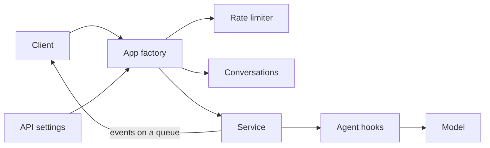
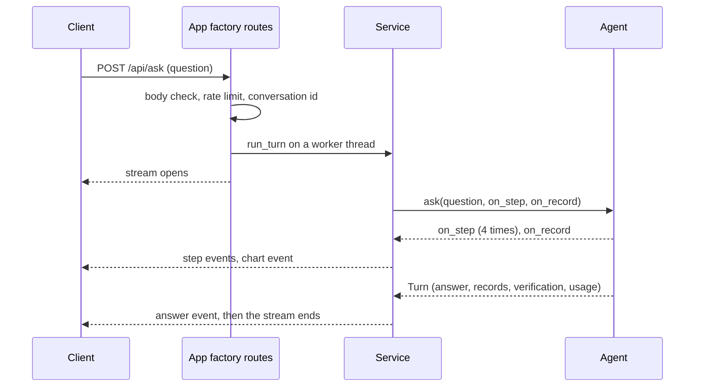

# 09 Analyst API + streaming

| | |
| --- | --- |
| Work | Feature: an HTTP service that sends each turn of the analyst to the client as a stream of events |
| Change | `630c97b` on `main`, 2026-10-13 |
| Evidence | `blueprint/history/features/09-analyst-api-streaming.md` (spec, live observations, repairs, findings 9/F-11 to 9/F-15, the second independent review. Local, not in Git). The commit message. The build conversation with its two reviews. `blueprint/context/findings.md` (F-10, F-16, F-17, F-18). |
| Reader | A learner who can write basic code and is new to this stack |

This document obeys the rules of ASD-STE100 Simplified Technical
English. It is not a certified STE document.

## 1. Summary

This work puts the analyst behind HTTP. A client posts a question and reads the
turn as a stream. The stream has one event for each tool call, one for each
chart, and then the verified answer. The service also limits each address, keeps the answer of each
suggestion, serves follow-up questions, and writes one log line for each turn.
The web page of feature 11 is the planned client.

The one idea to remember: the agent runs on its own thread and puts each event
on a queue. Thus the client sees each step when it starts.

## 2. Why this work exists

Before this work, only the `ask` command gave an answer, and it printed the
answer when the turn ended. A turn with the real model takes about 15 seconds.
A visitor of a web page who sees no sign of work for 15 seconds goes away.

A public service also has needs that a command does not have. A visitor is
anonymous, and each question costs money. Thus the service needs a rate limit,
a bound on its memory, and a record of the cost with no text of the visitor.

## 3. Design

The design is one module, `api.py`, with four parts that share one agent, and
two small changes in modules that it uses.

Six terms are new in this work:

- **FastAPI** is a Python library that maps an HTTP route to a function. This
  work uses it for the three routes and for the check of the request body.
- **Server-sent events (SSE)** is a text format for a response that stays open.
  Each event has a name line and a data line. The service uses it so that a
  browser reads each step when the step comes.
- **App factory** is a function that makes the app. `create_app` checks the
  settings and builds the agent, thus a bad environment stops the start.
- **CORS** is the browser rule for a page that calls a different origin. The
  service allows only the origins of `CORS_ORIGINS`.
- **Rate limit** is a maximum number of requests in a time. Here one address
  gets `RATE_LIMIT_PER_MINUTE` questions in 60 seconds.
- **Worker thread** is a second path of execution in one process. The agent is
  synchronous, thus each turn runs on a worker thread.

| Part | Location | Job |
| --- | --- | --- |
| API settings | `services/analyst/src/analyst/settings.py` | Checks the four variables that only the API reads, and names each bad one. |
| Agent hooks | `services/analyst/src/analyst/agent.py` | Tells a caller about each step and each record, and counts the model calls and the tokens. |
| Rate limiter | `services/analyst/src/analyst/api.py` | Counts the requests of each address in the last 60 seconds. |
| Conversations | `services/analyst/src/analyst/api.py` | Knows each conversation id, marks a turn in flight, and forgets the oldest conversation. |
| Service | `services/analyst/src/analyst/api.py` | Runs one turn on a worker thread, keeps the turn of a suggestion, and writes the log line. |
| App factory | `services/analyst/src/analyst/api.py` | Makes the app with its three routes, CORS, and the body of a 422. |

Support files: `tests/test_api.py` (new), `tests/test_agent.py`,
`tests/test_settings.py`, `tests/scripted.py`, `tests/conftest.py`,
`.env.example`, and `AGENTS.md`.

The routes are `POST /api/ask`, `GET /api/suggestions`, and `GET /api/health`.
A stream has four event names: `step`, `chart`, `answer`, and `error`. The
`answer` event holds the conversation id, the verified answer, the
`Verification` of feature 8, and one line for each tool call.

The diagram also shows the client and the model, which this work does not own.

## 4. Workflow

Example input: `curl -N -X POST localhost:8000/api/ask` with the question "Show me Thierry Henry's shots in 2003-04."

1. FastAPI checks the body with `AskRequest`. (`services/analyst/src/analyst/api.py:66`)
2. `ask` reads the address of the connection and asks the limiter. (`services/analyst/src/analyst/api.py:462`)
3. `RateLimiter.wait` counts the request and returns 0. (`services/analyst/src/analyst/api.py:155`)
4. `Conversations.begin` makes a new id and marks a turn in flight. (`services/analyst/src/analyst/api.py:190`)
5. `ask` starts a worker thread for `run_turn` and returns the stream. (`services/analyst/src/analyst/api.py:479`)
6. `Service.answer` finds no kept turn, thus it calls `ask_model`. (`services/analyst/src/analyst/api.py:324`)
7. `ask_model` calls `agent.ask` with the hooks `on_step` and `on_record`. (`services/analyst/src/analyst/api.py:382`)
8. The model calls a tool, and `limit_tool_calls` calls `on_step`. (`services/analyst/src/analyst/agent.py:159`)
9. `sse` writes the `step` event, and the hook puts it on the queue. (`services/analyst/src/analyst/api.py:115`)
10. The stream reads the queue and sends the event to the client at once. (`services/analyst/src/analyst/api.py:485`)
11. `build_chart` ends, `record_tool_call` calls `on_record`, and a `chart` event leaves. (`services/analyst/src/analyst/agent.py:178`)
12. `count_usage` adds each model call and its tokens to the usage. (`services/analyst/src/analyst/agent.py:203`)
13. `agent.ask` returns the verified `Turn`: 3 claims, 4 records, 12,846 input tokens.
14. `compact` keeps one copy of the messages of the conversation. (`services/analyst/src/analyst/api.py:344`)
15. The question is a suggestion with no tool error, thus `ask_model` keeps the turn. (`services/analyst/src/analyst/api.py:400`)
16. `run_turn` frees the conversation, sends the `answer` event, and writes the log line. (`services/analyst/src/analyst/api.py:278`)
17. `run_turn` puts `None` on the queue, and the stream ends.

## 5. Decisions and tradeoffs

### 5.1 Each turn runs on a worker thread with a queue

- **Choice:** The route starts a thread for `run_turn`. The stream reads a
  `queue.Queue` until it gets `None`.
- **Alternatives:** Make the agent and its middleware asynchronous, or send all
  events when the turn ends.
- **Reason:** Recorded: the middleware of the agent is synchronous, and each
  `step` event must leave before the turn ends. Source: the spec, "Notes for
  the AI", and the comment at `api.py:476`.
- **Cost:** Each open stream holds one thread of the pool of 40. The 41st
  question waits for a thread.

### 5.2 The service makes each conversation id

- **Choice:** `Conversations.begin` makes the id with `uuid.uuid4()`. A client
  sends back only an id that an `answer` event gave.
- **Alternatives:** Let the client select the id.
- **Reason:** Recorded: a client must not name the thread of a different
  visitor. Source: the comment at `api.py:195`, and the spec, "Conversations".
- **Cost:** An unknown id gets 404. A restart ends each conversation.

### 5.3 The key of the rate limit is the address of the connection

- **Choice:** The limiter reads `request.client.host` and no header.
- **Alternatives:** Read `X-Forwarded-For`.
- **Reason:** Recorded: a client can write that header, thus it is not a safe
  key. Source: the spec, "Decisions that the plans do not state".
- **Cost:** Behind a proxy, all visitors have one address. Feature 10 must set
  the proxy options of uvicorn.

### 5.4 Each valid request counts for the limit, also a kept answer

- **Choice:** The limiter counts a request before the service looks for a kept
  turn.
- **Alternatives:** Count only a request that reaches the model.
- **Reason:** Recorded: the user selected one rule for all requests on
  2026-10-13. Source: the spec, "In scope".
- **Cost:** A visitor who selects six suggestions in one minute gets 429.

### 5.5 A kept answer starts a conversation of its own

- **Choice:** `replay` sends the kept events and puts the kept messages into a
  new thread with `update_state`.
- **Alternatives:** Send a kept answer with no conversation, or keep no answer.
- **Reason:** Recorded: demo question 4 is a follow-up to demo question 1, which
  is a suggestion. Source: the spec, "Decisions that the plans do not state".
- **Cost:** The service keeps the messages of each kept turn in memory.

### 5.6 The service does not keep a turn with a failed tool call

- **Choice:** `ask_model` keeps a suggestion turn only when no record has an
  `error`.
- **Alternatives:** Keep each turn that ends with an answer, as the first build
  did.
- **Reason:** Recorded: a database failure in one turn gave a wrong
  "unavailable" to each later visitor. Source: finding 9/F-11 of the first
  independent review.
- **Cost:** A suggestion whose turn always has a tool error is never kept. No
  live run checked suggestions 2 and 3 (F-17).

### 5.7 A conversation keeps one copy of its messages

- **Choice:** After each answered turn, `compact` deletes the thread and puts
  the messages back one time.
- **Alternatives:** Keep each checkpoint, or limit the turns of a conversation.
- **Reason:** Recorded: the checkpointer kept a full copy for each step, thus
  the memory grew with the square of the turns. Source: finding F-10, with
  measured sizes.
- **Cost:** The memory still grows with each turn. A conversation has no limit
  of turns, and F-10 stays open at P3.

### 5.8 The price of the model comes from the environment

- **Choice:** Two optional variables give US dollars for one million tokens.
  With no price, `cost_usd` is `null`.
- **Alternatives:** A price table in the code, or a log with no cost.
- **Reason:** Recorded: the project had no price for the model, and the user
  selected the two variables on 2026-10-13. Source: the spec, "In scope".
- **Cost:** The operator must set the two prices. One price alone stops the
  start.

### 5.9 The body of a 422 does not repeat the input

- **Choice:** A handler returns the `loc`, `msg`, and `type` of each error.
- **Alternatives:** The default body of FastAPI, which holds the input.
- **Reason:** Recorded: a lone surrogate in the question gave 500, and a
  question of 5,000,000 characters came back in full. Source: finding 9/F-14.
- **Cost:** The body differs from the FastAPI default that other tools expect.

## 6. Blast radius

### 6.1 This work needs

| Dependency | Used for | If it fails |
| --- | --- | --- |
| `agent.ask`, `Turn`, `AgentError` | Each turn | The app does not import, or a turn ends with an `error` event. |
| Postgres as `analyst_ro` | The prompt at the start, and each tool call | At the start: `AgentError`, and the app does not start. In a turn: the tool returns error text, and the service does not keep that turn. |
| `ANALYST_MODEL` and the key of the provider | Each model call | At the start: `SettingsError` or `AgentError`. In a turn: an `error` event with the class of the cause. |
| `CORS_ORIGINS`, `RATE_LIMIT_PER_MINUTE` | CORS and the rate limit | `SettingsError` names the variable, and the app does not start. |
| The two price variables | `cost_usd` in the log | With none: `cost_usd` is `null`. With one: the app does not start. |
| `get_state`, `update_state`, `delete_thread` of LangGraph | A kept answer, one copy of the messages, the end of a conversation | The turn ends with the generic `error` event, and the conversation ends. |
| One process | The conversations, the limiter, and the kept turns live in memory | With two workers, a follow-up gets 404 and the limit doubles. |

### 6.2 These things use this work

| Consumer | Uses | Found in |
| --- | --- | --- |
| The start command | `analyst.api:create_app` | `AGENTS.md:74` |
| Tests | `create_app`, `Service`, `RateLimiter`, `Conversations`, `api_settings` | `services/analyst/tests/test_api.py:34` |

No other consumers yet. A search of `apps/web/src`, `ingest`, the other analyst
modules, and the project config found no use. The planned consumers are the
release config of feature 10 and the Ask page of feature 11.

Shared ground:

- `agent.ask` has two new keyword arguments. `cli.py:127` calls it with none.
- `Turn` has a new required field `usage`. Only `ask` makes a `Turn`.
- `AgentError` takes the usage as a second argument. Each old call still works.
- `Settings` has four new optional fields. The command line and the MCP server
  read `Settings` and do not need them.
- `tests/conftest.py` has the fixture `api_env`, and `tests/scripted.py` has
  `with_usage`.

### 6.3 If you change this work

| If you change | Then check |
| --- | --- |
| A field of an event | The tests in `test_api.py:158`, and the web types of feature 11. |
| `SUGGESTIONS` at `api.py:33` | The kept turns use the exact text as the key. The chips of feature 11 must send the same text. |
| The agent or its checkpointer | `compact` at `api.py:344` and `replay` at `api.py:336`. Run `test_api.py:341` and `test_api.py:567`. |
| A tool result in `tools.py` | `working_step` at `api.py:121`, and the rule for a kept turn at `api.py:396`. |
| The number of uvicorn workers | Each state of the service is in one process. Keep one worker. |
| The proxy in front of the service | The address at `api.py:461`. Set the proxy options of uvicorn, not a header in the code. |
| The log line at `api.py:303` | The cost report of feature 15. Keep the line free of text from the visitor. |
| The version of `fastapi` or `langgraph` | Run `test_api.py`. The stream, the 422 handler, and `update_state` depend on them. |

### 6.4 How to remove this work

1. Revert commit `630c97b`.
2. Clear the check mark of item 9 in `blueprint/build-plan.md`.

No data and no migration stay behind. The four API variables stay in `.env`
with no reader. After the revert, `ask` on the command line works as before,
and `Turn` has no `usage` field.

## 7. Code reading path

1. [`services/analyst/src/analyst/api.py:66`](../services/analyst/src/analyst/api.py#L66) - Look for: the two fields of a request, and the four event models below them.
2. [`services/analyst/src/analyst/api.py:115`](../services/analyst/src/analyst/api.py#L115) - Look for: the three lines of one event, and why NaN goes out as `null`.
3. [`services/analyst/src/analyst/api.py:145`](../services/analyst/src/analyst/api.py#L145) - Look for: how the limiter forgets an address, and how it gets the seconds to wait.
4. [`services/analyst/src/analyst/api.py:180`](../services/analyst/src/analyst/api.py#L180) - Look for: the three results of `begin`, and why a conversation in flight is not forgotten.
5. [`services/analyst/src/analyst/api.py:278`](../services/analyst/src/analyst/api.py#L278) - Look for: the order of the last four actions of a turn, and the `finally` block.
6. [`services/analyst/src/analyst/api.py:357`](../services/analyst/src/analyst/api.py#L357) - Look for: the lock around `emit`, and the two conditions for a kept turn.
7. [`services/analyst/src/analyst/api.py:336`](../services/analyst/src/analyst/api.py#L336) - Look for: how a kept answer gets a thread of its own.
8. [`services/analyst/src/analyst/api.py:457`](../services/analyst/src/analyst/api.py#L457) - Look for: the order of the checks, and the worker thread with the queue.
9. [`services/analyst/src/analyst/agent.py:146`](../services/analyst/src/analyst/agent.py#L146) - Look for: where `on_step` runs, and `count_usage` at line 203.
10. [`services/analyst/src/analyst/settings.py:88`](../services/analyst/src/analyst/settings.py#L88) - Look for: how one function names each bad variable and repeats no value.

## 8. Known limits

- F-10 (P3, open): one conversation has no limit of turns, thus 200
  conversations do not bound the memory.
- F-16 (P3, open): `ask_model` keeps a turn before it writes the `answer`
  event. Text that UTF-8 cannot hold then fails each later request for that
  suggestion.
- F-17 (P3, unverified): a suggestion whose turn always has a tool error is
  never kept. No live run checked suggestions 2 and 3.
- F-18 (P3, open): the value `http://[::1` in `CORS_ORIGINS` stops the start
  with `ValueError`, not with `SettingsError`.
- A turn has no time limit. A model call that never ends holds its conversation
  and its thread.
- When an error that is not an `AgentError` ends a turn, the log line shows
  zero tokens.
- A request body has no size limit in the service. The spec gives that limit to
  the proxy of feature 10.
- `GET /docs` and `GET /openapi.json` answer 200, which is the FastAPI default.
- No real model ran after the four repair steps. Their evidence is the tests
  and the probes of the second review.
- Seen in the live run: a client that named `localhost` needed 2.07 seconds to
  connect. A client that named `127.0.0.1` needed under 0.01 seconds. uvicorn
  listens on IPv4 only by default.
- The live follow-up read 20,939 input tokens, and the first turn read 12,846.
  Each follow-up sends the earlier rows to the model again (F-05).

## 9. Self-test

1. Why does a `step` event reach the client before the turn ends?
2. What happens if a visitor sends a conversation id that the service did not make?
3. Why does a follow-up to a kept answer know the question of the kept turn?
4. What happens to a suggestion when the database fails in the first turn that asks it?
5. Why does the limiter not read the `X-Forwarded-For` header?

Answers

1. The agent runs on a worker thread and puts each event on a queue. The
   stream reads the queue at once. See section 5.1.
2. An id of a wrong form gets 422. An id of the correct form that the service
   does not know gets 404. See section 5.2.
3. `replay` puts the kept messages into the new thread before the `answer`
   event leaves. See section 5.5.
4. The turn has a record with an `error`, thus the service does not keep it.
   The next visitor reaches the model. See section 5.6.
5. A client can write that header, thus it is not a safe key. The proxy options
   of uvicorn give the correct address. See section 5.3.

