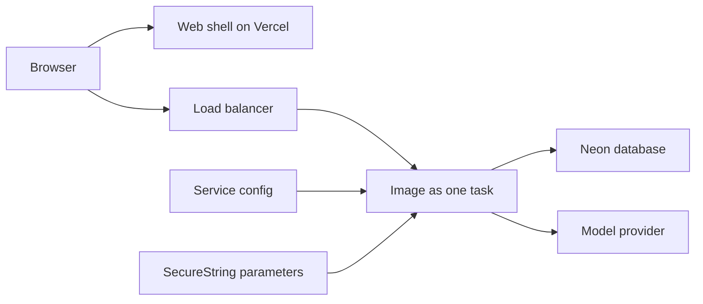
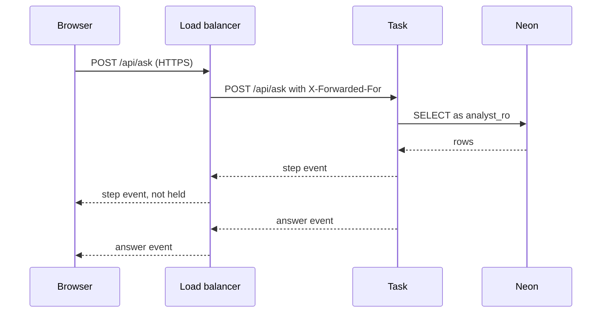

# 10 Deploy pipeline

| | |
| --- | --- |
| Work | Feature: the analyst API and a small web page on public URLs, with the database on Neon |
| Change | `08b66e4` on `main`, 2026-10-13 |
| Evidence | `blueprint/history/features/10-deploy-pipeline.md` (spec, progress notes, the independent review. Local, not in Git). The commit message. The build conversation. `blueprint/context/findings.md` (F-19 to F-22). |
| Reader | A learner who can write basic code and is new to this stack |

This document obeys the rules of ASD-STE100 Simplified Technical
English. It is not a certified STE document.

## 1. Summary

This work puts the analyst on the internet. The API runs as one container on
AWS, and a small web page runs on Vercel. The API reads the production database
on Neon with the read-only role `analyst_ro`. A visitor opens the page, selects
one button, and sees an answer arrive as a stream.

The one idea to remember: a public service sits behind a proxy, and the proxy
changes what the service sees. Most of this work makes three things correct
behind that proxy: the stream, the address of the visitor, and the secrets.

## 2. Why this work exists

Before this work, the API of feature 9 ran only on the machine of the
developer. No visitor could reach it, and the web app showed the page that the
Next.js installer makes.

A local service hides three problems that a public service has:

- A proxy can hold a response until it is complete. Then the visitor sees no
  step before the answer.
- Each connection comes from the proxy. Thus the rate limit of feature 9 counts
  all visitors as one address.
- The service needs a database password and a model key on a machine that the
  developer does not own.

## 3. Design

The design has four parts: an image, a service config, a web shell, and one
header in the API. Most of the work is configuration, not code.

Seven terms are new in this work:

- A **container image** is a file system and a start command in one package.
  This work uses an image so that the cloud runs the same code as the local test.
- **ECS Express Mode** is an AWS service that runs a container and makes a load
  balancer with an HTTPS address for it. This work uses it as the host of the API.
- A **load balancer** is a proxy that accepts each public connection and sends
  it to the container. Here it also ends the HTTPS connection.
- `X-Forwarded-For` is a request header in which a proxy writes the address of
  the visitor. The service needs it because each connection comes from the proxy.
- `X-Accel-Buffering: no` is a response header that tells a proxy to send each
  part of a response immediately. A stream needs it.
- **CORS** is the browser rule for a page that calls an API on a different
  host. The API must name the origin of the page, or the browser refuses the answer.
- A **SecureString parameter** is an encrypted value in AWS Systems Manager.
  This work keeps the two secrets there, and the config holds only their names.

| Part | Location | Job |
| --- | --- | --- |
| Stream header | `services/analyst/src/analyst/api.py` | Adds `X-Accel-Buffering: no` to the stream of `POST /api/ask`. |
| Image | `Dockerfile`, `.dockerignore` | Builds the analyst service from the lock file and starts uvicorn as a user that is not root. |
| Service config | `deploy/ecs/service.example.json` | Names the image, the port, the health path, the task count, the variables, and the secrets. |
| Web shell | `apps/web/src/components/connection-check.tsx`, `apps/web/src/app/page.tsx` | Shows that the browser can reach the API and that an answer streams. |
| Web settings | `apps/web/vercel.json`, `apps/web/.env.example` | Tell Vercel the framework, and name the variable for the API address. |
| Operator notes | `AGENTS.md`, `.env.example`, `.gitignore` | Give the deploy commands, explain `FORWARDED_ALLOW_IPS`, and keep the filled config out of Git. |

The work also made resources that are not in Git. These are the image
repository, two IAM roles, the two parameters, the service with its load
balancer, and the Vercel project. The archive lists each one by name.

## 4. Workflow

Example input: a visitor opens `https://highbury-sigma.vercel.app` and selects
**Ask** for the question "Show me Thierry Henry's shots in 2003-04."

1. Vercel sends the static page, and the effect of `ConnectionCheck` starts. (`apps/web/src/components/connection-check.tsx:123`)
2. `loadSuggestion` gets `/api/suggestions` from the address in `NEXT_PUBLIC_API_URL`. (`apps/web/src/components/connection-check.tsx:39`)
3. The load balancer adds the address of the visitor to `X-Forwarded-For` and calls port 8000 of the task.
4. uvicorn trusts the header, because the connection comes from the range in `FORWARDED_ALLOW_IPS`. (`deploy/ecs/service.example.json:19`)
5. The CORS middleware finds the origin of the page in `CORS_ORIGINS` and allows the answer. (`services/analyst/src/analyst/api.py:427`)
6. The visitor selects **Ask**, and `ask` posts the question to `/api/ask`. (`apps/web/src/components/connection-check.tsx:59`)
7. The route reads `request.client.host`, and the rate limit counts that address. (`services/analyst/src/analyst/api.py:461`)
8. The route returns the stream with the two headers that stop a buffer. (`services/analyst/src/analyst/api.py:489`)
9. The agent queries Neon as `analyst_ro`, and each tool call sends a `step` event.
10. The page reads the stream in parts and splits it into events. (`apps/web/src/components/connection-check.tsx:87`)
11. The page adds each step label, and then it shows the summary. (`apps/web/src/components/connection-check.tsx:98`)

In production, a live question from the page gave steps at 6.2, 13.5, and 22.0
seconds. The answer came at 49.8 seconds. Thus the load balancer did not hold
the events.

## 5. Decisions and tradeoffs

### 5.1 The API runs on ECS Express Mode

- **Choice:** One container on AWS Fargate behind a load balancer, in the
  Singapore region, next to the Neon database.
- **Alternatives:** A Lightsail container service, Render, or Railway.
- **Reason:** Recorded: AWS refused a Lightsail container service, because the
  limit of the account is zero. The user then selected ECS Express Mode and has
  AWS credits. Source: the revision note of the spec and the build conversation.
- **Cost:** More parts than one small host: a registry, two roles, and a load
  balancer. The estimate in the conversation is 30 to 40 dollars each month.
  An update takes about 8 minutes.

### 5.2 The service has one task, always

- **Choice:** The minimum and the maximum task count are 1.
- **Alternatives:** Let the host add tasks when the load grows.
- **Reason:** Recorded: the rate limit, the conversations, and the kept answers
  are in the memory of one process. Two tasks give two different memories.
  Source: Data / contracts of the spec, and the archive of feature 9.
- **Cost:** One task is the limit of the service. During an update, an old task
  and a new task run together for a short time, and each update empties the memory.

### 5.3 uvicorn trusts the header only from the network of the load balancer

- **Choice:** `FORWARDED_ALLOW_IPS` is the address range of the VPC, which is
  the private network of the account. The service code reads no header.
- **Alternatives:** Trust the header from all addresses with `*`, or read the
  header in the route.
- **Reason:** Recorded: the visitor writes the first address of
  `X-Forwarded-For`. With `*`, uvicorn uses that first address, so each false
  address gets a new count. Source: Notes of the spec and `.env.example`.
- **Cost:** The value belongs to one network. If the network changes and the
  value stays, all visitors share one count. Nothing checks the value at the start.

### 5.4 The secrets are parameters, and Git holds only their names

- **Choice:** The database URL and the model key are SecureString parameters.
  The execution role of the task can read only the parameters below `/highbury/`.
- **Alternatives:** Put the values in the service config as plain variables.
- **Reason:** Inferred: the service config then holds no secret value, so a
  copy of it is not a leak. Deduced from `deploy/ecs/service.example.json`.
- **Cost:** A new value needs two commands: one for the parameter and one for
  a new deployment.

### 5.5 The access log of uvicorn is off

- **Choice:** The start command has `--no-access-log`.
- **Alternatives:** Keep the default log, which writes one line for each request.
- **Reason:** Recorded: that log writes the address of each visitor, and the
  project stores no personal data. Source: the comment in `Dockerfile`.
- **Cost:** The log does not show a request that fails before the route. Only
  the `ask` line of feature 9 shows use.

### 5.6 The build context is an allow list

- **Choice:** `.dockerignore` refuses each file, then allows five paths.
- **Alternatives:** A list of paths to refuse, such as `.env` and `ingest/raw`.
- **Reason:** Recorded: a new file, such as an env file or raw data, stays out
  of the image until a line lets it in. Source: the comment in `.dockerignore`.
- **Cost:** A new source folder does not reach the image until someone adds a line.

### 5.7 The web page is a temporary connection check

- **Choice:** One client component that loads one suggestion and has one
  **Ask** button. It reads the stream with `fetch` in the same file.
- **Alternatives:** A static page with no call, or the full Ask page.
- **Reason:** Recorded: the done-when of the build plan needs a question that
  streams from the public page, and the Ask page is feature 11. The user
  selected this option. Source: Out of scope of the spec and the conversation.
- **Cost:** Feature 11 removes this component. It has no test, because the web
  app has no test runner.

### 5.8 The stream has no heartbeat

- **Choice:** The service sends an event only when the agent makes one.
- **Alternatives:** Send a small comment line at a fixed interval.
- **Reason:** Recorded: the spec puts a heartbeat out of scope. Source: Out of
  scope and Notes of the spec.
- **Cost:** The load balancer stops a connection that is quiet for 60 seconds.
  One live turn was quiet for 27.5 seconds. Finding F-21 records this risk.

## 6. Blast radius

### 6.1 This work needs

| Dependency | Used for | If it fails |
| --- | --- | --- |
| Neon database, role `analyst_ro` | Each query of the agent, and the prompt at the start | The task does not start, or a tool gives an error text and the answer says less. |
| Model provider key | Each question that is not kept | The stream ends with an `error` event. A spending cap at the provider stops all new answers. |
| Load balancer | HTTPS, and the address of the visitor | The page shows "The analyst API is not reachable." |
| `FORWARDED_ALLOW_IPS` | The key of the rate limit | With no value, all visitors share one count. With `*`, a visitor can avoid the limit. |
| `CORS_ORIGINS` | The browser check | The browser refuses each answer, and the page shows the not-reachable text. |
| `NEXT_PUBLIC_API_URL` at build time | The address that the page calls | The page shows a text that names the variable, and it sends no request. |
| Vercel | The web shell | The page does not load. The API continues to work. |

### 6.2 These things use this work

| Consumer | Uses | Found in |
| --- | --- | --- |
| The home page | `ConnectionCheck` | `apps/web/src/app/page.tsx:14` |
| The web shell | `NEXT_PUBLIC_API_URL` | `apps/web/src/components/connection-check.tsx:8` |
| The stream test | The header `X-Accel-Buffering` | `services/analyst/tests/test_api.py:173` |
| The deploy commands | `Dockerfile` and the service config | `AGENTS.md` (Commands) |
| uvicorn | `FORWARDED_ALLOW_IPS` | `deploy/ecs/service.example.json:19` |

No code in the repository reads `X-Accel-Buffering`. The proxies between the
task and the browser are its readers.

### 6.3 If you change this work

| If you change | Then check |
| --- | --- |
| The address of the web page | `CORS_ORIGINS` on the service. The value must be the exact origin. |
| The address of the API | `NEXT_PUBLIC_API_URL` on the Vercel project, then build the page again. |
| The network of the load balancer | `FORWARDED_ALLOW_IPS`. Send six fast requests and make sure the sixth gets 429. |
| The task count | The rate limit, the follow-up questions, and the kept answers. All three need one process. |
| The start command in `Dockerfile` | The port in the service config, and the health path `/api/health`. |
| The event format of `sse` in `api.py` | `parseEvent` in the web shell, which reads two lines for each event. |
| A dependency of the analyst service | Build the image again and push it with a new tag. The repository accepts each tag only one time. |

### 6.4 How to remove this work

1. Delete the ECS service `highbury-api`. This also stops the cost of the load balancer.
2. Delete the image repository, the two parameters, and the two IAM roles.
3. Delete the Vercel project `highbury`.
4. Revert the commit `08b66e4`.

The Neon database stays, with its data and its two roles. The log group of the
service also stays until someone deletes it.

## 7. Code reading path

1. [`Dockerfile:16`](../Dockerfile#L16) - Look for: the manifests come before the source, so the dependency layer stays in the cache.
2. [`Dockerfile:36`](../Dockerfile#L36) - Look for: one process, port 8000, and no access log.
3. [`.dockerignore:1`](../.dockerignore#L1) - Look for: the allow list that keeps secrets and raw data out of the image.
4. [`deploy/ecs/service.example.json:7`](../deploy/ecs/service.example.json#L7) - Look for: the health path, one task, and the two secrets as names.
5. [`.env.example:22`](../.env.example#L22) - Look for: the reason that `FORWARDED_ALLOW_IPS` must not be `*`.
6. [`services/analyst/src/analyst/api.py:461`](../services/analyst/src/analyst/api.py#L461) - Look for: the route uses the address of the connection and reads no header.
7. [`services/analyst/src/analyst/api.py:489`](../services/analyst/src/analyst/api.py#L489) - Look for: the two headers of the stream.
8. [`apps/web/src/components/connection-check.tsx:59`](../apps/web/src/components/connection-check.tsx#L59) - Look for: the request, the 429 case, and the loop that reads the stream.
9. [`apps/web/src/components/connection-check.tsx:119`](../apps/web/src/components/connection-check.tsx#L119) - Look for: one state for the suggestion and one for the turn.

## 8. Known limits

- **A request body has no size limit.** A local test sent a body of 60 MB. The
  service read all of it, answered 422, and its memory went from 103 MiB to
  223 MiB. Such a request does not count for the rate limit. The task has
  512 MiB. The archive of feature 9 gave this limit to the proxy of feature 10,
  and this work did not add it. This is a defect seen after the review.
- The load balancer stops a stream that is quiet for 60 seconds (F-21, not verified).
- The check of the rate limit from a second network did not run. Requests
  through two addresses of the load balancer shared one count.
- The tracked plans in `project-requirement-docs` name Railway or Render as the host (F-20).
- The commit has an ignore rule for `.gitkeep` files that the spec does not name (F-19).
- Five images of the installer page stay in `apps/web/public` and are public (F-22).
- The AWS resources have no code that makes them again. The commands are in `AGENTS.md` and the archive.
- The log group has no end date, and the log line has no cost, because the two price variables are not set.
- CORS allows one origin. A preview deployment of Vercel cannot call the API.
- The independent review did not check the production state. It confirmed the code and the config.

## 9. Self-test

1. Why does the rate limit count all visitors as one address when `FORWARDED_ALLOW_IPS` has no value?
2. What happens if `FORWARDED_ALLOW_IPS` is `*` and a visitor sends a false `X-Forwarded-For` header?
3. Why must the service have only one task?
4. What happens if the address of the web page changes and `CORS_ORIGINS` stays the same?
5. Why does a change of `NEXT_PUBLIC_API_URL` on Vercel have no effect until the next build?

Answers

1. Each connection comes from the load balancer, and uvicorn does not trust the header. Thus the address is the address of the load balancer. See sections 2 and 5.3.
2. uvicorn uses the first address of the header, which the visitor wrote. Each false address gets a new count, so the limit stops no one. See section 5.3.
3. The rate limit, the conversations, and the kept answers are in the memory of one process. See section 5.2.
4. The browser refuses each answer of the API, and the page shows the not-reachable text. See sections 6.1 and 6.3.
5. Next.js puts the value into the browser bundle when it builds the page. See sections 4 and 6.1.

