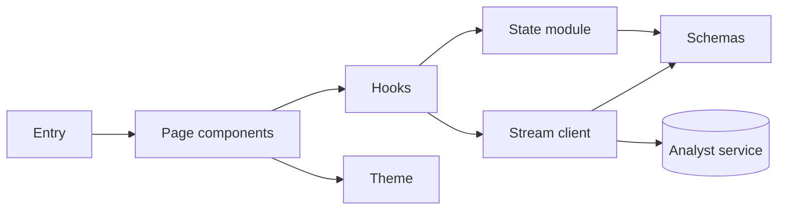
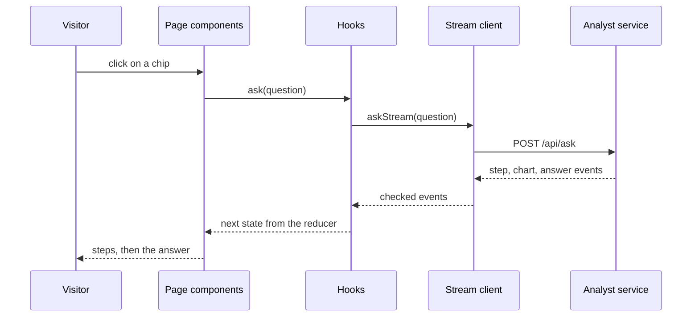

# 11 Ask page

| | |
| --- | --- |
| Work | Feature: the web page where a visitor asks the analyst and reads the checked answer |
| Change | `b39abee` on `main`, 2026-10-13 |
| Evidence | `blueprint/history/features/11-ask-page.md` (spec with its verification notes. Local, not in Git). The commit message. The build conversation. The mockups in `prototypes/`. `blueprint/context/findings.md` (F-21). |
| Reader | A learner who can write basic code and is new to this stack |

This document obeys the rules of ASD-STE100 Simplified Technical
English. It is not a certified STE document.

## 1. Summary

This work replaces the temporary page at `/` with the Ask page. A visitor types
a question or clicks a suggestion. The page shows each step of the analyst when
it starts, then the answer with its checked claims, its caveats, and its tool
calls. The visitor can ask a follow-up in the same conversation.

The one idea to remember: the browser does not trust the service. The page
checks each payload against a schema, and one small state module decides what
each event does to the screen.

## 2. Why this work exists

Before this work, the page at `/` was a connection check. It asked one fixed
suggestion and printed the summary as plain text. It did not show the claims,
the caveats, or the tool calls. A visitor could not type a question or ask a
follow-up.

The service of feature 9 already sends all of this data. Without a real page,
the main promise of the product stays out of view: each number has a check
behind it. The page must also give a clear screen for each result that is not
a plain answer. Examples are a rate limit and a question that the data cannot
answer.

## 3. Design

The design has three layers under one page component: schemas, a stream client,
and a state module. A hook joins them to React.

Seven terms are new in this work:

- **Zod** is a library that checks a value against a schema and gives its type.
  This work uses it to check each payload of the service in the browser.
- A **server component** is a React component that runs only on the server.
  `page.tsx` is one, so the first HTML needs no script.
- A **client component** runs in the browser and can hold state. The Ask page
  is one, because it reacts to clicks and to the stream.
- A **hook** is a function that gives state to a React component. `useAsk`
  gives the page the state of the turn.
- A **reducer** is a function that takes a state and an action and returns the
  next state. `reduce` is the reducer of this work.
- **`next/font`** is the part of Next.js that downloads a font when the app
  builds. This work uses it so that the browser asks Google for nothing.
- **`@theme`** is the block where Tailwind CSS reads its colour and font names.
  This work puts the palette of the mockups there.

| Part | Location | Job |
| --- | --- | --- |
| Theme | `apps/web/src/app/globals.css`, `layout.tsx` | Holds each colour, font, and radius of the page. |
| Schemas | `apps/web/src/lib/analyst-schema.ts` | Describe each payload that the service sends, and give its type. |
| Stream client | `apps/web/src/lib/ask-stream.ts` | Posts a question, reads the stream, and gives checked events or a named failure. |
| State module | `apps/web/src/lib/ask-state.ts` | Holds the reducer and the rules for the badge, the charts, and the retry. |
| Hooks | `apps/web/src/hooks/use-ask.ts`, `use-suggestions.ts` | Join the stream client and the state module to React. |
| Page components | `apps/web/src/components/ask/` | Draw one screen for each phase: `idle`, `asking`, `answered`, `failed`. |
| Entry | `apps/web/src/app/page.tsx` | Reads the address of the service and renders the page. |

The three test files and `test-fixtures.ts` in `src/lib` are support. So are
`package.json` and the lockfile, which add Zod.

## 4. Workflow

Example input: a click on the chip `Show me Thierry Henry's shots in 2003-04.`

1. `Home` reads `NEXT_PUBLIC_API_URL` and renders `AskPage`. (`apps/web/src/app/page.tsx:9`)
2. `useSuggestions` loads the three chips from `GET /api/suggestions`. (`apps/web/src/lib/ask-stream.ts:170`)
3. The visitor clicks the chip, and `AskPage` calls `ask` with `asNew`. (`apps/web/src/components/ask/ask-page.tsx:52`)
4. `ask` applies the `ask` action. (`apps/web/src/hooks/use-ask.ts:28`)
5. `reduce` returns the `asking` state with no conversation id. (`apps/web/src/lib/ask-state.ts:77`)
6. `askStream` posts the question to `POST /api/ask`. (`apps/web/src/lib/ask-stream.ts:126`)
7. `readEvents` joins the text of the stream and cuts it at each empty line. (`apps/web/src/lib/ask-stream.ts:74`)
8. `parseEvent` checks the payload of each event against its schema. (`apps/web/src/lib/ask-stream.ts:34`)
9. `onEvent` adds each step and each chart to the turn. (`apps/web/src/lib/ask-state.ts:47`)
10. `StepList` shows the spinner on the newest step. (`apps/web/src/components/ask/step-list.tsx:30`)
11. For the `answer` event, `onEvent` returns the `answered` state with the conversation id. (`apps/web/src/lib/ask-state.ts:56`)
12. `AnswerPanel` gets the badge and the charts of the answer. (`apps/web/src/components/ask/answer-panel.tsx:40`)
13. `AskPage` moves the focus to the title. (`apps/web/src/components/ask/ask-page.tsx:27`)

On the public page this input gave four steps, the badge `3 of 3 claims
verified`, and one chart panel with 194 shots.

## 5. Decisions and tradeoffs

### 5.1 The browser checks each payload, and a bad chart does not stop the answer

- **Choice:** `parseEvent` checks each payload with Zod. It drops a chart that
  fails its schema, and the panel of that chart shows a fallback. An answer
  that fails its schema gives the unexpected-error card.
- **Alternatives:** Trust the service and cast the JSON to a type. Stop the
  full turn when a chart is bad.
- **Reason:** Recorded: the spec says that a chart spec that fails the check
  shows a fallback and does not break the page. Source: the Goal of the spec,
  and the done-when of item 11 in the build plan.
- **Cost:** Two definitions of each shape exist, one in Python and one in
  TypeScript. A person must change the two together.

### 5.2 The rules of a turn are pure functions outside React

- **Choice:** `reduce`, `retryOffer`, `badgeState`, and `chartsOfAnswer` take
  their input as arguments and use no React.
- **Alternatives:** Keep the rules in the hook, with `useState` calls.
- **Reason:** Recorded: the user asked for unit tests of the web app. The spec
  says that each function with a test takes its input as arguments. Source:
  the build conversation, and the `Testing` section of the spec.
- **Cost:** The hook keeps a second copy of the state in a ref, because the
  request needs the conversation id in the same call. The comment in
  `use-ask.ts` records this.

### 5.3 Three failures forget the conversation, and three keep it

- **Choice:** An error event, a 404, and a broken stream set the conversation
  id to null. A rate limit, a service that is not reachable, and another HTTP
  status keep it.
- **Alternatives:** Always keep the id. Always forget it.
- **Reason:** Recorded: the service ends a conversation after an error, and a
  turn that still runs keeps its conversation busy. The other failures come
  before the turn starts. Source: the comment on `ENDS_CONVERSATION` in
  `ask-state.ts`, and the rules of the page in the spec.
- **Cost:** After an error, a follow-up cannot go again. The visitor must write
  a full question.

### 5.4 Where the mockups and the service differ, the service wins

- **Choice:** The page shows only data that the service sends. It has no stat
  tiles, no captions under a step, and no steps before they start.
- **Alternatives:** Build the mockups as drawn, with invented values.
- **Reason:** Recorded: the spec lists each difference. One mockup said that
  suggested questions still work under a rate limit. That is false, because the
  rate limit runs before the kept answers. Source: the Data / contracts section
  of the spec.
- **Cost:** The page looks plainer than the mockups.

### 5.5 A chart panel shows a title and a count, not the chart

- **Choice:** `ChartPanel` shows the title of a chart and one line of counts.
- **Alternatives:** Draw the charts in this work.
- **Reason:** Recorded: items 12, 13, and 16 of the build plan draw the
  charts. Source: step 4 and the Out of scope section of the spec.
- **Cost:** Until item 12, a visitor who asks for a shot map sees no pitch.

### 5.6 One dark palette sits under the role names of shadcn

- **Choice:** `globals.css` has one palette on `:root`. A colour that shadcn
  has a role for sits under that role name. The mockup names `accent` and
  `muted` became `brand` and `muted-foreground`.
- **Alternatives:** Keep the mockup names and change each shadcn component.
- **Reason:** Recorded: shadcn already uses `accent` and `muted` for other
  roles. Source: the comment above `:root` in `globals.css`.
- **Cost:** A reader of `prototypes/theme.css` must learn two renamed names.

### 5.7 A claim row shows no call id

- **Choice:** The claim list shows the text and the value of each claim, and
  no id of its query.
- **Alternatives:** Show `tool_call_id`, or add a `call_id` to each tool call
  of the service and link the two.
- **Reason:** Recorded: the service gives the id on a claim but not on a tool
  call, so the page cannot join them. The user decided on 2026-10-13 to add the
  link with a later fix. Source: the Notes of the spec.
- **Cost:** A visitor cannot see which query backs which claim yet.

## 6. Blast radius

### 6.1 This work needs

| Dependency | Used for | If it fails |
| --- | --- | --- |
| `POST /api/ask` of the analyst service | Each question | The page shows `The analyst API is not reachable.` with a Try again button. |
| `GET /api/suggestions` | The chips | The page shows no chips. The question bar still works. |
| `NEXT_PUBLIC_API_URL` | The address of the service, set at build time | The page shows a card that says the variable is not set. |
| The `Retry-After` header, exposed through CORS | The countdown of a rate limit | The card shows the text of the service and no countdown. |
| Google Fonts, at build time | The three fonts | The build stops. One build in this work failed this way, and the next one passed. |
| The load balancer in front of the service | An open stream | It cuts a stream that is quiet for 60 seconds (finding F-21). The page then shows `Something went wrong. Try again.` |
| Zod | Each schema | The build stops. |

### 6.2 These things use this work

| Consumer | Uses | Found in |
| --- | --- | --- |
| `Home` | `AskPage` | `apps/web/src/app/page.tsx:14` |
| The `Button` of shadcn | The colour roles of the theme | `apps/web/src/components/ui/button.tsx:10` |

No other code outside this work uses the schemas, the stream client, or the
state module yet. A search for `ConnectionCheck` and for the old Geist fonts
finds no use.

### 6.3 If you change this work

| If you change | Then check |
| --- | --- |
| A payload in `api.py`, `answer.py`, `charts.py`, or `verifier.py` | `analyst-schema.ts`. A new field is safe. A removed or renamed field makes each answer fail its schema. |
| The limit of 500 characters in `api.py` | `MAX_QUESTION_LENGTH` in `question-bar.tsx` |
| When the service ends a conversation | `ENDS_CONVERSATION` in `ask-state.ts`, and its tests |
| A colour in `globals.css` | Each page component and the `Button`, because all of them read the same names |
| The format of an event in the stream | `parseEvent` and `readEvents`, and the tests in `ask-stream.test.ts` |

### 6.4 How to remove this work

Revert commit `b39abee`. The connection check and the old theme come back. Then
deploy the web app again, because the public page runs this work. The
`prototypes/` folder and the test setup of commit `6ae80fa` stay.

## 7. Code reading path

1. [`apps/web/src/lib/analyst-schema.ts:50`](../apps/web/src/lib/analyst-schema.ts#L50) - Look for: the three chart types as one union on `type`.
2. [`apps/web/src/lib/ask-stream.ts:13`](../apps/web/src/lib/ask-stream.ts#L13) - Look for: the six kinds of failure, each with a name.
3. [`apps/web/src/lib/ask-stream.ts:74`](../apps/web/src/lib/ask-stream.ts#L74) - Look for: the buffer that joins an event from two reads.
4. [`apps/web/src/lib/ask-stream.ts:34`](../apps/web/src/lib/ask-stream.ts#L34) - Look for: a bad chart gives `skip`, and a bad answer gives a failure.
5. [`apps/web/src/lib/ask-state.ts:14`](../apps/web/src/lib/ask-state.ts#L14) - Look for: the four phases of the state.
6. [`apps/web/src/lib/ask-state.ts:41`](../apps/web/src/lib/ask-state.ts#L41) - Look for: the three failures that end a conversation.
7. [`apps/web/src/lib/ask-state.ts:75`](../apps/web/src/lib/ask-state.ts#L75) - Look for: the reducer, with one case for each action.
8. [`apps/web/src/hooks/use-ask.ts:28`](../apps/web/src/hooks/use-ask.ts#L28) - Look for: the order of the abort, the action, and the request.
9. [`apps/web/src/components/ask/ask-page.tsx:34`](../apps/web/src/components/ask/ask-page.tsx#L34) - Look for: one block of the screen for each phase.
10. [`apps/web/src/app/globals.css:88`](../apps/web/src/app/globals.css#L88) - Look for: the palette, and the comment on the two renamed names.

## 8. Known limits

- A chart panel shows no chart. Items 12, 13, and 16 draw the charts.
- The claim list has no link to a query. A later fix adds it.
- Stop ends the wait in the browser only. The turn still runs on the service
  and still costs money.
- The spinner is on the newest step. The service does not say when a step
  ends, so two tool calls that run together show one spinner.
- Two calls of the same tool show the same label two times.
- An answer from the kept answers of the service shows `Answered in 0.0 s`.
- The button of a question that the data cannot answer sends the alternative
  text as a question. Its result depends on the words of the model.
- The page components and the hooks have no unit tests. Only the three
  modules in `src/lib` have them.
- The phone layout of the mockups is not built. Item 14 adds it.
- Some checks used a replaced response in the browser, not a real failure of
  the service. The verification notes of the spec list them.
- Seen in this work: the first deploy command failed with `Not authorized`,
  and the same command passed on the second try. Reason not recorded.

## 9. Self-test

1. Why does a chart with a shot at `x: 999` not stop the answer?
2. What happens to the conversation id when the service sends an error event, and why?
3. Why can a rate-limited follow-up go again, but a follow-up after an error cannot?
4. Why does the hook keep the state in a ref and also in `useState`?
5. What happens on the page if the service renames the field `summary`?

Answers

1. `parseEvent` drops a chart that fails its schema, and `chartsOfAnswer` then
   gives null for its id. The panel shows a fallback. See section 5.1.
2. The reducer sets it to null, because the service ends a conversation after
   an error. See section 5.3.
3. A rate limit comes before the turn starts, so the conversation is as it
   was. An error ends the conversation, and a follow-up means nothing without
   it. See section 5.3.
4. The request needs the conversation id of the new state in the same call.
   State from `useState` comes only with the next render. See section 5.2.
5. Each answer fails its schema, and the page shows the unexpected-error card.
   See sections 5.1 and 6.3.

