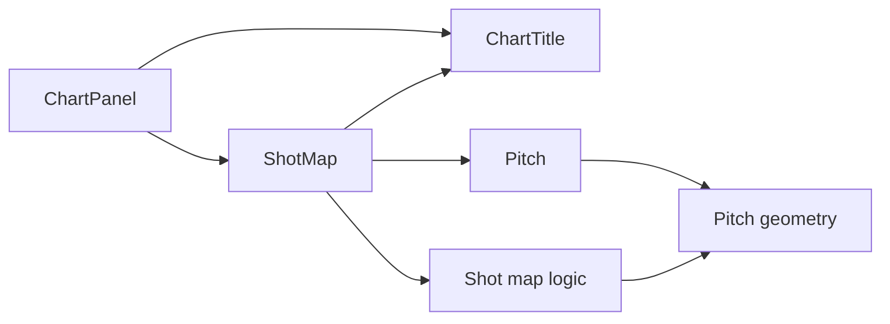
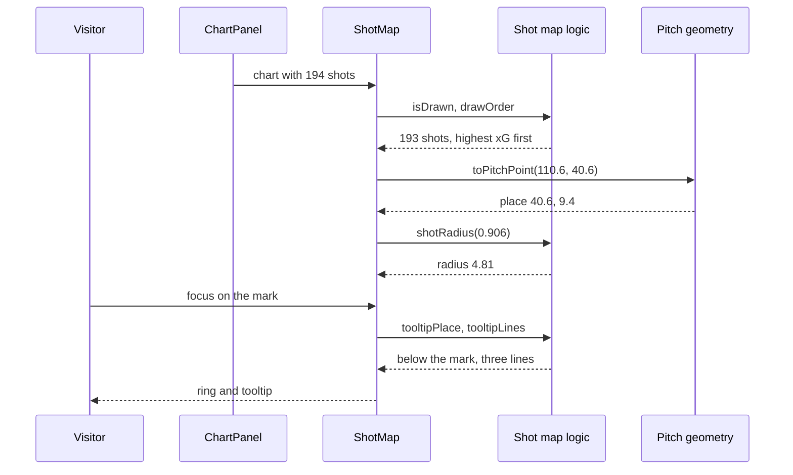

# 12 Pitch + shot map

| | |
| --- | --- |
| Work | Feature: a reusable football pitch and the shot map chart of an answer |
| Change | `f5e6691` on `main`, 2026-10-14 |
| Evidence | `blueprint/history/features/12-pitch-shot-map.md` (spec with six build steps. Local, not in Git). The commit message. The build conversation, with the results of `/check`. The mockup `prototypes/03-answer.html`. |
| Reader | A learner who can write basic code and is new to this stack |

This document obeys the rules of ASD-STE100 Simplified Technical
English. It is not a certified STE document.

## 1. Summary

This work draws a `shot_map` chart of an answer on a football pitch. Each shot
is one mark. The size of the mark shows the xG, and the shape shows the outcome.
A visitor reads one shot with the pointer, with a tap, or with the arrow keys.
A sentence below the pitch gives the same counts in words.

The one idea to remember: the drawing uses the units of the data. One unit of
the SVG is one unit of the pitch, thus the browser scales the full picture.

## 2. Why this work exists

Before this work, the Ask page showed a chart as a title and one count, for
example "194 shots". The service already sent each shot with its place, its xG,
and its outcome. The page did not draw them.

The project overview calls the pitch charts "the hero" of the page. Without
this work, the visitor reads numbers but does not see where the shots came
from. The pass network of feature 16 also needs a pitch. Thus the pitch is a
component of its own.

## 3. Design

The design has two layers: pure functions that calculate, and components that
draw. `ChartPanel` selects the drawing for each chart type.

Five terms are new in this work:

- **xG** (expected goals) is the chance, from 0 to 1, that a shot becomes a
  goal. This work shows it as the size of a mark.
- An **SVG view box** is the rectangle of coordinates that an SVG shows. The
  browser scales it to the element, so this work has no resize code.
- **`d3-scale`** is a library of functions that map one range of numbers to a
  different range. This work uses it for the place and the radius of a mark.
- A **roving tab index** is a pattern where a group of elements is one stop for
  the Tab key. This work uses it because a season has more than 100 shots.
- **`clamp()`** is a CSS function that keeps a value between two limits. This
  work uses it to keep the tooltip inside the drawing.

| Part | Location | Job |
| --- | --- | --- |
| Pitch geometry | `apps/web/src/lib/pitch.ts` | Holds the sizes of the pitch and turns a data coordinate into a place on the drawing. |
| Shot map logic | `apps/web/src/lib/shot-map.ts` | Calculates the radius, the outcome kind, the order, the summary, the label, and the tooltip place of a shot. |
| `Pitch` | `apps/web/src/components/charts/pitch.tsx` | Draws the lines of the pitch and puts its children on top. |
| `ShotMap` | `apps/web/src/components/charts/shot-map.tsx` | Draws the marks, the legend, the tooltip, and the summary. It holds the active shot. |
| `ChartTitle` | `apps/web/src/components/charts/chart-title.tsx` | Draws the title of a chart. |
| `ChartPanel` | `apps/web/src/components/ask/chart-panel.tsx` | Selects `ShotMap` for a `shot_map`. It keeps the fallback for a chart that is not valid. |

Support files: `package.json`, `pnpm-lock.yaml`, `pitch.test.ts`, and
`shot-map.test.ts`.

The data uses a pitch of 120 x 80 units. The attack goes to `x = 120`, and
`y = 0` is the left touchline of the attacker. The drawing turns the pitch so
that the attack goes up the screen. Thus `toPitchPoint` returns `y` as the
horizontal place and `120 - x` as the vertical place.

## 4. Workflow

Example input: one shot of Thierry Henry against Chelsea on 2003-10-18. Its
values are `x` 110.6, `y` 40.6, `xg` 0.906, outcome `goal`, and minute 74.

1. `AnswerPanel` gives each chart of the answer to `ChartPanel`. (`answer-panel.tsx:99`)
2. `ChartPanel` finds the type `shot_map` and renders `ShotMap`. (`chart-panel.tsx:40`)
3. `ShotMap` keeps the shots that `isDrawn` accepts, and this shot is one of them. (`shot-map.tsx:173`)
4. `drawOrder` sorts the shots by xG, and this shot is the first of 193. (`shot-map.ts:63`)
5. `toPitchPoint` returns the place 40.6, 9.4, which is near the penalty spot. (`pitch.ts:27`)
6. `shotRadius` returns 4.81 pitch units for an xG of 0.906. (`shot-map.ts:46`)
7. `outcomeKind` returns `goal`, and `ShotMark` draws a filled red circle. (`shot-map.tsx:37`)
8. `shotLabel` gives the mark its name for a screen reader. (`shot-map.ts:110`)
9. The visitor moves the focus to the mark, and `ShotMap` stores its index. (`shot-map.tsx:224`)
10. `tooltipPlace` puts the tooltip below the mark, because the mark is in the top half. (`shot-map.ts:140`)
11. The tooltip shows "Goal · xG 0.91" and "Minute 74 · v Chelsea". (`shot-map.tsx:118`)
12. `summaryText` counts all 194 shots and names the one shot that has no mark. (`shot-map.ts:84`)

## 5. Decisions and tradeoffs

### 5.1 The SVG uses pitch units, and the attack goes up

- **Choice:** The view box is the pitch plus a small margin. A mark needs only
  `toPitchPoint`.
- **Alternatives:** A horizontal pitch. Pixel coordinates with code that
  measures the element after each resize.
- **Reason:** Recorded: the browser scales the SVG through the view box, so no
  resize code is necessary. The mockup shows the attack upward. Source: the
  spec, "Notes for the AI" and "Design reference".
- **Cost:** The two position scales do almost no work. One of them returns its
  input.

### 5.2 Only `d3-scale` comes from D3, and React draws the SVG

- **Choice:** The work adds one D3 module. React creates each SVG element.
- **Alternatives:** The full `d3` package. `d3-selection`, which changes the
  page directly.
- **Reason:** Recorded: the build plan names D3 scales, and the project rule is
  to add a dependency only for a current requirement. Source: the spec, "Notes
  for the AI".
- **Cost:** The bundle has one more dependency for three small scales.

### 5.3 The shot map always shows the attacking half

- **Choice:** A shot with `x` below 60 has no mark. The summary counts it and
  says that it is not shown.
- **Alternatives:** The full pitch when one shot is in the own half, which was
  the first design. A threshold. A mark on the halfway line.
- **Reason:** Recorded: one shot of Henry from `x = 58` put 194 shots on a
  pitch 420 px wide, and the marks were too crowded. Source: the spec, build
  step 6, from the result of `/check`.
- **Cost:** The visitor does not see that shot on the pitch. In the database,
  this applies to 3 shots of 1,791.

### 5.4 The summary holds counts only

- **Choice:** The summary gives the count of shots, of each outcome, and of
  shots in the penalty area. It gives no sum of xG.
- **Alternatives:** A sum of xG that the browser calculates.
- **Reason:** Recorded: a sum made in the browser can differ in the last digit
  from the checked number in the answer. Source: the spec, "Data / contracts".
- **Cost:** The total xG is in the answer, not below the chart.

### 5.5 The chart is one tab stop, and one list gives two orders

- **Choice:** The arrow keys, Home, and End move between the marks. The list
  goes from the highest xG to the lowest. The same list is the draw order.
- **Alternatives:** One tab stop for each shot. An order by date or by place on
  the pitch.
- **Reason:** Recorded: `ShotMap` draws a large mark first, so that it does not
  hide a small mark. Source: the spec, "Data / contracts". Recorded: a season has more
  than 100 shots, thus one stop for each shot traps a keyboard user. Source: the
  build conversation.
- **Cost:** The arrow keys do not follow the place of the marks on the screen.

### 5.6 The shape shows the outcome, and an unknown outcome has a shape

- **Choice:** Five stored outcomes have five shapes. Each other text is the
  kind `other`, with a square.
- **Alternatives:** Colour only. A refusal of a chart with an unknown outcome.
- **Reason:** Recorded: the overview requires "outcome by shape and not only
  colour", and the service does not restrict the outcome text. Source: the
  spec, "Data / contracts".
- **Cost:** The shapes for `post` and `other` are not in the mockup.

### 5.7 A ring around the mark shows the focus

- **Choice:** `ShotMap` draws one circle in the `ring` colour around the active
  mark, after all the marks. The mark has no browser outline.
- **Alternatives:** The global `:focus-visible` outline. A stroke on the mark.
- **Reason:** Recorded: browsers draw an outline on a part of an SVG in
  different ways. Source: the spec, "Notes for the AI", and a code comment.
  Inferred: the ring is last in the SVG, so no mark can hide it. Deduced from
  the order of the elements in `shot-map.tsx`.
- **Cost:** The spec asked for a stroke on the mark. The ring is a small
  difference from that text.

### 5.8 The tooltip gets its place from an inline style

- **Choice:** `tooltipPlace` returns percentages, and the tooltip sets `left`
  and `top` with `clamp()`. The tooltip has `aria-hidden`.
- **Alternatives:** A measurement of the tooltip with JavaScript. A tooltip in
  the SVG.
- **Reason:** Recorded: the place is data, so it cannot be a class. The label
  of the mark already has the same text. Source: the spec, "Notes for the AI"
  and "Data / contracts".
- **Cost:** This is the one exception to the project rule against inline
  styles. The tooltip has one width, 13 rem, at each screen size.

## 6. Blast radius

### 6.1 This work needs

| Dependency | Used for | If it fails |
| --- | --- | --- |
| `d3-scale` | The place and the radius of a mark | The build stops at the import. |
| `shotSchema` in `analyst-schema.ts` | The fields of a shot | A chart that fails the check shows "This chart cannot be shown". |
| The colour tokens in `globals.css` | The fill and the stroke of each shape | A mark with a removed token has no colour. |
| The five outcome values of the loaders (`SHOT_OUTCOMES`) | The shape of a mark | A new stored value draws as a square with the label "Other". |
| `build_chart` in the service | A chart with all the rows of its query | The service sends no chart. The answer shows without one. |

### 6.2 These things use this work

| Consumer | Uses | Found in |
| --- | --- | --- |
| `ChartPanel` | `ShotMap` | `apps/web/src/components/ask/chart-panel.tsx:40` |
| `ChartPanel` | `ChartTitle` | `apps/web/src/components/ask/chart-panel.tsx:43` |
| `ShotMap` | `Pitch`, `toPitchPoint`, and the shot map logic | `apps/web/src/components/charts/shot-map.tsx:197` |

The view `full` of `Pitch` has no consumers yet. Only a test calls
`viewBoxOf("full")`.

### 6.3 If you change this work

| If you change | Then check |
| --- | --- |
| `toPitchPoint` | The place of each mark, the ring, `tooltipPlace`, and `pitch.test.ts` |
| The margins of the view box | `tooltipPlace`, which uses the same box, and the goal behind the goal line |
| The range of the radius scale | `MIN_HIT_RADIUS`, and marks on a touchline that go past the view box |
| `STORED_OUTCOMES` | `SHOT_OUTCOMES` in the two loaders, the legend, and `countText` |
| `TOOLTIP_WIDTH` | The class `w-52` of the tooltip, which must have the same width |
| `isDrawn` | The sentence of `summaryText` about shots that are not shown |
| `chart-panel.tsx` | Features 13 and 16, which add their drawings in the same file |

### 6.4 How to remove this work

Revert commit `f5e6691`. The revert removes the seven new files and the two
packages, and `ChartPanel` shows the title and the count again. No data, no
environment variable, and no service code stays behind.

## 7. Code reading path

1. [`analyst-schema.ts:12`](../apps/web/src/lib/analyst-schema.ts#L12) - Look for: the fields of a shot, which are the full input.
2. [`pitch.ts:23`](../apps/web/src/lib/pitch.ts#L23) - Look for: the two scales, and how the second one turns the length over.
3. [`pitch.ts:39`](../apps/web/src/lib/pitch.ts#L39) - Look for: the view box as the pitch plus a margin.
4. [`pitch.tsx:76`](../apps/web/src/components/charts/pitch.tsx#L76) - Look for: one `PitchEnd` that the full view draws two times.
5. [`shot-map.ts:24`](../apps/web/src/lib/shot-map.ts#L24) - Look for: the map of stored outcomes, and the fallback to `other`.
6. [`shot-map.ts:43`](../apps/web/src/lib/shot-map.ts#L43) - Look for: the square-root scale and its range from 1 to 5.
7. [`shot-map.ts:55`](../apps/web/src/lib/shot-map.ts#L55) - Look for: the rule for a shot with no mark.
8. [`shot-map.ts:84`](../apps/web/src/lib/shot-map.ts#L84) - Look for: a summary of counts with no sum of xG.
9. [`shot-map.tsx:153`](../apps/web/src/components/charts/shot-map.tsx#L153) - Look for: the four state values and what each event sets.
10. [`chart-panel.tsx:40`](../apps/web/src/components/ask/chart-panel.tsx#L40) - Look for: the one place that selects a drawing by chart type.

## 8. Known limits

- A shot from the own half has no mark. The summary is the only place that
  names it.
- In a dense map, a saved shot on top of a goal looks like a dark red disc.
  The cause is the fill of the hollow shapes, which is 60 percent opaque.
- The tooltip can cover the marks next to the active mark.
- The arrow keys follow the xG order, not the place of the marks.
- The components have no unit tests. Lint, the build, and the browser checks
  cover them.
- The check used real data for Henry and Saka. The square for `other` and the
  empty state appeared only with a mocked answer.
- A mouse click replaced a tap. No check ran on a real touch screen.
- The check of Saka ran before build step 6. Saka has no shot from the own
  half, so step 6 does not change his chart.
- `compare_bars` and `pass_network` charts still show a title and a count.
- During `/check`, one request to `/api/suggestions` failed and the next one
  passed. This work does not touch that code, and the cause is not known.

## 9. Self-test

1. Why does the code have no handler for a resize of the window?
2. What happens if a loader stores a new outcome value, for example `own goal`?
3. Why does the summary give no total xG?
4. What happens to a shot with `x = 58`, and why?
5. Why is the ring a separate circle and not a stroke on the mark?

Answers

1. The view box uses pitch units, and the browser scales it. See section 5.1.
2. The mark is a square with the label "Other", and the summary counts it as other. See section 5.6.
3. A sum in the browser can differ from the checked number in the answer. See section 5.4.
4. It has no mark, and the summary says so, because one such shot made the map too small. See section 5.3.
5. Browsers draw SVG outlines differently, and a last element is always on top. See section 5.7.

