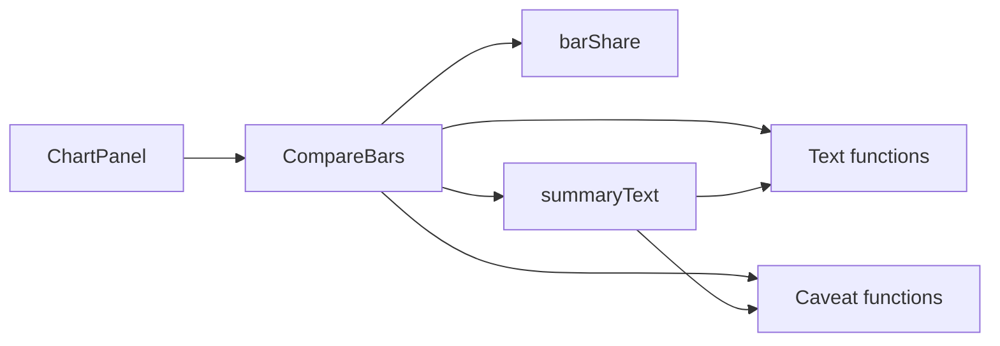
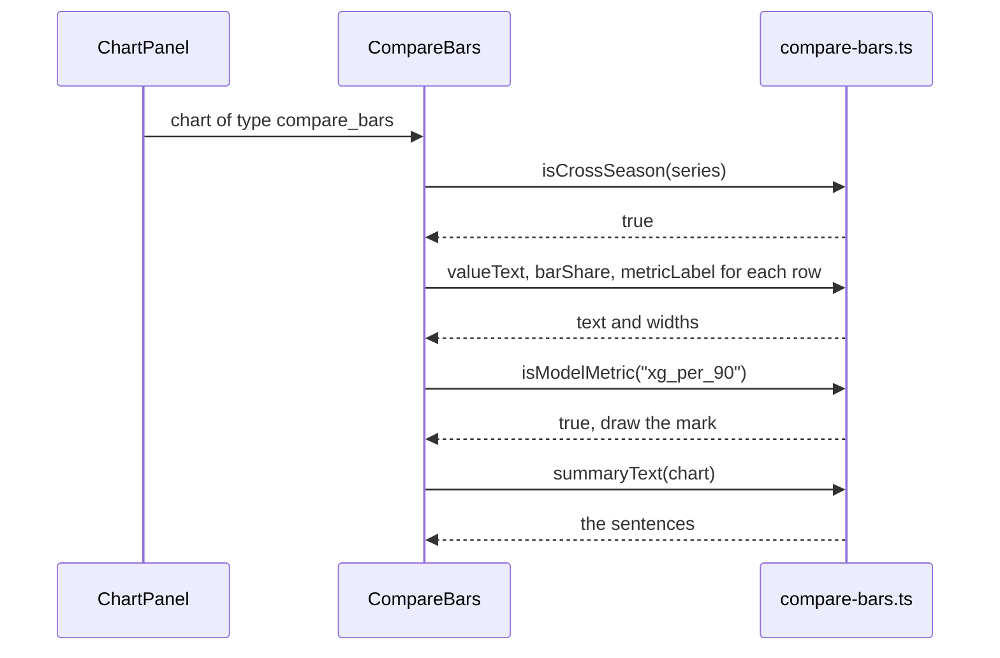

# 13 Compare bars

| | |
| --- | --- |
| Work | Feature: the chart that compares two players on shared metrics |
| Change | `29f46d4` on `main`, 2026-10-14 |
| Evidence | `blueprint/history/features/13-compare-bars.md` (spec. Local, not in Git). The commit message. The build conversation, with the browser check. |
| Reader | A learner who can write basic code and is new to this stack |

This document obeys the rules of ASD-STE100 Simplified Technical
English. It is not a certified STE document.

## 1. Summary

This work draws a `compare_bars` chart. The chart has one row for each metric.
Each row shows the value of each player as a number and as a bar. A visitor
uses it to compare two players, for example Thierry Henry in 2003-04 and Bukayo
Saka in 2025-26.

The one idea to remember: the chart shows numbers and does not make them. Each
number on the chart is a number that the service sent.

## 2. Why this work exists

The analyst service already made the `compare_bars` spec (feature 6). The page
already checked the spec (feature 11). But the page drew only the title and one
line of text for it, for example "2 metrics". The visitor could not see the
comparison.

The project has a locked rule for a comparison across the two seasons. Such a
comparison must state that the xG models differ. The term xG means expected
goals. It is an estimate of the quality of a chance, and each data source has
its own model.
Thus a chart of xG across the seasons needs a caveat in the chart itself.

## 3. Design

The design has the same split as the shot map: pure functions in `src/lib`, and
one component that draws.

Two terms are new in this work.

- A **container query** is a CSS rule that depends on the width of a parent
  element, not of the window. Tailwind writes it as `@container` on the parent
  and `@md:` on a class. This work uses it because the chart is in a column
  whose width changes with the layout of the answer.
- An **ARIA table** is a set of `role` attributes (`table`, `row`, `cell`,
  `rowheader`, `columnheader`) on plain elements. A screen reader then reads the
  elements as a table. This work uses it because the rows are a CSS grid of
  `div` elements, which has no table meaning of its own.

| Part | Location | Job |
| --- | --- | --- |
| Text functions | `apps/web/src/lib/compare-bars.ts` | `metricLabel` and `valueText` make the label of a metric and the text of a value. |
| `barShare` | `apps/web/src/lib/compare-bars.ts` | Gives the width of a bar as a percentage of its cell. |
| Caveat functions | `apps/web/src/lib/compare-bars.ts` | `isCrossSeason`, `isModelMetric`, and `hasModelCaveat` decide which rows get the mark. |
| `summaryText` | `apps/web/src/lib/compare-bars.ts` | Writes the chart in words, one sentence for each metric. |
| `CompareBars` | `apps/web/src/components/charts/compare-bars.tsx` | Draws the header, the rows, the note line, and the summary. |
| `ChartPanel` | `apps/web/src/components/ask/chart-panel.tsx` | Selects the component for the type of the chart. |

Support file: `compare-bars.test.ts`, with 17 cases for the functions.

## 4. Workflow

Example input: the visitor asks "Compare Henry in 2003-04 with Saka in 2025-26
on goals and xG per 90." The service sends a chart with two metrics:
`goals_per_90` with the values 0.81 and 0.28, and `xg_per_90` with 0.65 and
0.35.

1. `ChartPanel` gets the chart and sees the type `compare_bars`. (`chart-panel.tsx:35`)
2. `CompareBars` reads the two series and calls `isCrossSeason`. The result is true. (`compare-bars.tsx:65`)
3. For each metric, `CompareBars` finds the higher value of the row. (`compare-bars.tsx:87`)
4. `valueText` makes the text of each value, for example `0.81`. (`compare-bars.ts:29`)
5. `barShare` gives 100 for 0.81 and 34.6 for 0.28. (`compare-bars.ts:37`)
6. `metricLabel` changes `xg_per_90` to `xG per 90`. (`compare-bars.ts:14`)
7. `isModelMetric` finds the word `xg`, thus the row gets the mark `△`. (`compare-bars.tsx:100`)
8. `hasModelCaveat` is true, thus the note line explains the mark. (`compare-bars.ts:52`)
9. `summaryText` writes one sentence for each metric below the rows. (`compare-bars.ts:60`)

## 5. Decisions and tradeoffs

### 5.1 The page finds the caveat from the data of the chart

- **Choice:** A row gets the mark when the two seasons differ and the metric
  name has the word `xg`, `xa`, or `npxg`.
- **Alternatives:** Add a caveat field to the spec in the service. Show no
  caveat in the chart and use only the caveats of the answer.
- **Reason:** Recorded: the spec carries no caveat field, and the feature
  changes no contract and no service code. Source: the spec, "Out of scope" and
  "Model caveat".
- **Cost:** The page guesses from a column name. A model metric with a
  different name, for example `expected_goals`, gets no mark.

### 5.2 The chart calculates no new number

- **Choice:** The chart shows each value as the service gave it, with two
  decimals at most. It shows no difference and no ratio.
- **Alternatives:** Show the difference between the two players in each row.
- **Reason:** Recorded: derived numbers come from SQL only, which is a locked
  rule of the project. Source: the spec, "Value text".
- **Cost:** The visitor does the subtraction. A value with three decimals shows
  as two.

### 5.3 Each row has its own scale

- **Choice:** The higher value of a row has the full width. The other bar is in
  proportion to it.
- **Alternatives:** One scale for all the rows.
- **Reason:** Inferred: the metrics have different units, so one scale makes a
  rate of 0.6 invisible next to 30 goals. The prototype has the same rule in
  its note line.
- **Cost:** The reader cannot compare the bars of two rows. The note line says
  so.

### 5.4 Plain division, not `d3-scale`

- **Choice:** `barShare` divides the value by the higher value of the row.
- **Alternatives:** `scaleLinear` from `d3-scale`, which the shot map uses.
- **Reason:** Recorded: `scaleLinear` returns the middle of the range for a
  domain of `[0, 0]`, which is wrong for two zero values. Source: the spec,
  "Notes for the AI".
- **Cost:** The two charts do not use the same tool for their scales.

### 5.5 A negative value has a bar of no width

- **Choice:** `barShare` returns 0 for a value of 0 or less. The number is
  still visible.
- **Alternatives:** Draw the bar by the size of the number without its sign.
- **Reason:** Inferred: a long bar for a negative number tells the reader that
  the value is high. Source: the spec states the rule and gives no reason.
- **Cost:** The chart cannot show how far below zero a value is.

### 5.6 The summary says "is higher" and not "leads"

- **Choice:** Each sentence names the player with the higher value.
- **Alternatives:** The word "leads", as in the prototype.
- **Reason:** Recorded: for some metrics a lower value is better. Source: the
  spec, "Text summary".
- **Cost:** The summary does not say who is better.

### 5.7 The chart has no interactive part

- **Choice:** No tooltip, no tab stop, and no keyboard handler. The rows are an
  ARIA table.
- **Alternatives:** A tab stop for each row, as the shot map has for each shot.
- **Reason:** Recorded: each value is always visible, so there is nothing to
  open. A reader gets each value from the table and from the summary. Source:
  the spec, "Accessibility structure".
- **Cost:** None found. Nobody tested the table with a screen reader.

### 5.8 The layout follows the width of the panel

- **Choice:** Container queries make the columns and the text smaller in a
  narrow panel.
- **Alternatives:** Breakpoints on the width of the window, as the spec named
  ("responsive Tailwind classes").
- **Reason:** Inferred: the chart is in a flex column of the answer, and its
  width is not a fixed part of the window width. Source: `answer-panel.tsx:97`.
- **Cost:** This is the first use of container queries in the web app.

## 6. Blast radius

### 6.1 This work needs

| Dependency | Used for | If it fails |
| --- | --- | --- |
| `compareBarsSchema` in `analyst-schema.ts` | The promise of two series and one metric or more | A spec that fails the schema never gets to `CompareBars`. `ChartPanel` shows "This chart cannot be shown". |
| The metric names of the service | The label and the caveat mark | A name with other words gets a plain label and no mark. Nothing stops. |
| `Intl.NumberFormat` of the browser | The text of a value | All current browsers have it. |
| Tailwind container queries | The narrow layout | The chart keeps the narrow layout at each width. |
| `ChartTitle`, `cn`, the colour tokens | The look | The build fails. |

### 6.2 These things use this work

| Consumer | Uses | Found in |
| --- | --- | --- |
| `ChartPanel` | `CompareBars` | `apps/web/src/components/ask/chart-panel.tsx:36` |
| `CompareBars` | All the functions of `compare-bars.ts` | `apps/web/src/components/charts/compare-bars.tsx:2` |

No other file imports the new code.

### 6.3 If you change this work

| If you change | Then check |
| --- | --- |
| The metric names in the prompt of the service | `MODEL_WORDS`: a new model metric needs its word there, or the row gets no mark. |
| The `compare_bars` spec | `compareBarsSchema`, and then the types in `compare-bars.ts`, which come from it. |
| `valueText` | The done-when of the build plan: the values of the chart must agree with the checked claims. |
| The classes in `ROW` and `VALUE` | The chart at 1440 px and at 390 px, for cut text and horizontal scroll. |
| `countsText` in `ChartPanel` | Only the `pass_network` chart uses it now. |

### 6.4 How to remove this work

Revert commit `29f46d4`. `ChartPanel` then shows the title and one line of
counts for a `compare_bars` chart again. The work stores no data and adds no
dependency, thus nothing stays behind.

## 7. Code reading path

1. [`apps/web/src/lib/analyst-schema.ts:31`](../apps/web/src/lib/analyst-schema.ts#L31) - Look for: the shape of the spec, and that `values[i]` belongs to `series[i]`.
2. [`apps/web/src/components/ask/chart-panel.tsx:35`](../apps/web/src/components/ask/chart-panel.tsx#L35) - Look for: the one place that selects a component by chart type.
3. [`apps/web/src/lib/compare-bars.ts:7`](../apps/web/src/lib/compare-bars.ts#L7) - Look for: `MODEL_WORDS`, which the label and the caveat use.
4. [`apps/web/src/lib/compare-bars.ts:37`](../apps/web/src/lib/compare-bars.ts#L37) - Look for: the two cases of `barShare` that return 0.
5. [`apps/web/src/lib/compare-bars.ts:43`](../apps/web/src/lib/compare-bars.ts#L43) - Look for: the split of a name into words, so that `boxgoals` is not a model metric.
6. [`apps/web/src/lib/compare-bars.ts:60`](../apps/web/src/lib/compare-bars.ts#L60) - Look for: the three forms of a sentence in `summaryText`.
7. [`apps/web/src/components/charts/compare-bars.tsx:17`](../apps/web/src/components/charts/compare-bars.tsx#L17) - Look for: the grid of three columns and its `@md:` classes.
8. [`apps/web/src/components/charts/compare-bars.tsx:42`](../apps/web/src/components/charts/compare-bars.tsx#L42) - Look for: `aria-hidden` on the bar, and the `style` value for its width.
9. [`apps/web/src/components/charts/compare-bars.tsx:70`](../apps/web/src/components/charts/compare-bars.tsx#L70) - Look for: the `@container` element and the roles of the table.

## 8. Known limits

- The caveat mark depends on the metric name. A model metric with a name
  without `xg`, `xa`, or `npxg` gets no mark.
- `isCrossSeason` compares the text of the two seasons. The database has two
  seasons, one for each xG model, thus a different season means a different
  model today. A third season from one of the two sources breaks this.
- The note line names no data source. The caveats of the answer name them.
- A negative value has no bar.
- The chart shows the full name of a player, and a long name wraps.
- Nobody tested the chart with a screen reader. The browser check read the text
  and the layout only.
- The browser check used the kept answer of a suggestion. The model chose
  `goals_per_90` there and not `goals`.
- The component has no unit test, by the rule of the project. Lint, the build,
  and the browser check cover it.
- The debrief found no defect.

## 9. Self-test

1. Why does the page decide which rows get the caveat mark, and not the service?
2. What happens if the two values of a row are both 0?
3. Why does `isModelMetric` split the name into words before it looks for `xg`?
4. Why does the summary not give the difference between the two players?
5. What happens to the layout if the answer column becomes narrow on a wide window?

Answers

1. The spec has no caveat field, and the feature changes no contract. See section 5.1.
2. `barShare` returns 0 for each bar, and the summary says "level at 0". See sections 5.4 and 4.
3. A name such as `boxgoals` has the letters `xg` inside a word and is not a model metric. See section 7, stop 5.
4. Derived numbers come from SQL only, so the chart calculates no new number. See section 5.2.
5. The container query follows the width of the panel, so the chart uses its narrow layout. See sections 3 and 5.8.

