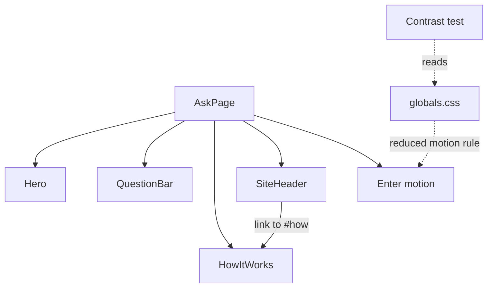
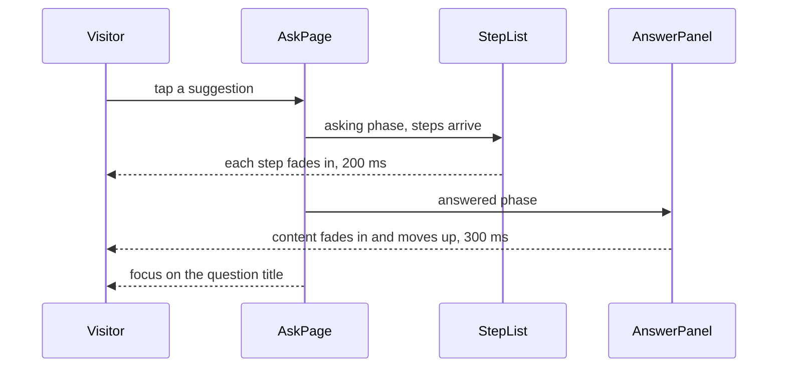

# 14 Visual polish + hero

| | |
| --- | --- |
| Work | Feature: the hero, the "How it works" strip, the motion, the phone layout, and the contrast test |
| Change | `b29c077` on `main`, 2026-10-14 |
| Evidence | `blueprint/history/features/14-visual-polish-hero.md` (spec. Local, not in Git). The commit message. The build conversation, with the browser checks. |
| Reader | A learner who can write basic code and is new to this stack |

This document obeys the rules of ASD-STE100 Simplified Technical
English. It is not a certified STE document.

## 1. Summary

This work makes the first screen say what Highbury is. A hero shows the two
seasons, and a strip of three cards explains why a visitor can trust an answer.
The steps and the answer now arrive with a short motion. The page fits a phone
at 390 px, and a test proves the contrast of the text colours.

The one idea to remember: the work adds almost no logic. It adds static
content, CSS classes, and one test that reads the stylesheet.

## 2. Why this work exists

Before this work, the first screen had one heading, one paragraph, and the
question bar. It did not show the idea of the project: two seasons, 22 years
apart, behind one analyst. It did not say how the analyst protects its numbers.

The page also had three gaps that the build plan named.

- The answer replaced the step list with no transition.
- At phone width, the follow-up bar was at the end of a long page.
- Nobody measured the contrast of the colours.

Feature 11 already ported the colour tokens, the fonts, the focus outline, and
the rule for reduced motion. Thus this work did not do them again. It checked
them on the finished page.

## 3. Design

The design has three groups: static content, classes on components that exist,
and one test.

Four terms are new in this work.

- A **contrast ratio** is a number from 1 to 21 that compares the brightness of
  two colours. WCAG, the web accessibility standard, asks for 4.5 or more for
  text. This work uses it as the pass mark of the test.
- **Reduced motion** is a setting of the operating system. A page reads it with
  the CSS media query `prefers-reduced-motion`. This work uses it so that a
  visitor can turn off each animation.
- **`tw-animate-css`** is a small CSS package with classes such as `animate-in`
  and `fade-in`. This work uses it because it was already installed.
- **Sticky position** is a CSS position that keeps an element on the screen
  while the page scrolls. This work uses it for the follow-up bar on a phone.

| Part | Location | Job |
| --- | --- | --- |
| `Hero` | `apps/web/src/components/ask/hero.tsx` | Shows the eyebrow, the headline, the paragraph, and the pitch figure. |
| `HowItWorks` | `apps/web/src/components/ask/how-it-works.tsx` | Shows three cards from the `CARDS` list. |
| `SiteHeader` | `apps/web/src/components/ask/site-header.tsx` | Shows the link to the strip, and a small header on a phone. |
| `AskPage` | `apps/web/src/components/ask/ask-page.tsx` | Puts the hero and the strip on the idle screen. |
| Enter motion | `step-list.tsx`, `answer-panel.tsx` | Fades in a new step and the content of an answer. |
| `QuestionBar` | `apps/web/src/components/ask/question-bar.tsx` | Keeps the follow-up bar at the bottom of a phone screen. |
| `Button` | `apps/web/src/components/ui/button.tsx` | Uses the global focus outline. |
| Contrast test | `apps/web/src/app/globals.test.ts` | Reads the tokens from `globals.css` and checks each colour pair. |

Support file: `page.tsx`, with the data credit in the footer.

## 4. Workflow

Example input: a visitor on a phone with a width of 390 px opens the page and
taps the first suggestion.

1. `AskPage` is in the idle phase, thus it shows `Hero`. (`ask-page.tsx:41`)
2. `SiteHeader` gets `howLink` and shows the link to the strip. (`site-header.tsx:20`)
3. The visitor taps a suggestion, and the phase changes to asking.
4. Each new step is a new list item with the classes `animate-in` and `fade-in`. (`step-list.tsx:53`)
5. The answer arrives, and `AnswerPanel` fades in its content in 300 ms. (`answer-panel.tsx:69`)
6. `AskPage` moves the focus to the question title, which does not move. (`ask-page.tsx:29`)
7. The follow-up `QuestionBar` stays at the bottom of the screen. (`question-bar.tsx:48`)
8. The header shows a plus icon, and the text stays as the name of the button. (`site-header.tsx:38`)

If the visitor has reduced motion on, one rule in `globals.css` removes each
animation. The content of steps 4 and 5 then shows at once.

## 5. Decisions and tradeoffs

### 5.1 CSS classes, not Framer Motion

- **Choice:** The motion uses the classes of `tw-animate-css`.
- **Alternatives:** Framer Motion, which the project plan names in its stack.
- **Reason:** Recorded: two enter motions do not need a library, and the
  package was already installed. Source: the spec, "Notes for the AI" and
  "Open questions". The user approved the default.
- **Cost:** The step list has no exit motion. CSS cannot animate an element
  that React removes.

### 5.2 Only two things move

- **Choice:** A new step fades in. The content of an answer fades in and moves
  up 8 px. Nothing else moves.
- **Alternatives:** Motion on the hero, the cards, and the state cards.
- **Reason:** Recorded: the project overview permits motion only for the
  change from the step list to the answer. Source: the spec, "Motion".
- **Cost:** The failure and state cards arrive with no motion.

### 5.3 The question title does not move

- **Choice:** The wrapper with the animation starts below the title.
- **Alternatives:** One animation on the full answer.
- **Reason:** Recorded: the focus goes to the title when the answer arrives.
  Source: the spec, "Motion", and the comment at `answer-panel.tsx:68`.
- **Cost:** `AnswerPanel` has one more wrapper element.

### 5.4 One global rule for reduced motion

- **Choice:** The rule in `globals.css` sets `animation: none` and
  `transition: none` for each element. No component has its own rule.
- **Alternatives:** A `motion-reduce:` class on each animated element.
- **Reason:** Recorded: the global rule covers each animation, and the browser
  check proves it. Source: the spec, "Notes for the AI".
- **Cost:** The spinner of the active step is a ring that does not turn. The
  title "Analyst at work" and the timer still show progress.

### 5.5 The contrast check is a unit test

- **Choice:** A Vitest file reads the hex values from `globals.css` and
  calculates each ratio.
- **Alternatives:** A browser audit tool. A manual check with a colour picker.
- **Reason:** Inferred: the build plan says "the contrast check passes" and
  the project has no browser test runner. A unit test runs with `pnpm test`
  each time. Source: the spec, "Testing".
- **Cost:** The test checks the pairs in its list, not the pixels of the page.
  A new text colour on a new background needs a new line in `PAIRS`.

### 5.6 The pitch of the hero is decoration

- **Choice:** The figure is a static SVG with `aria-hidden`. Its dots are not
  shots of the data. It does not use the `Pitch` component.
- **Alternatives:** Real shots from the API. The `Pitch` component of feature 12.
- **Reason:** Recorded: `Pitch` draws an attack that goes up, and the prototype
  shows a horizontal pitch with one season in each half. Source: the spec,
  "Pitch figure".
- **Cost:** A page that promises checked numbers shows 12 invented dots. A
  comment in the code and `aria-hidden` mark them as decoration.

### 5.7 The follow-up bar is sticky on a phone only

- **Choice:** Below 640 px the follow-up bar has sticky position, one row, and
  a hidden label.
- **Alternatives:** The same bar at each width.
- **Reason:** Recorded: the phone prototype has the bar at the bottom of the
  screen. Source: the spec, step 5.
- **Cost:** The bar covers 73 px of the content while the page scrolls. The
  class string of `QuestionBar` is long.

### 5.8 The button uses the global focus outline

- **Choice:** The base class of `Button` no longer hides the outline.
- **Alternatives:** Keep the ring of shadcn at half opacity.
- **Reason:** Recorded: the focus pass in the browser found that only "New
  question" and "Ask" had a different, fainter indicator. Source: the build
  conversation.
- **Cost:** The file of a shadcn component differs from its upstream version.

### 5.9 No season coverage table

- **Choice:** The table "What each season can answer" of the prototype is not
  built.
- **Alternatives:** A static table on the idle screen.
- **Reason:** Recorded: the table is a second copy of the data catalog,
  written by hand. Source: the spec, "Open questions". The user approved the
  default.
- **Cost:** A visitor learns the limits of a season only from an answer.

## 6. Blast radius

### 6.1 This work needs

| Dependency | Used for | If it fails |
| --- | --- | --- |
| `tw-animate-css`, imported in `globals.css` | The enter motion | The content shows with no motion. Nothing stops. |
| The reduced-motion rule in `globals.css` | Motion off for a visitor who asks | The animations run for that visitor. |
| The `:focus-visible` rule in `globals.css` | The focus indicator of each `Button` | A button shows no focus indicator. |
| The `:root` block of `globals.css` | The contrast test | The test fails with "No token" if a name changes. |
| The `sm` breakpoint of Tailwind (640 px) | The phone layout | The phone rules apply at a different width. |
| `lucide-react` | The icons of the cards and the plus icon | The build fails. |

### 6.2 These things use this work

| Consumer | Uses | Found in |
| --- | --- | --- |
| `AskPage` | `Hero`, `HowItWorks`, the `howLink` prop | `apps/web/src/components/ask/ask-page.tsx:36` |
| `page.tsx` | `SiteHeader` with no `howLink` | `apps/web/src/app/page.tsx` |
| Each caller of `Button` | The new focus indicator | `site-header.tsx`, `question-bar.tsx`, `step-list.tsx`, and the state cards |
| Each follow-up `QuestionBar` | The sticky bar | `apps/web/src/components/ask/ask-page.tsx` |

### 6.3 If you change this work

| If you change | Then check |
| --- | --- |
| A colour token in `globals.css` | `pnpm test`: the contrast test names the pair that fails. |
| The id `how` in `HowItWorks` | The link in `SiteHeader`, which goes to `#how`. |
| The text of a card in `CARDS` | The locked rules of the project. Each sentence states one of them. |
| The wrapper with `animate-in` in `AnswerPanel` | The focus on the question title after an answer. |
| The reduced-motion rule | Each animation of the page, with the setting on. |
| The `max-sm:` classes of `QuestionBar` | An answer at 390 px: the bar, its label, and horizontal scroll. |
| The base class of `Button` | The focus indicator of each button, with the keyboard. |

### 6.4 How to remove this work

Revert commit `b29c077`. The idle screen then shows the old heading, the
buttons get the old focus ring, and the contrast test goes away. The work
stores no data and adds no dependency, thus nothing stays behind.

## 7. Code reading path

1. [`apps/web/src/components/ask/ask-page.tsx:41`](../apps/web/src/components/ask/ask-page.tsx#L41) - Look for: the idle screen, with the hero, the bar, and the strip in order.
2. [`apps/web/src/components/ask/hero.tsx:67`](../apps/web/src/components/ask/hero.tsx#L67) - Look for: the hidden word "and" that a screen reader reads in place of the arrow.
3. [`apps/web/src/components/ask/hero.tsx:22`](../apps/web/src/components/ask/hero.tsx#L22) - Look for: `aria-hidden` on the figure, and classes in place of colour values in the SVG.
4. [`apps/web/src/components/ask/how-it-works.tsx:3`](../apps/web/src/components/ask/how-it-works.tsx#L3) - Look for: the cards as data, and one loop that draws them.
5. [`apps/web/src/components/ask/site-header.tsx:20`](../apps/web/src/components/ask/site-header.tsx#L20) - Look for: the link that shows only with `howLink`, and the `max-sm:` classes.
6. [`apps/web/src/components/ask/step-list.tsx:53`](../apps/web/src/components/ask/step-list.tsx#L53) - Look for: the animation classes on a list item with a stable key.
7. [`apps/web/src/components/ask/answer-panel.tsx:69`](../apps/web/src/components/ask/answer-panel.tsx#L69) - Look for: the wrapper that starts below the question title.
8. [`apps/web/src/app/globals.css:190`](../apps/web/src/app/globals.css#L190) - Look for: the one rule that turns off each animation and transition.
9. [`apps/web/src/components/ask/question-bar.tsx:48`](../apps/web/src/components/ask/question-bar.tsx#L48) - Look for: the sticky position, only for the bar that is not large.
10. [`apps/web/src/app/globals.test.ts:40`](../apps/web/src/app/globals.test.ts#L40) - Look for: the list of pairs, and the two minimum values.

## 8. Known limits

- The step list has no exit motion.
- The contrast test checks a list of token pairs. It does not see a colour
  that a component sets in a different way.
- The browser check made the failure state with a request that fails inside
  the browser. It did not stop the API.
- The check used screenshots for the idle screen, the shot map answer, and the
  rate limit card. For the other states it measured only the width.
- Nobody tested the page with a screen reader or on a real phone.
- The header link goes to the strip with no smooth scroll.
- The public page on Vercel does not have this work until a deploy.
- The debrief found no defect.

## 9. Self-test

1. Why does the question title not fade in with the answer?
2. What happens to the spinner of the active step if a visitor has reduced motion on?
3. Why is the contrast check a unit test and not a browser audit?
4. What happens if you rename the token `--brand` in `globals.css`?
5. Why does the hero not use the `Pitch` component of the shot map?

Answers

1. The focus goes to the title when the answer arrives, so the title must not move. See section 5.3.
2. The global rule removes its animation, so the ring does not turn. See section 5.4.
3. The project has no browser test runner, and a unit test runs with each `pnpm test`. See section 5.5.
4. The contrast test fails with "No token", and each class that uses the token loses its colour. See section 6.1.
5. `Pitch` draws an attack that goes up, and the hero needs a horizontal pitch with two halves. See section 5.6.

