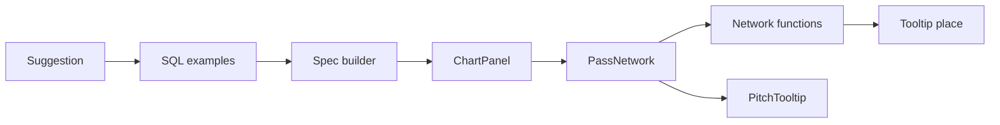
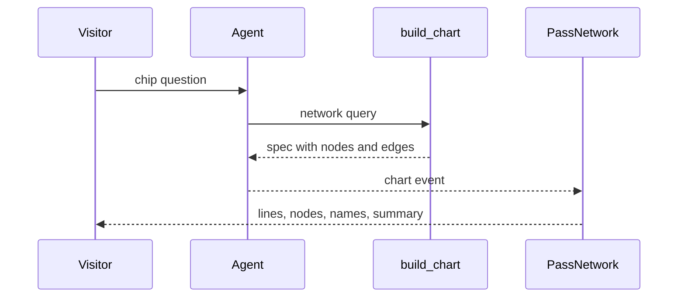

# 15 Stretch: pass network

| | |
| --- | --- |
| Work | Feature: the chart of who passed to whom in one 2003-04 match, and a suggestion chip that asks for it |
| Change | `f516655` on `main`, 2026-10-14 |
| Evidence | `blueprint/history/features/15-stretch-pass-network.md` (spec and completion record. Local, not in Git). The commit message. The build conversation, with the browser check. |
| Reader | A learner who can write basic code and is new to this stack |

This document obeys the rules of ASD-STE100 Simplified Technical
English. It is not a certified STE document.

## 1. Summary

This work draws a `pass_network` chart on the full pitch. Each Arsenal player is
a node at the mean start of their passes. A line joins two players, and its
width shows how many passes went between them. A new chip on the landing page
asks for the network of the 2003-04 home match against Liverpool.

The one idea to remember: the service already made the data. This work taught
the agent to ask for it, and it taught the page to draw it.

## 2. Why this work exists

Feature 6 made the `pass_network` spec in `charts.py`. Feature 11 made the page
check it. But the page showed only the title and a count, for example "2
players, 1 passing link". Also, the prompt of the agent had no example query
for passes. Thus the agent had no model for a network query.

The build plan calls this item a stretch, "the 2003-04 wow moment". Only
2003-04 has pass events, because StatsBomb records each pass and Understat does
not. A visitor who asks for a 2025-26 network still gets the honest
"unavailable" answer from the data catalog.

## 3. Design

The design has three layers: two SQL examples for the agent, pure functions in
`src/lib`, and one component that draws.

Two terms are new in this work.

- A **pass network** is a graph of one team in one match. A node is a player
  and an edge is the count of passes from one player to another. This work uses
  it to show the shape of a team, not single events.
- A **greedy placement** puts items one at a time in a fixed order, and never
  moves an item that it placed before. This work uses it for the names on the
  pitch, because the full search for the best layout is slow and not necessary.

| Part | Location | Job |
| --- | --- | --- |
| SQL examples | `services/analyst/src/analyst/prompt.py` | Show the agent one query for the chart rows and one query for the totals. |
| Suggestion | `services/analyst/src/analyst/api.py` | Adds the fourth chip question, which the service keeps after the first answer. |
| Spec builder | `services/analyst/src/analyst/charts.py` | Turns the grouped rows into nodes and edges (feature 6, not changed). |
| Network functions | `apps/web/src/lib/pass-network.ts` | Join edges into links, give sizes, place names, and write the labels and the summary. |
| Tooltip place | `apps/web/src/lib/pitch.ts` | `tooltipPlaceAt` puts a tooltip above or below a mark on any pitch view. |
| `PitchTooltip` | `apps/web/src/components/charts/pitch-tooltip.tsx` | Draws the tooltip box for the shot map and the pass network. |
| `PassNetwork` | `apps/web/src/components/charts/pass-network.tsx` | Draws the lines, the nodes, the names, the legend, and the summary. |
| `ChartPanel` | `apps/web/src/components/ask/chart-panel.tsx` | Selects the component for the type of the chart. |

## 4. Workflow

Example input: a click on the chip "Show Arsenal's pass network vs Liverpool at home."

1. The landing page shows the chip from `GET /api/suggestions`. (`api.py:503`)
2. The agent reads the pass examples in its system prompt. (`prompt.py:135`)
3. The agent calls `build_chart` with the network query. (`tools.py:314`)
4. `build_chart` runs the query through `run_sql`, with its guard and limit. (`tools.py:333`)
5. `charts.pass_network` makes 12 nodes and their edges. (`charts.py:190`)
6. The service sends the spec as a `chart` event. (`api.py:424`)
7. The page checks the spec with its Zod schema. (`ask-stream.ts:51`)
8. `ChartPanel` gives the spec to `PassNetwork`. (`chart-panel.tsx:28`)
9. `links` joins 101 one-way edges into 55 lines. (`pass-network.ts:24`)
10. `labelSides` places the 12 names. (`pass-network.ts:110`)
11. `summaryText` writes the chart summary. (`pass-network.ts:166`)
12. The service keeps the answer, because the question is a suggestion. (`api.py:443`)

In the live check, the answer had four claims and all four passed the verifier.
The claims were the score (4-2), 416 completed passes, and 12 passers. The
summary read "Most passes: Ashley Cole (58). Strongest link: Fredrik Ljungberg
and Lauren (27 passes)." A second click on the chip gave the kept answer in 0.0
seconds.

## 5. Decisions and tradeoffs

### 5.1 One line for each pair of players

- **Choice:** `links` joins the edge from A to B and the edge from B to A into one line. The label and the tooltip keep both counts. The schema does not check that an edge ends at a node, so `links` skips an edge that does not.
- **Alternatives:** Two directed lines with arrows, or two parallel lines.
- **Reason:** Recorded: at 390 px, a reader cannot tell apart two directed lines on top of each other. Source: spec, Notes for the AI.
- **Cost:** The chart does not show direction. A visitor must open the tooltip to see it.

### 5.2 The chart draws every link

- **Choice:** A link with few passes is a thin, faint line. The chart hides no link.
- **Alternatives:** A minimum count, for example three passes.
- **Reason:** Recorded: a minimum would hide data that the summary counts. Source: spec, Notes for the AI.
- **Cost:** The centre of the pitch has many faint lines.

### 5.3 Names go below, then above, then off

- **Choice:** `labelSides` puts each name below its node. If that box hits a placed name, it tries above. If both hit, the name stays off.
- **Alternatives:** A smaller font, or names only above a node size.
- **Reason:** Recorded: in the live check, the names of Henry, Pirès, and Edu were on top of each other. Source: build conversation and spec, Notes for the AI.
- **Cost:** A crowded player can have no name on the pitch. Its tooltip and its accessible name still give the full name.

### 5.4 The full pitch, with a width cap

- **Choice:** The chart uses the `full` view, held to 440 px wide.
- **Alternatives:** The `attacking-half` view, as the shot map uses.
- **Reason:** Recorded: the spec requires the whole pitch to fit in a 1440 x 900 window. Inferred: a pass network needs the defenders and the goalkeeper, who stand in the own half. Source: spec step 3, and the position of Lehmann in the live chart.
- **Cost:** On a wide screen the chart uses less than half of its panel.

### 5.5 Example queries name one real match

- **Choice:** Both examples find the 2003-04 home match against Liverpool through `v_matches`.
- **Alternatives:** A general example with a placeholder for the opponent.
- **Reason:** Recorded: every example must run on the views, and a test runs each one. Source: comment above `SQL_EXAMPLES`.
- **Cost:** For another match, the model must change the team names itself.

### 5.6 A separate test seed for the Liverpool match

- **Choice:** The fixture `liverpool_home` loads its own match. The helper `season` got an `opponent` parameter.
- **Alternatives:** Add a second match to the shared `seeded` fixture.
- **Reason:** Recorded: three tests in `test_tools.py` count every match or pass of the shared seed. Source: build conversation.
- **Cost:** The tests now have two seeds to keep in step.

### 5.7 The short name is the last word

- **Choice:** `shortName` takes the last word of the full name.
- **Alternatives:** A table of names for display, or the aliases from `aliases.yaml`.
- **Reason:** Recorded: the spec chose it as the simplest rule. Source: spec, Notes for the AI.
- **Cost:** Edu shows as "Gaspar" and Gilberto Silva shows as "Silva".

## 6. Blast radius

### 6.1 This work needs

| Dependency | Used for | If it fails |
| --- | --- | --- |
| `v_passes` and `v_matches` as `analyst_ro` | The rows of the network | `build_chart` returns error text, and the answer has no chart. |
| The model provider | The first answer to the chip | The page shows the error state. The chip has no kept answer. |
| The team names "Arsenal" and "Liverpool" in the data | The match lookup in the examples | The example finds no match. The model must find it another way. |
| `d3-scale` | The sizes of nodes and lines | The build fails. |

### 6.2 These things use this work

| Consumer | Uses | Found in |
| --- | --- | --- |
| The suggestions route | `SUGGESTIONS` | [`api.py:503`](../services/analyst/src/analyst/api.py#L503) |
| The kept answers | `SUGGESTIONS` | [`api.py:443`](../services/analyst/src/analyst/api.py#L443) |
| The landing page | `GET /api/suggestions` | [`ask-stream.ts:175`](../apps/web/src/lib/ask-stream.ts#L175) |
| The system prompt | `SQL_EXAMPLES` | [`prompt.py:135`](../services/analyst/src/analyst/prompt.py#L135) |
| The shot map | `tooltipPlaceAt`, `PitchTooltip` | `shot-map.ts`, `shot-map.tsx` |
| The answer panel | `PassNetwork` through `ChartPanel` | [`chart-panel.tsx:28`](../apps/web/src/components/ask/chart-panel.tsx#L28) |

### 6.3 If you change this work

| If you change | Then check |
| --- | --- |
| The text of the chip | The kept answer matches the exact text, and `test_api.py` asserts the list. |
| The number of SQL examples | `test_the_prompt_holds_the_sql_examples` allows 4 to 8. |
| `tooltipPlaceAt` | The shot map tests in `shot-map.test.ts`. |
| The `pass_network` spec | The Pydantic model in `charts.py` and the Zod schema in `analyst-schema.ts`. |

### 6.4 How to remove this work

Revert `f516655`. The page then shows the count line again, and the chip goes
away. No table, column, or variable changed, so no data stays behind. A kept
answer lives in the memory of the service, and it goes away when the process
stops.

## 7. Code reading path

1. [`prompt.py:44`](../services/analyst/src/analyst/prompt.py#L44) - Look for: the match lookup that both examples share.
2. [`charts.py:190`](../services/analyst/src/analyst/charts.py#L190) - Look for: the node position as a mean that the pass counts weight.
3. [`pass-network.ts:24`](../apps/web/src/lib/pass-network.ts#L24) - Look for: the pair key and the skipped edges.
4. [`pass-network.ts:110`](../apps/web/src/lib/pass-network.ts#L110) - Look for: the greedy placement of names.
5. [`pass-network.ts:166`](../apps/web/src/lib/pass-network.ts#L166) - Look for: a summary of counts only.
6. [`pitch.ts:60`](../apps/web/src/lib/pitch.ts#L60) - Look for: one tooltip rule for two pitch views.
7. [`pass-network.tsx:134`](../apps/web/src/components/charts/pass-network.tsx#L134) - Look for: the draw order of lines, nodes, names, and the focus ring.
8. [`test_prompt.py:83`](../services/analyst/tests/test_prompt.py#L83) - Look for: the proof that the chart and the claims count the same passes.

## 8. Known limits

- The network uses the full match. Thus a substitute and the player that he
  replaced both get a node, and their positions are a mean over different
  periods.
- In a dense group, a name can stay off the pitch (section 5.3).
- `labelSides` guesses the width of a name from its length. A wide font can
  make two names touch.
- Production does not show this work yet. The API image needs a new deploy, and
  `main` needs a push.
- The fingerprint of the project overview did not match the plans before this
  work. The overview still gives this item the number 16. Run `/overview` to
  refresh it.
- The debrief found no new defect.

## 9. Self-test

1. Why does the page join two directed edges into one line?
2. What happens to an edge whose target is not a node?
3. Why does the new test use its own seed and not the shared seed?
4. What happens if someone changes one word of the chip text?
5. Why can a player have no name on the pitch, and where does the visitor find it?

Answers

1. At 390 px, a reader cannot tell apart two lines on top of each other. The tooltip keeps both counts. See section 5.1.
2. `links` skips it, because the schema does not check that an edge ends at a node. See section 5.1.
3. Three tests in `test_tools.py` count every match or pass of the shared seed. See section 5.6.
4. The service keeps an answer only for an exact suggestion, and a test asserts the list. See section 6.3.
5. Its name box hits a placed name both below and above. The tooltip and the accessible name give the full name. See section 5.3.

