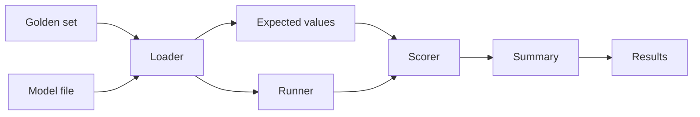
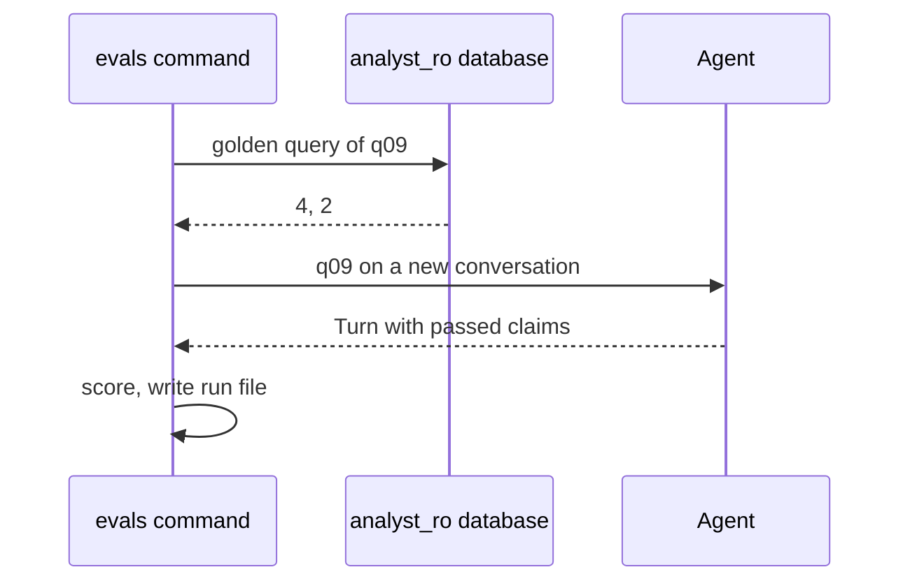

# 16 Evals + model comparison

| | |
| --- | --- |
| Work | Feature: a command that asks 15 fixed questions through the agent on each model, scores the answers, and writes a table |
| Change | `3b82bdf` on `main`, 2026-10-14 |
| Evidence | `blueprint/history/features/16-evals-model-comparison.md` (spec and completion record. Local, not in Git). The commit message. The build conversation, with the smoke runs and the full runs. |
| Revised | 2026-10-14, after the fix `17e6017`. That fix changed the result for q02 and the reason for the decision. See [Accept both readings of a golden question](2026-10-14-accept-both-readings-of-a-golden-question.md). |
| Reader | A learner who can write basic code and is new to this stack |

This document obeys the rules of ASD-STE100 Simplified Technical
English. It is not a certified STE document.

## 1. Summary

This work adds the command `evals`. The command asks 15 golden questions through
the real agent, on each model in `evals/models.yaml`, two times. It scores each
answer against values from hand-written SQL. Then it writes `evals/results.md`
with a table of correct answers, verified claims, charts, refusals, tool calls,
seconds, and cost.

The first full run compared `gemini-3.8-flash` with `gemini-3.5-flash-lite`.
Flash was correct on 15 of 15 in both runs, and Flash-Lite on 13.5. A later fix
found that one golden query held only one fair reading of q02. After that fix,
both models got 15 of 15. The current model stays, because Flash-Lite failed the
demo follow-up 2 times in 9.

The one idea to remember: an eval measures what the visitor sees. A correct
number counts only when the verifier lets it through.

## 2. Why this work exists

The MVP plan says "Model is config", and it asks for numbers to choose the model.
Before this work, the only proof of quality was the five demo questions, asked
by hand. Nobody could say how often a model gave a wrong number, or what one
answer cost.

Two terms are new in this work.

- An **eval** is a fixed set of inputs with known correct results, and a program
  that scores a system on them. This work uses it to compare two models on the
  same questions.
- A **golden set** is the list of those inputs and results. This work keeps it
  in `evals/golden.yaml`, because a person must review each question and each
  query.

## 3. Design

The design has one module with four layers: load the files, score one answer,
summarize a run, and run the agent.

| Part | Location | Job |
| --- | --- | --- |
| Golden set | `evals/golden.yaml` | Holds the 15 questions, each with its status, chart type, and SQL. |
| Model file | `evals/models.yaml` | Holds the model ids, their prices with source and date, and the decision. |
| Loader | `services/analyst/src/analyst/evals.py` | `load_golden` and `load_models` check both files with Pydantic models and the SQL guard. |
| Expected values | `services/analyst/src/analyst/evals.py` | `golden_expected` runs each golden query as `analyst_ro` and keeps the numbers of the first row. |
| Scorer | `services/analyst/src/analyst/evals.py` | `score` turns one agent turn into one `QuestionResult`. |
| Summary | `services/analyst/src/analyst/evals.py` | `summarize` and `render` make the metrics and the markdown. |
| Runner | `services/analyst/src/analyst/evals.py` | `main`, `run_model`, and `ask_item` ask the agent and write a run file after each question. |
| Results | `evals/runs/`, `evals/results.md` | Hold the raw results and the table. |

The runner does not have its own agent. It calls `agent.build_agent` and
`agent.ask`, the same functions as the API and the `ask` command. Thus the eval
measures the product, with its tool limits and its verifier.

## 4. Workflow

Example input: `uv run --env-file .env evals`, with item q09, "What was the score
of Arsenal's home match against Liverpool in 2003-04?"

1. `main` reads the arguments and loads both files. (`evals.py:634`)
2. `load_golden` checks each golden query with the SQL guard. (`evals.py:130`)
3. `golden_expected` runs the q09 query and keeps 4 and 2. (`evals.py:537`)
4. `run_model` loads the model with a 120 s timeout. (`evals.py:605`)
5. `ask_item` asks q09 on a new conversation and times it. (`evals.py:514`)
6. `agent.ask` runs the tools and the verifier, and returns a `Turn`. (`agent.py:261`)
7. `score` looks for 4 and 2 among the passed claims. (`evals.py:213`)
8. `run_model` writes the run file and prints one line. (`evals.py:605`)
9. `render` writes `evals/results.md` from all run files. (`evals.py:441`)

On Flash, q09 was correct in both runs. The full run asked 60 questions and cost
$0.77 with the smoke runs.

## 5. Decisions and tradeoffs

### 5.1 Only passed claims count

- **Choice:** `score` looks for each expected value in the claims of the answer. These are the claims that passed the verifier.
- **Alternatives:** Look in the summary text, or ask a second model to grade the answer.
- **Reason:** Recorded: "A correct number that the verifier removed does not count: the eval measures what the visitor sees." Source: spec, Notes for the AI.
- **Cost:** An answer with the right chart but no claim for the asked number fails. Also, the eval accepts only the values of the readings that the golden set names. The first run marked q02 of Flash-Lite wrong for this second reason.

### 5.2 Expected values come from hand-written SQL

- **Choice:** Each answered item has SQL that the user approved. The numbers of its first row are the expected values.
- **Alternatives:** Values typed into the file, or values from an agent answer.
- **Reason:** Recorded: the MVP plan says the expected values must come from SQL that the person wrote, not the agent. Source: MVP plan, workflow notes, and the spec.
- **Cost:** The values follow the local database. If the data changes, the expected values change with it.

### 5.3 The decision rule puts accuracy first

- **Choice:** More correct answers win. A gap of one question or less is a tie, and then the lower cost wins.
- **Alternatives:** A weighted score of accuracy, time, and cost.
- **Reason:** Recorded: the MVP plan picks "on accuracy, latency and cost", and the spec writes it as this rule. Source: spec, step 5.
- **Cost:** The rule ignores time and reliability. After the fix of q02, the two models tied, so the rule proposed Flash-Lite. The user kept Flash for the demo follow-up, and `models.yaml` records the reason.

### 5.4 A timeout on each model call

- **Choice:** `load_eval_model` loads each model with a 120 s timeout and one retry.
- **Alternatives:** The defaults of the provider library, with no limit.
- **Reason:** Recorded: the first smoke run on `gemini-3.1-pro-preview` waited more than 10 minutes on one question. A direct call gave `504 DEADLINE_EXCEEDED`. Source: build conversation.
- **Cost:** A slow model gets a failed question, not a slow answer. That is a fair result for a model that must serve visitors.

### 5.5 A run file after each question

- **Choice:** `run_model` writes the JSON file again after each question.
- **Alternatives:** One write at the end of a run.
- **Reason:** Recorded: "so a stopped run keeps what it did". Source: spec, step 3, and the comment in `run_model`.
- **Cost:** The command writes the same file 15 times in one run. The file is small.

### 5.6 The second model changed two times

- **Choice:** The comparison uses `gemini-3.5-flash-lite`.
- **Alternatives:** Claude Sonnet 5.5, then `gemini-3.1-pro-preview`.
- **Reason:** Recorded: the user had no paid Anthropic key. Then the Pro preview model failed its first model call after 118 s. Source: spec, Goal, and the build conversation.
- **Cost:** The table compares the current model with a cheaper model, not with a stronger one.

## 6. Blast radius

### 6.1 This work needs

| Dependency | Used for | If it fails |
| --- | --- | --- |
| Local database as `analyst_ro` | The expected values | `golden_expected` stops the command before any model call. |
| Google key in `.env` | The model calls | `load_agent` stops the command with the error class. |
| The provider | Each answer | A failed call becomes a wrong result with its error, and the run continues. |
| `pyyaml` | To read both files | The command does not start. |

### 6.2 These things use this work

| Consumer | Uses | Found in |
| --- | --- | --- |
| The `evals` script | `analyst.evals:main` | [`pyproject.toml:23`](../services/analyst/pyproject.toml#L23) |
| The production image | `evals.py` and `pyyaml`, installed but not used | [`Dockerfile:24`](../Dockerfile#L24) |

No other module imports `analyst.evals`.

### 6.3 If you change this work

| If you change | Then check |
| --- | --- |
| The agent, the prompt, or the model | Run `evals` again. The table is the regression test. |
| The verifier tolerance | `score` uses `cell_matches`, so the eval follows it. |
| The data in the database | The expected values change. Review `golden.yaml` with the new values. |
| `golden.yaml` | `test_the_golden_set_has_15_items_with_sql_on_each_answered_item`. |

### 6.4 How to remove this work

Revert `3b82bdf`. This removes the module, the tests, the `evals` folder, and the
`pyyaml` line. The production model does not change, because the decision kept
the current model.

## 7. Code reading path

1. [`evals/golden.yaml`](../evals/golden.yaml) - Look for: q04, the follow-up with `before`.
2. [`evals.py:43`](../services/analyst/src/analyst/evals.py#L43) - Look for: the rule that only an answered item has SQL.
3. [`evals.py:160`](../services/analyst/src/analyst/evals.py#L160) - Look for: a boolean is not a number.
4. [`evals.py:213`](../services/analyst/src/analyst/evals.py#L213) - Look for: how a passed claim matches an expected value.
5. [`evals.py:270`](../services/analyst/src/analyst/evals.py#L270) - Look for: the metrics of one run.
6. [`evals.py:331`](../services/analyst/src/analyst/evals.py#L331) - Look for: the tie of one question.
7. [`evals.py:514`](../services/analyst/src/analyst/evals.py#L514) - Look for: time only for the scored question, cost for all questions.
8. [`evals.py:581`](../services/analyst/src/analyst/evals.py#L581) - Look for: the timeout of a model call.
9. [`evals/results.md`](../evals/results.md) - Look for: the Decision section, where the choice is not the model that the rule proposes.

## 8. Known limits

- 15 questions and 2 runs are a small sample. A gap of one question can come
  from chance.
- The check reads only numbers. A claim of the right number with the wrong
  meaning passes.
- q11 checks the goals of the top scorer, not the name.
- The cost counts all input tokens at the full price. Cached input costs less,
  so the true cost can be lower.
- `gemini-3.1-pro-preview` was not measured. A later run can add it to
  `models.yaml` when Google serves it again.
- The Flash price in `models.yaml` holds until 2026-12-31. From 2027-01-01 it is
  two times higher.
- The first version of this debrief found no new defect. Then the fix
  `17e6017` found one: the golden query of q02 held only one of two fair
  readings, so a correct answer failed.

## 9. Self-test

1. Why does a correct number that the verifier removed not count?
2. What happens when the golden query of an item fails?
3. Why did the evals keep `gemini-3.8-flash` when Flash-Lite is faster and cheaper?
4. What happens if a model call takes three minutes?
5. If the database gets new data, why must someone review `golden.yaml`?

Answers

1. The eval measures what the visitor sees, and the verifier removes that claim before the visitor sees it. See section 5.1.
2. `golden_expected` stops the command before any model call. See section 6.1.
3. After the fix of q02, the rule proposed Flash-Lite, but Flash-Lite failed the demo follow-up 2 times in 9. See section 5.3.
4. The call stops at 120 s, then one retry. If it fails, the question is a wrong result with its error. See section 5.4.
5. The expected values come from the SQL at run time, so they change with the data. See section 5.2 and section 6.3.

