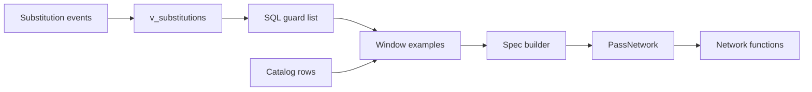
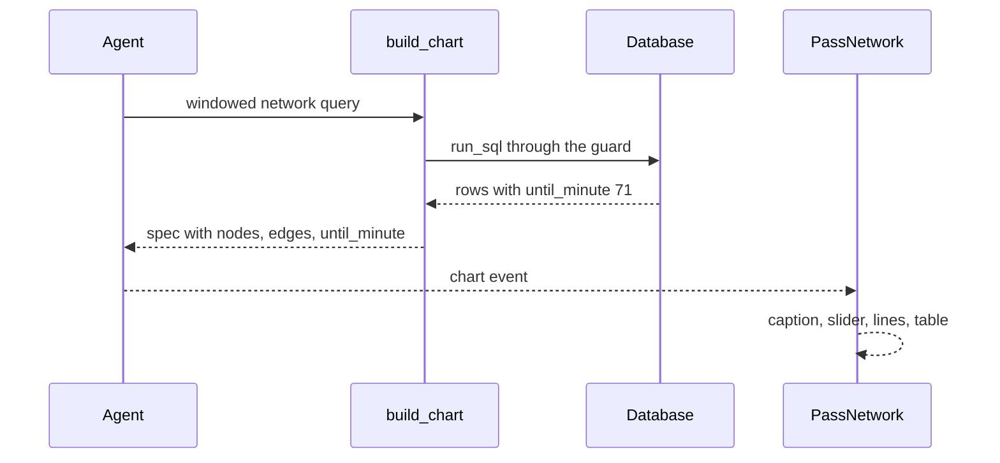

# 17 Pass network polish

| | |
| --- | --- |
| Work | Feature: the 2003-04 pass network shows the starting XI by default, with a minimum-passes control and a data table |
| Change | `baab1d0` on `main` (squash of `f2afa16`, base `fe290f2`), 2026-10-22 |
| Evidence | `blueprint/history/features/17-pass-network-polish.md` (spec, completion record, and the passed independent review. Local, not in Git). The findings ledger, F-25 to F-27. The commit message. The build conversation, with the live browser check. |
| Reader | A learner who can write basic code and is new to this stack |

This document obeys the rules of ASD-STE100 Simplified Technical
English. It is not a certified STE document.

## 1. Summary

This work changes which passes the pass network draws. By default, the chart
now shows only the passes before Arsenal's first substitution. A caption under
the title gives that minute, for example "Passes before the first substitution,
71'". A slider hides the links with few passes, and a table under the chart
lists the links that the chart draws.

The one idea to remember: the cut-off minute is data. It comes from a SQL
column, so a verified tool output backs the caption, as it backs every other
number.

## 2. Why this work exists

Feature 15 drew a network of the full match. Each node is a player at the mean
start of their passes. A substitute plays only part of the match, so their few
passes pull the average shape of the team out of true. Analysts usually draw a
network of the starting XI for this reason. Recorded: spec, Goal.

The build plan names three parts for item 17: the starting XI window, a minimum
for passes, and a data table. The data table also gives an accessible view of
the chart, as the other charts have.

The database had no substitutions before this work. The StatsBomb loader kept
only passes, carries, and pressures. Thus the agent could not find the minute
of the first substitution, and the window needed new data first.

## 3. Design

The design adds one kind of event, one view, one optional field in the chart
spec, and three controls on the page.

Two terms are new in this work.

- A **starting XI window** is the part of a match before the first change to
  the team. This work uses it to keep the network to the eleven players who
  started.
- A **scalar subquery** is a `SELECT` inside another query that gives one value.
  This work uses one to put the minute of the first substitution on every row.

| Part | Location | Job |
| --- | --- | --- |
| Substitution events | `ingest/src/ingest/statsbomb.py` | Stores each StatsBomb substitution as an event: the player off, the player on, and the reason. |
| `v_substitutions` | `db/migrations/0005_substitutions.sql` | Gives the agent one flat row for each substitution, readable by `analyst_ro`. |
| Catalog rows | `ingest/src/ingest/curated.py` | Tell the agent that 2003-04 has substitutions and 2025-26 does not. |
| SQL guard list | `services/analyst/src/analyst/sql_guard.py` | Lets the agent read the new view. The same list feeds `get_schema`. |
| Window examples | `services/analyst/src/analyst/prompt.py` | Show the agent the windowed query, and one rule makes the window the default. |
| Spec builder | `services/analyst/src/analyst/charts.py` | Reads the optional `until_minute` column into the `pass_network` spec. |
| Network functions | `apps/web/src/lib/pass-network.ts` | Give the default minimum, the drawn links, the caption text, and the summary. |
| `PassNetwork` | `apps/web/src/components/charts/pass-network.tsx` | Draws the caption, the slider, the lines, and the table. |

## 4. Workflow

Example input: the question "Show Arsenal's pass network vs Liverpool at home."

1. The agent reads the window rule in its system prompt. (`prompt.py:34`)
2. The agent copies the windowed network example. (`prompt.py:104`)
3. The agent calls `build_chart` with that query. (`tools.py:314`)
4. `build_chart` sends the query through `run_sql` and its guard. (`tools.py:334`)
5. The guard accepts `v_substitutions`, because the view is on its list. (`sql_guard.py:21`)
6. The view gives 71, the minute when Pirès went off. (`0005_substitutions.sql:2`)
7. `pass_network` checks that every row has the same minute. (`charts.py:208`)
8. The spec leaves the service with `until_minute` 71. (`charts.py:231`)
9. The page accepts the field in its Zod schema. (`analyst-schema.ts:49`)
10. `PassNetwork` sets the minimum to 3 from `defaultMinPasses`. (`pass-network.tsx:247`)
11. `visibleLinks` keeps 39 of the 48 links. (`pass-network.tsx:264`)
12. `windowText` writes the caption with the minute 71. (`pass-network.tsx:289`)
13. `LinkTable` lists the same 39 links as rows. (`pass-network.tsx:364`)

In the live check, the agent answered in 47 seconds with four claims, and all
four passed the verifier. The network had 11 players and 341 completed passes.
At the minimums 8, 26, and 1, the chart drew 14, 1, and 48 lines. The table had
the same count of rows each time.

## 5. Decisions and tradeoffs

### 5.1 Substitutions become events

- **Choice:** The loader stores each StatsBomb substitution in `events` with the type `substitution`. The player on goes in the `recipient` column.
- **Alternatives:** A "started" flag on `player_match_stats`, or a guess from the minutes of each player.
- **Reason:** Recorded: the minutes of a player cannot show which change came first, because the player off and the player on both have part minutes. Source: the build conversation. Inferred: the `events` table already had a player and a recipient column, so no new table was necessary.
- **Cost:** The data changed, so production needs migration 0005 and a reload of StatsBomb and the catalog.

### 5.2 The cut-off minute comes from the rows

- **Choice:** The query returns `until_minute` as a column, and `pass_network` reads it. The `build_chart` signature did not change.
- **Alternatives:** A new `until_minute` argument for `build_chart`, which the model fills in.
- **Reason:** Recorded: "Derived numbers from SQL". A minute that the model types has no tool output behind it. Source: spec, Notes for the AI.
- **Cost:** If the model writes a windowed query without the column, the caption says "Whole match". Source: review receipt, Remaining risk.

### 5.3 The window compares one clock

- **Choice:** A pass counts when `minute * 60 + second` is below that of the first substitution. `COALESCE` keeps every pass when Arsenal made no change.
- **Alternatives:** Store the StatsBomb period and compare `(period, minute, second)`.
- **Reason:** Recorded: the spec assumed that passes and substitutions share one clock. Source: spec, Data / contracts.
- **Cost:** The assumption is false at half time. Both halves start at minute 45, so a half-time change drops first-half stoppage passes. See F-25 in section 8.

### 5.4 The minimum is a view choice

- **Choice:** The slider lives on the page only, from 1 to the largest link. It starts at 3, or lower when no link has 3 passes.
- **Alternatives:** A minimum in the spec, or no minimum, as in feature 15.
- **Reason:** Recorded: the minimum is a choice about the view, like the outcome filter of the shot map. The claims stay about all passes in the window. Source: spec, Notes for the AI.
- **Cost:** Feature 15 drew every link on purpose. Now the summary says "39 of 48 links shown", so it still counts all links. On the real match, 3 hides only 9 links.

### 5.5 The table reuses the drawn links

- **Choice:** `LinkTable` renders the output of `visibleLinks`, in the order of `links`.
- **Alternatives:** A separate `tableRows` function with its own sort, as the spec named it.
- **Reason:** Recorded: `links` already sorts by passes and then by name, so a second sort was a copy. The table also cannot differ from the lines. Source: the build conversation and F-27.
- **Cost:** The spec text names a function that does not exist.

### 5.6 Players keep every link

- **Choice:** Node sizes, tooltips, and keyboard labels use all links. Only the lines follow the slider.
- **Alternatives:** Apply the minimum to the tooltips too.
- **Reason:** Recorded: the tooltips describe the player, not the filter. Source: spec, build step 4.
- **Cost:** A tooltip can name a partner whose line the slider hides.

## 6. Blast radius

### 6.1 This work needs

| Dependency | Used for | If it fails |
| --- | --- | --- |
| Migration `0005` | The view `v_substitutions` | The windowed query fails with "relation does not exist", and the agent cannot draw the network. |
| Substitution rows in `events` | The cut-off minute | The view is empty, `COALESCE` keeps every pass, and the caption says "Whole match". |
| The SQL guard list | Agent access to the view | The guard rejects the query and the agent gets error text. |
| The cached StatsBomb files | The reload | The loader downloads the files again. |

### 6.2 These things use this work

| Consumer | Uses | Found in |
| --- | --- | --- |
| The agent prompt | The window rule and two examples | `services/analyst/src/analyst/prompt.py:34` |
| `get_schema` and the MCP server | The view list and its comments | `services/analyst/src/analyst/tools.py:196` |
| `ChartPanel` | The `PassNetwork` component | `apps/web/src/components/ask/chart-panel.tsx:28` |
| Golden question q10 | The pass count of the Liverpool match | `evals/golden.yaml:114` |

### 6.3 If you change this work

| If you change | Then check |
| --- | --- |
| The columns of `v_substitutions` | The prompt examples and the view comments that `get_schema` sends. |
| The range of `until_minute` | The Pydantic type in `charts.py` and the Zod schema. Both must agree. |
| `DEFAULT_MIN_PASSES` | The tests of `defaultMinPasses` and the default view on a phone. |
| `EVENT_TYPES` | The loader tests and the four kinds that `events` holds. |

### 6.4 How to remove this work

1. Revert `baab1d0`.
2. Add a new migration that drops `v_substitutions`. The migration log keeps `0005` as applied.
3. Delete the rows of `events` with the type `substitution`.
4. Run the catalog load again to remove the two `substitutions` rows.

## 7. Code reading path

1. [`ingest/src/ingest/statsbomb.py:232`](../ingest/src/ingest/statsbomb.py#L232) - Look for: how the player on becomes the recipient.
2. [`db/migrations/0005_substitutions.sql:2`](../db/migrations/0005_substitutions.sql#L2) - Look for: a view built in the same way as `v_passes`, and its grant.
3. [`services/analyst/src/analyst/sql_guard.py:21`](../services/analyst/src/analyst/sql_guard.py#L21) - Look for: one list for the guard and for `get_schema`.
4. [`services/analyst/src/analyst/prompt.py:49`](../services/analyst/src/analyst/prompt.py#L49) - Look for: the scalar subqueries and the `COALESCE` fallback.
5. [`services/analyst/src/analyst/charts.py:208`](../services/analyst/src/analyst/charts.py#L208) - Look for: the rule that one network stops at one minute.
6. [`apps/web/src/lib/pass-network.ts:47`](../apps/web/src/lib/pass-network.ts#L47) - Look for: the default minimum and the drawn links.
7. [`apps/web/src/components/charts/pass-network.tsx:247`](../apps/web/src/components/charts/pass-network.tsx#L247) - Look for: which parts use all links and which use the drawn links.
8. [`apps/web/src/components/charts/pass-network.tsx:140`](../apps/web/src/components/charts/pass-network.tsx#L140) - Look for: the table, and its place before the figure caption.

## 8. Known limits

- F-25 (P2): a half-time substitution drops first-half stoppage passes. This occurs in 1 of 38 matches, Arsenal v Middlesbrough, where the network loses 8 passes. A fix that stores the period follows next.
- F-26 (P3): no test checks the `player_on` and `reason` columns of the view.
- F-27 (P3): the spec names `tableRows`, which does not exist.
- Defect seen during this debrief: golden question q10 expects the pass count of the full match. The agent now gives the starting XI count, 341. Thus the next eval run can mark q10 as wrong.
- A sending-off does not end the window. The data keeps cards in the lineups, not as events.
- The default minimum of 3 hides only 9 of 48 links on the Liverpool match.
- Production does not have this work yet. It needs migration 0005, a reload on Neon, a new API image, and a push.

## 9. Self-test

1. Why does the cut-off minute come from a SQL column and not from a `build_chart` argument?
2. What happens if Neon has migration 0005 but the StatsBomb data was not loaded again?
3. Why does a half-time substitution drop passes from the first half?
4. What happens if two rows of a network query have different values for `until_minute`?
5. Why can the data table never list a link that the chart does not draw?

Answers

1. The model cannot type a number that no tool output backs. A column puts the minute in the verified rows. See section 5.2.
2. The view is empty, so `COALESCE` keeps every pass. The chart shows the full match with the caption "Whole match". See section 6.1.
3. Both halves start their clock at minute 45, and the views keep no period. Thus a stoppage pass at 45:30 compares as later than a change at 45:00. See section 5.3.
4. `pass_network` rejects the rows with an error that names the row, and the agent can correct the query. See section 4, step 7.
5. `LinkTable` renders the same list that draws the lines, the output of `visibleLinks`. See section 5.5.

