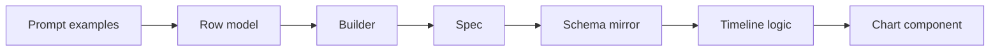
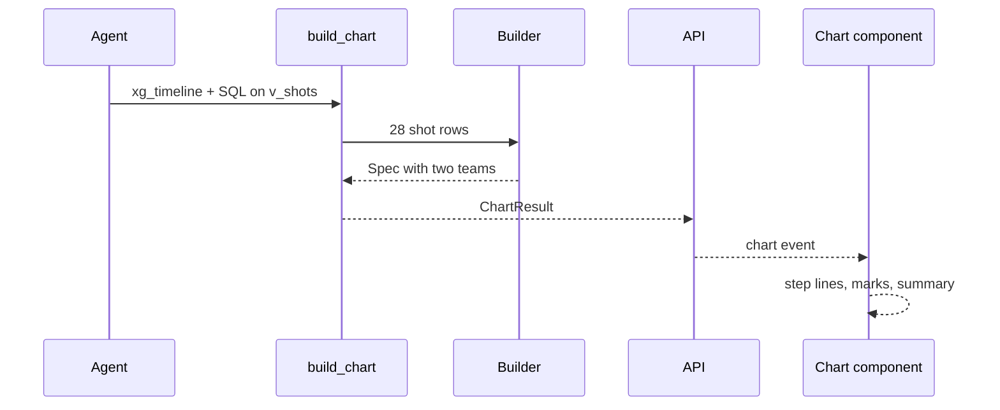

# 18 xG timeline

| | |
| --- | --- |
| Work | Feature: a chart of the cumulative xG of both teams in one match, by minute, with a mark at each shot and goal |
| Change | `cb5829e` on `main` (squash of `3483144`, base `2c77358`), 2026-10-22 |
| Evidence | `blueprint/history/features/18-xg-timeline.md` (spec with five steps and the completion record. Local, not in Git). The commit message. The build conversation, with the live browser check. |
| Reader | A learner who can write basic code and is new to this stack |

This document obeys the rules of ASD-STE100 Simplified Technical
English. It is not a certified STE document.

## 1. Summary

This work adds a fourth chart type, `xg_timeline`. For one match, the chart
draws two step lines. Each line is the cumulative xG of one team, minute by
minute. Each shot has a small mark on its line, and each goal has a larger,
filled mark. The chart works for both seasons, because `v_shots` holds the
shots of both teams in each Arsenal match.

The one idea to remember: the service adds up the xG, and the browser only
draws it. Thus the end total of each line is the same number that the answer
claims and that the verifier checks.

## 2. Why this work exists

The shot map shows where the shots of one player came from. It does not show
when the chances came, or how the match changed. An xG timeline answers
"who had the better chances, and when". Expected goals (xG) is the chance that
a shot becomes a goal, from 0 to 1. A sum of xG over a match shows how many
goals a team "deserved".

Item 18 of the build plan asks for this chart: "cumulative xG step lines for
both teams by minute, goals marked, from `v_shots`, both seasons". The project
plan names `xg_timeline` as one of the two chart types of v1.1. Recorded:
build plan, item 18, and the Contracts of the project overview.

Before this work, a question about the flow of a match got numbers only. The
agent could give the xG totals, but no chart could show them.

## 3. Design

The design follows the other three charts: a builder in the service turns SQL
rows into a spec, and the web page draws the spec. A spec is a JSON object that
holds the chart and its data. It does not say how the chart looks.

| Part | Location | Job |
|---|---|---|
| Row model | `services/analyst/src/analyst/charts.py` (`TimelineRow`) | Checks the type and range of each column of one shot row |
| Builder | `services/analyst/src/analyst/charts.py` (`xg_timeline`) | Checks that the rows are one Arsenal match, then calculates the cumulative xG of each team |
| Spec | `services/analyst/src/analyst/charts.py` (`XgTimeline`) | Holds two teams, Arsenal first, each with its total and its shots in minute order |
| Prompt examples | `services/analyst/src/analyst/prompt.py` | Shows the agent the query for the chart rows and the query for the claims |
| Schema mirror | `apps/web/src/lib/analyst-schema.ts` | Checks the spec in the browser before the page uses it |
| Timeline logic | `apps/web/src/lib/xg-timeline.ts` | Turns the spec into step corners, scales, mark order, labels, and the summary |
| Chart component | `apps/web/src/components/charts/xg-timeline.tsx` | Draws the SVG, the HTML labels, the legend, and the tooltip, and moves the focus |

Two new terms appear in the web part. A step line stays flat between events
and goes straight up at each event. This chart uses it because xG changes only
at a shot. A scale is a function from data values to units of the SVG. The work
uses `scaleLinear` from the installed `d3-scale` package, as the pitch already
does.

## 4. Workflow

Example input: "Show the xG timeline of Arsenal v Liverpool at home in
2003-04". This question ran in the live check. It took 3 tool calls and
24.5 s.

1. The agent calls `build_chart` with `xg_timeline` and a query on `v_shots`. ([`tools.py:314`](../services/analyst/src/analyst/tools.py#L314))
2. `build_chart` runs the query through `run_sql`, with its guard and row limit. ([`tools.py:336`](../services/analyst/src/analyst/tools.py#L336))
3. `build` sends the rows to the builder for the chart type. ([`charts.py:360`](../services/analyst/src/analyst/charts.py#L360))
4. The builder checks each of the 28 rows with `TimelineRow`. ([`charts.py:281`](../services/analyst/src/analyst/charts.py#L281))
5. The builder rejects rows from two matches or two team pairs. ([`charts.py:290`](../services/analyst/src/analyst/charts.py#L290))
6. The builder sorts the shots by minute. ([`charts.py:308`](../services/analyst/src/analyst/charts.py#L308))
7. For each team, it adds each xG and rounds each total. ([`charts.py:317`](../services/analyst/src/analyst/charts.py#L317))
8. The API sends the spec to the browser as a `chart` event. ([`api.py:424`](../services/analyst/src/analyst/api.py#L424))
9. The browser checks the spec against the schema mirror. ([`ask-stream.ts:51`](../apps/web/src/lib/ask-stream.ts#L51))
10. `ChartPanel` gives the spec to `XgTimeline`. ([`chart-panel.tsx:31`](../apps/web/src/components/ask/chart-panel.tsx#L31))
11. The component draws each line from `stepPoints` and `linePath`. ([`xg-timeline.tsx:177`](../apps/web/src/components/charts/xg-timeline.tsx#L177))
12. The caption shows the totals: Arsenal 2.01, Liverpool 1.94. ([`xg-timeline.tsx:259`](../apps/web/src/components/charts/xg-timeline.tsx#L259))

In the same turn, the agent also runs the totals query from the prompt. The
claims cite that query, and the verifier passed all 6 of them. The claimed
totals, 2.01 and 1.94, are equal to the end totals of the chart.

## 5. Decisions and tradeoffs

### 5.1 The service adds up the xG

- **Choice:** The builder calculates the cumulative xG of each shot and each team total. The browser draws and writes these numbers as they are.
- **Alternatives:** Send only the shots, and let the browser add them up.
- **Reason:** Recorded: the spec says "The web draws and writes these numbers as given, and it computes no new xG value". The comment in `compare-bars.ts` states the same rule for all charts. Source: spec, Data / contracts.
- **Cost:** The spec is larger, because each shot carries its total. A float sum in Python and a sum in Postgres can differ in the last digit. Thus the check uses the 0.01 tolerance of the verifier.

### 5.2 Arsenal is always the first team

- **Choice:** `teams[0]` is Arsenal, drawn solid in the brand colour. The builder rejects rows with no Arsenal team.
- **Alternatives:** Put the home team first, or keep the order of the rows.
- **Reason:** Recorded: each match in the database is an Arsenal match, so this gives one colour and one order with no home column. Source: spec, Notes for the AI.
- **Cost:** The chart cannot show a match without Arsenal. Feature 19 adds league matches, but it adds no shots, so this limit holds for now.

### 5.3 Each row names both teams

- **Choice:** The rows must have `team` and `opponent`. The builder takes the two team names from that pair.
- **Alternatives:** Find the teams from the shots only.
- **Reason:** Recorded: with names from the shots only, a team with no shot does not get a line. Source: spec critique in the build conversation, and spec step 1.
- **Cost:** The builder cannot see a query that keeps only Arsenal's shots. Then the opponent gets a flat line at 0, which is not true.

### 5.4 One `match_id` for all rows

- **Choice:** Each row must have the same `match_id`.
- **Alternatives:** Check only the team pair.
- **Reason:** Recorded: the home and away matches against one opponent have the same team pair. Without the id, two matches can merge into one chart. Source: spec critique, and spec step 1.
- **Cost:** The agent must select one more column.

### 5.5 Round after the sum

- **Choice:** The builder adds the unrounded values, and rounds only the values in the spec.
- **Alternatives:** Round each total and add the rounded values.
- **Reason:** Recorded: if the builder rounds the sum at each shot, small shots disappear. Three shots of 0.004 give 0, not 0.01. Source: code comment at `charts.py:316`, and the test `test_an_xg_timeline_adds_up_before_it_rounds`.
- **Cost:** None seen.

### 5.6 Shots in one minute keep the row order

- **Choice:** A stable sort by minute keeps the order of the rows for ties. The fix for a flaky test changed only the test query, to `ORDER BY minute, xg`.
- **Alternatives:** Also order the product query and the builder by `minute, xg`.
- **Reason:** Recorded: the user chose the test-only fix. A tie moves marks only inside one minute, and the end totals do not change. Source: spec step 5, and the build conversation.
- **Cost:** In real data, two shots in one minute can show in either order on different runs. `v_shots` has no second column to fix this.

### 5.7 The axis labels are HTML

- **Choice:** The tick labels are HTML text, placed by percent over and under the SVG.
- **Alternatives:** Put the labels as `<text>` in the SVG.
- **Reason:** Recorded: the SVG scales to the width of the panel. At 390 px, SVG text becomes about 6 px high. Source: build conversation, step 4.
- **Cost:** The component must keep the HTML positions and the SVG scale in step. `percentX` and `percentY` do this.

## 6. Blast radius

### 6.1 This work needs

| Dependency | Used for | If it fails |
|---|---|---|
| `v_shots` | The shots of both teams, with `match_id`, `team`, `opponent`, `minute`, `xg`, `is_goal` | `build_chart` returns the database error as text, and the agent can try again |
| `run_sql` guard and row limit | Safe SQL for the chart rows | A query over the limit gets an error, not a chart with part of the shots |
| The agent's prompt | The query shape and the totals query | If the agent filters to one team, the other line is flat at 0 |
| `d3-scale` | The minute and xG scales | The web build stops |
| `PitchTooltip` and `nextIndex` | The tooltip and the arrow keys | The chart loses its tooltip or its keyboard moves |

### 6.2 These things use this work

| Consumer | Uses | Found in |
|---|---|---|
| `build_chart` | The `xg_timeline` builder through `build` | [`tools.py:346`](../services/analyst/src/analyst/tools.py#L346) |
| MCP server | The `chart_type` enum of `build_chart` | [`mcp_server.py:19`](../services/analyst/src/analyst/mcp_server.py#L19) |
| Agent | Only `id`, `type`, `title` of the spec, for the model | [`agent.py:103`](../services/analyst/src/analyst/agent.py#L103) |
| API | The `chart` event | [`api.py:424`](../services/analyst/src/analyst/api.py#L424) |
| Browser stream | The schema mirror | [`ask-stream.ts:51`](../apps/web/src/lib/ask-stream.ts#L51) |
| `ChartPanel` | The `XgTimeline` component | [`chart-panel.tsx:31`](../apps/web/src/components/ask/chart-panel.tsx#L31) |
| `ask` CLI | The shot count of a timeline | [`cli.py:35`](../services/analyst/src/analyst/cli.py#L35) |
| Evals | `ChartType` for the expected chart of a golden question | [`evals.py:49`](../services/analyst/src/analyst/evals.py#L49) |

### 6.3 If you change this work

| If you change | Then check |
|---|---|
| The fields of `XgTimeline` | The Zod mirror, `test-fixtures.ts`, and `xg-timeline.ts`. A spec that fails the mirror shows the fallback card. |
| `ChartType` | The enum test in `test_mcp_server.py` and the unknown-type message tests |
| The `ARSENAL` rule | The order and the colours of the web chart, which assume Arsenal first |
| The prompt examples | `test_the_prompt_holds_the_sql_examples`, which allows 10 examples at most |
| Where the builder rounds | The equality of the chart totals and the claimed totals |

### 6.4 How to remove this work

Revert `cb5829e`. The work added no table, no migration, and no configuration value, so no
data stays behind. Then deploy the web app and a new API image, because the
prompt changes back. No golden question names `xg_timeline` yet.

## 7. Code reading path

1. [`charts.py:107`](../services/analyst/src/analyst/charts.py#L107) - Look for: the row model and the three spec models.
2. [`charts.py:277`](../services/analyst/src/analyst/charts.py#L277) - Look for: the checks before the sum, and the sum before it rounds the values.
3. [`prompt.py:124`](../services/analyst/src/analyst/prompt.py#L124) - Look for: the chart query and the totals query on the same match.
4. [`analyst-schema.ts:55`](../apps/web/src/lib/analyst-schema.ts#L55) - Look for: the same contract in Zod.
5. [`xg-timeline.ts:51`](../apps/web/src/lib/xg-timeline.ts#L51) - Look for: the step corners from the totals in the spec.
6. [`xg-timeline.ts:88`](../apps/web/src/lib/xg-timeline.ts#L88) - Look for: the keyboard order across the two teams.
7. [`xg-timeline.tsx:97`](../apps/web/src/components/charts/xg-timeline.tsx#L97) - Look for: one tab stop, the marks, and the HTML labels.

## 8. Known limits

- The `shots` table has no period. A shot in first-half stoppage time can show after an early second-half shot. The spec puts this out of scope.
- Own goals are not shots in either source. Thus they have no mark, and the chart does not show the score. The summary says this.
- Two shots in one minute can show in either order (decision 5.6).
- A query that keeps the shots of one team gives a false flat line for the other team (decision 5.3).
- At 390 px, the chart is about 160 px high. Early shots near 0 xG come close together, and the legend wraps unevenly. The live check saw this.
- Production does not show timelines yet. It needs a new API image with the new prompt and chart type, and a web deploy.
- No new finding. The open findings in the ledger are from earlier features.
- The debrief found no new defect.

## 9. Self-test

1. Why does each shot in the spec carry `total`, when the browser can add the values itself?
2. What happens if the agent selects only the shots where `team = 'Arsenal'`?
3. Why must each row carry `match_id`, when the team pair already names the match?
4. What happens to three shots of 0.004 xG if the builder rounds after each shot?
5. Why are the axis labels HTML and not SVG text?

Answers

1. The verifier checks the totals of the service. If the browser makes its own sum, the chart can differ from the claim. See section 5.1.
2. The opponent gets a flat line at 0, and the builder cannot see the problem. See section 5.3.
3. The home and away matches against one opponent have the same pair, and they can merge. See section 5.4.
4. Each total rounds to 0, so the team ends at 0 and not 0.01. See section 5.5.
5. The SVG scales down on a phone, and its text becomes too small to read. See section 5.7.

