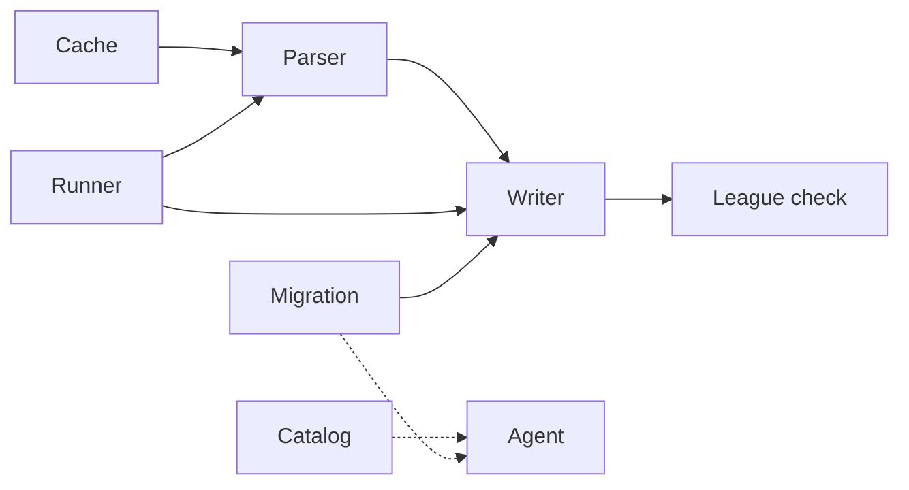
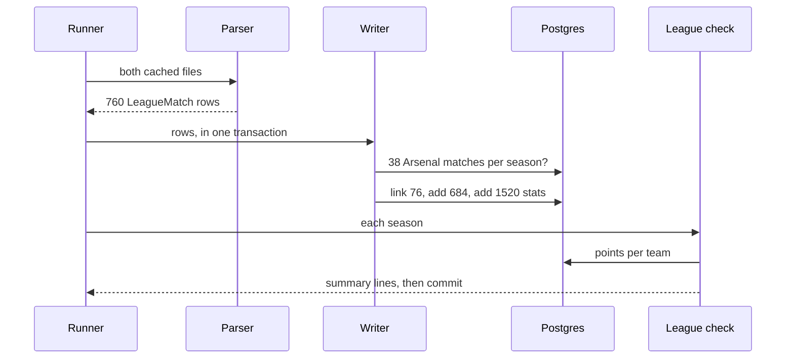

# 19 Ingest football-data.co.uk

| | |
| --- | --- |
| Work | Feature: every Premier League match of both seasons, with team match stats, a league table, and links to Arsenal's stored matches |
| Change | `12867ea` on `main` (squash of `3d7faea`, base `06b7328`), 2026-10-23 |
| Evidence | `blueprint/history/features/19-ingest-football-data-co-uk.md` (spec, step 1 evidence, completion record, and the passed independent review. Local, not in Git). The findings ledger, F-28 and F-29. The commit message. The build conversation. |
| Reader | A learner who can write basic code and is new to this stack |

This document obeys the rules of ASD-STE100 Simplified Technical
English. It is not a certified STE document.

## 1. Summary

This work gives the agent the whole league, not only Arsenal. A new loader reads
one results file per season from football-data.co.uk. Each file holds all 380
matches, with the half-time score, the referee, and the shots, corners, fouls,
and cards of each team. Two new views, `v_league_matches` and `v_league_table`,
let the agent answer questions such as "Which team finished second in 2003-04?".

The one idea to remember: Arsenal's 76 matches already existed, so the loader
links to them and never adds them again. Each linked score must equal the
stored score, or the load stops.

## 2. Why this work exists

Before this work, the database held only Arsenal's matches. StatsBomb gave the
2003-04 season and Understat gave 2025-26, and both loaders kept only Arsenal's
38 matches. The agent could not say who finished second, or how many fouls
Chelsea made in a season.

Item 19 of the build plan asks for "all 380 league matches of both seasons, plus
team match stats". It also asks for a team-name map and two league views.
Feature 20, the points-pace chart, needs this league data. Recorded: build plan, items 19 and 20.

The plan also asks to "check the CSVs and the site's terms before building on
them". Step 1 of the spec did this before any code. The site's `notes.txt` has
no terms of use and no licence. It only credits its sources. The project owner
read that finding and approved the build. Recorded: spec, step 1 evidence.

## 3. Design

The design follows the two season loaders: fetch and parse with no database,
then write and check in one transaction.

| Part | Location | Job |
|---|---|---|
| Migration | `db/migrations/0007_league_matches.sql` | Adds the half-time and referee columns, the `team_match_stats` table, and the two views, and filters `v_matches` to Arsenal |
| Cache | `ingest/src/ingest/command.py` (`cached_text`) | Returns a cached file, or downloads it once and saves it through a rename |
| Parser | `ingest/src/ingest/footballdata.py` (`parse_season`) | Turns one CSV file into 380 `LeagueMatch` rows with canonical team names |
| Writer | `ingest/src/ingest/footballdata.py` (`load_matches`) | Links Arsenal's matches, adds the others, and writes the team stats |
| League check | `ingest/src/ingest/footballdata.py` (`check_league`) | Compares the loaded table with the published points before the commit |
| Runner | `ingest/src/ingest/command.py` (`execute`) | Turns each expected failure into one line on stderr and exit code 1 |
| Catalog | `ingest/src/ingest/curated.py` (`LEAGUE_ROWS`) | Tells the agent what the new data holds, for each season |

Three terms are new in this work. A CSV file is plain text with one record on
each line and commas between the values. The source publishes its data in
this format.

A byte order mark (BOM) is an invisible mark at the start of a
text file. The 2025-26 file starts with one, so the loader reads both files
with the `utf-8-sig` encoding, which removes it. A double round robin is a
schedule where each team plays each other team once at home and once away.
The parser uses this rule to prove that a file is complete.

## 4. Workflow

Example input: `uv run --env-file .env python -m ingest.footballdata` on the
local database, after the two season loaders. The run printed 760 matches and
1520 stats rows.

1. `main` gives one task to the shared runner. ([`footballdata.py:459`](../ingest/src/ingest/footballdata.py#L459))
2. The runner reads the ingest URL and calls the task. ([`command.py:54`](../ingest/src/ingest/command.py#L54))
3. `build` reads both seasons before the database opens. ([`footballdata.py:222`](../ingest/src/ingest/footballdata.py#L222))
4. `fetch_season` finds each file in the raw cache. ([`footballdata.py:206`](../ingest/src/ingest/footballdata.py#L206))
5. `parse_season` checks the columns and each cell of each row. ([`footballdata.py:148`](../ingest/src/ingest/footballdata.py#L148))
6. `check_schedule` proves 380 matches, 19 home and 19 away per team. ([`footballdata.py:187`](../ingest/src/ingest/footballdata.py#L187))
7. `load_league` opens one transaction. ([`footballdata.py:441`](../ingest/src/ingest/footballdata.py#L441))
8. `check_prerequisites` finds 38 Arsenal matches per season from the season loaders. ([`footballdata.py:233`](../ingest/src/ingest/footballdata.py#L233))
9. The writer finds every club in `teams`. ([`footballdata.py:272`](../ingest/src/ingest/footballdata.py#L272))
10. Each Arsenal match becomes a link, and each other match a new row. ([`footballdata.py:298`](../ingest/src/ingest/footballdata.py#L298))
11. Three batch writes update links, add matches, and add stats. ([`footballdata.py:306`](../ingest/src/ingest/footballdata.py#L306))
12. `check_league` compares points with the published tables. ([`footballdata.py:400`](../ingest/src/ingest/footballdata.py#L400))
13. The block commits, and the runner prints the summary lines. ([`command.py:89`](../ingest/src/ingest/command.py#L89))

Both seasons passed. 2003-04 gave Arsenal 90, Chelsea 79, and Manchester United
75 points. All 20 clubs of 2025-26 had the points of the published table. A
second run printed the same counts.

## 5. Decisions and tradeoffs

### 5.1 Arsenal's matches are links, not new rows

- **Choice:** The loader finds the stored row for each Arsenal match and updates only the half-time goals and the referee. It adds a row only for the 342 other matches per season.
- **Alternatives:** Add all 380 matches as football-data rows, and keep two rows for each Arsenal match.
- **Reason:** Recorded: the shots, events, and player stats of the season loaders point at the stored match id. A second row would split one match in two. Source: spec, Goal and step 4.
- **Cost:** The loader must run after the season loaders. It checks this and stops with "Load statsbomb and understat first".

### 5.2 A linked score must agree

- **Choice:** If the stored score of an Arsenal match differs from the file, the load stops and names the match.
- **Alternatives:** Trust one source and overwrite the other.
- **Reason:** Recorded: two sources that disagree point to a wrong link or a wrong record, and the spec asks for a stop. Source: spec, step 4. Step 1 found 76 equal scores and 76 equal dates.
- **Cost:** One wrong score in a source blocks the whole load until someone looks.

### 5.3 The loader adds no clubs

- **Choice:** `TEAM_NAMES` maps 12 source spellings, for example "Man United", to the names in `teams`. A name with no club in `teams` stops the load.
- **Alternatives:** Insert any unknown name as a new club.
- **Reason:** Recorded: every club played Arsenal, so the season loaders already wrote all 20 clubs of each season. A new row for "Man United" would make a second Manchester United. Source: spec, step 4, and the code comment at `footballdata.py:270`.
- **Cost:** A new spelling needs a code change. Feature 21 moves the map to `overrides.yaml`.

### 5.4 Match facts on `matches`, team counts in a new table

- **Choice:** The half-time score and the referee are columns of `matches`. The six counts of each team go in `team_match_stats`, one row per team per match.
- **Alternatives:** One wide table with home and away columns, or all fields in `matches`.
- **Reason:** Recorded: the overview left this table design to the feature 19 spec. A referee belongs to the match, and a shot count belongs to one team in one match. Source: project overview, Data model TODO, and the spec review in the build conversation.
- **Cost:** A query for both teams needs two joins. `v_league_matches` does them, so the agent sees one flat row.

### 5.5 `v_matches` stays Arsenal-only

- **Choice:** The migration adds `WHERE 'Arsenal' IN (ht.name, at.name)` to `v_matches` and keeps its columns.
- **Alternatives:** Let `v_matches` show all 760 matches.
- **Reason:** Recorded: the plan says "`v_matches` stays Arsenal-only, so the agent's existing queries keep their meaning". The prompt examples and the golden questions read it. Source: project overview, Views for the agent.
- **Cost:** The agent must pick between two match views. The catalog notes and the view comments say which one to use.

### 5.6 A check against a second source

- **Choice:** Before the commit, the points of each club must equal a published table. For 2003-04, the check uses the three numbers of the build plan. For 2025-26, it uses all 20 clubs from premierleague.com.
- **Alternatives:** Check only the counts of matches.
- **Reason:** Recorded: the code comment says the points "do not come from football-data, so that the check is against a second source". The project owner chose the Premier League site and confirmed the numbers. Source: `footballdata.py:71`, and spec, step 1.
- **Cost:** The expected points are constants in the code.

### 5.7 The cache comes first

- **Choice:** The loader reads `ingest/raw/football-data/` first. A failed download says where to save the file by hand.
- **Alternatives:** Always download.
- **Reason:** Recorded: the site did not answer from the build machine, and the owner saved the two files from a browser. Source: spec, step 1 evidence.
- **Cost:** A bad file in the cache stays there (finding F-28).

## 6. Blast radius

### 6.1 This work needs

| Dependency | Used for | If it fails |
|---|---|---|
| The season loaders' rows | Arsenal's 76 matches and all 40 clubs | The load stops and names the season loader to run |
| The two cached CSV files | The source data | An absent file starts a download. If the download fails, the error names the file to save |
| Migration `0007` | The new columns, table, and views | The load fails with a database error, and the loader writes nothing |
| Postgres, as the `ingest` role | The writes | The runner prints the server message only, and the loader writes nothing |
| `EXPECTED_POINTS` | The final check | A wrong value makes the load fail before the commit |

### 6.2 These things use this work

| Consumer | Uses | Found in |
|---|---|---|
| The agent's tools | `v_league_matches` and `v_league_table` in `AGENT_VIEWS` | [`sql_guard.py:22`](../services/analyst/src/analyst/sql_guard.py#L22), [`tools.py:196`](../services/analyst/src/analyst/tools.py#L196) |
| The prompt | The Arsenal-only `v_matches` | [`prompt.py:55`](../services/analyst/src/analyst/prompt.py#L55) |
| The golden questions | The Arsenal-only `v_matches` | [`golden.yaml:92`](../evals/golden.yaml#L92) |
| The data catalog | The three league rows per season | [`curated.py:29`](../ingest/src/ingest/curated.py#L29) |
| The season loaders | `command.run` and `cached_json`, now over `execute` and `cached_text` | [`statsbomb.py:342`](../ingest/src/ingest/statsbomb.py#L342), [`understat.py:104`](../ingest/src/ingest/understat.py#L104) |
| The test cleanup | `team_match_stats` in the `TRUNCATE` list | [`conftest.py:72`](../conftest.py#L72) |

### 6.3 If you change this work

| If you change | Then check |
|---|---|
| The filter of `v_matches` | The prompt examples and the golden questions, which expect Arsenal's matches only |
| `TEAM_NAMES` | That no spelling makes a second club, and feature 21, which takes over the map |
| `command.execute` | The two season loaders and their error-message tests |
| The views' columns | The catalog notes and the agent's prompt, which lists each column comment |
| The schedule rules | The 380-match check and the tests that build a 20-club league |

### 6.4 How to remove this work

Revert `12867ea`. Then remove the football-data rows from `matches` and all rows
of `team_match_stats`, because the revert does not delete data. Then drop the
three columns, the table, and the two views, and restore the old `v_matches`.
Run `ingest.curated` again so that the catalog loses its league rows. Then
deploy a new API image, because `AGENT_VIEWS` changes back.

## 7. Code reading path

1. [`0007_league_matches.sql:7`](../db/migrations/0007_league_matches.sql#L7) - Look for: where each new fact lives, and the Arsenal filter at line 42.
2. [`0007_league_matches.sql:102`](../db/migrations/0007_league_matches.sql#L102) - Look for: a league table made from scores, with `rank()` and shared positions.
3. [`footballdata.py:56`](../ingest/src/ingest/footballdata.py#L56) - Look for: the team map and the published points.
4. [`footballdata.py:148`](../ingest/src/ingest/footballdata.py#L148) - Look for: the checks on each cell and on the whole schedule.
5. [`footballdata.py:260`](../ingest/src/ingest/footballdata.py#L260) - Look for: link or add, and the rules that stop the load.
6. [`footballdata.py:400`](../ingest/src/ingest/footballdata.py#L400) - Look for: the check that every problem names itself.
7. [`command.py:23`](../ingest/src/ingest/command.py#L23) - Look for: one cache for text and JSON, and `newline=""`.
8. [`command.py:54`](../ingest/src/ingest/command.py#L54) - Look for: the runner that the three loaders share.

## 8. Known limits

- F-28 (P3, open): if the site sends a page that is not the CSV file, the cache keeps it. Each later run then fails because a column is absent, and the error does not name the cache.
- F-29 (P3, open): no test runs `load_league` or `main`. The live run and the code show the rollback on a failed check, but no test does.
- The shot counts of football-data are not the shots of `v_shots`. The two sources count differently, and the column comments say so.
- `v_league_table` uses only the first three tie-breaks of the league. Teams equal on all three share a position. No such tie exists in the two seasons.
- Football-data counts a second yellow card as a red card only. The column comment says so.
- The step 4 query and the paid question of step 5 rest on the build session's evidence. The independent review could not run them.
- The debrief found no new defect.

## 9. Self-test

1. Why does the loader refuse to run before the season loaders?
2. What happens if football-data says Arsenal won 2-1 and StatsBomb says 2-0?
3. Why does an unknown club name stop the load, when the loader can make a new club row?
4. Why does `v_matches` keep only Arsenal's matches after this work?
5. What happens if the site sends a login page instead of the CSV file?

Answers

1. If it ran first, it would add Arsenal's matches, and the season loaders would add them again. See section 5.1.
2. The load stops and names the match, and the loader writes nothing. See section 5.2.
3. All clubs already exist, so an unknown name is a spelling with no map. A new row would duplicate a club. See section 5.3.
4. The prompt examples and the golden questions read `v_matches` and expect Arsenal's matches. See section 5.5.
5. The cache keeps the page, and each later run fails because a column is absent. See section 8.

