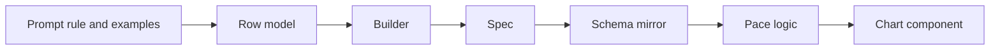
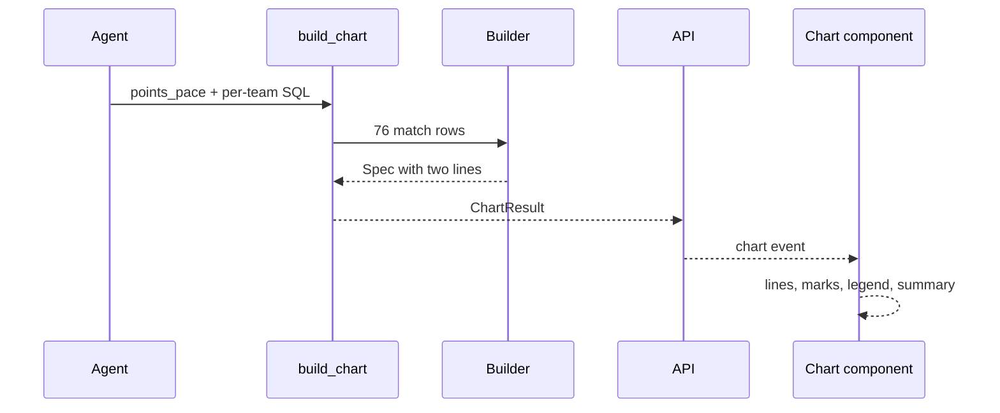

# 20 Points pace

| | |
| --- | --- |
| Work | Feature: a chart of the cumulative league points of each team and season, by matches played |
| Change | `78a166f` on `main` (squash of `b778949`, base `500c9be`), 2026-10-24 |
| Evidence | `blueprint/history/features/20-points-pace.md` (spec with six steps and the completion record. Local, not in Git). The commit message. The build conversation, with the live CLI and browser checks. |
| Reader | A learner who can write basic code and is new to this stack |

This document obeys the rules of ASD-STE100 Simplified Technical
English. It is not a certified STE document.

## 1. Summary

This work adds a fifth chart type, `points_pace`. The chart draws one line for
each team and season. Each line starts at 0 points and goes up after each match.
The x axis is the number of matches played, from 0 to 38. Arsenal always has one
line or more, and a line can also show the season leader or a rival.

The one idea to remember: the service calculates the points from the goals, with
the same 3/1/0 rule as the league table. Thus the end of each line is the same
number that the answer claims and that the verifier checks.

## 2. Why this work exists

Feature 19 loaded every league match of both seasons. The agent could thus give
the points of a team, but no chart could show how a season grew. A points pace
chart answers "was this season ahead of or behind that season, and when".

Item 20 of the build plan asks for "cumulative points by matchday for Arsenal in
both seasons". It also asks for "that season's leader or a rival named in the
question". Its done-when is the question "Compare Arsenal's 2025-26 points pace
with the Invincibles". The Invincibles are the Arsenal team of 2003-04, which did
not lose a league match. Recorded: build plan, item 20.

## 3. Design

The design follows the other four charts: a builder in the service turns SQL
rows into a spec, and the web page draws the spec. A spec is a JSON object that
holds the chart and its data.

| Part | Location | Job |
|---|---|---|
| Row model | `services/analyst/src/analyst/charts.py` (`PaceRow`) | Checks the type and range of each column of one match row |
| Builder | `services/analyst/src/analyst/charts.py` (`points_pace`) | Groups the rows into lines, checks them, and calculates the points and the cumulative totals |
| Spec | `services/analyst/src/analyst/charts.py` (`PointsPace`) | Holds one to four lines, Arsenal first, each with its matches in date order |
| Prompt rule and examples | `services/analyst/src/analyst/prompt.py` | Tells the agent which lines to draw, and gives the query for the chart and for the claims |
| Schema mirror | `apps/web/src/lib/analyst-schema.ts` | Checks the spec in the browser before the page uses it |
| Pace logic | `apps/web/src/lib/points-pace.ts` | Turns the spec into scales, paths, colours, keyboard moves, labels, and the summary |
| Chart component | `apps/web/src/components/charts/points-pace.tsx` | Draws the SVG, the labels, the legend, and the tooltip, and moves the focus |

One new term appears in this work. A matchday here is the number of a match in
the season of one team, by date. It is not the gameweek of the league. The
source data has no gameweek column, and a postponed match moves a team out of
step with the league calendar.

## 4. Workflow

Example input: "Compare Arsenal's 2025-26 points pace with the Invincibles".
This question ran in the live check, on the command line and in the browser.

1. The agent calls `build_chart` with `points_pace` and the per-team query. ([`tools.py:314`](../services/analyst/src/analyst/tools.py#L314))
2. `build_chart` runs the query through `run_sql`, with its guard and row limit. ([`tools.py:339`](../services/analyst/src/analyst/tools.py#L339))
3. `build` sends the 76 rows to the builder for the chart type. ([`charts.py:473`](../services/analyst/src/analyst/charts.py#L473))
4. The builder checks each row with `PaceRow` and parses each date. ([`charts.py:413`](../services/analyst/src/analyst/charts.py#L413))
5. The builder puts each row in the line of its team and season. ([`charts.py:418`](../services/analyst/src/analyst/charts.py#L418))
6. The builder rejects rows with no Arsenal line. ([`charts.py:435`](../services/analyst/src/analyst/charts.py#L435))
7. The builder sorts the lines: Arsenal first, then by season and team. ([`charts.py:438`](../services/analyst/src/analyst/charts.py#L438))
8. For each line, `pace_line` sorts the matches by date and adds the points. ([`charts.py:381`](../services/analyst/src/analyst/charts.py#L381))
9. The browser checks the spec against the schema mirror. ([`ask-stream.ts:51`](../apps/web/src/lib/ask-stream.ts#L51))
10. `ChartPanel` gives the spec to `PointsPace`. ([`chart-panel.tsx:34`](../apps/web/src/components/ask/chart-panel.tsx#L34))
11. The component draws each line with `linePath`. ([`points-pace.tsx:139`](../apps/web/src/components/charts/points-pace.tsx#L139))
12. The caption shows the totals: 90 points and 85 points. ([`points-pace.tsx:236`](../apps/web/src/components/charts/points-pace.tsx#L236))

In the same turn, the agent runs the totals query from the prompt. The claims
cite that query, and the verifier passed all of them. The claimed totals, 90 and
85 points from 38 matches each, are equal to the ends of the two lines.

## 5. Decisions and tradeoffs

### 5.1 The builder calculates the points from the goals

- **Choice:** Each row has `goals_for` and `goals_against`. The builder gives 3 points for a win, 1 for a draw, and 0 for a loss.
- **Alternatives:** Let the SQL of the agent return a points column.
- **Reason:** Recorded: the chart and the claims query then share one rule, the rule that `v_league_table` uses. Source: spec, Data / contracts, and the comment in `match_points`.
- **Cost:** The rule exists in three places: the view, the builder, and the totals example. A change to one must go to all three.

### 5.2 The x axis counts the matches of each team

- **Choice:** The matchday is the position of a match in the season of its team, by date. The axis always goes from 0 to 38.
- **Alternatives:** Use the gameweek of the league, or a date axis.
- **Reason:** Recorded: the source has no gameweek column, and postponed matches make the gameweeks differ by team. Matches played compares two seasons fairly. Source: spec, Data / contracts.
- **Cost:** The chart cannot show where a team stood in the league on a given date.

### 5.3 One subquery for the chart and its claims

- **Choice:** The prompt keeps the per-team query in one constant, `TEAM_MATCHES`. Both new examples read it.
- **Alternatives:** Write the two examples as separate queries.
- **Reason:** Recorded: with one constant, the chart and its claims cannot count different matches. Source: the comment above `TEAM_MATCHES`, and the commit message.
- **Cost:** The prompt now has 12 SQL examples. The test limit went from 10 to 12, and each example makes the prompt longer.

### 5.4 Which lines the chart draws

- **Choice:** The agent draws the Arsenal seasons that the question names. It adds a named rival in the same season. For one season with no rival, it adds the champion, or the second team when Arsenal won.
- **Alternatives:** Always add the leader, which gives one line when Arsenal is the leader.
- **Reason:** Recorded: the plan says "that season's leader", but Arsenal won both seasons. A chart with one line compares nothing. Source: the spec review in the build conversation, and the prompt rule.
- **Cost:** The rule is text in the prompt. The builder checks only that one line or more is Arsenal, not that the agent chose the correct rival.

### 5.5 No new view and no migration

- **Choice:** The query reads `v_league_matches` two times with `UNION ALL`: the home side, then the away side.
- **Alternatives:** Add a view with one row for each team in each match.
- **Reason:** Recorded: without a migration, the Neon database needs no new migration for this feature. Source: spec, Out of scope.
- **Cost:** The agent must write a longer query. The prompt example carries this load.

### 5.6 A line shows by more than its colour

- **Choice:** Each line has its own dash pattern. An Arsenal line takes the colour of its season. The other lines take the next chart colours.
- **Alternatives:** Use colour only.
- **Reason:** Recorded: the project plan asks for charts that do not depend on colour only. The season colours come from `globals.css`. Source: project overview, UI rules, and the comment above `SEASON_COLOUR`.
- **Cost:** Four dash patterns are the limit, which is one reason for the limit of four lines.

### 5.7 The xG caveat applies only to xG

- **Choice:** The rule for a comparison of two seasons now asks for the xG caveat only when the comparison uses xG.
- **Alternatives:** Keep the caveat on every comparison of two seasons.
- **Reason:** Recorded: the live check showed a caveat about xG models under a chart with no xG. The user chose to fix it before the merge. Source: the build conversation, and spec step 6.
- **Cost:** The change touches a rule that all questions use. One paid run confirmed the points answer, but no other golden question ran again.

## 6. Blast radius

### 6.1 This work needs

| Dependency | Used for | If it fails |
|---|---|---|
| `v_league_matches` (feature 19) | The league matches of both seasons, with goals | `build_chart` returns the database error as text, and the agent can try again |
| `run_sql` guard and row limit | Safe SQL for the chart rows | A query over the limit gets an error, not a chart with part of the matches |
| The prompt of the agent | The lines to draw, the query shape, and the totals query | The agent can draw the wrong rival, or claim numbers from another query |
| `d3-scale` | The scales of matches and points | The web build stops |
| `PitchTooltip` and `ChartTitle` | The tooltip and the title | The chart loses its tooltip or its title |

### 6.2 These things use this work

| Consumer | Uses | Found in |
|---|---|---|
| `build_chart` | The `points_pace` builder through `build` | [`tools.py:349`](../services/analyst/src/analyst/tools.py#L349) |
| MCP server | The `chart_type` enum of `build_chart` | [`mcp_server.py:19`](../services/analyst/src/analyst/mcp_server.py#L19) |
| Agent | Only `id`, `type`, `title` of the spec, for the model | [`agent.py:103`](../services/analyst/src/analyst/agent.py#L103) |
| API | The `chart` event | [`api.py:422`](../services/analyst/src/analyst/api.py#L422) |
| Browser stream | The schema mirror | [`ask-stream.ts:51`](../apps/web/src/lib/ask-stream.ts#L51) |
| `ChartPanel` | The `PointsPace` component | [`chart-panel.tsx:34`](../apps/web/src/components/ask/chart-panel.tsx#L34) |
| `ask` CLI | The match count of a points pace chart | [`cli.py:37`](../services/analyst/src/analyst/cli.py#L37) |
| Evals | `ChartType` for the expected chart of a golden question | [`evals.py:49`](../services/analyst/src/analyst/evals.py#L49) |

### 6.3 If you change this work

| If you change | Then check |
|---|---|
| The fields of `PointsPace` | The Zod mirror, `test-fixtures.ts`, and `points-pace.ts`. A spec that fails the mirror shows the fallback card. |
| The 3/1/0 rule | `v_league_table`, `match_points`, and the totals example in the prompt |
| `TEAM_MATCHES` | `test_the_points_examples_make_a_chart_whose_totals_are_the_claims` |
| The limit of four lines | `MAX_PACE_LINES`, the Zod `.max(4)`, and `DASHES` in the component |
| The caveat rule | Every golden question that compares the two seasons |

### 6.4 How to remove this work

Revert `78a166f`. The work added no table, no migration, and no configuration
value, so no data stays behind. Then deploy the web app and a new API image,
because the prompt changes back. No golden question names `points_pace` yet.

## 7. Code reading path

1. [`charts.py:147`](../services/analyst/src/analyst/charts.py#L147) - Look for: the row model and the three spec models.
2. [`charts.py:374`](../services/analyst/src/analyst/charts.py#L374) - Look for: the 3/1/0 rule and the cumulative total.
3. [`charts.py:401`](../services/analyst/src/analyst/charts.py#L401) - Look for: the checks on the rows and the order of the lines.
4. [`prompt.py:86`](../services/analyst/src/analyst/prompt.py#L86) - Look for: the per-team subquery that both examples share.
5. [`prompt.py:42`](../services/analyst/src/analyst/prompt.py#L42) - Look for: the rule that picks the lines.
6. [`analyst-schema.ts:77`](../apps/web/src/lib/analyst-schema.ts#L77) - Look for: the same contract in Zod.
7. [`points-pace.ts:55`](../apps/web/src/lib/points-pace.ts#L55) - Look for: the colour of each line.
8. [`points-pace.ts:70`](../apps/web/src/lib/points-pace.ts#L70) - Look for: the moves along a line and between lines.
9. [`points-pace.tsx:76`](../apps/web/src/components/charts/points-pace.tsx#L76) - Look for: one tab stop, the marks, and the HTML labels.

## 8. Known limits

- The chart has no mark for the result of a match. The tooltip and the label give the result, but the line shows it only as a change in slope.
- The builder does not check that the agent chose the correct rival (decision 5.4).
- Production does not show this chart yet. It needs a new API image with the new prompt and chart type, and a web deploy.
- The caveat change (decision 5.7) can change the answers to other comparisons of two seasons. The evals did not run again.
- No new finding. The open findings in the ledger are from earlier features.
- The debrief found no new defect.

## 9. Self-test

1. Why does the builder calculate the points, when SQL can return a points column?
2. Why is the x axis matches played and not the gameweek of the league?
3. What happens if the chart example and the totals example use different subqueries?
4. Which second line does the agent add for "Show Arsenal's points pace in 2025-26"?
5. Why does each line have its own dash pattern?

Answers

1. The chart and the claims then use the same 3/1/0 rule as the league table. See section 5.1.
2. The source has no gameweek, and postponed matches put teams out of step. See section 5.2.
3. The chart and its claims can count different matches, and the end of a line can differ from the claim. See section 5.3.
4. Arsenal finished first in 2025-26, so the agent adds the second team, Manchester City. See section 5.4.
5. A line must show by more than its colour, for readers who cannot tell the colours apart. See section 5.6.

