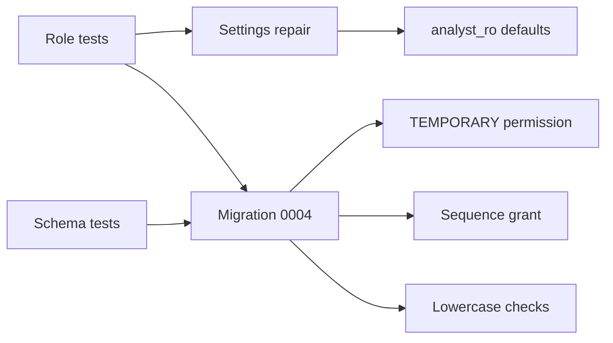
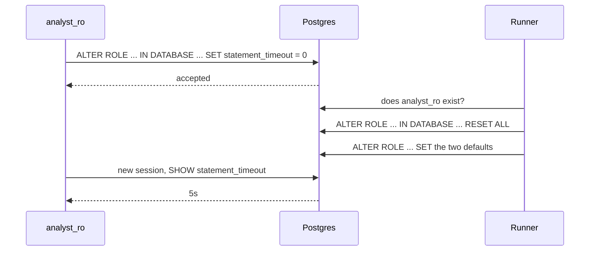

# Harden roles and schema checks

| | |
| --- | --- |
| Work | Fix: close the seven review findings on the database roles and schema |
| Change | `d938af9` on `main`, 2026-10-11 |
| Evidence | `blueprint/history/fixes/harden-roles-and-schema-checks.md` (spec, seven findings, review receipt), the commit message, and the build conversation |
| Reader | A learner who can write basic code and is new to this stack |

This document obeys the rules of ASD-STE100 Simplified Technical
English. It is not a certified STE document.

## 1. Summary

This fix makes the database from feature 1 stricter. It removes one permission
that `analyst_ro` got by default, and it adds one permission that `ingest` did
not get. It adds two checks that reject text values with capital letters. The
migration runner now repairs the settings of `analyst_ro` on each run.

The one idea to remember: PostgreSQL gives some permissions by default, so you
must also examine what a role got without a grant.

Read [01 Database schema, views, roles](01-database-schema-views-roles.md)
first. This document continues from it.

## 2. Why this work exists

An independent review examined feature 1 and recorded six findings. A second
review of this fix reopened one finding and recorded a seventh. A third review
closed all seven.

Two findings are about safety. `analyst_ro` is the role that will run SQL from a
language model. The review showed two things that the role could do, which the
design did not intend:

- It could create a temporary table and write rows into it.
- It could change its own settings and remove its 5-second limit.

One finding is about wrong results with no error. The views look for the
lowercase words `goal` and `pass`. If a loader stores `Goal`, the views show no
goals, and nothing fails.

The other findings are about an absent grant, absent tests, and two rules in
the project standards.

## 3. Design

The fix has one new migration, one change to the runner, and new tests.

An applied migration does not change. The runner records each file name and does
not apply that file again. Thus each database change in this fix is in a new
file.

| Part | Location | Job |
| --- | --- | --- |
| Migration 0004 | `db/migrations/0004_harden_roles.sql` | Remove the default permission, add the sequence grant, add two checks |
| Settings repair | `ingest/src/ingest/migrate.py` | Put the two defaults of `analyst_ro` back on each run |
| Role tests | `ingest/tests/test_roles.py` | Prove the new limits of `analyst_ro` and the new grant of `ingest` |
| Schema tests | `ingest/tests/test_schema.py` | Cover the checks, the unique keys, and the away-team rows |

The project standards in `blueprint/context/coding-standards.md` also changed.
That file is not in Git, so the commit does not show it.

Three terms are new in this fix.

`PUBLIC` is a name for all roles together. PostgreSQL gives `PUBLIC` the
`TEMPORARY` permission on each database. Thus each role can create a temporary
table, unless a migration removes that permission.

A **sequence** is a counter that the database uses to make the next id number.
`USAGE` on a sequence lets a role ask for the next number directly.

A **check constraint** is a rule on a column. The database rejects a row that
breaks the rule.

## 4. Workflow

This trace shows the settings repair. A role setting can exist at two levels:
for the role in all databases, and for the role in one database. The setting for
one database wins.

Example input: `analyst_ro` removes its own limits in one database, and then a
developer runs the migrate command.

1. `analyst_ro` runs `ALTER ROLE analyst_ro IN DATABASE highbury SET statement_timeout = 0`.
2. PostgreSQL permits this, because a role can change its own settings.
3. A new `analyst_ro` session now has no time limit.
4. The developer runs the migrate command.
5. `apply` finds no new migration files. (`migrate.py:68`)
6. `apply` sets the role passwords, as before.
7. `apply` asks the database if the role `analyst_ro` exists. (`migrate.py:99`)
8. `apply` reads the name of the current database. (`migrate.py:104`)
9. `apply` clears all settings of the role for that database. (`migrate.py:106`)
10. `apply` sets the two defaults for the role in all databases. (`migrate.py:110`)
11. A new `analyst_ro` session has the 5-second limit again.

The other changes have no steps at run time. PostgreSQL applies them when a
statement arrives. For example, `INSERT` with `outcome` equal to `Goal` fails
with a check violation.

## 5. Decisions and tradeoffs

### 5.1 The fix adds a new migration and does not edit the old files

- **Choice:** All database changes are in `0004_harden_roles.sql`.
- **Alternatives:** Edit `0003_roles.sql`, the file that defines the roles.
- **Reason:** Recorded: the runner does not apply an applied file again, so an
  edit does not reach the local database or Neon. Source: the spec, section The
  fix.
- **Cost:** A reader must read `0003` and `0004` together to know the full set
  of permissions.

### 5.2 `TEMPORARY` is removed from `PUBLIC`, and `ingest` does not get it back

- **Choice:** The migration revokes `TEMPORARY` on the database from all roles.
- **Alternatives:** Revoke and then grant `TEMPORARY` to `ingest`. Or change the
  design rule to "no permanent tables" and keep the permission.
- **Reason:** Recorded: the role contract says `analyst_ro` cannot run DDL, and
  no loader uses temporary tables at this time. Source: finding F-01 and the
  spec.
- **Cost:** A loader that needs a temporary table for a bulk load must add a
  grant in a new migration.

### 5.3 The runner repairs the role settings, because no grant can protect them

- **Choice:** On each run, the runner clears the settings for the current
  database and sets the two defaults again.
- **Alternatives:** Set the defaults one time in a migration, as feature 1 did.
- **Reason:** Recorded: PostgreSQL always lets a role change its own settings,
  so a repair is the only control in the database. Source: finding F-02.
- **Cost:** The repair occurs only when a person runs the migrate command. It
  does not cover settings that the role stores for other databases.

### 5.4 The true control for the time limit moves to feature 5

- **Choice:** The project standards now say that the SQL check must accept one
  `SELECT` and reject each other statement type. `run_sql` must set its own time
  limit for each query.
- **Alternatives:** Rely on the role default of 5 seconds.
- **Reason:** Recorded: the role default is not a boundary. Source: finding F-02
  and the Database section of the project standards.
- **Cost:** Until feature 5 exists, the time limit is only a default.

### 5.5 The checks enforce lowercase, not a list of permitted words

- **Choice:** `outcome` must equal `lower(outcome)`, and the same for `type`.
- **Alternatives:** A check with a fixed list such as `goal`, `saved`, `blocked`.
- **Reason:** Inferred from the spec and finding F-06. The full list of values
  is not known before the loaders exist. The defect was only about capital
  letters.
- **Cost:** A wrong lowercase word, for example `gaol`, is still accepted.

### 5.6 The standard changed, and the runner code did not

- **Choice:** Offline `ingest` commands can read a small set of environment
  variables directly. The analyst service uses `pydantic-settings`.
- **Alternatives:** Add `pydantic-settings` to the `ingest` package and change
  the runner.
- **Reason:** Recorded: the spec for feature 1 added no dependency, and the
  runner reads and checks its variables in one function. Source: finding F-04
  and the spec. The project owner approved this change to the standards.
- **Cost:** The project has two patterns for settings. A new module must use the
  correct one for its package.

## 6. Blast radius

### 6.1 This work needs

| Dependency | Used for | If it fails |
| --- | --- | --- |
| Migrations `0001` to `0003` | `0004` changes the tables and roles from those files | `0004` fails and the database stays unchanged |
| The admin role | Only the owner can revoke from `PUBLIC` and change a role | The runner prints "Migration failed" and returns 1 |
| The role `analyst_ro` | The settings repair | If the role is absent, the runner skips the repair |

### 6.2 These things use this work

No code uses this work yet. A search found no loader and no agent code. The
planned consumers are:

| Consumer | Effect of this fix |
| --- | --- |
| Features 2 and 3 (loaders) | Must store `outcome` and `type` in lowercase, or the insert fails |
| Features 2 to 4 (loaders) | Can call `nextval`. Cannot create a temporary table. |
| Feature 5 (data tools) | Must reject each statement that is not one `SELECT`, and must set a time limit for each query |

### 6.3 If you change this work

| If you change | Then check |
| --- | --- |
| The values in `ANALYST_DEFAULTS` | The role tests, and the limit that `run_sql` sets in feature 5 |
| A new table with an id column | Add grants for the table and `USAGE` on its sequence for `ingest` |
| A loader that needs a temporary table | Add `GRANT TEMPORARY` for `ingest` in a new migration |
| The lowercase checks | `v_shots.is_goal` and the filter in `v_passes` |

### 6.4 How to remove this work

Revert commit `d938af9`. Then add a migration that drops the two checks, revokes
the sequence grant, and grants `TEMPORARY` to `PUBLIC` again. Do not delete
`0004` on a database that applied it, because the runner does not undo a file.

## 7. Code reading path

1. [`db/migrations/0004_harden_roles.sql:5`](../db/migrations/0004_harden_roles.sql#L5) - Look for: how one line removes a permission that no migration gave.
2. [`db/migrations/0004_harden_roles.sql:12`](../db/migrations/0004_harden_roles.sql#L12) - Look for: how `lower()` makes a check for capital letters.
3. [`ingest/src/ingest/migrate.py:23`](../ingest/src/ingest/migrate.py#L23) - Look for: the two defaults that the runner keeps.
4. [`ingest/src/ingest/migrate.py:99`](../ingest/src/ingest/migrate.py#L99) - Look for: the order of the steps, where the clear comes before the set.
5. [`ingest/tests/test_roles.py:49`](../ingest/tests/test_roles.py#L49) - Look for: why the test leaves read-only mode before it tries the command.
6. [`ingest/tests/test_roles.py:97`](../ingest/tests/test_roles.py#L97) - Look for: the two SQL forms that change a role setting.
7. [`ingest/tests/test_roles.py:102`](../ingest/tests/test_roles.py#L102) - Look for: the `finally` block that repairs the role if the test fails.
8. [`ingest/tests/test_schema.py:192`](../ingest/tests/test_schema.py#L192) - Look for: the away-team row that the first tests did not have.

## 8. Known limits

- The role defaults are not a boundary. The SQL check and the time limit in
  feature 5 are the true control, and they do not exist yet.
- The runner does not clear settings that `analyst_ro` stores for other
  databases on the same server.
- One role test opens the shared role `analyst_ro` for a short time. If you stop
  pytest at that moment, run the migrate command to repair the role.
- `ingest` cannot create a temporary table.
- No test covers the runner path where `analyst_ro` is absent.
- The reviewer did not connect to Neon. Manual runs confirmed the fix on Neon.

## 9. Self-test

1. Why could `analyst_ro` create a temporary table, when no migration gave that
   permission?
2. Why does the runner clear the settings for one database before it sets the
   defaults for the role?
3. Why is the fix in `0004` and not in `0003`?
4. What happens if a loader inserts a shot with `outcome` equal to `Goal`?
5. Why is the 5-second default on the role not sufficient protection?

Answers

1. PostgreSQL gives `TEMPORARY` on each database to `PUBLIC`, and `PUBLIC` is
   all roles. See section 3.
2. A setting for one database wins over the setting for the role. If the runner
   does not clear it, the bad value stays. See section 4.
3. The runner does not apply an applied file again. Thus an edit to `0003` has
   no effect on a migrated database. See section 5.1.
4. The check constraint rejects the row, and the insert fails with an error. See
   sections 3 and 4.
5. A role can always change its own settings. Thus feature 5 must reject each
   statement that is not one `SELECT` and set its own limit. See section 5.4.

