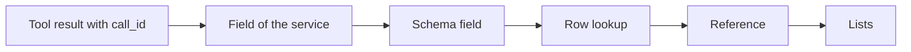

# Link claims to their queries

| | |
| --- | --- |
| Work | Fix: each claim of an answer links to the tool call whose query backs it |
| Change | `8ed5c24` on `main`, 2026-10-13 |
| Evidence | `blueprint/history/fixes/link-claims-to-their-queries.md` (spec with its verification note. Local, not in Git). The commit message. The build conversation. The study document of feature 11, section 5.7. |
| Reader | A learner who can write basic code and is new to this stack |

This document obeys the rules of ASD-STE100 Simplified Technical
English. It is not a certified STE document.

## 1. Summary

This fix lets a visitor see which query backs which claim. The service now
sends the id of the query with each tool call. The Ask page shows that id on
each tool call, and each claim has a button that goes to its tool call.

The one idea to remember: two lists can join only on a value that the two of
them hold. The id was in the claims and in the tool results, but not in the
list that the page gets.

## 2. Why this work exists

An answer has claims, and each claim has `tool_call_id`. That value is the
`call_id` of the `run_sql` result whose rows hold the number of the claim. The
verifier uses it to check the claim.

The page also gets the `working` list, with one entry for each tool call of the
turn. Before this fix, an entry had the tool, the arguments, the SQL, the row
count, and the error. It had no `call_id`. Thus the page showed the claims and
the tool calls, but it could not say which query backs which claim.

Feature 11 left this out on purpose. Its study document records the decision in
section 5.7.

## 3. Design

The design has one change in the service and three small parts on the page.

| Part | Location | Job |
| --- | --- | --- |
| Field of the service | `services/analyst/src/analyst/api.py` | `WorkingStep` holds `call_id`, and `working_step` copies it from the tool result. |
| Schema field | `apps/web/src/lib/analyst-schema.ts` | Says that each entry of the `working` list has `call_id`, as a text or null. |
| Row lookup | `apps/web/src/lib/ask-state.ts` | `workingRowOf` gives the place of the tool call with an id, or null. |
| Reference | `apps/web/src/components/ask/call-ref.tsx` | Shows one id, as a button when a tool call has it and as plain text when none has. |
| Lists | `verification-list.tsx`, `working-list.tsx`, `answer-panel.tsx` | Put the reference on each claim, the id on each tool call, and the move to a row. |

The tests in `test_api.py`, `analyst-schema.test.ts`, and `ask-state.test.ts`
are support. So is `test-fixtures.ts`.

## 4. Workflow

Example input: a click on the id `q_c541c374` of a claim on the public page.

1. `run_sql` makes the id of its query: `q_` and eight hex characters. (`services/analyst/src/analyst/tools.py:141`)
2. The verifier finds the `run_sql` result with the id that the claim cites. (`services/analyst/src/analyst/verifier.py:86`)
3. `working_step` copies `call_id` from the tool result into the entry. (`services/analyst/src/analyst/api.py:135`)
4. The schema of the page accepts the entry with its `call_id`. (`apps/web/src/lib/analyst-schema.ts:98`)
5. `callRef` asks `workingRowOf` for the row of the id. (`apps/web/src/components/ask/verification-list.tsx:42`)
6. `workingRowOf` returns 3, the place of the `run_sql` call. (`apps/web/src/lib/ask-state.ts:142`)
7. `CallRef` shows the id as a button. (`apps/web/src/components/ask/call-ref.tsx:13`)
8. The visitor clicks the button, and `revealRow` opens the `working` panel. (`apps/web/src/components/ask/answer-panel.tsx:35`)
9. `revealRow` moves the view and the focus to the row with `data-row` 3. (`apps/web/src/components/ask/working-list.tsx:32`)

On the public page, the row of the `run_sql` call showed the same id and an
amber outline. The row of the chart showed a different id, `q_91052df6`.

## 5. Decisions and tradeoffs

### 5.1 The service sends the id, and the page does not guess it

- **Choice:** `WorkingStep` has a `call_id` field, copied from the tool result.
- **Alternatives:** Let the page match a claim to a tool call by its place in
  the list or by its SQL.
- **Reason:** Recorded: the tool result already has the id, and the entry of
  the `working` list did not carry it. Source: the problem statement of the
  spec.
- **Cost:** The public answer of the service has one more field.

### 5.2 The schema of the page requires the field

- **Choice:** `call_id` must be in each entry, as a text or null. An entry with
  no `call_id` key fails the schema.
- **Alternatives:** Let the page accept an entry with no `call_id`.
- **Reason:** Recorded: the schema mirrors the service, where the field is
  always there. The build conversation offered the second choice, and the user
  kept the first. Source: the spec, under "It must not break".
- **Cost:** The order of a deploy matters. A page with this schema fails each
  answer of a service without the field. Thus the service deploys first.

### 5.3 An id with no tool call shows as plain text

- **Choice:** `CallRef` shows a button only when `workingRowOf` finds a row.
- **Alternatives:** Hide the id, or show a button that goes nowhere.
- **Reason:** Recorded: a removed claim with the reason `call_not_found` cites
  an id that no tool call has. Source: the fix section of the spec.
- **Cost:** A visitor sees two forms of the same kind of id.

### 5.4 The lookup is a pure function

- **Choice:** `workingRowOf` takes the list and an id and uses no React.
- **Alternatives:** Search the list inside the component.
- **Reason:** Recorded: the spec asks for one pure function with tests.
  Source: step 2 of the spec.
- **Cost:** None that the evidence shows.

### 5.5 A row shows its outline after a click

- **Choice:** A row of the `working` list has an outline for each focus, not
  only for a keyboard focus.
- **Alternatives:** Use the focus ring of the theme, which shows only for a
  keyboard.
- **Reason:** Recorded: a claim moves the focus to the row, and the row must
  show it also after a click. Source: the comment in `working-list.tsx`.
- **Cost:** This row has a focus rule of its own, apart from the theme.

### 5.6 The tool call of a chart shows an id that no claim cites

- **Choice:** `working_step` copies `call_id` for each tool in the same way.
  A `build_chart` result has the id of its own query, so its row shows one.
- **Alternatives:** Send the id only for a `run_sql` call.
- **Reason:** Inferred: `working_step` has no branch for each tool, and it
  reads `sql` in the same way. From `api.py`.
- **Cost:** A visitor can look for a claim with the id of the chart and find
  none.

## 6. Blast radius

### 6.1 This work needs

| Dependency | Used for | If it fails |
| --- | --- | --- |
| `call_id` in a tool result (`tools.py`) | The value of the field | The field is null, and each claim shows its id as plain text. |
| A service with the field | Each answer on the page | Each answer fails its schema, and the page shows `Something went wrong. Try again.` |
| The `
` element of the browser | The panel that opens on a click | The row does not come into view. |

### 6.2 These things use this work

| Consumer | Uses | Found in |
| --- | --- | --- |
| The claim list | `workingRowOf` and `CallRef` | `apps/web/src/components/ask/verification-list.tsx:42` |
| The `working` list | `call_id` of an entry | `apps/web/src/components/ask/working-list.tsx:39` |

A search finds `WorkingStep` only in `api.py`. The MCP server and the `ask`
command do not use it.

### 6.3 If you change this work

| If you change | Then check |
| --- | --- |
| The form of an id in `tools.py` | The pattern in `test_api.py`. The page reads the id as text and does not depend on its form. |
| The `call_id` field of `WorkingStep` | `analyst-schema.ts`. A removed field makes each answer fail on the page. |
| The order of the `working` list | Nothing. The page finds the row when it renders. |

### 6.4 How to remove this work

Revert commit `8ed5c24`. Deploy the page first and the service second. This is
the reverse of the order of the fix. The old page accepts the extra field, but
the new page does not accept an answer without it.

## 7. Code reading path

1. [`services/analyst/src/analyst/api.py:87`](../services/analyst/src/analyst/api.py#L87) - Look for: the fields of `WorkingStep`, with `call_id` last.
2. [`services/analyst/src/analyst/api.py:130`](../services/analyst/src/analyst/api.py#L130) - Look for: the function keeps a value only when it has the correct type.
3. [`services/analyst/tests/test_api.py:250`](../services/analyst/tests/test_api.py#L250) - Look for: the three cases of the id in one turn.
4. [`apps/web/src/lib/ask-state.ts:142`](../apps/web/src/lib/ask-state.ts#L142) - Look for: the lookup that gives a place or null.
5. [`apps/web/src/components/ask/call-ref.tsx:13`](../apps/web/src/components/ask/call-ref.tsx#L13) - Look for: one component with two forms.
6. [`apps/web/src/components/ask/answer-panel.tsx:35`](../apps/web/src/components/ask/answer-panel.tsx#L35) - Look for: open, find, show, focus, in that order.

## 8. Known limits

- The id of a chart row links to no claim. See section 5.6.
- The click and the move of the focus have no unit test. A browser check on the
  local page and on the public page showed them.
- A kept answer of the service keeps the ids of its first turn. Each visitor
  who gets that answer sees the same ids.
- The service runs image tag `2026-10-13-3`. The file that names it,
  `deploy/ecs/service.json`, is local and not in Git.
- Seen in this work: the login of Docker to the registry failed with status 400
  when PowerShell gave the password through a pipe. The push passed because
  Docker had an earlier login. Reason not recorded.
- Seen in this work: the dev server showed an old stylesheet after two branch
  changes, also after a restart. An edit of `globals.css` made it compile
  again. Reason not recorded.

## 9. Self-test

1. Why could the page not join a claim to a tool call before this fix?
2. Why did the service deploy before the page?
3. What does a claim show when no tool call has its id, and when does that occur?
4. Why does the focused row need an outline rule of its own?
5. What is the safe order to remove this fix, and why?

Answers

1. A claim had the id of its query, but an entry of the `working` list had no
   id. See section 2.
2. The schema of the page requires `call_id`. A page with that schema fails
   each answer of a service without the field. See section 5.2.
3. It shows the id as plain text. That occurs for a removed claim with the
   reason `call_not_found`. See section 5.3.
4. The focus ring of the theme shows only for a keyboard focus. A click on a
   claim also moves the focus to the row. See section 5.5.
5. Deploy the page first and the service second. The old page accepts the
   extra field, but the new page does not accept an answer without it. See
   section 6.4.

