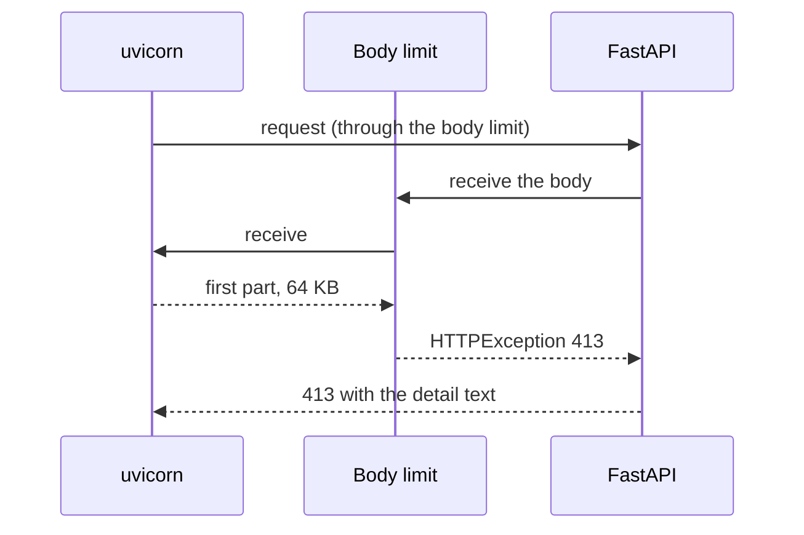

# Request body limit and review cleanup

| | |
| --- | --- |
| Work | Fix: a size limit for the request body of the public API, the real host in the tracked plans, and five unused images removed |
| Change | `8df0b9b` on `main`, 2026-10-13 |
| Evidence | `blueprint/history/fixes/request-body-limit-and-review-cleanup.md` (spec, evidence, findings F-20 and F-22, the independent review. Local, not in Git). The commit message. The build conversation. `blueprint/context/findings.md` (F-23, F-24). |
| Reader | A learner who can write basic code and is new to this stack |

This document obeys the rules of ASD-STE100 Simplified Technical
English. It is not a certified STE document.

## 1. Summary

This fix gives the public API a limit of 16 KB for a request body. Before the
fix, the service read a body of any size into memory before it checked the
question. Now the read stops at the limit, and the client gets status 413.

The fix also does two small repairs from the review of feature 10. The tracked
plans now name the real host of the API. Five images of the Next.js installer
are gone from the public site.

The one idea to remember: a check after the read is too late. The limit must
act while the service reads the body.

## 2. Why this work exists

FastAPI reads the full body of a `POST` request before it validates the
fields. The question has a limit of 500 characters, but that check comes after
the read. Thus a large body used memory although the service refused it.

A local test showed the size of the problem. A body of 60 MB got status 422,
and the memory of the container went from 103 MiB to 223 MiB. A 422 does not
count for the rate limit. The production task has 512 MiB, so a small number of
such requests can stop it.

The review of feature 9 gave this limit to "the proxy of feature 10". The load
balancer of feature 10 has no such limit, and feature 10 did not add one. The
builder found the gap after the review of feature 10.

## 3. Design

The design is one small class in `api.py` that sits between the server and the
routes.

Three terms are new in this work:

- **ASGI** is the interface between a Python web server and an app. The server
  calls the app with three things: `scope`, `receive`, and `send`.
- `receive` is the function that the app calls to get the next part of the
  request body. A large body comes in many parts.
- An **ASGI middleware** is an object that wraps the app and can change these
  three things. This work uses one to replace `receive` with a function that counts.

| Part | Location | Job |
| --- | --- | --- |
| Limit value | `services/analyst/src/analyst/api.py` (`MAX_BODY_BYTES`) | States the limit of 16 KB and the reason for that number. |
| Body limit | `services/analyst/src/analyst/api.py` (`BodyLimit`) | Counts the body bytes as the app reads them, and raises an error at the limit. |
| App setup | `services/analyst/src/analyst/api.py` (`create_app`) | Adds the body limit to the app. |
| Tests | `services/analyst/tests/test_api.py` | Show the limit at its edge, over it, with no length header, and for the web origin. |
| Plans | `project-requirement-docs/` | Six lines now name AWS ECS Express Mode as the host of the API. |
| Images | `apps/web/public/` | The fix deletes the five unused images. The folder is now absent. |

## 4. Workflow

Example input: a client posts a body of 1 MB to `/api/ask`.

1. uvicorn reads the headers and calls the app. The request passes the CORS middleware. (`services/analyst/src/analyst/api.py:468`)
2. `BodyLimit` gives the app the function `counted` in place of `receive`. (`services/analyst/src/analyst/api.py:170`)
3. FastAPI starts to read the body for the route, so it calls `counted`.
4. uvicorn gives the first part of the body, which is 64 KB at most.
5. `counted` adds the length of the part. The count is now more than 16 KB.
6. `counted` raises `HTTPException(413)`, so the app keeps no more of the body. (`services/analyst/src/analyst/api.py:178`)
7. FastAPI lets this error through, and the exception handler of the app makes the 413 response.
8. The response goes out through the CORS middleware, which adds its header.
9. The route function `ask` does not run. Thus the rate limit does not count, and the model gets no call. (`services/analyst/src/analyst/api.py:500`)

In production, a body of 1 MB got 413 with the text "The request body is too
large." This was the result with a length header and also with a body in parts.
A local body of 60 MB got 413 in 21 ms, and the memory stayed at 102 MiB.

## 5. Decisions and tradeoffs

### 5.1 The limit is in the service, not in front of it

- **Choice:** A middleware in `api.py`.
- **Alternatives:** A size rule in a firewall in front of the load balancer.
- **Reason:** Recorded: the load balancer has no body limit, and the spec puts
  a limit at the load balancer or a firewall out of scope. Source: The problem
  and The fix of the spec.
- **Cost:** The service gets the first part of each large body before it
  refuses it. The limit covers the body only, not the headers or the URL.

### 5.2 The limit counts bytes as the app reads them

- **Choice:** `counted` adds the length of each part and raises the error from
  inside the read.
- **Alternatives:** Compare the `Content-Length` header with the limit.
- **Reason:** Inferred: a body that comes in parts has no `Content-Length`
  header, so a header check does not see it. Deduced from the test for a body
  with no length header.
- **Cost:** The error must be an `HTTPException`. FastAPI changes each other
  error in the body read into a 400, as the code comment says.

### 5.3 The middleware is a plain ASGI class

- **Choice:** A class with `__call__(scope, receive, send)`.
- **Alternatives:** `BaseHTTPMiddleware` of Starlette, which is shorter to write.
- **Reason:** Recorded: that class wraps the response, and the service streams
  its response. Source: The fix of the spec, and the docstring of `BodyLimit`.
- **Cost:** The code works at the level of ASGI messages, which is less
  familiar to a new reader.

### 5.4 The limit is 16 KB

- **Choice:** `MAX_BODY_BYTES = 16 * 1024`, a constant with no environment variable.
- **Alternatives:** A smaller number near the largest valid body, or a variable.
- **Reason:** Recorded: the largest valid body is about 6 KB. That is a
  question of 500 characters, where JSON can write one character as 12 bytes.
  Source: the comment above `MAX_BODY_BYTES`. The spec says "no new variable".
- **Cost:** A valid question with a very large run of spaces in its text now
  gets 413. The review saw this case. The web page does not send such a question.

### 5.5 A 413 does not count for the rate limit

- **Choice:** The limit acts before the route, and the route holds the rate limit.
- **Alternatives:** Count each refused body for the address of the visitor.
- **Reason:** Recorded: a 413 is the same as a 422 here, which also does not
  count. Source: The fix of the spec.
- **Cost:** A client can send many large bodies with no 429. Each one costs at
  most one read of about 64 KB.

## 6. Blast radius

### 6.1 This work needs

| Dependency | Used for | If it fails |
| --- | --- | --- |
| The body reader of FastAPI | It must let an `HTTPException` through | The client gets 400 with a general text, not 413. The memory stays safe. |
| The exception handler of the app | It makes the 413 response | The server answers 500. |
| uvicorn | It gives the body in parts and stops the read | Without parts, the first message can hold a full large body. |

### 6.2 These things use this work

| Consumer | Uses | Found in |
| --- | --- | --- |
| `create_app` | `BodyLimit` | `services/analyst/src/analyst/api.py:467` |
| The tests | `MAX_BODY_BYTES`, `BodyLimit`, the 413 body | `services/analyst/tests/test_api.py:340` |
| The web shell | Status 413, shown as a general status text | `apps/web/src/components/connection-check.tsx:82` |

No code reads the five deleted images. A search of `apps/web/src` found no use.

### 6.3 If you change this work

| If you change | Then check |
| --- | --- |
| `MAX_QUESTION_LENGTH` or the fields of the request | `MAX_BODY_BYTES`. The largest valid body must stay below the limit. |
| The version of FastAPI | The test for a body over the limit. It fails if FastAPI changes the error into a 400. |
| `BodyLimit` so that it sends a response by itself | The order in `create_app`. Then the CORS middleware must be outside it. |
| The 413 body | The web page of feature 11, which will show errors to the visitor. |

### 6.4 How to remove this work

1. Revert the commit `8df0b9b`.
2. Build the image, push it with a new tag, and update the ECS service.
3. Deploy the web shell again if the five images must come back.

No data and no configuration stay behind. Without this work, the service reads a
body of any size again.

## 7. Code reading path

1. [`services/analyst/src/analyst/api.py:54`](../services/analyst/src/analyst/api.py#L54) - Look for: the reason for the number 16 KB.
2. [`services/analyst/src/analyst/api.py:151`](../services/analyst/src/analyst/api.py#L151) - Look for: the shape of a plain ASGI middleware.
3. [`services/analyst/src/analyst/api.py:170`](../services/analyst/src/analyst/api.py#L170) - Look for: the count, and the error that FastAPI lets through.
4. [`services/analyst/src/analyst/api.py:465`](../services/analyst/src/analyst/api.py#L465) - Look for: the two middlewares. Read section 8 before you trust the comment.
5. [`services/analyst/tests/test_api.py:340`](../services/analyst/tests/test_api.py#L340) - Look for: one test at the limit and one test one byte over it.
6. [`services/analyst/tests/test_api.py:371`](../services/analyst/tests/test_api.py#L371) - Look for: a body in three parts, and the part that the reader never gets.

## 8. Known limits

- **The comment in `create_app` gives a wrong reason (F-23).** It says that the
  CORS middleware must be outside the body limit. The review showed that the
  413 has the CORS header in each order, because the exception handler of the
  app makes the response. The behavior is correct. Only the comment is wrong.
- **No test gives the real app a body in more than one message (F-24).** The
  test client reads the full body first. The review confirmed the behavior with
  two probes, but the test suite does not guard it.
- A valid question with more than 16 KB of spaces in its text gets 413.
- The limit covers the body only. The server defaults limit the headers and the URL.
- A 413 does not count for the rate limit.
- The web shell shows a 413 as "The analyst API answered with status 413."
- The independent review did not check the production state. The builder did those checks.
- The ignore rule for `.gitkeep` files (F-19) and the quiet stream (F-21) are not part of this fix.

## 9. Self-test

1. Why did the limit of 500 characters for the question not protect the memory?
2. Why does `counted` raise an `HTTPException` and not a different error?
3. What happens if a client sends a large body with no `Content-Length` header?
4. Why is the body limit not a `BaseHTTPMiddleware`?
5. Why does a refused body not count for the rate limit, and what does that cost?

Answers

1. FastAPI reads the full body before it checks the fields. Thus the body used the memory before the check. See section 2.
2. FastAPI lets an `HTTPException` through its body reader and changes each other error into a 400. See section 5.2.
3. The limit counts the bytes of each part, so it stops the read when the count passes 16 KB. See sections 4 and 5.2.
4. That class wraps the response, and the service streams its response. See section 5.3.
5. The limit acts before the route, which holds the rate limit. A client can send many large bodies with no 429. See section 5.5.

