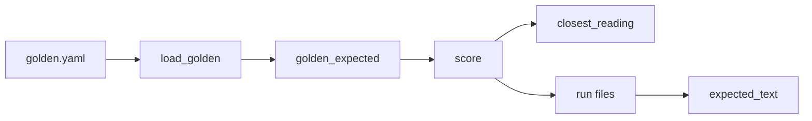
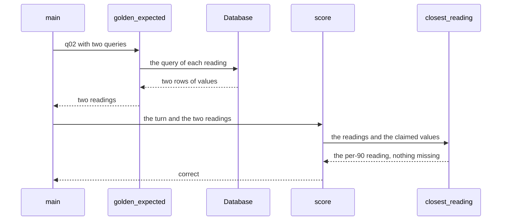

# Accept both readings of a golden question

| | |
| --- | --- |
| Work | Fix: a golden question can have more than one fair reading, and the evals accept an answer to each |
| Change | `17e6017` on `main`, 2026-10-14 |
| Evidence | `blueprint/history/fixes/accept-both-readings-of-a-golden-question.md` (spec with the notes of each step. Local, not in Git). The commit message. The build conversation. The study document of feature 16. |
| Reader | A learner who can write basic code and is new to this stack |

This document obeys the rules of ASD-STE100 Simplified Technical
English. It is not a certified STE document.

## 1. Summary

This work lets one golden question of the evals have two or more fair readings.
Each reading is a hand-written query. An answer is correct when it claims every
value of one reading. The fix gives q02 a second reading, and a new run of the
evals gives 15 of 15 to each model.

The one idea to remember: when the eval marks an answer wrong, first find out
if the answer or the eval is wrong.

## 2. Why this work exists

Feature 16 added the evals. Each golden item has one query, and its values are
the expected values. Question q02 asks: "Compare Henry in 2003-04 with Saka in 2025-26 on
goals and xG per 90."

The query of q02 read the question as goal totals and xG per 90. That gives 30,
7, 0.65, and 0.35. But "per 90" can also apply to the goals. That reading gives
0.81, 0.28, 0.65, and 0.35.

`gemini-3.5-flash-lite` failed q02 in both runs. A reproduction showed that it
used the second reading. All four of its claims passed the verifier, and its
chart matched. Thus the eval marked a correct answer wrong.

The cost was real. The model decision of feature 16 rested on a gap of 1.5
questions. With q02 counted, the gap was 0.5, which is a tie under the rule.

## 3. Design

The design changes one rule: an item has a list of readings, not one list of
values. The scorer picks the reading that the answer is closest to.

Two terms come from feature 16. A **golden item** is one question of
`evals/golden.yaml` with its expected result. A **claim** is one number of an
answer, and the verifier checks it against the rows of a tool call.

One term is new in this work. A **reading** is one fair meaning of a question,
written as one query. This work uses readings because English can be ambiguous,
and the agent must not fail for a fair choice.

| Part | Location | Job |
| --- | --- | --- |
| `also_sql` | `evals/golden.yaml` and `GoldenItem` in `evals.py` | Holds the queries of the other fair readings of an answered item. |
| `GoldenItem.queries` | `services/analyst/src/analyst/evals.py` | Returns the query of each reading, with `sql` first. |
| `load_golden` | `services/analyst/src/analyst/evals.py` | Sends each query of each item through the SQL guard before any model call. |
| `golden_expected` | `services/analyst/src/analyst/evals.py` | Runs each query and returns the values of each reading of each item. |
| `closest_reading` | `services/analyst/src/analyst/evals.py` | Finds the reading with the fewest values that no claim has. |
| `score` | `services/analyst/src/analyst/evals.py` | Scores one turn against the closest reading. |
| `expected_text` | `services/analyst/src/analyst/evals.py` | Writes each reading that the answers matched into the report. |

Support files:

- `test_evals.py`, with three cases for the readings, two load errors, and one
  case for the report.
- `evals/models.yaml`, with the new reason for the decision.
- `evals/results.md` and the four run files in `evals/runs/`, made again by the
  new run.

## 4. Workflow

Example input: the evals ask q02 on `gemini-3.5-flash-lite`. The answer claims
0.81, 0.28, 0.65, and 0.35, and all four claims pass.

1. `main` calls `load_golden` on `golden.yaml`. (`evals.py:641`)
2. The validator accepts `also_sql` only on an answered item. (`evals.py:59`)
3. `load_golden` sends both queries of q02 through the SQL guard. (`evals.py:145`)
4. `golden_expected` runs both queries on the database. (`evals.py:537`)
5. The readings of q02 are 30, 7, 0.65, 0.35 and 0.81, 0.28, 0.65, 0.35.
6. `run_model` asks q02 and gives the turn to `score`. (`evals.py:622`)
7. `score` collects the values of the claims that passed. (`evals.py:224`)
8. `closest_reading` finds two missing values in the first reading and none in the second. (`evals.py:201`)
9. `is_correct` gets an empty list of missing values and returns true. (`evals.py:192`)
10. `run_model` writes the run file with the per-90 values as `expected`. (`evals.py:626`)
11. `expected_text` puts each reading that the runs matched in the report. (`evals.py:373`)

## 5. Decisions and tradeoffs

### 5.1 The eval accepts both readings

- **Choice:** q02 gets a second reading. The question keeps its words.
- **Alternatives:** Change the words of the question. Only write the problem
  down.
- **Reason:** Recorded: both readings are fair, and the words of the demo question stay as
  it is. The user asked for the best fix after the three options. Source: the
  spec, Notes.
- **Cost:** The golden set must name each fair reading. A reading that nobody
  writes down still fails.

### 5.2 The fix does not change the prompt

- **Choice:** No change to the agent, the prompt, or the verifier.
- **Alternatives:** A prompt rule: "claim each number the question asks for".
- **Reason:** Recorded: the reproduction showed that the answer already
  claimed every number of its reading. Thus the prompt rule fixed nothing.
  Source: the spec, "The problem", and the result of step 1.
- **Cost:** None found.

### 5.3 Each reading is a full query

- **Choice:** `also_sql` is a list of queries, not a list of numbers.
- **Alternatives:** Write the expected numbers of the second reading in the
  file.
- **Reason:** Inferred: the `sql` field of feature 16 already gets its values
  from the data. A query stays correct when the data changes, and a number
  does not. From `golden_expected`, which runs each query at the start.
- **Cost:** Each reading repeats most of the first query. The q02 queries
  differ in two lines.

### 5.4 The scorer keeps the closest reading, and the run file keeps its shape

- **Choice:** `score` keeps the reading with the fewest missing values, and the
  first one on a tie. `expected` and `missing` hold only that reading.
- **Alternatives:** Store all readings and their missing values in each result.
- **Reason:** Recorded: the run file format does not change. Source: the spec,
  "The fix". Inferred: on a failure, the closer reading gives the most useful
  list of missing values. From the test of half of each reading.
- **Cost:** A run file does not say which reading it used, or that other
  readings exist.

### 5.5 Only an answered item has other readings, and the guard checks each one

- **Choice:** The validator rejects `also_sql` on an item that is not
  answered. `load_golden` guards each query.
- **Alternatives:** Guard only `sql`, and trust the other queries.
- **Reason:** Recorded: the spec states both rules. Inferred: an item that is
  unavailable or out of scope has no expected values. A query that writes must
  stop the evals before any model call. From `load_golden` and the load tests.
- **Cost:** None found.

### 5.6 The fix runs the full evals again

- **Choice:** Step 3 ran all 15 questions, 2 runs, on both models.
- **Alternatives:** Run only q02 with `--only`.
- **Reason:** Recorded: the old run files came from the old scorer, so only a
  new run gives a fair table. Also, `--only` writes a run file with only the
  chosen questions. Thus it replaces a full run file. Source: the spec, step 3
  and Notes.
- **Cost:** About $0.80 and 20 minutes. The first try stopped when the prepaid
  credit of the key ran out, and the run started again after a top-up.

### 5.7 The decision stays `gemini-3.8-flash`

- **Choice:** Production keeps `gemini-3.8-flash`, but the rule now proposes
  `gemini-3.5-flash-lite`.
- **Alternatives:** Change to Flash-Lite, which is about 6 times faster and 5
  times cheaper.
- **Reason:** Recorded: the demo follow-up "Only the ones inside the box."
  failed on Flash-Lite 2 times in 9. One failure was in the first evals, and
  one was in a check of 5 conversations. The user agreed before the check that
  any failure keeps Flash. Source: the spec, Notes, and `evals/models.yaml`.
- **Cost:** Each question costs about $0.023, not $0.004, and the median time
  is 22.3 s, not 3.8 s.

### 5.8 The report names each reading that the answers matched

- **Choice:** `expected_text` collects the expected values of each run and
  joins the different sets with "or".
- **Alternatives:** Show the expected values of the first run file, as before.
- **Reason:** Recorded: before this work, the report showed the reading of the
  first run file only. Source: the spec, Notes. Inferred: with two readings, the
  first run file can hide the reading of the other runs.
- **Cost:** The report shows only readings that a run matched, not each reading
  in the golden set.

## 6. Blast radius

### 6.1 This work needs

| Dependency | Used for | If it fails |
| --- | --- | --- |
| The view `v_player_season` (`goals`, `xg`, `minutes`) | The values of both readings of q02 | `golden_expected` stops the evals before any model call. |
| `sql_guard.guard` | A check of each golden query | A query that the guard rejects stops the load with the id of the item. |
| `tools.run_sql` and the role `analyst_ro` | Each golden query | The evals stop with "the golden query failed". |
| `cell_matches` | The match of a claim to an expected value | A wrong match marks a correct answer wrong, or the opposite. |

### 6.2 These things use this work

| Consumer | Uses | Found in |
| --- | --- | --- |
| `load_golden` | `GoldenItem.queries` | `services/analyst/src/analyst/evals.py:145` |
| `golden_expected` | `GoldenItem.queries` | `services/analyst/src/analyst/evals.py:543` |
| `main` | `golden_expected` | `services/analyst/src/analyst/evals.py:646` |
| `run_model` | `score` with the readings | `services/analyst/src/analyst/evals.py:622` |
| `question_table` | `expected_text` | `services/analyst/src/analyst/evals.py:397` |
| `test_evals.py` | `score`, `queries`, `also_sql` | `services/analyst/tests/test_evals.py:64` |

The agent, the API, and the web page do not use the evals. The production model
comes from `ANALYST_MODEL`, and this work does not change it.

### 6.3 If you change this work

| If you change | Then check |
| --- | --- |
| The shape of `QuestionResult` | `read_runs`, which must still read the committed run files |
| The tie rule of `closest_reading` | The test of an answer with no claim, which expects the first reading |
| A golden query or a view | `test_each_golden_query_runs_on_the_views`, then run the evals again |
| The decision in `models.yaml` | `ANALYST_MODEL` in `.env.example` and in the service of production |

### 6.4 How to remove this work

Revert commit `17e6017`. The revert also restores the old run files and
`results.md`, which agree with the old scorer. Then q02 fails for Flash-Lite
again, and the reason in `models.yaml` goes back to the gap of 1.5 questions. No
data and no configuration of production stays behind.

## 7. Code reading path

1. [`golden.yaml:33`](../evals/golden.yaml#L33) - Look for: the second reading of q02, and how it differs from the first.
2. [`evals.py:53`](../services/analyst/src/analyst/evals.py#L53) - Look for: the field, the rule for answered items, and `queries`.
3. [`evals.py:145`](../services/analyst/src/analyst/evals.py#L145) - Look for: the guard on each query, not only on `sql`.
4. [`evals.py:537`](../services/analyst/src/analyst/evals.py#L537) - Look for: one list of values for each reading.
5. [`evals.py:201`](../services/analyst/src/analyst/evals.py#L201) - Look for: the fewest missing values, and the first reading on a tie.
6. [`evals.py:224`](../services/analyst/src/analyst/evals.py#L224) - Look for: only passed claims count, and a failed turn claims nothing.
7. [`test_evals.py:161`](../services/analyst/tests/test_evals.py#L161) - Look for: the two readings of q02 as test data, and the three cases.
8. [`evals.py:373`](../services/analyst/src/analyst/evals.py#L373) - Look for: the readings from all runs, joined with "or".

## 8. Known limits

- A run file does not record which reading it matched. The report gets the
  readings from the `expected` values of the runs.
- `closest_reading` counts missing values only. If a later item has readings of
  different lengths, the shorter reading wins more ties.
- The check of the follow-up on Flash-Lite had 5 conversations. 2 failures in 9
  is a small sample.
- The `--only` defect of the runner is still there. It replaces a full run file
  with a short one.
- The study document of feature 16 still gives the old result: Flash-Lite at
  13.5 of 15, with the q02 miss as the reason.

## 9. Self-test

1. Why did the fix not add a prompt rule that tells the model to claim each number?
2. What happens if a query in `also_sql` writes to a table?
3. Why does `also_sql` hold queries and not the expected numbers?
4. Why does the evals keep `gemini-3.8-flash` when both models now get 15 of 15?
5. What happens if you run `evals --only q02` after a full run?

Answers

1. The answer already claimed every number of its reading, so the rule changes nothing. See section 5.2.
2. `load_golden` rejects it and the evals stop before any model call. See section 5.5.
3. A query follows the data, and a fixed number does not. See section 5.3.
4. Flash-Lite failed the demo follow-up 2 times in 9. See section 5.7.
5. The new run file holds only q02 and replaces the full run file. See sections 5.6 and 8.

