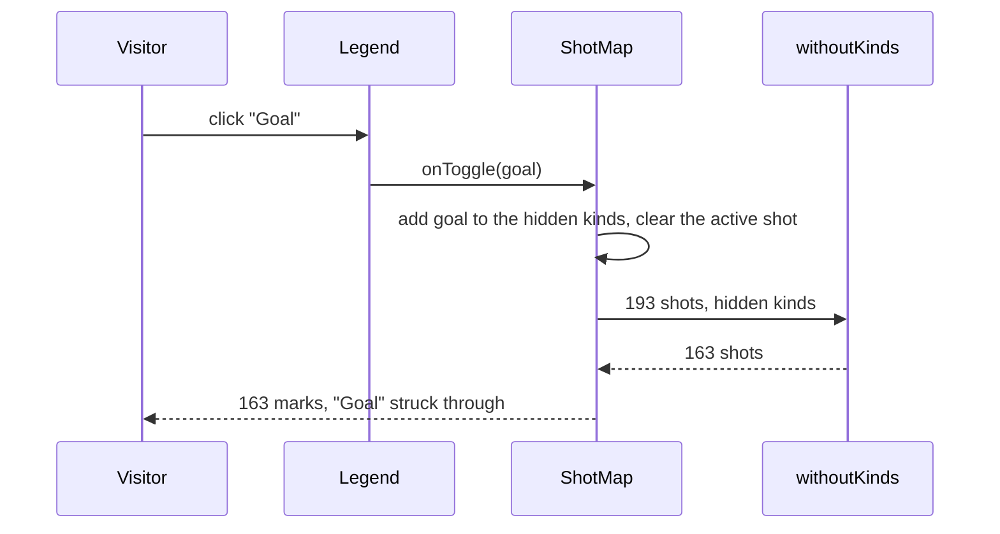

# Filter the shot map by outcome

| | |
| --- | --- |
| Work | Fix: the legend of the shot map shows and hides the marks of each outcome |
| Change | `e701f72` on `main`, 2026-10-14 |
| Evidence | `blueprint/history/fixes/filter-the-shot-map-by-outcome.md` (spec. Local, not in Git). The commit message. The build conversation, with the browser check. The study document of feature 12. |
| Reader | A learner who can write basic code and is new to this stack |

This document obeys the rules of ASD-STE100 Simplified Technical
English. It is not a certified STE document.

## 1. Summary

This work makes the legend of the shot map a filter. Each outcome in the legend
is a button. A click hides the marks of that outcome, and a second click shows
them again. A visitor uses it to look at one outcome alone, for example only
the goals.

The one idea to remember: the filter changes what the pitch draws, and nothing
else. The text summary still describes all the shots of the chart.

## 2. Why this work exists

A shot map of a full season is dense. Thierry Henry in 2003-04 has 193 marks,
and many of them overlap near the goal. Before this work, the visitor saw all
outcomes together and could not separate them. The legend named the outcomes
but did nothing.

The spec of feature 12 put filters out of scope. The user asked for them after
the first real maps, with one condition: the UI stays clean.

## 3. Design

The design adds one piece of state to `ShotMap`: the set of hidden outcomes.
One pure function applies it, and the legend changes it.

One term is new in this work. A **toggle button** is a button with two states,
on and off. The attribute `aria-pressed` gives the state to a screen reader.
This work uses it so that the legend is a control and not only a picture.

| Part | Location | Job |
| --- | --- | --- |
| `withoutKinds` | `apps/web/src/lib/shot-map.ts` | Returns the shots whose outcome kind is not hidden. |
| `Legend` | `apps/web/src/components/charts/shot-map.tsx` | Draws one toggle button for each outcome that the chart has marks for. |
| `ShotMap` | `apps/web/src/components/charts/shot-map.tsx` | Holds the set of hidden kinds and draws only the visible marks. |

Support file: `shot-map.test.ts`, with four cases for `withoutKinds`.

The design section has no flowchart, because the three parts are in two files
and the workflow diagram shows them all.

## 4. Workflow

Example input: the visitor clicks "Goal" on the map of Henry in 2003-04, which
shows 193 marks.

1. The button of the legend calls `onToggle` with the kind `goal`. (`shot-map.tsx:111`)
2. `toggleKind` copies the set of hidden kinds and adds `goal` to the copy. (`shot-map.tsx:214`)
3. `toggleKind` clears the active shot and sets the tab stop to 0. (`shot-map.tsx:221`)
4. React renders `ShotMap` again with the new set.
5. `withoutKinds` returns 163 of the 193 shots, with no goal. (`shot-map.ts:68`)
6. `ShotMap` draws 163 marks, and the label of the pitch gives that count. (`shot-map.tsx:210`)
7. `Legend` draws "Goal" with a line through it and `aria-pressed` false. (`shot-map.tsx:110`)
8. `summaryText` gets all the shots of the chart, so its text does not change. (`shot-map.tsx:304`)

## 5. Decisions and tradeoffs

### 5.1 The legend is the filter

- **Choice:** Each outcome of the legend is a button. The work adds no row of
  controls.
- **Alternatives:** A row of filter chips above the pitch. A menu.
- **Reason:** Recorded: the user asked for a clean UI, and the legend already
  names each outcome. Source: the spec, "The problem" and "The fix".
- **Cost:** The legend row is 44 px high, the touch target of the project. At
  390 px it has three rows.

### 5.2 A click toggles one outcome

- **Choice:** Each button turns its own outcome on or off.
- **Alternatives:** "Click to show only this outcome", with a second click to
  show all.
- **Reason:** Recorded: the visitor can combine outcomes, and each button shows
  its own state. Source: the build conversation, and the spec, "Out of scope".
- **Cost:** "Only the goals" needs four clicks when the chart has five
  outcomes.

### 5.3 The summary does not follow the filter

- **Choice:** `summaryText` always gets all the shots of the chart.
- **Alternatives:** A summary of the visible marks only.
- **Reason:** Recorded: the counts of the summary agree with the checked claims
  of the answer. Source: the spec, "It must not break".
- **Cost:** The summary can say "194 shots" when the pitch shows 30 marks.

### 5.4 The buttons have no counts, and no line says "Showing 30 of 194"

- **Choice:** A button is the mark and the label only.
- **Alternatives:** A count in each button. A line with the count of visible
  marks.
- **Reason:** Recorded: the summary already gives each count, and the dim
  buttons show what is hidden. Source: the spec, "Kept clean on purpose".
- **Cost:** A sighted visitor gets no count of the visible marks. A screen
  reader gets it from the label of the pitch.

### 5.5 The legend lists only the outcomes that have marks

- **Choice:** An outcome with no mark on the pitch has no button.
- **Alternatives:** The five known outcomes at all times, as in feature 12.
- **Reason:** Recorded: a button for an outcome with no marks does nothing.
  Source: the spec, "The fix".
- **Cost:** The legend is not the same for each chart.

### 5.6 A change of the filter clears the active shot

- **Choice:** `toggleKind` sets the hovered and the focused index to `null` and
  the tab stop to 0.
- **Alternatives:** Find the same shot in the new list and keep it active.
- **Reason:** Recorded: the indexes count the visible marks, so an old index is
  a different shot after a change. Source: a code comment in `toggleKind`.
- **Cost:** After a change, the Tab key goes to the first visible mark.

### 5.7 A button that is off has a line through its label

- **Choice:** The label is faint with a line through it, and the mark is dim.
- **Alternatives:** A change of colour only.
- **Reason:** Recorded: the state must be visible without the use of colour
  alone. Source: the spec, "The fix".
- **Cost:** None found.

## 6. Blast radius

### 6.1 This work needs

| Dependency | Used for | If it fails |
| --- | --- | --- |
| `outcomeKind` and `OUTCOME_KINDS` | The kind of each shot and the order of the buttons | A wrong kind hides the wrong marks. |
| The colour token `faint` | The label of a button that is off | The label keeps its normal colour. The line through it stays. |
| The spacing token `target` (`min-h-target`) | The height of a button | The buttons are smaller than the touch target. |

### 6.2 These things use this work

| Consumer | Uses | Found in |
| --- | --- | --- |
| `ShotMap` | `withoutKinds` | `apps/web/src/components/charts/shot-map.tsx:210` |
| `ShotMap` | `Legend` | `apps/web/src/components/charts/shot-map.tsx:298` |

`Legend` is local to its file. No other file uses the filter.

### 6.3 If you change this work

| If you change | Then check |
| --- | --- |
| The state of the active shot in `ShotMap` | `toggleKind`, which must reset each index that counts the visible marks |
| The input of `summaryText` | The summary must still count all the shots of the chart |
| The classes of a button that is off | The state must stay visible without colour |
| The list of kinds for `Legend` | A hidden kind must keep its button, or the visitor cannot turn it on again |

### 6.4 How to remove this work

Revert commit `e701f72`. The legend shows plain items again, with the five known
outcomes at all times. No data and no configuration stays behind.

## 7. Code reading path

1. [`shot-map.ts:68`](../apps/web/src/lib/shot-map.ts#L68) - Look for: the full filter in one line.
2. [`shot-map.test.ts:84`](../apps/web/src/lib/shot-map.test.ts#L84) - Look for: the case where an unknown outcome is hidden as `other`.
3. [`shot-map.tsx:193`](../apps/web/src/components/charts/shot-map.tsx#L193) - Look for: the state, a set that is not changed in place.
4. [`shot-map.tsx:208`](../apps/web/src/components/charts/shot-map.tsx#L208) - Look for: two lists, the drawn shots and the visible shots.
5. [`shot-map.tsx:214`](../apps/web/src/components/charts/shot-map.tsx#L214) - Look for: the copy of the set, and the four resets after it.
6. [`shot-map.tsx:98`](../apps/web/src/components/charts/shot-map.tsx#L98) - Look for: `aria-pressed`, and the classes of a button that is off.
7. [`shot-map.tsx:298`](../apps/web/src/components/charts/shot-map.tsx#L298) - Look for: the kinds come from the drawn shots, not from the visible shots.

## 8. Known limits

- With all outcomes off, the pitch is empty and no text says why.
- The filter is state of the component. A new answer starts with all outcomes
  on, and a link cannot hold a filter.
- The label of the list is still "Legend". It does not tell a screen reader
  that the buttons filter the pitch.
- Only `withoutKinds` has unit tests. The browser check covers the buttons.
- The browser check used a replay of the 194 database shots of Henry through a
  mocked answer. It made no request to the model.
- A mouse click replaced a tap. No check ran on a real touch screen.

## 9. Self-test

1. Why does the summary say "194 shots" when the pitch shows only 30 marks?
2. What happens if `toggleKind` does not reset the tab stop?
3. Why does the legend get its kinds from the drawn shots and not from the visible shots?
4. Why is a line through the label better than a change of colour alone?
5. What happens if the visitor turns off each outcome?

Answers

1. The summary counts all shots, because those counts agree with the checked claims. See section 5.3.
2. The old index can point to a different shot, or to no shot. See section 5.6.
3. A hidden outcome must keep its button, or it cannot come back. See section 6.3.
4. A visitor who cannot see the colour still sees the state. See section 5.7.
5. The pitch is empty, and no text explains it. See section 8.

