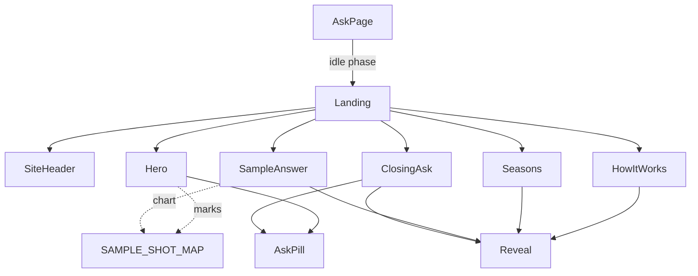
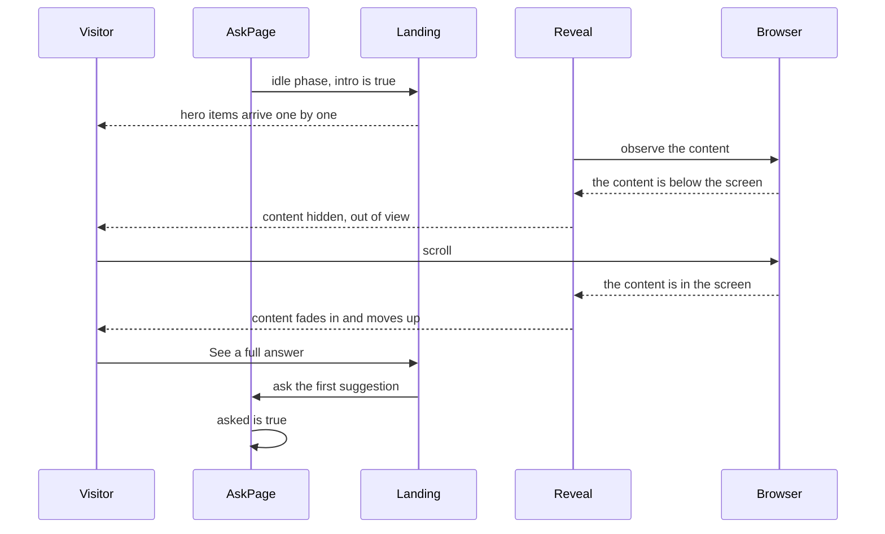

# Landing screen with the grass hero

| | |
| --- | --- |
| Work | Feature: the first screen of the page, built again from a new design reference |
| Change | `66a53c7` on `main`, 2026-10-14 (pull request 1, squash merge) |
| Evidence | The design reference in `blueprint/reference/` (`07-landing-page.html`, its stylesheet, its screenshot. Local, not in Git). The commit message. The build conversation, with the browser checks. No spec and no review record. |
| Reader | A learner who can write basic code and is new to this stack |

This document obeys the rules of ASD-STE100 Simplified Technical
English. It is not a certified STE document.

## 1. Summary

This work builds the first screen of the page again, from a new design
reference. A visitor sees a hero of grass with the question bar in it. Below
the hero, four sections explain the product. The chart on this screen is the
real shot map with real shots.

The one idea to remember: the screen is static content around one input. The
work adds one component with logic, `Reveal`, and one file of copied data.

## 2. Why this work exists

Before this work, the first screen had a headline, a pitch figure, the question
bar in a card, and a strip of three cards. Feature 14 built it.

Then the user made a new design reference for a full first screen. The user
asked for that design, with motion and a phone layout. Source: the build
conversation.

The old screen had three gaps that the reference fills.

- It did not show what each season holds, and where a season stops.
- It did not show a chart before the first question.
- Its pitch figure had 12 invented dots on a page that promises checked numbers.

## 3. Design

`AskPage` shows one component, `Landing`, while no question is active. `Landing`
puts the parts in order and gives each one the function that asks a question.

Five terms are new in this work.

- **`backdrop-filter`** is a CSS property that blurs what is behind an element.
  The header and the question bar use it, so the grass shows through them.
- **`IntersectionObserver`** is a browser interface that tells code when an
  element comes into the screen. `Reveal` uses it to start a motion at the
  correct moment.
- **`@utility`** is a Tailwind rule that makes a new class from plain CSS. The
  layers of the grass use it, because a gradient is too long for a class name.
- An **easing curve** sets the speed of a motion through its time. This work
  uses `--ease-out-strong`, which starts fast and stops slowly.
- An **italic font file** holds the true slanted letters of a font. Without
  it, the browser slants the upright letters, which looks wrong.

| Part | Location | Job |
| --- | --- | --- |
| `Landing` | `apps/web/src/components/ask/landing.tsx` | Puts the header, the hero, and the sections in order. |
| `Hero` | `apps/web/src/components/ask/hero.tsx` | Shows the grass, the headline, the question bar, and the sample card. |
| `AskPill` | `apps/web/src/components/ask/ask-pill.tsx` | The question bar of this screen: one row of glass. |
| `pill` and `PillDisc` | `apps/web/src/components/ask/pill.tsx` | The light button with a dark disc, as one class string. |
| `SiteHeader` | `apps/web/src/components/ask/site-header.tsx` | The header for each screen. On this screen it lies on the hero. |
| `Reveal` | `apps/web/src/components/ask/reveal.tsx` | Shows its content with a motion when the visitor scrolls to it. |
| `HowItWorks`, `Seasons`, `SampleAnswer`, `ClosingAsk` | `apps/web/src/components/ask/` | The four sections below the hero. |
| `SAMPLE_SHOT_MAP` | `apps/web/src/lib/sample-shots.ts` | Nine real shots, as a chart of the same form that the service sends. |
| Tokens and utilities | `apps/web/src/app/globals.css` | The colours of paper and grass, the easing curve, and the grass layers. |
| Tests | `globals.test.ts`, `sample-shots.test.ts` | Check the contrast of the new colours and the form of the sample. |

Support files: `layout.tsx` (the italic font files), `section-tag.tsx`,
`suggestion-chips.tsx`, `question-bar.tsx`, and one `export` in `shot-map.tsx`.

## 4. Workflow

Example input: a visitor opens the page at a width of 1440 px, scrolls to the
sample chart, and selects "See a full answer".

1. `AskPage` is in the idle phase, thus it returns `Landing` with `intro` set to true. (`ask-page.tsx:32`)
2. `Landing` puts `SiteHeader` on the hero, with a function that moves the focus to the bar. (`landing.tsx:33`)
3. `Hero` sets `data-intro`. Each item with `RISE` fades in and moves up 12 px. (`hero.tsx:13`)
4. The marks of the picture arrive on the grass after the text. (`hero.tsx:16`)
5. `useSuggestions` gets the questions. The chips arrive one by one, 60 ms apart. (`suggestion-chips.tsx:27`)
6. Each `Reveal` learns from the browser that its content is below the screen. It then hides the content. (`reveal.tsx:30`)
7. The visitor scrolls. The observer reports the content, and `Reveal` shows it in 700 ms. (`reveal.tsx:51`)
8. `SampleAnswer` draws `ShotMap` from `SAMPLE_SHOT_MAP`. The visitor can use the chart. (`sample-answer.tsx:43`)
9. The visitor selects "See a full answer". `Landing` asks the first suggestion. (`landing.tsx:56`)
10. `AskPage` sets `asked` to true and starts the question. (`ask-page.tsx:39`)

If the visitor later selects "New question", `Landing` shows again with `intro`
set to false. The hero then does not move.

If the visitor sends an empty bar, `AskPill` moves the focus to the input.
(`ask-pill.tsx:40`)

The row of the chips has its height before the questions come. Thus the page
below the row does not jump. (`landing.tsx:45`)

## 5. Decisions and tradeoffs

### 5.1 The first screen stays in the one page

- **Choice:** `Landing` is the idle phase of `AskPage`. There is no second route.
- **Alternatives:** A first screen at `/` and the analyst at `/ask`, as the
  links of the reference show.
- **Reason:** Recorded: the project rule asks for the smaller design that is
  easy to reverse. Source: the build conversation, and `AGENTS.md`.
- **Cost:** The address does not say which screen is in view. The Back button
  of the browser does not go from an answer to the first screen.

### 5.2 The question bar is in the hero

- **Choice:** The hero holds `AskPill`. The reference has a button there.
- **Alternatives:** The button of the reference, with the only input in the
  last panel.
- **Reason:** Recorded: in one page, the button can only send the visitor past
  each section to the last panel. Also, Stop and "Edit question" put the text
  back into a bar that takes the focus. Source: the build conversation.
- **Cost:** The hero is different from the reference. The screen has two bars.

### 5.3 The sample holds real shots

- **Choice:** `SAMPLE_SHOT_MAP` is a copy of nine rows of `v_shots`: the shots
  of Henry against Liverpool on 9 April 2004.
- **Alternatives:** The invented marks of the reference, with the label
  "Sample values".
- **Reason:** Recorded: a page that promises checked numbers must not show
  invented numbers. Source: the build conversation. Section 5.6 of the debrief
  of feature 14 names this cost.
- **Cost:** Nine rows from StatsBomb are in Git. The copy does not follow the
  database. The user must decide if this agrees with the rule for raw data.

### 5.4 The sample chart is the real `ShotMap`

- **Choice:** `SampleAnswer` gives the sample to the component that draws each
  answer.
- **Alternatives:** A static SVG, as the reference has.
- **Reason:** Recorded: a visitor can use the chart before a question, and the
  page has no second code for a shot map. Source: the build conversation.
- **Cost:** The pitch is tall, and its lower half is empty for this match. Thus
  the chart has a width limit of 680 px.

### 5.5 The enter motion of the hero plays one time

- **Choice:** `AskPage` keeps `asked`. After the first question, `intro` is false.
- **Alternatives:** The motion each time the first screen shows.
- **Reason:** Recorded: a visitor who comes back for a new question wants the
  bar at once. Source: the comment at `hero.tsx:10`.
- **Cost:** `AskPage` has one more state.

### 5.6 `Reveal` hides content only after the browser reports it

- **Choice:** The content starts in view. `Reveal` hides it when the observer
  says that it is below the screen.
- **Alternatives:** Hidden content in the HTML from the server. A CSS animation
  that follows the scroll position.
- **Reason:** Recorded: content that is in view at the start does not move, and
  a page with no JavaScript shows all of it. Source: the comment at
  `reveal.tsx:16`.
- **Cost:** The screen has 11 observers. `Reveal` runs only in the browser.

### 5.7 The Ask button of `AskPill` is not disabled

- **Choice:** The button always takes a press. With no text, it moves the focus
  to the input.
- **Alternatives:** A disabled button, as the follow-up bar has.
- **Reason:** Recorded: the first action of the page must look ready. Source:
  the comment at `ask-pill.tsx:37`.
- **Cost:** The two bars of the page behave in two different ways.

### 5.8 Two earlier decisions do not apply to this screen

- **Choice:** This screen has motion on the hero and on each section. It also
  has a section for what each season holds.
- **Alternatives:** The rules of feature 14: only two things move, and no
  coverage table.
- **Reason:** Recorded: the user asked for the new reference and for motion.
  Source: the build conversation.
- **Cost:** The project overview still says "Motion only for the step list to
  answer transition". The text of `Seasons` is a second copy of the data catalog.

### 5.9 Three items of the reference are not built

- **Choice:** The header has no link to Evals, no link to MCP, and no menu button.
- **Alternatives:** Links with no target, as the reference has.
- **Reason:** Recorded: the two links have no page to go to. Source: the build
  conversation.
- **Cost:** Below 1024 px the header has no links to the sections.

## 6. Blast radius

### 6.1 This work needs

| Dependency | Used for | If it fails |
| --- | --- | --- |
| `tw-animate-css` | The enter motion of the hero and the chips | The content shows with no motion. Nothing stops. |
| `IntersectionObserver` of the browser | The start of each `Reveal` | The content stays in view from the start. |
| `GET /api/suggestions` | The chips, and the question of "See a full answer" | The row of chips and that button do not show. |
| `ShotMap`, `ShotMark`, and the functions of `lib/shot-map.ts` | The sample chart and the small chart of the hero | The build fails. |
| The reduced-motion rule in `globals.css` | Motion off for a visitor who asks | `Reveal` still does not hide content. The hero motion plays. |
| The italic files of Barlow Condensed | The slanted words of the headlines | The browser slants the upright letters. |
| `backdrop-filter` in the browser | The glass of the header and the bar | The glass has a flat dark colour. The text stays readable. |

### 6.2 These things use this work

| Consumer | Uses | Found in |
| --- | --- | --- |
| `AskPage` | `Landing` | `apps/web/src/components/ask/ask-page.tsx:34` |
| `AskPage` and `page.tsx` | `SiteHeader` with no `onAsk` | `ask-page.tsx:48`, `apps/web/src/app/page.tsx:17` |
| `SiteHeader`, `AskPill`, `SampleAnswer` | `pill` and `PillDisc` | `site-header.tsx:1`, `ask-pill.tsx:5`, `sample-answer.tsx:1` |
| `AskPill` | `MAX_QUESTION_LENGTH` of `question-bar.tsx` | `ask-pill.tsx:6` |
| The four sections | `Reveal` | `how-it-works.tsx:3`, `seasons.tsx:3`, `sample-answer.tsx:2`, `closing-ask.tsx:3` |
| `Hero`, `SampleAnswer`, the test | `SAMPLE_SHOT_MAP` | `hero.tsx:129`, `sample-answer.tsx:43`, `sample-shots.test.ts:9` |
| `Hero` | `ShotMark`, now an export | `hero.tsx:171` |
| `AnswerBody` | `SuggestionChips`, with no `stagger` | `apps/web/src/components/ask/answer-body.tsx:56` |

### 6.3 If you change this work

| If you change | Then check |
| --- | --- |
| A colour token of paper or grass | `pnpm test`: the contrast test names the pair that fails. |
| The id of a section (`how`, `seasons`, `sample`) | The `SECTIONS` list in `site-header.tsx`. |
| The top padding of `Hero`, or the height of the header | The header lies on the hero. The text must start below it at each width. |
| The place of a mark in `Grass` | The sample card at 1024 px and 1440 px. It must not cover the marks. |
| `SAMPLE_SHOT_MAP` | The test, and the three literal texts in section 8. |
| `ShotMark` or `ShotMap` | The first screen. It now draws the two of them. |
| `pill` | The header of the answer screen. It uses the same class. |
| The `scroll-behavior` rule | The focus on the question title after an answer. |

### 6.4 How to remove this work

Revert commit `66a53c7`. The first screen then is the screen of feature 14, and
the answer screen gets its old header. The work stores no data and adds no
dependency, thus nothing stays behind.

## 7. Code reading path

1. [`apps/web/src/components/ask/ask-page.tsx:32`](../apps/web/src/components/ask/ask-page.tsx#L32) - Look for: the early return for the idle phase, and how `asked` becomes `intro`.
2. [`apps/web/src/components/ask/landing.tsx:25`](../apps/web/src/components/ask/landing.tsx#L25) - Look for: the order of the parts, and the one `ref` that the header and the bar share.
3. [`apps/web/src/components/ask/hero.tsx:199`](../apps/web/src/components/ask/hero.tsx#L199) - Look for: `data-intro` on the section, and the delay that grows from item to item.
4. [`apps/web/src/components/ask/hero.tsx:20`](../apps/web/src/components/ask/hero.tsx#L20) - Look for: the layers of the grass, and the group that a narrow screen does not draw.
5. [`apps/web/src/app/globals.css:215`](../apps/web/src/app/globals.css#L215) - Look for: four `@utility` rules, and the shade that changes direction at the `lg` width.
6. [`apps/web/src/components/ask/ask-pill.tsx:34`](../apps/web/src/components/ask/ask-pill.tsx#L34) - Look for: the two results of `submit`, and the focus ring on the form.
7. [`apps/web/src/components/ask/reveal.tsx:20`](../apps/web/src/components/ask/reveal.tsx#L20) - Look for: the three states, and why the first one is `static`.
8. [`apps/web/src/lib/sample-shots.ts:16`](../apps/web/src/lib/sample-shots.ts#L16) - Look for: a chart as plain data, of the same type as a chart of the service.
9. [`apps/web/src/components/ask/site-header.tsx:25`](../apps/web/src/components/ask/site-header.tsx#L25) - Look for: one prop that changes the position, the width, and the button.
10. [`apps/web/src/app/globals.test.ts:60`](../apps/web/src/app/globals.test.ts#L60) - Look for: the new pairs, and the comment on where the focus ring is.

## 8. Known limits

- Three texts are literal and do not come from the shots of `SAMPLE_SHOT_MAP`.
  They are "Goal · xG 0.31" and "9 April 2004 · StatsBomb" in `hero.tsx`, and
  the title of the sample. If the shots change, they stay. The debrief found
  this defect.
- The sample is a copy. It does not change when the database changes.
- The address keeps the id of a section after a link. A reload then opens the
  page at that section.
- The browser check used Chromium at 390, 768, 1024, and 1440 px. Nobody tested
  Safari, Firefox, a real phone, or a screen reader.
- Nobody measured the cost of the grain filter and the blur on a slow phone.
- `layout.tsx` declares italic files for the weights 700 and 800. No text uses them.
- The contrast test checks token pairs. The text of the hero is on grass with a
  shade, which the test does not see.
- The work has no spec and no review. The pull request got no review comment.
- The project overview still has the old rule for motion.

## 9. Self-test

1. Why does the hero not move when a visitor comes back for a new question?
2. What happens to the sections below the hero if the browser has no JavaScript?
3. Why is the question bar in the hero, when the reference has a button there?
4. What happens if you change one shot in `SAMPLE_SHOT_MAP`?
5. Why does the row of chips have its place before the questions arrive?

Answers

1. `AskPage` sets `asked` after the first question, so `intro` is false and `data-intro` is not on the section. See section 5.5.
2. They all show. `Reveal` hides content only after the observer reports it, and the observer needs JavaScript. See section 5.6.
3. In one page the button can only scroll past each section. Also, a text that goes back to the bar needs the bar at the top. See section 5.2.
4. The two charts follow the change, the test fails on its summary, and three literal texts stay as they were. See sections 6.3 and 8.
5. The page below the row then does not jump when the chips come. See the end of section 4.

