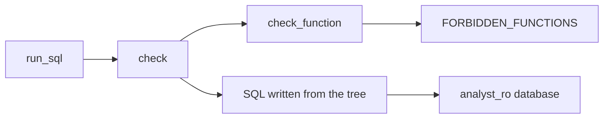
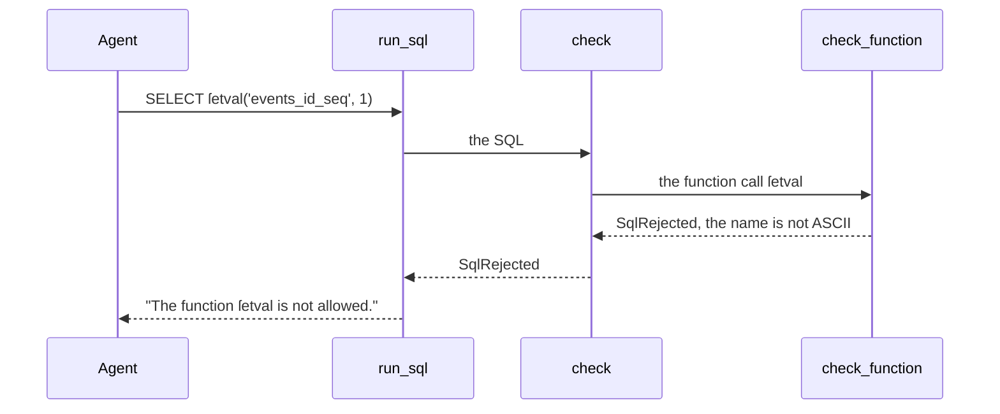

# Reject sequence write functions in the SQL guard

| | |
| --- | --- |
| Work | Fix: the SQL guard rejects the functions that change a sequence, and any function name that is not ASCII |
| Change | `a894ee8` on `main`, 2026-10-14 |
| Evidence | `blueprint/history/fixes/reject-sequence-write-functions-in-the-sql-guard.md` (spec, closed findings F-01 and F-25, and the receipt of the independent review. Local, not in Git). The commit messages. The build conversation, with the probes. |
| Reader | A learner who can write basic code and is new to this stack |

This document obeys the rules of ASD-STE100 Simplified Technical
English. It is not a certified STE document.

## 1. Summary

The analyst agent writes SQL from the question of a visitor. Two locks stop
that SQL from a change to the database. This work makes the first lock, the SQL
guard, reject `nextval` and `setval`, and any function name with a letter that
is not ASCII.

The one idea to remember: a check must look at the text that the database gets,
not only at the text that came in.

## 2. Why this work exists

Feature 5 built two locks on model-written SQL:

- The **parser lock** is `sql_guard.py`. It parses the SQL with sqlglot and lets
  only one read-only SELECT on the five agent views through.
- The **database lock** is the role `analyst_ro`. It has SELECT grants only, and
  each query runs in a READ ONLY transaction.

The contract is that each lock holds when the other one fails. An audit of
feature 5 found F-01: the parser lock accepted `nextval` and `setval`. Both
functions change a sequence, but they read as a plain SELECT with a function
call. Only the database lock stopped them.

The first repair added the two names to a list of forbidden functions. Then the
independent review found F-25: `SELECT ſetval('events_id_seq', 1)` still got
through. The first letter is U+017F, the long s. The guard did not know that
name, but the database got `SETVAL`.

## 3. Design

The design adds two rules to one function, `check_function`. That function sees
each function call in the parsed SQL.

Two terms are new in this work.

- A **sequence** is a PostgreSQL object that gives the next number of an id
  column. `nextval` moves it forward, and `setval` sets it. This work rejects
  them because a change to a sequence is a write.
- **ASCII** is the set of 128 basic characters: the letters A to Z, digits, and
  common signs. This work rejects a function name outside it, because sqlglot
  can change such a name before the database sees it.

| Part | Location | Job |
| --- | --- | --- |
| `FORBIDDEN_FUNCTIONS` | `services/analyst/src/analyst/sql_guard.py` | Names the functions that the guard rejects by exact name. |
| `check_function` | `services/analyst/src/analyst/sql_guard.py` | Folds the name of one function call and rejects it if a rule matches. |
| `check` | `services/analyst/src/analyst/sql_guard.py` | Parses the SQL, calls `check_function` for each call, and writes the SQL again from the tree. |
| `run_sql` | `services/analyst/src/analyst/tools.py` | Calls the guard, then sends the written SQL to the database as `analyst_ro`. |

Support file: `test_sql_guard.py`, with eight new rejection cases.

## 4. Workflow

Example input: the model sends `SELECT ſetval('events_id_seq', 1)` to `run_sql`.

1. `run_sql` gives the SQL to the guard. (`tools.py:143`)
2. `check` parses the SQL into a tree with sqlglot. (`sql_guard.py:71`)
3. `check` finds one function call and calls `check_function`. (`sql_guard.py:87`)
4. `check_function` takes the name `ſetval` and folds A to Z only. (`sql_guard.py:94`)
5. The name is not ASCII, so `check_function` raises `SqlRejected`. (`sql_guard.py:102`)
6. `run_sql` returns the error text to the agent. No query goes to the database.

Before this work, step 5 found no match. Then `check` wrote the tree as text with
the name `SETVAL`. (`sql_guard.py:91`)

## 5. Decisions and tradeoffs

### 5.1 The parser lock rejects the two functions, and the database lock stays as it is

- **Choice:** Add `nextval` and `setval` to `FORBIDDEN_FUNCTIONS`.
- **Alternatives:** Trust the database lock alone, because `analyst_ro` has no
  sequence privilege.
- **Reason:** Recorded: each lock must hold when the other one fails. A later
  grant of sequence USAGE, or a use of the guard outside a READ ONLY
  transaction, would make the call a real write. Source: F-01, "Why it matters".
- **Cost:** None found. No view exposes a sequence, so no analyst query needs
  these functions.

### 5.2 `currval` and `lastval` stay allowed

- **Choice:** The guard accepts `currval` and `lastval`.
- **Alternatives:** Reject all four sequence functions, as F-01 suggested as an
  example.
- **Reason:** Recorded: they only read the state of the session, and they fail
  unless the same session called `nextval` first. Source: the spec, "The fix".
- **Cost:** The guard lets two sequence functions through. The database refuses
  them, because `analyst_ro` has no sequence privilege.

### 5.3 A function name that is not ASCII is rejected

- **Choice:** `check_function` rejects a name with any character outside ASCII.
- **Alternatives:** Fold the name with `str.upper` first, as sqlglot does, then
  compare. Or reject non-ASCII text in the whole SQL.
- **Reason:** Recorded: sqlglot writes an unknown name with Python `str.upper`.
  That function maps some letters to ASCII: the long s to S, and the dotless i to
  I. Source: F-25, and the comment in `check_function`. Inferred: no
  PostgreSQL function that the agent needs has a non-ASCII name. A copy of the
  rule of sqlglot can break when sqlglot changes. From the spec, step 2.
- **Cost:** A real function with a non-ASCII name cannot run. None exists in
  the agent's views or in PostgreSQL.

### 5.4 The rule covers only function names

- **Choice:** Text in string literals and aliases can still have any character.
- **Alternatives:** Reject non-ASCII text in the whole statement.
- **Reason:** Inferred: player names such as Pirès have letters outside ASCII,
  and a query must match them. From the probe of the review, where an `ILIKE
  '%Pirès%'` query returned rows.
- **Cost:** No test guards this behavior yet. F-26 records it.

### 5.5 The fix lands after a second independent review

- **Choice:** Repair F-25 on the same branch as step 2, and review again.
- **Alternatives:** Land step 1, and repair F-25 in a later fix.
- **Reason:** Recorded: the user chose to repair it on this branch. A change to
  the code made the first receipt stale, so a fresh reviewer checked both
  steps. Source: the spec, Notes.
- **Cost:** Two checkpoints and two reviews for a change of 17 lines.

## 6. Blast radius

### 6.1 This work needs

| Dependency | Used for | If it fails |
| --- | --- | --- |
| sqlglot 30.22.0 | The parse, and the SQL that goes to the database | A new version can write names in a different way. Run the guard tests and the probes again after an upgrade. |
| `str.isascii` | The non-ASCII rule | Part of Python 3.12. No failure mode found. |

### 6.2 These things use this work

| Consumer | Uses | Found in |
| --- | --- | --- |
| `run_sql` | `guard` | `services/analyst/src/analyst/tools.py:143` |
| `load_golden` of the evals | `guard` on each golden query | `services/analyst/src/analyst/evals.py:145` |
| The MCP server | `run_sql` | `services/analyst/src/analyst/mcp_server.py` |

### 6.3 If you change this work

| If you change | Then check |
| --- | --- |
| `FORBIDDEN_FUNCTIONS` or the non-ASCII rule | `test_a_function_that_can_do_harm_is_rejected` and `test_a_read_only_select_on_the_views_is_accepted` |
| The non-ASCII rule, to cover more than names | Questions about players with accents. F-26 has no test for this yet. |
| The version of sqlglot | The guard suite, and a probe with `ſetval` and `tſ_stat` |
| The grants of `analyst_ro` | A sequence grant removes the second lock for `currval` |

### 6.4 How to remove this work

Revert commit `a894ee8`, then build and deploy a new API image. The guard accepts
`nextval`, `setval`, and non-ASCII names again. The database lock still refuses
the writes. No data and no configuration stays behind.

## 7. Code reading path

1. [`sql_guard.py:31`](../services/analyst/src/analyst/sql_guard.py#L31) - Look for: the two new names in the list.
2. [`sql_guard.py:94`](../services/analyst/src/analyst/sql_guard.py#L94) - Look for: the fold of A to Z only, and why.
3. [`sql_guard.py:99`](../services/analyst/src/analyst/sql_guard.py#L99) - Look for: the comment on `str.upper`, and the first rule.
4. [`sql_guard.py:91`](../services/analyst/src/analyst/sql_guard.py#L91) - Look for: the SQL that goes out comes from the tree, not from the input.
5. [`test_sql_guard.py:137`](../services/analyst/tests/test_sql_guard.py#L137) - Look for: the five ASCII forms and the three non-ASCII forms.
6. [`db.py:58`](../services/analyst/src/analyst/db.py#L58) - Look for: the second lock, a READ ONLY transaction.
7. [`0003_roles.sql:25`](../db/migrations/0003_roles.sql#L25) - Look for: `analyst_ro` gets SELECT only, and no sequence grant.

## 8. Known limits

- F-26 (P3, open): no guard test shows that non-ASCII text outside a function
  name still passes.
- The guard depends on how sqlglot 30.22.0 writes SQL. A quoted name also goes
  out in upper case, which fails closed.
- `currval` and `lastval` pass the guard. Only the database lock refuses them.
- The fix reached production in the API image `highbury-api:2026-10-14-2`.

## 9. Self-test

1. Why did the guard accept `nextval` before this work, when it rejects `set_config`?
2. What happens if `analyst_ro` gets USAGE on the sequences and the guard has no rule for `setval`?
3. Why did `ſetval` get past the first repair?
4. Why does the guard not reject non-ASCII text in the whole SQL?
5. What must you do after an upgrade of sqlglot?

Answers

1. The guard rejects only the names in its lists, and `nextval` was not in them. See section 2.
2. The parser lock lets it through, so a sequence write can occur. See section 5.1.
3. sqlglot wrote the name with `str.upper`, and the database got `SETVAL`. See section 5.3.
4. A player name such as Pirès must match in a query. See section 5.4.
5. Run the guard tests and the probes again, because the written SQL can change. See section 6.1.

