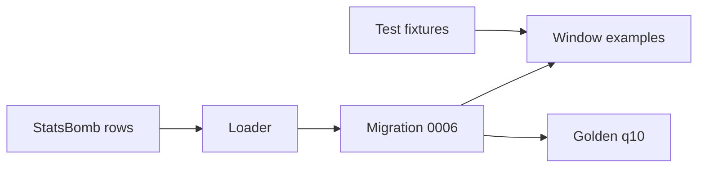
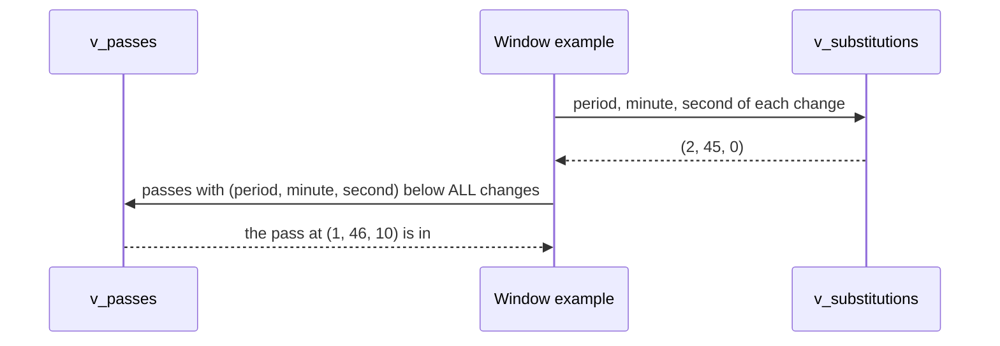

# Store the event period for the starting XI window

| | |
| --- | --- |
| Work | Fix: the starting XI window of the pass network orders events by half, not by the clock alone. It repairs F-25 and F-26 |
| Change | `7900abe` on `main` (squash of `790cf35`, base `2446249`), 2026-10-22 |
| Evidence | `blueprint/history/fixes/store-the-event-period-for-the-starting-xi-window.md` (fix spec, closed findings F-25 and F-26, and the passed independent review. Local, not in Git). The commit message. The build conversation. |
| Reader | A learner who can write basic code and is new to this stack |

This document obeys the rules of ASD-STE100 Simplified Technical
English. It is not a certified STE document.

## 1. Summary

Feature 17 made the pass network stop at Arsenal's first substitution. It
compared the clock of each pass with the clock of that substitution. This fix
stores the half of the match, the **period**, on each event, and compares
`(period, minute, second)` instead. One match of 38 changes: Arsenal v
Middlesbrough gets 8 passes back.

The one idea to remember: a clock that starts again is not an order. The order
of two events needs the period and the clock together.

## 2. Why this work exists

StatsBomb starts the clock of each half at its own minute. First-half stoppage
time runs at minute 45, 46, and 47 of period 1. Then period 2 starts again at
45:00. Source: F-25.

Feature 17 compared `minute * 60 + second`, and the views kept no period. Thus a
half-time substitution, at 45:00 of period 2, looked earlier than a pass at
46:10 of period 1. The window then dropped every first-half stoppage pass of the
starting XI. The independent review of feature 17 found this as F-25 (P2).

The review also found F-26 (P3): no test checked the `player_on` and `reason`
columns of `v_substitutions`. A swapped join could pass the tests.

The loader already knew the period. `nominal_minute` uses it to count the
minutes of each player (`statsbomb.py:142`). But the loader did not store it.

## 3. Design

The fix adds one column, shows it in two views, and changes two SQL fragments
that the agent copies.

Two terms are new in this work.

- A **row comparison** compares two lists of values from left to right, like
  words in a dictionary. This work uses `(period, minute, second)` so that the
  period decides first and the clock decides second.
- **`< ALL (subquery)`** is true when the left side is smaller than every row of
  the subquery. This work uses it because it is also true when the subquery has
  no rows, so a match with no substitution keeps every pass.

| Part | Location | Job |
| --- | --- | --- |
| Migration 0006 | `db/migrations/0006_event_period.sql` | Adds `events.period` and a `period` column to `v_passes` and `v_substitutions`. |
| Loader | `ingest/src/ingest/load.py` | Writes the period of each event in the upsert. |
| StatsBomb rows | `ingest/src/ingest/statsbomb.py` | Takes the period from each StatsBomb event. |
| Window examples | `services/analyst/src/analyst/prompt.py` | Order passes and substitutions by `(period, minute, second)`. |
| Golden q10 | `evals/golden.yaml` | Accepts the starting XI count and the whole-match count. |
| Test fixtures | `services/analyst/tests/conftest.py` | Load the Liverpool match with a half-time change, or with no change. |

## 4. Workflow

Example input: the windowed network query for Arsenal v Middlesbrough, 2004-01-10
(local `match_id` 35), on the reloaded data.

1. The loader stores each event with its period. (`statsbomb.py:233`)
2. The upsert writes the period to `events`. (`load.py:258`)
3. `v_substitutions` shows the half-time change at 45:00, period 2. (`0006_event_period.sql:37`)
4. `v_passes` shows a first-half pass at 46:10, period 1. (`0006_event_period.sql:8`)
5. The example compares `(1, 46, 10)` with `(2, 45, 0)`. (`prompt.py:66`)
6. Period 1 is smaller than period 2, so the pass stays in.
7. `UNTIL_MINUTE` takes the first change in period order: 45. (`prompt.py:58`)

On the local data, match 35 went from 198 to 206 completed passes, with
`until_minute` 45. The Liverpool match stayed at 341 passes and 71'. The
review checked all 38 matches, and only match 35 changed.

## 5. Decisions and tradeoffs

### 5.1 Store the period

- **Choice:** Add `events.period` and compare `(period, minute, second)`.
- **Alternatives:** Document the limit and accept the loss in one match. Or order the events by the StatsBomb possession number.
- **Reason:** Recorded: the review called the period "the smallest exact fix", and the user chose a fix before production. Source: F-25 and the build conversation. Inferred: a possession number does not show where a substitution falls inside a possession.
- **Cost:** A schema change, so production needs migration 0006 and a reload.

### 5.2 `< ALL` replaces the sentinel

- **Choice:** `(period, minute, second) < ALL (SELECT ...)`.
- **Alternatives:** Keep `COALESCE` with the large number 100000 when no change exists.
- **Reason:** Recorded: `ALL` over no rows is true, so the sentinel goes. Source: fix spec, The fix. The builder checked that the SQL guard accepts the form before the spec.
- **Cost:** The local query took about 100 to 190 ms, against 7 to 12 ms before. The review put most of it on query compile time. Source: review receipt.

### 5.3 The column can be null

- **Choice:** `period` has no `NOT NULL`, only a check from 1 to 5.
- **Alternatives:** `NOT NULL` with a default value.
- **Reason:** Recorded: the migration must apply to rows that the loader wrote before. The reload then fills every row. Source: fix spec, The fix.
- **Cost:** A null period never compares as smaller. If the migration runs and the reload does not, every starting XI network is empty, and the claims back 0. Source: review receipt, Remaining risk.

### 5.4 The new field goes last

- **Choice:** `period` is the last field of `load.EventRow`, with the default `None`.
- **Alternatives:** Put it next to `minute` and `second`.
- **Reason:** Recorded: tests build this row by position. Source: comment at `load.py:85`.
- **Cost:** The field order no longer follows the order of the columns.

### 5.5 q10 accepts two readings

- **Choice:** `sql` is the starting XI count (341). `also_sql` is the whole-match count (416).
- **Alternatives:** Keep only the whole-match count.
- **Reason:** Recorded: feature 17 made the starting XI the default answer, and the whole match is a fair reading. Source: fix spec, The fix.
- **Cost:** An answer passes with either count, so the eval cannot tell which reading the agent chose.

## 6. Blast radius

### 6.1 This work needs

| Dependency | Used for | If it fails |
| --- | --- | --- |
| Migration 0006 | The `period` column | The windowed example fails with "column does not exist". |
| A StatsBomb reload after 0006 | A period on every event | Every period is null, and each starting XI network is empty. |
| The `period` key of StatsBomb events | The value to store | The loader stops with a `KeyError`. StatsBomb gives it on every event. |

### 6.2 These things use this work

| Consumer | Uses | Found in |
| --- | --- | --- |
| The window examples | `v_passes.period`, `v_substitutions.period` | `services/analyst/src/analyst/prompt.py:58` |
| Golden question q10 | `v_passes.period` | `evals/golden.yaml:114` |
| `get_schema` | The new column comments | `db/migrations/0006_event_period.sql:62` |

No code in the web app reads the period.

### 6.3 If you change this work

| If you change | Then check |
| --- | --- |
| The views | `CREATE OR REPLACE VIEW` can only add columns at the end. |
| The window examples | The three Liverpool fixtures and the golden q10 query. |
| `EventRow` | Every test that builds the row by position. |

### 6.4 How to remove this work

1. Revert `7900abe`.
2. Add a migration that drops `period` from both views and from `events`.
3. Accept that F-25 comes back for match 35.

## 7. Code reading path

1. [`db/migrations/0006_event_period.sql:1`](../db/migrations/0006_event_period.sql#L1) - Look for: why only the period orders events across half time.
2. [`ingest/src/ingest/statsbomb.py:142`](../ingest/src/ingest/statsbomb.py#L142) - Look for: the period that the loader used before this fix.
3. [`ingest/src/ingest/load.py:86`](../ingest/src/ingest/load.py#L86) - Look for: the new field and its place.
4. [`services/analyst/src/analyst/prompt.py:56`](../services/analyst/src/analyst/prompt.py#L56) - Look for: the row comparison and `< ALL`.
5. [`services/analyst/tests/conftest.py:213`](../services/analyst/tests/conftest.py#L213) - Look for: a pass that reads later on the clock but comes first.
6. [`services/analyst/tests/test_prompt.py:111`](../services/analyst/tests/test_prompt.py#L111) - Look for: the test that failed on the old window.
7. [`ingest/tests/test_schema.py:144`](../ingest/tests/test_schema.py#L144) - Look for: the F-26 test of every column of a substitution.

## 8. Known limits

- The deploy order matters. On Neon, run migrations 0005 and 0006, then the StatsBomb and curated reloads, before the new API image.
- The review measured the query time on the local database only, not on Neon.
- No paid model call or eval run confirms that the agent copies the new window.
- F-27 (P3) stays open: the feature 17 spec names a function that does not exist.
- A sending-off still does not end the window.

## 9. Self-test

1. Why does `minute * 60 + second` give the wrong order at half time?
2. What happens if Arsenal made no substitution in a match?
3. What happens if migration 0006 runs on Neon but the StatsBomb reload does not?
4. Why is `period` the last field of `EventRow`?
5. Why can q10 not tell which reading the agent chose?

Answers

1. Each half starts its own clock, and period 2 starts at 45:00. Thus a stoppage pass at 46:10 of period 1 reads later than a change at 45:00. See section 2.
2. The subquery has no rows, and `< ALL` over no rows is true. Thus the network keeps every pass, and `until_minute` is null. See section 5.2.
3. Every period is null, and a null period never compares as smaller. Each starting XI network is empty. See section 5.3.
4. Tests build the row by position, so a field in the middle breaks them. See section 5.4.
5. The answer passes with the starting XI count or the whole-match count. See section 5.5.

