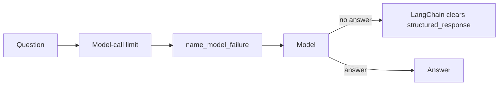
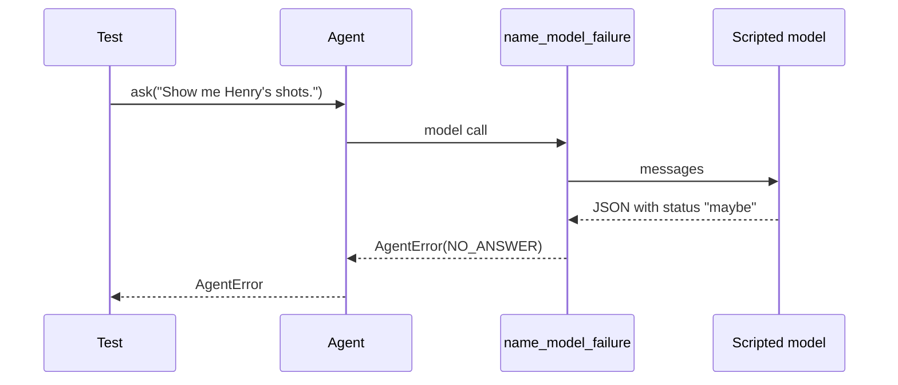

# Agent hook cleanup and structured-output tests

| | |
| --- | --- |
| Work | Fix: remove one agent middleware that repeats LangChain, and add tests for two paths that no test guarded |
| Change | `543d9dc` on `main`, 2026-10-26 |
| Evidence | `blueprint/history/fixes/agent-hook-cleanup-and-structured-output-tests.md` (spec, evidence, findings F-02, F-03, F-04, F-27. Local, not in Git). GitHub issue #2. The commit message. The build conversation. |
| Reader | A learner who can write basic code and is new to this stack |

This document obeys the rules of ASD-STE100 Simplified Technical
English. It is not a certified STE document.

## 1. Summary

This fix repairs four small findings of earlier reviews. It removes the
`forget_last_answer` middleware from the agent, because the installed
LangChain does the same work. It adds tests for the provider path of the
structured answer and for the model-call limit of each question. The behavior
of the service does not change, so the fix needs no deploy.

The one idea to remember: a test proves a rule only when a wrong program fails
it. The fix checked that with a mutation.

## 2. Why this work exists

Earlier reviews of the agent found three defects in `agent.py` and its tests:

- **F-02.** A `before_agent` middleware cleared the answer of the turn before.
  LangChain 1.4.4 already clears it, so the hook was one more part for a
  reader to understand.
- **F-03.** The scripted model of the tests has no profile. Thus each test took
  the tool strategy, and one `except` branch ran in no test.
- **F-04.** The only test with long turns made 14 model calls in total. The
  limit is 15, so the test also passed with a limit for the full conversation.

A fourth finding, F-27, was a gap in a local record. The archived spec of
feature 17 names a `tableRows` function that the build does not have.

## 3. Design

The fix has three parts. Only one part changes code of the service, and that
part removes lines.

| Part | Location | Job |
| --- | --- | --- |
| Middleware list | `services/analyst/src/analyst/agent.py` (`build_agent`) | Builds the agent with five middlewares, not six. |
| Agent tests | `services/analyst/tests/test_agent.py` | Guard the provider path and the limit for each question. |
| Archive note | `blueprint/history/features/17-pass-network-polish.md` | Says that the table rows are the result of `visibleLinks`. |

Three terms are new in this work:

- A **middleware** is a function that LangChain runs around each model call or
  tool call. The agent uses middlewares for the limits and for the usage count.
- A **structured answer** is the `Answer` object that the model must return.
  LangChain gets it in one of two ways, which it calls strategies.
- The **tool strategy** asks the model to call a tool named `Answer`. The
  **provider strategy** asks the provider for JSON of the `Answer` shape.

LangChain picks the strategy from the **profile** of the model. A profile is a
dictionary that tells what the model can do. If the profile says
`structured_output`, LangChain uses the provider strategy.

## 4. Workflow

Example input: the test `test_a_provider_answer_of_a_wrong_shape_fails`. The
scripted model has the profile `{"structured_output": True}`. Its one reply is
JSON of an answer with the status `maybe`.

1. The test builds the agent with the scripted model. (`services/analyst/tests/test_agent.py:374`)
2. LangChain reads the profile and picks the provider strategy. (`services/analyst/src/analyst/agent.py:221`)
3. The model-call limit counts one call. (`services/analyst/src/analyst/agent.py:236`)
4. The model gives the JSON reply. LangChain parses it as an `Answer`.
5. The status `maybe` is not valid, so LangChain raises `StructuredOutputError`.
6. `name_model_failure` turns it into `AgentError` with `NO_ANSWER`. (`services/analyst/src/analyst/agent.py:186`)
7. The test asserts the text and the class of the cause. (`services/analyst/tests/test_agent.py:374`)

## 5. Decisions and tradeoffs

### 5.1 The hook goes, and the test stays

- **Choice:** Delete `forget_last_answer`. Keep `test_a_turn_that_ends_with_no_structured_answer_fails`.
- **Alternatives:** Keep the hook and write in its docstring why it stays.
- **Reason:** Recorded: LangChain 1.4.4 sets `structured_response` to `None`
  on each model call with no structured answer. The project rule is to reuse
  an installed dependency before new machinery. Source: finding F-02, and
  `langchain/agents/factory.py`, `_build_commands`, lines 256 to 260.
- **Cost:** The floor in `pyproject.toml` is `langchain>=1.0`. An older release
  can lack this behavior. The app runs the lock file, and the kept test fails first.

### 5.2 The provider path gets tests and no code change

- **Choice:** Two tests give the scripted model a profile. No code of the service changes.
- **Alternatives:** Give the real model a fixed strategy in `build_agent`.
- **Reason:** Recorded: the code is correct today, but no test guarded it. A
  package upgrade can move the agent to the provider path with no code change.
  Source: finding F-03.
- **Cost:** The tests depend on the name of the profile key in LangChain.

### 5.3 A mutation proves the limit test

- **Choice:** The test of the limit has a third turn, 21 model calls in total.
  The builder changed `run_limit` to `thread_limit` once, and the test failed.
- **Alternatives:** A new small test, as F-04 also suggests.
- **Reason:** Inferred: the old test already has the right shape, so one
  more turn is the smallest change. Source: the diff of `test_agent.py`.
- **Cost:** The test now runs 18 queries on the test database, not 12.

### 5.4 The archive gets a note after its annotation

- **Choice:** The note is a new section at the end of the feature 17 archive.
- **Alternatives:** Edit build step 3 of the archived spec.
- **Reason:** Recorded: the completion annotation holds a SHA-256 hash of the
  spec bytes, so an edit of the spec breaks the record. Source: the Evidence
  section of the fix spec.
- **Cost:** A reader of step 3 must read to the end of the file to see the note.

## 6. Blast radius

### 6.1 This work needs

| Dependency | Used for | If it fails |
| --- | --- | --- |
| LangChain 1.4.4 | The clear of a stale answer, and the two strategies | If a new release stops the clear, the kept test fails. |
| The local Postgres | The `seeded` fixture of each agent test | The tests wait or fail before their first assertion. |

### 6.2 These things use this work

| Consumer | Uses | Found in |
| --- | --- | --- |
| The analyst API | `agent.build_agent` and `agent.ask` | `services/analyst/src/analyst/api.py` |
| The `ask` command | `agent.build_agent` and `agent.ask` | `services/analyst/src/analyst/cli.py` |
| The evals | `agent.build_agent` and `agent.ask` | `services/analyst/src/analyst/evals.py` |

No code used `forget_last_answer` outside `build_agent`. A search of the
repository found no other reference.

### 6.3 If you change this work

| If you change | Then check |
| --- | --- |
| The version of LangChain | `test_a_turn_that_ends_with_no_structured_answer_fails` and the two provider tests. |
| `MODEL_CALL_LIMIT` | The 21 calls of the limit test must stay above the limit. |
| The scripted model in `scripted.py` | The `profile` field, which the provider tests set. |

### 6.4 How to remove this work

Revert the commit `543d9dc`. The hook comes back and the agent works the same.
The suite loses two tests and one turn. The archive note is local and stays.

## 7. Code reading path

1. [`services/analyst/src/analyst/agent.py:235`](../services/analyst/src/analyst/agent.py#L235) - Look for: the middleware list with no hook.
2. [`services/analyst/src/analyst/agent.py:181`](../services/analyst/src/analyst/agent.py#L181) - Look for: the branch that turns `StructuredOutputError` into `NO_ANSWER`.
3. [`services/analyst/src/analyst/agent.py:280`](../services/analyst/src/analyst/agent.py#L280) - Look for: the check that a turn has a structured answer.
4. [`services/analyst/tests/test_agent.py:351`](../services/analyst/tests/test_agent.py#L351) - Look for: the test that guards the clear of a stale answer.
5. [`services/analyst/tests/test_agent.py:364`](../services/analyst/tests/test_agent.py#L364) - Look for: the profile that selects the provider strategy.
6. [`services/analyst/tests/test_agent.py:316`](../services/analyst/tests/test_agent.py#L316) - Look for: three turns of 7 model calls on one thread.

## 8. Known limits

- The floor `langchain>=1.0` stays. A release older than 1.4.4 is not tested.
- The provider tests use a scripted model. No real provider gave a wrong JSON answer in a test.
- On the provider path, a wrong answer ends the turn at once and gets no retry.
  This fix tests that behavior and does not change it.
- The audit of this fix ran in the builder session. No independent review ran,
  because the change is not sensitive.

## 9. Self-test

1. Why can the agent work with no `forget_last_answer` hook?
2. What happens if a model has the profile `{"structured_output": True}` and gives a wrong answer?
3. Why did the old limit test not prove the limit for each question?
4. How did the builder show that the new limit test can fail?
5. Why is the F-27 note at the end of the archive and not in the spec text?

Answers

1. LangChain 1.4.4 clears `structured_response` on each model call with no structured answer. See section 5.1.
2. LangChain raises `StructuredOutputError`, and the agent gives `AgentError` with `NO_ANSWER`. See section 4.
3. It made 14 calls in total, below the limit of 15, so a limit for the conversation also passed. See section 2.
4. The builder changed `run_limit` to `thread_limit`, and the test failed. See section 5.3.
5. The annotation holds a hash of the spec bytes, and an edit breaks it. See section 5.4.

