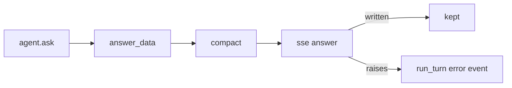
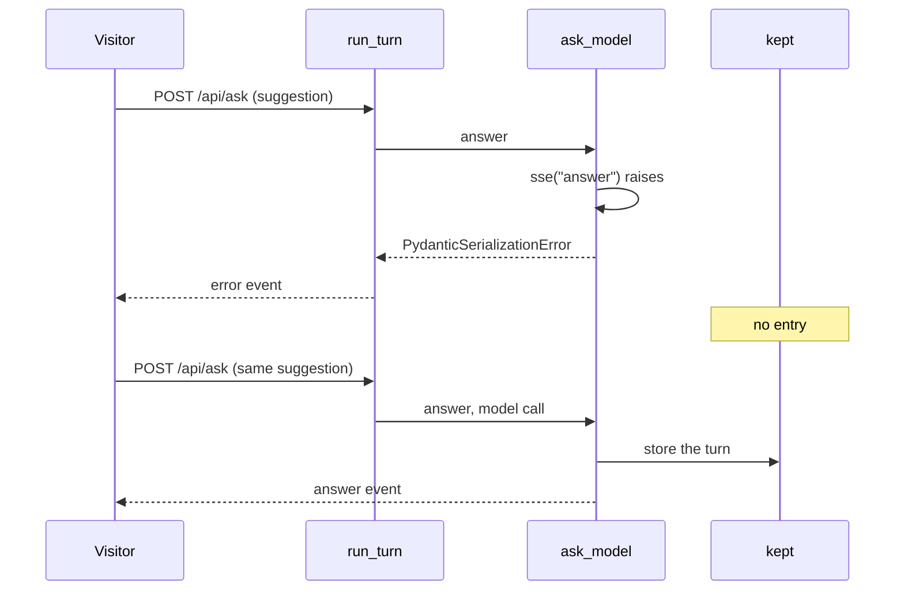

# Keep a suggestion turn only after its answer is written

| | |
| --- | --- |
| Work | Fix: the service writes the answer event of a suggestion before it keeps the turn |
| Change | `2f6107f` on `main`, 2026-10-26 |
| Evidence | `blueprint/history/fixes/keep-a-suggestion-turn-only-after-its-answer-is-written.md` (spec, evidence, findings F-16, F-23, F-24. Local, not in Git). GitHub issue #3. The commit message. The build conversation. |
| Reader | A learner who can write basic code and is new to this stack |

This document obeys the rules of ASD-STE100 Simplified Technical
English. It is not a certified STE document.

## 1. Summary

This fix changes the order of two lines in the analyst API. The service now
writes the answer event of a turn first, and keeps the turn of a suggestion
after that. Before the fix, a turn with an answer that `sse` cannot write stayed in
memory. That turn broke the suggestion for each later visitor.

The one idea to remember: store a result for reuse only after the step that
can fail with it.

## 2. Why this work exists

The web page shows four suggestion chips. The first visitor who clicks a chip
waits for the model. The service keeps that turn in `kept`, and each later
visitor gets the kept turn with no model call.

The finding F-16 showed a gap in this design. `ask_model` stored the turn in
`kept`, and then called `sse` to write the answer event. A text that UTF-8
cannot hold makes `sse` raise. A lone surrogate is such a text: one half of a
pair of UTF-16 code units, with no other half. The result was:

- The first request ended with "Something went wrong. Try again."
- The broken turn stayed in `kept`.
- Each later click on that chip failed in `replay` at the same call, with no
  model call, until the process stopped.

A visitor cannot cause this, because the text must come from the model.

## 3. Design

The fix has two parts.

| Part | Location | Job |
| --- | --- | --- |
| Turn end | `services/analyst/src/analyst/api.py` (`Service.ask_model`) | Writes the answer event, then keeps the turn of a suggestion. |
| Test | `services/analyst/tests/test_api.py` | Shows that the service does not keep a turn that `sse` cannot write. |

One term is new in this work. A **server-sent event** is one text block of a
stream, with an event name and one line of JSON data. The service sends each
turn as these events, and `sse` makes one of them.

## 4. Workflow

Example input: the first visitor clicks "Show me Thierry Henry's shots in
2003-04." The model gives a summary with a lone surrogate.

1. `run_turn` calls `answer` on a worker thread. (`services/analyst/src/analyst/api.py:323`)
2. `answer` finds no kept turn, so it calls `ask_model`. (`services/analyst/src/analyst/api.py:376`)
3. `agent.ask` returns the turn, and `compact` keeps one copy of its messages.
4. `sse("answer", data)` raises `PydanticSerializationError`. (`services/analyst/src/analyst/api.py:445`)
5. Thus the kept-turn store does not run. (`services/analyst/src/analyst/api.py:448`)
6. `run_turn` logs the class name and sends the generic error event. (`services/analyst/src/analyst/api.py:336`)
7. `run_turn` ends the conversation, because the outcome is `error`. (`services/analyst/src/analyst/api.py:341`)
8. The next visitor clicks the chip. `kept` is empty, so the model answers.

## 5. Decisions and tradeoffs

### 5.1 The service changes the order, and does not clean the text

- **Choice:** Write the event first, then keep the turn.
- **Alternatives:** Replace a lone surrogate in each text of the model before
  the event, or catch the error and remove the entry from `kept`.
- **Reason:** Recorded: the finding F-16 gives this order as the fix, and says
  that the fix loses no current requirement. Source: the suggested fix of F-16.
- **Cost:** The first visitor still gets an error for such a text. Only the
  later visitors get a model call in place of the error.

### 5.2 The test uses the real error path

- **Choice:** The scripted model gives a summary with `\ud800`, and the test
  reads the events and `kept`.
- **Alternatives:** Patch `sse` to raise.
- **Reason:** Inferred: a real text shows the real failure of
  `pydantic_core.to_json`, so a later change of `sse` cannot hide it. Source:
  the test and the log line `ask failed: PydanticSerializationError`.
- **Cost:** The test depends on the rule of pydantic that UTF-8 cannot
  hold a lone surrogate.

### 5.3 The audit also closed two earlier findings

- **Choice:** The audit of this fix examined F-23 and F-24 of the body limit fix.
- **Alternatives:** Leave them `fixed` for a later audit.
- **Reason:** Recorded: those findings waited for the next audit of
  `api.py`, and this audit read that file. Source: the archive of the body
  limit fix.
- **Cost:** The archive of this fix holds two findings of other work. Their
  **Found** lines show where they came from.

## 6. Blast radius

### 6.1 This work needs

| Dependency | Used for | If it fails |
| --- | --- | --- |
| `pydantic_core.to_json` | The JSON of each event | `sse` raises, and the visitor gets the generic error. |
| The worker thread of `run_turn` | The catch of each error of a turn | With no catch, the stream does not end. |

### 6.2 These things use this work

| Consumer | Uses | Found in |
| --- | --- | --- |
| The ask route | `Service.run_turn`, which calls `ask_model` | `services/analyst/src/analyst/api.py` |
| The web page | The `answer` and `error` events | `apps/web/src/lib/ask-stream.ts` |

The events and their data do not change, so the web page needs no change.

### 6.3 If you change this work

| If you change | Then check |
| --- | --- |
| The order of the lines at the end of `ask_model` | The new test, which fails on the old order. |
| `sse` or its JSON options | The rule that the answer event comes before `kept`. |
| The rule that selects the kept turns | `test_a_suggestion_turn_with_a_failed_tool_call_is_not_kept` and the new test. |

### 6.4 How to remove this work

Revert the commit `2f6107f`. The old order comes back, and the suite loses one
test. Production has the old order until a new API image goes out.

## 7. Code reading path

1. [`services/analyst/src/analyst/api.py:125`](../services/analyst/src/analyst/api.py#L125) - Look for: the call that can raise for a lone surrogate.
2. [`services/analyst/src/analyst/api.py:402`](../services/analyst/src/analyst/api.py#L402) - Look for: how a turn of the model becomes events.
3. [`services/analyst/src/analyst/api.py:445`](../services/analyst/src/analyst/api.py#L445) - Look for: the event before the kept turn.
4. [`services/analyst/src/analyst/api.py:381`](../services/analyst/src/analyst/api.py#L381) - Look for: the replay, which writes a copy of an answer that `sse` wrote once.
5. [`services/analyst/src/analyst/api.py:323`](../services/analyst/src/analyst/api.py#L323) - Look for: the catch that turns any error into the generic error event.
6. [`services/analyst/tests/test_api.py:794`](../services/analyst/tests/test_api.py#L794) - Look for: the two requests and the empty `kept`.

## 8. Known limits

- The first visitor still gets an error when the model writes a lone surrogate.
- Production still has the old order. The fix needs a new API image, and the
  deploy is a separate decision.
- A chart title with a lone surrogate fails earlier, in the chart event. That
  turn is not kept either, because `agent.ask` does not return.
- The audit of this fix ran in the builder session. No independent review ran,
  because the change is not sensitive.

## 9. Self-test

1. Why did one bad answer break a chip for each later visitor before this fix?
2. What happens now to the first visitor who gets such an answer?
3. Why can `replay` not fail on the same text after this fix?
4. Why does the test use a lone surrogate and not a patch of `sse`?
5. What must happen before production has this fix?

Answers

1. The service kept the turn before it wrote the answer event, and each replay failed at the same call. See section 2.
2. The visitor gets the generic error, and the service does not keep the turn. See section 4.
3. A kept answer passed `sse` once, and the copy changes only the id and the cache flag. See section 7.
4. A real text shows the real failure of the JSON writer. See section 5.2.
5. A new API image must go out. See section 8.

