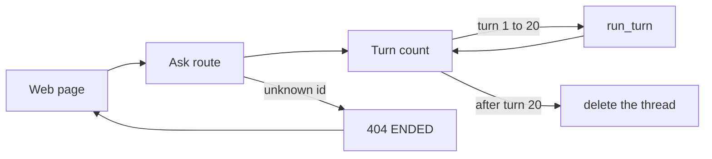
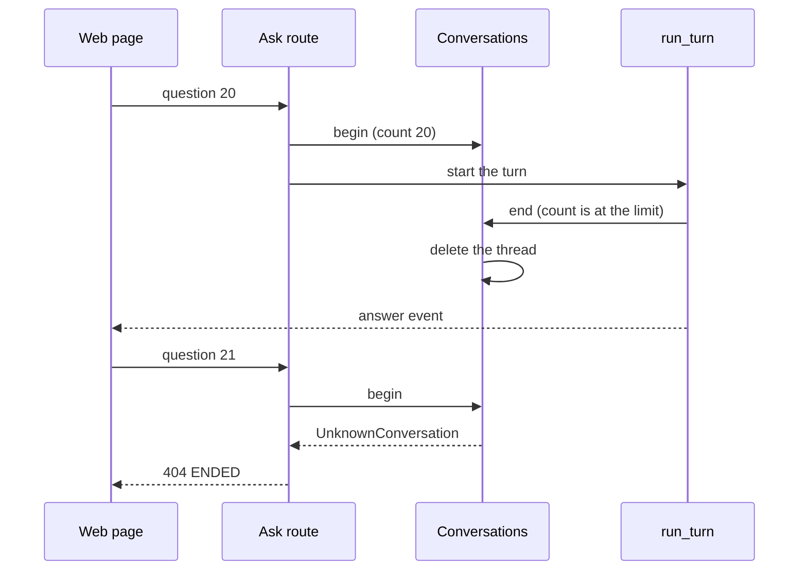

# Limit a conversation to 20 turns

| | |
| --- | --- |
| Work | Fix: one conversation of the analyst API ends after 20 turns, and its memory is free at once |
| Change | `9a1c0c4` on `main`, 2026-10-26 |
| Evidence | `blueprint/history/fixes/limit-a-conversation-to-20-turns.md` (spec, evidence, finding F-10. Local, not in Git). GitHub issue #4. The commit message. The build conversation, where the user chose the limit. |
| Reader | A learner who can write basic code and is new to this stack |

This document obeys the rules of ASD-STE100 Simplified Technical
English. It is not a certified STE document.

## 1. Summary

This fix gives each conversation of the analyst API a limit of 20 turns. When
the 20th turn ends, the service forgets the conversation and deletes its
memory. The next question on that conversation gets the 404 that the web page
already shows as "This conversation has ended."

The one idea to remember: a limit on the number of containers does not limit
the memory if one container can grow with no end.

## 2. Why this work exists

The service keeps each conversation in memory, so that a follow-up knows the
questions and the query results before it. `MAX_CONVERSATIONS = 200` limits the
number of conversations. The finding F-10 showed that this limit alone does not
bound the memory:

- One conversation can have any number of follow-ups.
- A worst-case turn adds about 1.25 MB to the memory of its conversation.
- The ECS task of the service has 512 MiB. If the memory fills, Fargate stops
  the task, and all visitors lose their conversations.

The user chose a limit of 20 turns for each conversation on 2026-10-26.

## 3. Design

The fix has two parts in the code, and it uses one part of the web page with
no change.

| Part | Location | Job |
| --- | --- | --- |
| Turn count | `services/analyst/src/analyst/api.py` (`Conversations`) | Counts the turns of each conversation and forgets it after the last one. |
| Ask route | `services/analyst/src/analyst/api.py` (`create_app`) | Answers 404 `ENDED` for a conversation that the service does not know. |
| Ended card | `apps/web/src/components/ask/failure-card.tsx` | Shows the end and offers to ask the question as a new one. |

Two terms help here:

- A **thread** is the memory of one conversation in the checkpointer of the
  agent. The service deletes the thread to free that memory.
- A **turn** is one question and its answer. A replay of a kept suggestion is
  a turn too, because it puts messages into a thread.

## 4. Workflow

Example input: a visitor asks the 20th question of one conversation, and then
a 21st question.

1. The route calls `Conversations.begin` with the id of the conversation. (`services/analyst/src/analyst/api.py:240`)
2. `begin` marks a turn in flight and adds one to the count. (`services/analyst/src/analyst/api.py:254`)
3. `run_turn` answers the question on a worker thread.
4. `run_turn` calls `end` before it sends the answer event. (`services/analyst/src/analyst/api.py:355`)
5. The count is 20, so `end` does not keep the conversation. (`services/analyst/src/analyst/api.py:277`)
6. `end` removes the id and deletes the thread.
7. The visitor gets the answer of the 20th question.
8. The 21st question comes. `begin` does not know the id and raises `UnknownConversation`.
9. The route answers 404 with `ENDED`. (`services/analyst/src/analyst/api.py:538`)
10. The web page reads the 404 as `conversation_ended`. (`apps/web/src/lib/ask-stream.ts:109`)

## 5. Decisions and tradeoffs

### 5.1 The limit counts turns, not bytes

- **Choice:** A limit of 20 turns for each conversation.
- **Alternatives:** A limit on the stored size of a conversation, a smaller
  copy of each stored turn, or no change.
- **Reason:** Recorded: the user chose a turn limit of 20 on 2026-10-26.
  The web page already handles the 404, so the web needs no change. Source:
  the build conversation and the spec.
- **Cost:** The limit does not know the size of a turn. A short conversation
  with large turns can still hold more memory than a long one with small turns.

### 5.2 The last turn frees the memory at once

- **Choice:** `end` forgets the conversation when its 20th turn ends.
- **Alternatives:** Refuse the 21st question in `begin`, and keep the thread
  until the 200 limit pushes it out.
- **Reason:** Inferred: with this choice, a conversation that hits the limit
  holds no memory after its last answer. The path is the same one that a
  failed turn uses. Source: the `keep=False` branch of `end`.
- **Cost:** The answer of the 20th turn does not say that the conversation
  ended. The visitor learns it from the next question.

### 5.3 The limit is a constant

- **Choice:** `MAX_TURNS = 20` in `api.py`, with no environment variable and no parameter.
- **Alternatives:** An environment variable, or a parameter of `Conversations`.
- **Reason:** Recorded: the audit removed a `max_turns` parameter that no
  caller used, under the project rule against a configuration surface with no
  current need. Source: the Evidence section of the spec.
- **Cost:** A change of the limit needs a code change and a new image.

## 6. Blast radius

### 6.1 This work needs

| Dependency | Used for | If it fails |
| --- | --- | --- |
| `InMemorySaver.delete_thread` | The release of the memory of a conversation | The memory of an ended conversation stays until the process stops. |
| The web parser of the 404 | The ended card | The visitor sees a generic error in place of the ended card. |

### 6.2 These things use this work

| Consumer | Uses | Found in |
| --- | --- | --- |
| The ask route | `Conversations.begin` and the 404 of an unknown id | `services/analyst/src/analyst/api.py:538` |
| `Service.run_turn` | `Conversations.end` | `services/analyst/src/analyst/api.py:355` |
| The web page | The 404 status | `apps/web/src/lib/ask-stream.ts:109` |
| The ended card | `conversation_ended` | `apps/web/src/components/ask/failure-card.tsx:63` |

### 6.3 If you change this work

| If you change | Then check |
| --- | --- |
| `MAX_TURNS` | `test_a_conversation_ends_after_its_last_turn`, which asserts 20. |
| The keys of `known` or `turns` | That `begin`, `make_room`, and `end` change both dictionaries together. |
| The text or the status of the 404 | `ask-stream.ts` and the ended card of the web page. |

### 6.4 How to remove this work

Revert the commit `9a1c0c4`. Conversations then have no limit of turns again.
Production has no turn limit until a new API image goes out.

## 7. Code reading path

1. [`services/analyst/src/analyst/api.py:63`](../services/analyst/src/analyst/api.py#L63) - Look for: the reason for the limit, next to the limit of 200.
2. [`services/analyst/src/analyst/api.py:240`](../services/analyst/src/analyst/api.py#L240) - Look for: the count of each new turn under the lock.
3. [`services/analyst/src/analyst/api.py:269`](../services/analyst/src/analyst/api.py#L269) - Look for: the last turn that takes the `keep=False` branch.
4. [`services/analyst/src/analyst/api.py:259`](../services/analyst/src/analyst/api.py#L259) - Look for: the 200 limit, which also removes the count.
5. [`services/analyst/src/analyst/api.py:538`](../services/analyst/src/analyst/api.py#L538) - Look for: the 404 of an unknown conversation.
6. [`services/analyst/tests/test_api.py:598`](../services/analyst/tests/test_api.py#L598) - Look for: 20 answers, a 404, and an empty thread.

## 8. Known limits

- The limit bounds one conversation, not the whole process. In the worst case
  of a scripted model, 200 conversations of 20 turns need more than 512 MiB.
  A real model stops such turns earlier, but nobody measured that point.
- A lower `MAX_CONVERSATIONS` would lower the bound. That is the decision of the user.
- Production has no turn limit until a new API image goes out.
- The audit of this fix ran in the builder session. No independent review ran.

## 9. Self-test

1. Why did the limit of 200 conversations not bound the memory before this fix?
2. What happens to the memory of a conversation when its 20th turn ends?
3. What does the visitor see after the 21st question?
4. Why did the web page need no change?
5. What happens if someone removes the count from `make_room` but not from `end`?

Answers

1. One conversation could have any number of turns, and each turn added to its memory. See section 2.
2. `end` forgets the conversation and deletes its thread. See section 4.
3. The ended card, with a button to ask the question as a new one. See sections 3 and 4.
4. The web page already reads a 404 as an ended conversation. See section 5.1.
5. The count of a forgotten conversation stays in `turns`, so that dictionary grows with no end. See section 6.3.

