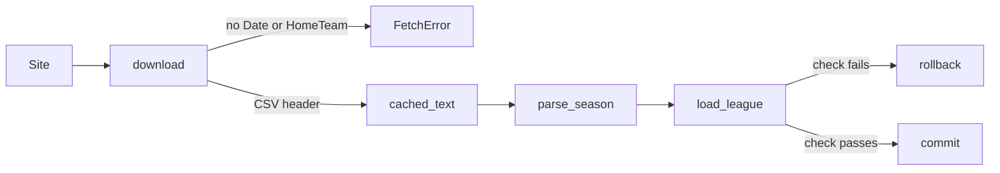
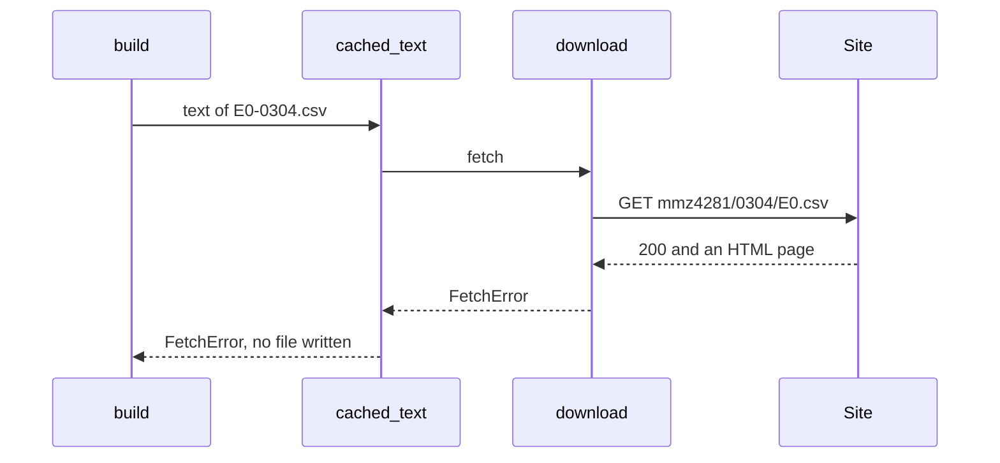

# Never cache a football-data page that is not CSV, and test the league load

| | |
| --- | --- |
| Work | Fix: the football-data loader refuses a download that is not a CSV file of matches, and two tests run the full league load |
| Change | `011646f` on `main`, 2026-10-26 |
| Evidence | `blueprint/history/fixes/never-cache-a-football-data-page-that-is-not-csv-and-test-the-league-load.md` (spec, evidence, findings F-28, F-29. Local, not in Git). GitHub issue #6. The commit message. The build conversation. |
| Reader | A learner who can write basic code and is new to this stack |

This document obeys the rules of ASD-STE100 Simplified Technical
English. It is not a certified STE document.

## 1. Summary

This fix repairs two findings of the football-data loader. The loader now checks the first row of a download before the cache gets it.
Thus a web page in place of the CSV file never stays in the cache. Two new tests run
`load_league`, the function that loads and checks the league in one
transaction.

The one idea to remember: check a download before you cache it, because the
cache makes each later run trust it.

## 2. Why this work exists

The loader keeps each download in `ingest/raw/football-data/`. A later run
reads that file and does not download again. The two findings were:

- **F-28.** The site can answer with status 200 and a page that is not the CSV
  file, for example a bot check. The loader cached that page. Each later run
  then stopped with "the file has no column Date, ...", which did not name the
  cached file as the cause.
- **F-29.** No test called `load_league`. Thus no test showed that a failed
  check commits nothing, or that a passed check commits and prints its lines.

## 3. Design

The fix has two parts.

| Part | Location | Job |
| --- | --- | --- |
| Download check | `ingest/src/ingest/footballdata.py` (`download`) | Refuses a text whose first row does not hold `Date` and `HomeTeam`. |
| League load tests | `ingest/tests/test_footballdata.py` | Run `load_league` on committed rows, with a failed and a passed check. |

Two terms help here:

- A **cache** is a local copy of a download. The loader uses it so that a run
  needs the network only one time, and so that a person can save the file by hand.
- A **transaction** is a group of database changes that all commit or all roll
  back. `load_league` loads and checks inside one transaction.

## 4. Workflow

Example input: a first run, where the site answers with an HTML page for the
2003-04 file.

1. `build` asks `fetch_season` for the text of the season. (`ingest/src/ingest/footballdata.py:187`)
2. The file is not in the cache, so `cached_text` calls `download`. (`ingest/src/ingest/command.py:23`)
3. `download` gets status 200 and decodes the body. (`ingest/src/ingest/footballdata.py:202`)
4. The first CSV row has no `Date` and no `HomeTeam`. (`ingest/src/ingest/footballdata.py:205`)
5. `download` raises `FetchError` with the URL and the file to save by hand. (`ingest/src/ingest/footballdata.py:207`)
6. `cached_text` lets `FetchError` through, so it writes no file. (`ingest/src/ingest/command.py:28`)
7. The command stops with that text, and the next run downloads again.

## 5. Decisions and tradeoffs

### 5.1 The check reads two columns of the first row

- **Choice:** A text passes when its first CSV row holds `Date` and `HomeTeam`.
- **Alternatives:** Parse the full file before the cache gets it, or put the cache path in the error
  for a column that is not there.
- **Reason:** Recorded: the finding F-28 gives this check, and names the cache
  path in the error as the second option. Source: the suggested fix of F-28.
- **Cost:** A file with a good header and a bad body still goes into the
  cache. `parse_season` then stops with its own error.

### 5.2 The error has the shape of a failed request

- **Choice:** The text names the URL and says "Save it by hand as" with the
  path of the cache file.
- **Alternatives:** A new class of error for a bad body.
- **Reason:** Inferred: a person can do the same thing for both failures,
  which is to save the file by hand. Source: the old `FetchError` in `download`.
- **Cost:** The text does not say what the site sent.

### 5.3 The tests commit their seed rows

- **Choice:** The tests commit the seed, then call `load_league` with its own connection.
- **Alternatives:** Give `load_league` the connection of the test.
- **Reason:** Inferred: only an own connection shows the commit and the
  rollback of `load_league`. The `ingest` fixture empties the tables after the
  test. Source: the comments in the test and in `conftest.py`.
- **Cost:** The tests depend on the fixture to remove the committed rows.

### 5.4 A mutation proves the rollback test

- **Choice:** The builder put a `conn.commit()` before the check one time, and
  the rollback test failed.
- **Alternatives:** Trust that the test fails for a wrong order.
- **Reason:** Recorded: the done-when of build step 2 asks for this check.
  Source: the spec.
- **Cost:** None in the code. The mutation was not committed.

## 6. Blast radius

### 6.1 This work needs

| Dependency | Used for | If it fails |
| --- | --- | --- |
| football-data.co.uk | The two season files | `FetchError` with the file to save by hand. |
| `command.cached_text` | The cache, which writes only after a good download | If it caught `FetchError`, a bad page could reach the cache again. |
| The local Postgres | The two `load_league` tests | The tests fail before their first assertion. |

### 6.2 These things use this work

| Consumer | Uses | Found in |
| --- | --- | --- |
| `fetch_season` | `download` as its default fetch | `ingest/src/ingest/footballdata.py:187` |
| The command `python -m ingest.footballdata` | `main`, which calls `build` and `load_league` | `ingest/src/ingest/footballdata.py:462` |

### 6.3 If you change this work

| If you change | Then check |
| --- | --- |
| The columns of the site | The two names in the check, and `REQUIRED_COLUMNS`. |
| `cached_text` | That a `FetchError` from the fetch still writes no file. |
| The order in `load_league` | `test_a_league_load_that_fails_its_check_commits_nothing`. |

### 6.4 How to remove this work

Revert the commit `011646f`. A bad page can then reach the cache again, and
the suite loses four tests. The cached files on disk do not change.

## 7. Code reading path

1. [`ingest/src/ingest/command.py:23`](../ingest/src/ingest/command.py#L23) - Look for: which errors stop the write of the cache.
2. [`ingest/src/ingest/footballdata.py:192`](../ingest/src/ingest/footballdata.py#L192) - Look for: the two ways that a download fails.
3. [`ingest/src/ingest/footballdata.py:205`](../ingest/src/ingest/footballdata.py#L205) - Look for: the check of the first row.
4. [`ingest/src/ingest/footballdata.py:445`](../ingest/src/ingest/footballdata.py#L445) - Look for: the load and the check inside one connection block.
5. [`ingest/tests/test_footballdata.py:181`](../ingest/tests/test_footballdata.py#L181) - Look for: the HTML page and the empty cache directory.
6. [`ingest/tests/test_footballdata.py:394`](../ingest/tests/test_footballdata.py#L394) - Look for: the commit of the seed and the patch to one season.

## 8. Known limits

- A download that ends early after a good header still goes into the cache.
- `main` itself runs in no test. It only joins `build` and `load_league`.
- The audit of this fix ran in the builder session. No independent review ran.

## 9. Self-test

1. Why did a bot-check page break each later run before this fix?
2. What does the cache directory hold after the site sends an HTML page now?
3. Why do the league load tests commit their seed rows?
4. What happens if someone moves the commit in `load_league` before the check?
5. Which bad download can still reach the cache?

Answers

1. The loader cached the page, and each later run read the cache and did not download again. See section 2.
2. Nothing, because `cached_text` lets `FetchError` through and writes no file. See section 4.
3. `load_league` uses its own connection, which reads only committed rows. See section 5.3.
4. The rollback test fails, as the mutation showed. See section 5.4.
5. A file that ends early after a good header. See sections 5.1 and 8.

