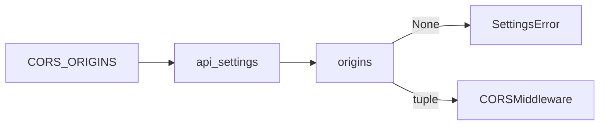

# Refuse a CORS origin that a browser never sends

| | |
| --- | --- |
| Work | Fix: the start of the API refuses each value of `CORS_ORIGINS` that is not an origin in the form a browser sends |
| Change | `2a4248c` on `main`, 2026-10-26 |
| Evidence | `blueprint/history/fixes/refuse-a-cors-origin-that-a-browser-never-sends.md` (spec, evidence, finding F-18. Local, not in Git). GitHub issue #5. The commit message. The build conversation. |
| Reader | A learner who can write basic code and is new to this stack |

This document obeys the rules of ASD-STE100 Simplified Technical
English. It is not a certified STE document.

## 1. Summary

This fix makes the check of `CORS_ORIGINS` stricter. The API now stops at the
start with `SettingsError("CORS_ORIGINS is not valid")` for a broken value. Before
the fix, one broken value gave a traceback with no variable name, and others
passed with no sign.

The one idea to remember: a check of a value that a program later compares as
text must compare the same text.

## 2. Why this work exists

**CORS** (Cross-Origin Resource Sharing) is the rule by which a browser lets a
page of one origin read a response of another origin. An **origin** is the
scheme, the host, and the port of a page, for example `https://highbury.vercel.app`.
The web page and the API have different origins, so the API must send a CORS
header with the origin of the web page.

The finding F-18 showed two gaps in `origins`, the function that checks the
value:

- `http://[::1` made `urlsplit` raise `ValueError`. The start ended with a
  traceback that did not name `CORS_ORIGINS`.
- `http://a b`, `https://x.example#`, and `HTTP://LOCALHOST:3000` passed. The
  CORS middleware compares the full text, and a browser never sends these
  forms. Thus the web page got no CORS header, and the start showed no sign.

The value comes from the operator and not from a visitor.

## 3. Design

The fix has two parts.

| Part | Location | Job |
| --- | --- | --- |
| Origin check | `services/analyst/src/analyst/settings.py` (`origins`) | Gives the origins back, or `None` when one value is not an origin. |
| Refused values | `services/analyst/tests/test_settings.py` | Lists the values that the start must refuse. |

The check now has one main rule. The value must equal
`f"{parts.scheme}://{parts.netloc}".lower()`, which is the form that a browser
sends. That one comparison replaces three checks: no path, no query, and no
fragment.

## 4. Workflow

Example input: the operator sets `CORS_ORIGINS=HTTP://LOCALHOST:3000`.

1. `create_app` calls `api_settings`. (`services/analyst/src/analyst/api.py:483`)
2. `api_settings` gives the stripped text to `origins`. (`services/analyst/src/analyst/settings.py:98`)
3. `origins` splits the text at the commas. (`services/analyst/src/analyst/settings.py:61`)
4. `urlsplit` gives the scheme `http` and the netloc `LOCALHOST:3000`.
5. The rebuilt text `http://localhost:3000` is not the value, so `origins` gives `None`. (`services/analyst/src/analyst/settings.py:74`)
6. `api_settings` adds "CORS_ORIGINS is not valid" to its problems.
7. `api_settings` raises `SettingsError`, and the API does not start.

The trace has three parts, and the diagram of section 3 shows them.

## 5. Decisions and tradeoffs

### 5.1 One comparison replaces three checks

- **Choice:** Compare the value with the rebuilt, lower-case origin.
- **Alternatives:** Add one check for each bad form: a space, a fragment
  mark, an upper-case scheme.
- **Reason:** Inferred: the CORS middleware compares the full text, so a check
  of the same text refuses each form that cannot match. Source: the comment in
  `origins` and the finding F-18.
- **Cost:** The comparison is less clear to a reader than three named checks.
  The comment in the code explains it.

### 5.2 The check also refuses an upper-case host

- **Choice:** The `.lower()` also refuses `http://LOCALHOST:3000`.
- **Alternatives:** Refuse only the upper-case scheme of the finding.
- **Reason:** Inferred: a browser sends the host in lower case, so an
  upper-case host never matches either. Source: the spec of this fix.
- **Cost:** None found. No valid value of the project has an upper-case letter.

### 5.3 Two rare forms still pass

- **Choice:** `http://u@host` and a default port such as `http://host:80` pass.
- **Alternatives:** Refuse a value with `@`, and a port that is the default
  of its scheme.
- **Reason:** Recorded: the audit noted these forms as a risk that
  stays, for operator input only. The finding did not list them. Source: the resolution of F-18.
- **Cost:** An operator who writes such a value gets no CORS header and no
  error at the start.

## 6. Blast radius

### 6.1 This work needs

| Dependency | Used for | If it fails |
| --- | --- | --- |
| `urllib.parse.urlsplit` | The scheme and the netloc of each value | A change of its rules can refuse or let through other forms. |
| The `CORS_ORIGINS` variable | The origins of the web page | No value, or a bad value, stops the start with `SettingsError`. |

### 6.2 These things use this work

| Consumer | Uses | Found in |
| --- | --- | --- |
| `api_settings` | `origins` | `services/analyst/src/analyst/settings.py:98` |
| The CORS middleware | `settings.cors_origins` | `services/analyst/src/analyst/api.py:494` |
| Local runs | `CORS_ORIGINS=http://localhost:3000` | `.env.example:21` |
| Production | `https://<project>.vercel.app` | `deploy/ecs/service.example.json:17` |

Both example values stay valid.

### 6.3 If you change this work

| If you change | Then check |
| --- | --- |
| The comparison in `origins` | The refused values and the valid values in `test_settings.py`. |
| The value of `CORS_ORIGINS` in production | That it is lower case, with no path and no `/` at the end. |
| The CORS options in `create_app` | That the middleware still compares the full text. |

### 6.4 How to remove this work

Revert the commit `2a4248c`. The old check comes back, with the traceback for
a broken IPv6 address. No data changes.

## 7. Code reading path

1. [`services/analyst/src/analyst/settings.py:61`](../services/analyst/src/analyst/settings.py#L61) - Look for: the split at the commas and the strip of each value.
2. [`services/analyst/src/analyst/settings.py:67`](../services/analyst/src/analyst/settings.py#L67) - Look for: the `ValueError` that becomes `None`.
3. [`services/analyst/src/analyst/settings.py:74`](../services/analyst/src/analyst/settings.py#L74) - Look for: the one comparison with the rebuilt origin.
4. [`services/analyst/src/analyst/settings.py:93`](../services/analyst/src/analyst/settings.py#L93) - Look for: how `None` becomes "is not valid" with no value in the text.
5. [`services/analyst/src/analyst/api.py:494`](../services/analyst/src/analyst/api.py#L494) - Look for: the middleware that compares the full text.

## 8. Known limits

- `http://u@host` and a default port still pass, as section 5.3 explains.
- The check does not prove that the origin is the real address of the web page.
- The audit of this fix ran in the builder session. No independent review ran.

## 9. Self-test

1. Why did `HTTP://LOCALHOST:3000` give no CORS header before this fix?
2. What happened at the start for `http://[::1` before this fix?
3. Why does one comparison replace the checks of the path, the query, and the fragment?
4. What happens if the production value ends with `/`?
5. Which forms can still pass with no error, and why?

Answers

1. The CORS middleware compares the full text, and a browser sends the origin in lower case. See section 2.
2. `urlsplit` raised `ValueError`, and the traceback did not name the variable. See section 2.
3. The rebuilt origin has no path, no query, and no fragment, so any of them makes the texts differ. See section 5.1.
4. The rebuilt origin has no `/`, so `origins` gives `None` and the start stops. See sections 4 and 6.3.
5. A value with user information or a default port, because the finding did not list them. See section 5.3.

