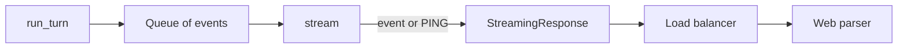
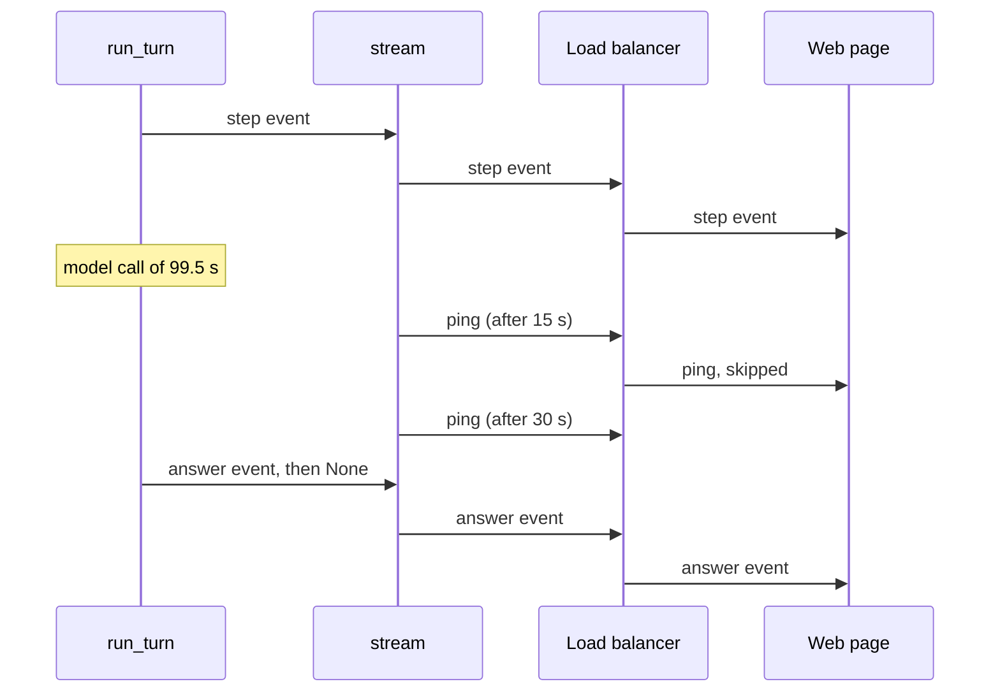

# Send a heartbeat while a turn is quiet

| | |
| --- | --- |
| Work | Fix: the stream of the analyst API sends a ping event after each 15 seconds with no event |
| Change | `5fdb01d` on `main`, 2026-10-26 |
| Evidence | `blueprint/history/fixes/send-a-heartbeat-while-a-turn-is-quiet.md` (spec, evidence, findings F-05, F-09, F-17, F-21. Local, not in Git). GitHub issue #7. The commit message. The build conversation with the live measurement. |
| Reader | A learner who can write basic code and is new to this stack |

This document obeys the rules of ASD-STE100 Simplified Technical
English. It is not a certified STE document.

## 1. Summary

This fix adds a heartbeat to the stream of each turn. When the agent sends no
event for 15 seconds, the service sends a small `ping` event. The load
balancer then sees traffic and keeps the connection open. The web page skips
the event, so the web needs no change.

The one idea to remember: measure first. A live run turned a lead into a
confirmed defect, and it also closed three other leads.

## 2. Why this work exists

The stream of `POST /api/ask` sends an event when a tool starts, when the agent makes a chart, and when the turn ends. Between two events it sends nothing. The load
balancer of the ECS service closes a connection that is quiet for 60 seconds.
Then the visitor gets "Something went wrong. Try again.", and the worker
thread still finishes the paid turn.

The finding F-21 was a lead with no evidence. A live measurement on
2026-10-26 gave these numbers on `gemini-3.8-flash`:

- The five demo turns in production had quiet times from 6.9 s to 37.8 s.
- One heavy question on the local server had quiet times of 61.4 s and 99.5 s.

The same measurement settled three other findings:

- **F-17** was `invalid`. Suggestions 2 and 3 had no tool error, and the second ask of each was a kept turn.
- **F-05** was `accepted`. The heavy turn cost about $0.23, and the model did not read raw rows.
- **F-09** was `accepted`. Nine real answers gave no false flag of an unbacked number.

## 3. Design

The fix has two parts in the service, and it uses one part of the web page
with no change.

| Part | Location | Job |
| --- | --- | --- |
| Stream | `services/analyst/src/analyst/api.py` (`stream`) | Yields the events of the turn, and `PING` after each quiet wait. |
| Ask route | `services/analyst/src/analyst/api.py` (`create_app`) | Gives `stream(events)` to `StreamingResponse`. |
| Event parser | `apps/web/src/lib/ask-stream.ts` (`parseEvent`) | Skips a named event that it does not know. |

Two terms help here:

- A **heartbeat** is a small message that a sender sends at fixed times, only
  to show that the connection is alive.
- An **idle timeout** is the time after which a proxy closes a connection
  with no traffic. The load balancer of this service uses 60 seconds.

## 4. Workflow

Example input: a heavy question. One model call of the turn takes 99.5 seconds.

1. The route starts `run_turn` on a worker thread and returns `stream(events)`. (`services/analyst/src/analyst/api.py:570`)
2. `run_turn` puts the step events of the tools on the queue.
3. `stream` waits for the next event for 15 seconds at most. (`services/analyst/src/analyst/api.py:144`)
4. The model call takes longer, so the wait ends with no event.
5. `stream` yields `PING` and waits again. (`services/analyst/src/analyst/api.py:146`)
6. The load balancer sees traffic each 15 seconds and keeps the connection.
7. The web parser skips each ping. (`apps/web/src/lib/ask-stream.ts:64`)
8. `run_turn` puts the answer event, then `None`, and `stream` ends.

## 5. Decisions and tradeoffs

### 5.1 The service sends a heartbeat

- **Choice:** A `ping` event after each 15 seconds with no event.
- **Alternatives:** A longer idle timeout on the load balancer, or no change.
- **Reason:** Recorded: the user chose the heartbeat on 2026-10-26. The
  idle timeout belongs to a load balancer that Express Mode manages, and it can change that value back. Source: the build conversation.
- **Cost:** Each quiet turn sends a few small events more.

### 5.2 The ping is a named event, not a comment line

- **Choice:** `event: ping` with `data: {}`.
- **Alternatives:** A comment line of server-sent events, such as `: keepalive`.
- **Reason:** Recorded: the web parser fails on a block with no `event:` line.
  But it skips a named event that it does not know.
  Thus a named event needs no web change and no order of the two deploys.
  Source: `ask-stream.ts` and its test "drops an event that it does not know".
- **Cost:** Another client of the API must also skip the `ping` event.

### 5.3 The wait is 15 seconds

- **Choice:** `HEARTBEAT_SECONDS = 15`, a constant.
- **Alternatives:** A wait near 60 seconds, or an environment variable.
- **Reason:** Inferred: 15 seconds is a quarter of the idle timeout, so a late
  ping still comes in time. Source: the comment above the constant.
- **Cost:** A change of the wait needs a new image.

### 5.4 The thread of a gone client stops sooner

- **Choice:** `stream` uses `events.get` with a timeout.
- **Alternatives:** Keep `iter(events.get, None)` and add a timer thread for the pings.
- **Reason:** Inferred: one loop gives both the ping and a reader that returns
  within 15 seconds after a client goes away. Source: the audit of this fix.
- **Cost:** None found.

## 6. Blast radius

### 6.1 This work needs

| Dependency | Used for | If it fails |
| --- | --- | --- |
| `queue.Queue.get` with a timeout | The quiet wait | No ping, and the old cut comes back. |
| The web parser | The skip of `ping` | Each ping ends the turn on the page as an unexpected failure. |
| The load balancer | The idle timeout of 60 s | A shorter timeout than 15 s cuts the stream again. |

### 6.2 These things use this work

| Consumer | Uses | Found in |
| --- | --- | --- |
| The ask route | `stream` | `services/analyst/src/analyst/api.py:570` |
| The web page | The events, with `ping` skipped | `apps/web/src/lib/ask-stream.ts:64` |

### 6.3 If you change this work

| If you change | Then check |
| --- | --- |
| `HEARTBEAT_SECONDS` | It must stay well below the idle timeout of the load balancer. |
| The `default` case of `parseEvent` | The parser must still skip a ping, or each quiet turn fails. |
| The name or the data of `PING` | `test_a_quiet_turn_sends_a_ping_until_its_next_event`. |

### 6.4 How to remove this work

Revert the commit `5fdb01d` and deploy a new API image. Streams with a quiet
time over 60 seconds are then cut again.

## 7. Code reading path

1. [`services/analyst/src/analyst/api.py:136`](../services/analyst/src/analyst/api.py#L136) - Look for: the reason for the wait, next to the constant.
2. [`services/analyst/src/analyst/api.py:140`](../services/analyst/src/analyst/api.py#L140) - Look for: the loop that yields an event, a ping, or the end.
3. [`services/analyst/src/analyst/api.py:570`](../services/analyst/src/analyst/api.py#L570) - Look for: the route that gives `stream` to the response.
4. [`apps/web/src/lib/ask-stream.ts:64`](../apps/web/src/lib/ask-stream.ts#L64) - Look for: the skip of an event that the page does not know.
5. [`services/analyst/tests/test_api.py:279`](../services/analyst/tests/test_api.py#L279) - Look for: pings from a quiet queue with a short wait.
6. [`services/analyst/tests/test_api.py:291`](../services/analyst/tests/test_api.py#L291) - Look for: pings through the real route, from a slow model.

## 8. Known limits

- Nobody observed the fix behind the production load balancer yet. The heavy
  question ran on the local server, where no load balancer exists.
- A heavy turn still costs about $0.23 and takes up to 4 minutes. The
  heartbeat keeps the connection, but the visitor still waits.
- The audit of this fix ran in the builder session. No independent review ran.

## 9. Self-test

1. Why did a heavy question fail in production before this fix?
2. Why is the ping a named event and not a comment line?
3. What does the web page do with a ping?
4. Why is the wait 15 seconds and not 59?
5. Which three other findings did the same live measurement settle, and how?

Answers

1. One model call was quiet for more than 60 seconds, and the load balancer closed the connection. See section 2.
2. The web parser fails on a block with no event line, but it skips an unknown named event. See section 5.2.
3. It skips it, in the `default` case of `parseEvent`. See section 4.
4. A quarter of the idle timeout leaves time for a late ping. See section 5.3.
5. F-17 was invalid, and the user accepted F-05 and F-09 on the numbers. See section 2.

