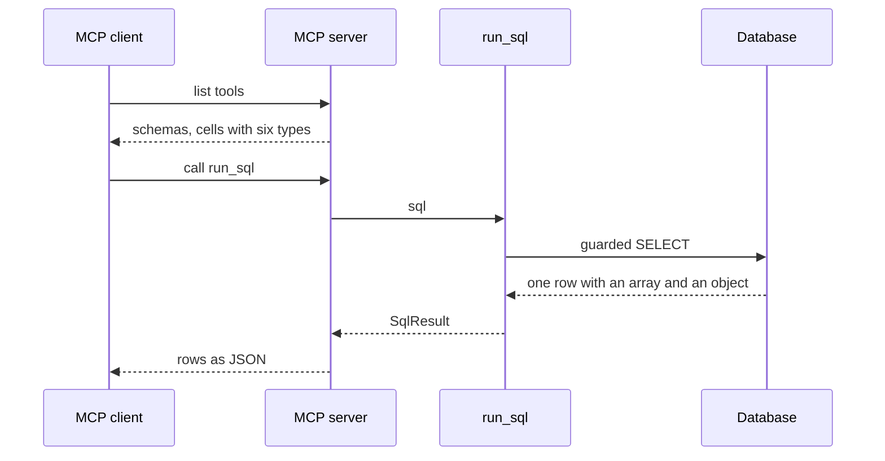

# Give the run_sql cells an explicit output schema

| | |
| --- | --- |
| Work | Fix: the MCP output schema of `run_sql` names the six JSON types of a cell, in place of an empty schema |
| Change | `2208b21` on `main`, 2026-10-28 |
| Evidence | `blueprint/history/fixes/give-the-run-sql-cells-an-explicit-output-schema.md` (spec. Local, not in Git). The commit message. The build conversation, with the MCP Inspector warning and the guard probes. |
| Reader | A learner who can write basic code and is new to this stack |

This document obeys the rules of ASD-STE100 Simplified Technical
English. It is not a certified STE document.

## 1. Summary

This fix changes one type in the data tools. A cell of a `run_sql` result keeps
the same contract: any JSON value. But the MCP output schema now names the six
JSON types, in place of the empty schema `{}`. The MCP Inspector stops its
warning, and a strict MCP client gets a schema that it can read.

The one idea to remember: an empty schema and an explicit schema can accept the
same values. The difference is how clearly a client can read the contract.

## 2. Why this work exists

The MCP server publishes the five data tools of the agent. For each tool it
sends an input schema and an output schema to the client. A **JSON Schema** is a
JSON document that describes the shape of other JSON data.

Before this fix, `SqlResult.rows` had the type `list[list[JsonValue]]`.
Pydantic publishes `JsonValue` as `{}`, a schema with no keyword. This schema
accepts any value, but it states nothing.

The MCP Inspector showed this warning on the `run_sql` page, under "Schema
portability". The text said that some MCP clients refuse or mishandle such a
schema. Thus a tool can work in the Inspector and fail in another client.

The tool worked before the fix. The agent calls `run_sql` in its own process
and never reads this schema. The real costs were two:

- A warning on screen in the demo video, which shows the Inspector.
- A risk with a stricter MCP client.

## 3. Design

The fix gives the cell its own type, with a fixed schema and the old
validation.

| Part | Location | Job |
| --- | --- | --- |
| Cell type | `services/analyst/src/analyst/tools.py` (`Cell`) | Validates as `JsonValue` and publishes the six JSON types. |
| SQL result | `services/analyst/src/analyst/tools.py` (`SqlResult`) | Holds the rows of `run_sql` as a list of lists of `Cell`. |
| MCP server | `services/analyst/src/analyst/mcp_server.py` | Builds each output schema from the return type of the tool. |
| Schema tests | `services/analyst/tests/test_mcp_server.py` | Fail if any tool publishes an empty schema. |

Two terms help here:

- **`Annotated`** is a Python type that adds metadata to another type. This fix
  uses it to attach a schema to `JsonValue`.
- **`WithJsonSchema`** is Pydantic metadata that replaces the published schema
  of a type. It does not change the validation.

## 4. Workflow

Example input: an MCP client asks the server for its tool list. Then it calls
`run_sql` with `SELECT ARRAY[1, 2] AS a, JSON_BUILD_OBJECT('k', 1.5) AS o`.

1. The server reads the return type of `run_sql`, which is `SqlResult`. (`services/analyst/src/analyst/mcp_server.py:24`)
2. Pydantic writes the output schema of `SqlResult`. (`services/analyst/src/analyst/tools.py:48`)
3. For each cell it writes the six types of `Cell`. (`services/analyst/src/analyst/tools.py:42`)
4. The client gets the tool list with no empty schema.
5. The client calls `run_sql`, and the guard accepts the `SELECT`. (`services/analyst/src/analyst/tools.py:151`)
6. `json_safe` turns the array into a list and the object into a dict. (`services/analyst/src/analyst/tools.py:124`)
7. `SqlResult` validates each cell as `JsonValue`. (`services/analyst/src/analyst/tools.py:160`)
8. The client gets the rows `[[[1, 2], {"k": 1.5}]]` and no error.

## 5. Decisions and tradeoffs

### 5.1 A cell stays any JSON value

- **Choice:** The schema names all six JSON types: string, number, boolean,
  null, array, and object.
- **Alternatives:** `{"type": "object"}`, which the Inspector suggested. Or
  only the scalar types.
- **Reason:** Recorded: the guard accepts `ARRAY_AGG`, `JSON_BUILD_OBJECT`, and
  `ARRAY[1, 2]`, and `json_safe` turns them into lists and dicts. Most cells are
  numbers, strings, or nulls. Thus a narrow type breaks real results. Source:
  the spec and the guard probes in the build conversation.
- **Cost:** The schema tells a client little about the real columns. The
  column names come in `columns`, not in the schema.

### 5.2 The fix changes the schema and keeps the validation

- **Choice:** `Annotated[JsonValue, WithJsonSchema(...)]`.
- **Alternatives:** A new union type such as `str | float | bool | None | list | dict`.
- **Reason:** Recorded: the spec says that `WithJsonSchema` changes only the
  published schema, so validation stays `JsonValue`. A model dump of all six
  types gave the same values after the fix. Source: the spec and the build
  conversation.
- **Cost:** The schema and the validation are now two statements. A later change
  to one of them must also change the other.

### 5.3 Only the MCP output schema changes

- **Choice:** `JsonValue` stays in `charts.py`, `answer.py`, `api.py`, and
  `cli.py`.
- **Alternatives:** Use `Cell` in all places.
- **Reason:** Recorded: these types are not MCP output schemas. Source: the spec.
- **Cost:** None found. A check of the OpenAPI schema of the API found no
  `JsonValue` and no `{}`, because the stream events are not part of it.

### 5.4 A test guards every tool, not only run_sql

- **Choice:** `empty_schemas` walks the input and output schema of each listed
  tool.
- **Alternatives:** One test for the cell of `run_sql` only.
- **Reason:** Inferred: a new field with `JsonValue` in any tool result brings
  back the same warning. A walk over all tools catches it. Source: the test and
  a scan of all five tools in the build conversation.
- **Cost:** The walk skips a key that ends in `.properties`. A tool with no
  arguments, such as `get_schema`, has an empty `properties` object that is
  valid.

## 6. Blast radius

### 6.1 This work needs

| Dependency | Used for | If it fails |
| --- | --- | --- |
| Pydantic `WithJsonSchema` | The published schema of a cell | The schema goes back to `{}`, and the new test fails. |
| The `mcp` library | The output schema from the return type | The server stops. The tools still work in the process of the agent. |

### 6.2 These things use this work

| Consumer | Uses | Found in |
| --- | --- | --- |
| The MCP server | The output schema of `SqlResult` | `services/analyst/src/analyst/mcp_server.py:24` |
| The agent | `SqlResult` as JSON | `services/analyst/src/analyst/agent.py:167` |
| The verifier | `rows` of a `run_sql` result | `services/analyst/src/analyst/verifier.py:42` |
| The evals | `result.rows` | `services/analyst/src/analyst/evals.py:548` |

The agent, the verifier, and the evals read the values, not the schema. The
values did not change, so these consumers did not change.

### 6.3 If you change this work

| If you change | Then check |
| --- | --- |
| The six types of `Cell` | `test_a_sql_cell_can_still_be_any_json_value`, and an array result through the server. |
| `json_safe` | The types that it returns must stay inside the six types of `Cell`. |
| A result model of any tool | `test_no_tool_publishes_a_schema_that_constrains_nothing`. |

### 6.4 How to remove this work

Revert the commit `2208b21`. No data, migration, or config stays behind. The
Inspector then shows the warning again.

## 7. Code reading path

1. [`services/analyst/src/analyst/tools.py:39`](../services/analyst/src/analyst/tools.py#L39) - Look for: the reason for the cell type, in the comment above it.
2. [`services/analyst/src/analyst/tools.py:54`](../services/analyst/src/analyst/tools.py#L54) - Look for: `rows` as a list of lists of `Cell`.
3. [`services/analyst/src/analyst/tools.py:124`](../services/analyst/src/analyst/tools.py#L124) - Look for: the lists and dicts that `json_safe` can return.
4. [`services/analyst/src/analyst/mcp_server.py:14`](../services/analyst/src/analyst/mcp_server.py#L14) - Look for: the five tools, added with no wrapper.
5. [`services/analyst/tests/test_mcp_server.py:39`](../services/analyst/tests/test_mcp_server.py#L39) - Look for: the walk that finds an empty schema.
6. [`services/analyst/tests/test_mcp_server.py:63`](../services/analyst/tests/test_mcp_server.py#L63) - Look for: the six types of a cell.

## 8. Known limits

- Nobody looked at the Inspector page after the fix. The tests read the same
  tool list that the Inspector reads.
- The schema of a cell tells a client nothing about the type of each column.
  A client gets the column names in `columns`, but not their types.
- No audit and no independent review ran. The gates are `manual` and
  `when-sensitive`, and this fix does not touch a trust boundary.

## 9. Self-test

1. Why did the tool work before the fix, although the Inspector showed a warning?
2. Why is `{"type": "object"}` wrong for a cell?
3. What happens if a later change makes `Cell` accept only the scalar types?
4. Why does the fix use `WithJsonSchema` and not a new union type?
5. What happens if a new tool result gets a field of type `JsonValue`?

Answers

1. The agent calls the tool in its own process and never reads the schema. See section 2.
2. Most cells are numbers, strings, or nulls, and an object type rejects them. See section 5.1.
3. A query with `ARRAY_AGG` or `JSON_BUILD_OBJECT` fails validation, and the result breaks. See section 5.1.
4. It changes only the published schema and keeps the validation of `JsonValue`. See section 5.2.
5. The schema walk finds `{}`, and `test_no_tool_publishes_a_schema_that_constrains_nothing` fails. See section 5.4.

