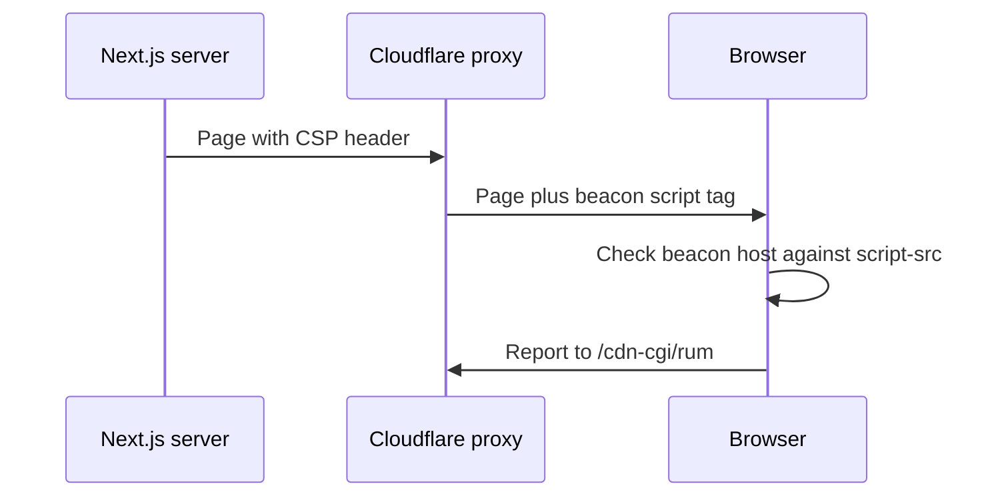

# Allow the Cloudflare Web Analytics script in the CSP

| | |
|---|---|
| Work | Fix: add the Cloudflare Web Analytics host to `script-src` |
| Change | `07c481d` on `main` (squash of `fix/allow-cloudflare-web-analytics-in-the-csp`), 2026-11-01 |
| Evidence | `blueprint/history/fixes/allow-cloudflare-web-analytics-in-the-csp.md` (fix spec and independent review receipt), the commit message, and the build conversation |
| Reader | A learner who can write basic code and is new to this stack |

This document obeys the rules of ASD-STE100 Simplified Technical
English. It is not a certified STE document.

## 1. Summary

Feature 30 added a Content-Security-Policy (CSP) to the web page. On the live site, that policy blocked the Cloudflare Web Analytics script. Thus Cloudflare recorded no visits after the deploy. This fix adds one host to `script-src` and changes nothing else. The one idea to remember: an edge proxy can add scripts that your code does not contain, and the CSP must permit them too.

## 2. Why this work exists

The domain `highbury.arkaslittlemind.com` runs through the Cloudflare proxy. A proxy is a server between the browser and the app. Cloudflare uses it to put the Web Analytics script into each page that it sends.

The first live check of feature 30 found this console error: the script at `https://static.cloudflareinsights.com/beacon.min.js/vce70...` violates `script-src`. The repository does not contain this script, so local tests and the local build did not show the problem. The user chose to keep Cloudflare Web Analytics. Source: the fix spec and the build conversation.

## 3. Design

The fix changes one directive in the header builder of feature 30.

| Part | Location | Job |
|---|---|---|
| Analytics origin | `apps/web/src/lib/security-headers.ts` | Names the host of the beacon script and explains why it is there. |
| Header builder | `apps/web/src/lib/security-headers.ts` | Adds that host to `script-src`. |
| CSP test | `apps/web/src/lib/security-headers.test.ts` | Checks that the host is in `script-src` and not in `connect-src`. |
| Deploy note | `AGENTS.md` | Lists the analytics script among the permitted origins. |

The beacon is the small script of Cloudflare Web Analytics. It measures a page view in the browser and sends a report.

## 4. Workflow

Example input: a browser asks for `https://highbury.arkaslittlemind.com/`.

1. The Next.js server sends the page with the CSP header. (`apps/web/src/lib/security-headers.ts:33`)
2. The Cloudflare proxy adds a `<script>` tag for the beacon to the HTML.
3. The browser compares the beacon URL with `script-src` and finds the host. (`apps/web/src/lib/security-headers.ts:6`)
4. The browser loads and runs the beacon.
5. The beacon sends its report to `/cdn-cgi/rum` on the same site. `connect-src 'self'` permits it. (`apps/web/src/lib/security-headers.ts:39`)

The trace has three actors, so the next diagram shows them.

## 5. Decisions and tradeoffs

### 5.1 A host source, not a file path

- **Choice:** `https://static.cloudflareinsights.com`, with no path.
- **Alternatives:** `https://static.cloudflareinsights.com/beacon.min.js`, the form in the Cloudflare FAQ.
- **Reason:** Recorded: the real script URL has a version path after `beacon.min.js`. A CSP source with a file path matches only that exact path. A source with no path matches every path on the host. Source: the fix spec, the code comment at `security-headers.ts:2`, and the independent review.
- **Cost:** Any other script on that Cloudflare host can also run on the page.

### 5.2 No change to `connect-src`

- **Choice:** `connect-src` stays `'self'` plus the API origin.
- **Alternatives:** Add `https://cloudflareinsights.com`, as the `/fix` request said.
- **Reason:** Recorded: the Cloudflare Web Analytics FAQ says that automatic injection on a proxied site reports to `/cdn-cgi/rum` on the site itself. Only a manual embed reports to `cloudflareinsights.com`. Source: the fix spec and the FAQ, read on 2026-11-01.
- **Cost:** If Cloudflare changes the report address, the browser blocks the report. The spec gives that case as a second step.

### 5.3 A named constant with a comment

- **Choice:** `CLOUDFLARE_ANALYTICS_ORIGIN` holds the host, and a comment says that the proxy, not the code, adds the script.
- **Alternatives:** The host written inline in the directive.
- **Reason:** Inferred from the code: a reader who searches the code for the beacon finds no script tag. The comment tells them where it comes from.
- **Cost:** None found.

## 6. Blast radius

### 6.1 This work needs

| Dependency | Used for | If it fails |
|---|---|---|
| Cloudflare proxy with Web Analytics | The injected beacon | If Cloudflare stops the injection, the host stays in the CSP with no use. Nothing breaks. |
| `static.cloudflareinsights.com` | The beacon script | If Cloudflare moves the script to a new host, the CSP blocks it and visits go unrecorded again. |
| `/cdn-cgi/rum` on the site | The beacon report | If Cloudflare sends the report to another origin, `connect-src` blocks it. |

### 6.2 These things use this work

| Consumer | Uses | Found in |
|---|---|---|
| Next.js config | `securityHeaders` | `apps/web/next.config.ts:3` |

The constant is private to `security-headers.ts`. No other file uses it.

### 6.3 If you change this work

| If you change | Then check |
|---|---|
| Turn off Cloudflare Web Analytics | Remove the host from `script-src` to keep the policy small. |
| Move the domain off the Cloudflare proxy | Remove the host. A manual embed needs `cloudflareinsights.com` in `connect-src` (see 5.2). |

### 6.4 How to remove this work

Revert `07c481d`. The CSP then blocks the beacon again, and Cloudflare records no visits. No data or configuration stays behind.

## 7. Code reading path

1. [`apps/web/src/lib/security-headers.ts:2`](../apps/web/src/lib/security-headers.ts#L2) - Look for: why a host and why `connect-src` needs nothing.
2. [`apps/web/src/lib/security-headers.ts:33`](../apps/web/src/lib/security-headers.ts#L33) - Look for: the host at the end of `script-src`.
3. [`apps/web/src/lib/security-headers.test.ts:44`](../apps/web/src/lib/security-headers.test.ts#L44) - Look for: the test that also proves `connect-src` stayed the same.
4. [`AGENTS.md:98`](../AGENTS.md#L98) - Look for: the rule for a new external origin.

## 8. Known limits

- The live checks wait for the push to `main`: the beacon load and the `/cdn-cgi/rum` report.
- The independent review found no defects.
- The Cloudflare dashboard shows new visits only some minutes after the deploy. That check is for the user.

## 9. Self-test

1. Why did the local build not show the blocked beacon?
2. What happens if the CSP names `https://static.cloudflareinsights.com/beacon.min.js`?
3. Why does `connect-src` not contain `cloudflareinsights.com`?
4. What happens if Cloudflare moves the beacon to a new host?
5. What must you change if the domain leaves the Cloudflare proxy?

Answers

1. The Cloudflare proxy adds the script on the live site, and the repository does not contain it. See section 2.
2. The browser blocks the script, because the real URL has a version path after the file name. See section 5.1.
3. A proxied site with automatic injection reports to `/cdn-cgi/rum` on its own origin. See section 5.2.
4. The CSP blocks the script, and Cloudflare records no visits. See section 6.1.
5. Remove the host. A manual embed also needs `cloudflareinsights.com` in `connect-src`. See section 6.3.

