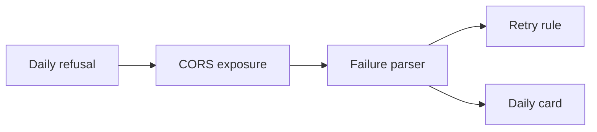
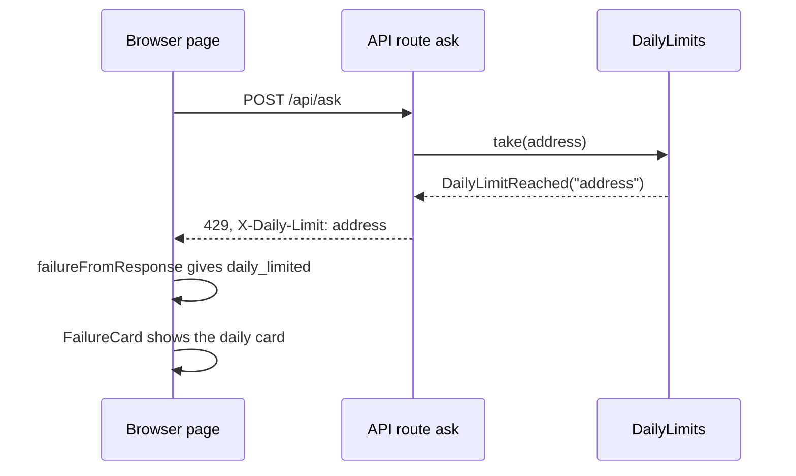

# Hide Ask again when a daily limit refuses the question

| | |
|---|---|
| Work | fix: a daily limit shows a calm card with no retry button |
| Change | `9acb7d7` on `main` (from `fix/hide-ask-again-when-a-daily-limit-refuses-the-question`), 2026-11-02 |
| Evidence | `blueprint/history/fixes/hide-ask-again-when-a-daily-limit-refuses-the-question.md` (spec, finding F-02, independent review), the commit message, and this conversation |
| Reader | A learner who can write basic code and is new to this stack |

This document obeys the rules of ASD-STE100 Simplified Technical
English. It is not a certified STE document.

## 1. Summary

The API has two daily limits: 10 paid questions for each address, and a total for the whole site. Before this fix, the page showed an "Ask again" button when a daily limit refused a question. That button cannot help until the next UTC day. Now the API adds the header `X-Daily-Limit` to each daily refusal, and the page shows a "Daily limit" card with no retry. The one idea to remember: when the status code has two meanings, send one explicit signal and do not guess from the text.

## 2. Why this work exists

The fix "API spend guard" added the daily limits before the public launch. Each limit refuses a question with a status code that also has a second use:

- The address limit sends 429. The per-minute limit also sends 429, with a `Retry-After` header.
- The site limit sends 503. A busy service also sends 503, with the text "Try again in a minute".

The page mapped every 429 to the kind `rate_limited`. If the 429 had no `Retry-After`, `RateLimitCard` counted 0 seconds and enabled "Ask again" at once. The page mapped the site 503 to the kind `http`, and `FailureCard` showed "Something went wrong" with a retry. The local test of item 31 showed the first problem (Recorded: the spec, "The problem"). A retry costs the user a click and gives the same refusal. The site error card also looks like a fault, but it is a plan.

## 3. Design

The design adds one signal in the API and one failure kind in the web. No status code or message text changes.

| Part | Location | Job |
|---|---|---|
| Daily refusal | `services/analyst/src/analyst/api.py` | Adds `X-Daily-Limit: address` or `X-Daily-Limit: site` to the 429 or 503 of a daily limit |
| CORS exposure | `services/analyst/src/analyst/api.py` | Lets a script of the web origin read `X-Daily-Limit` |
| Failure parser | `apps/web/src/lib/ask-stream.ts` | Turns a refusal with a valid header into the kind `daily_limited` |
| Retry rule | `apps/web/src/lib/ask-state.ts` | Gives `none` for `daily_limited` |
| Daily card | `apps/web/src/components/ask/failure-card.tsx` | Shows the tag "Daily limit", a title for the scope, the service text, and no button |

**CORS** (Cross-Origin Resource Sharing) is the browser rule that controls what a page of one origin can read from another origin. The page and the API have different origins, so the browser hides each response header that the API does not expose.

## 4. Workflow

Example input: a visitor asks a new question that is not a kept suggestion. The address already asked 10 paid questions today.

1. The route `ask` gets the question and checks the bot token. ([`api.py:677`](../services/analyst/src/analyst/api.py#L677))
2. The route finds no kept answer, so the question is paid. ([`api.py:704`](../services/analyst/src/analyst/api.py#L704))
3. `DailyLimits.take` raises `DailyLimitReached` with the scope `address`. ([`api.py:288`](../services/analyst/src/analyst/api.py#L288))
4. The route sends 429 with the text `ADDRESS_LIMIT`, the header `X-Daily-Limit: address`, and no `Retry-After`. ([`api.py:709-718`](../services/analyst/src/analyst/api.py#L709-L718))
5. The CORS middleware adds `access-control-expose-headers: Retry-After, X-Daily-Limit`. ([`api.py:651`](../services/analyst/src/analyst/api.py#L651))
6. `askStream` reads the header and calls `failureFromResponse`. ([`ask-stream.ts:162-167`](../apps/web/src/lib/ask-stream.ts#L162-L167))
7. `failureFromResponse` sees `address` and returns `daily_limited` with the text of the body. ([`ask-stream.ts:111-113`](../apps/web/src/lib/ask-stream.ts#L111-L113))
8. `FailureCard` shows the "Daily limit" card with the title "You have used today's questions." and no button. ([`failure-card.tsx:84-100`](../apps/web/src/components/ask/failure-card.tsx#L84-L100))

## 5. Decisions and tradeoffs

### 5.1 A new header, not a new status code or a text match

- **Choice:** The API adds `X-Daily-Limit` and keeps 429, 503, and both texts.
- **Alternatives:** Change the status codes. Or let the page match the text "Come back tomorrow".
- **Reason:** Recorded: an old page still shows the same text, and the status alone cannot tell the cases apart. Source: the spec, "The fix", and the comment at `api.py:710-712`.
- **Cost:** The page depends on one more header. A proxy that drops it gives the old behavior.

### 5.2 The page accepts only the exact values `address` and `site`

- **Choice:** Any other value, or no header, gives `rate_limited` or `http` as before.
- **Alternatives:** Treat any value of the header as a daily limit.
- **Reason:** Recorded: "Any other value, or no header, keeps today's behavior exactly". Source: the spec. The tests check `null`, an empty text, `minute`, and `Address`.
- **Cost:** A new scope in the API needs a change in the web too.

### 5.3 The daily card has no button

- **Choice:** The card shows text only. It has no "Ask again" and no "Edit question".
- **Alternatives:** Keep the outline "Edit question" button of the other failure cards.
- **Reason:** Recorded: the user accepted finding F-02 because "a daily limit refuses an edited question too". The header "New question" and the browser Back remain. Source: the archive, F-02.
- **Cost:** After a site refusal, the card does not put the question back in the bar.

### 5.4 The parser checks the daily header before the status

- **Choice:** `failureFromResponse` returns `daily_limited` before it looks at 429 or 503.
- **Alternatives:** Check the header inside the 429 branch and the 503 branch.
- **Reason:** Inferred from `ask-stream.ts:111-113`: one check covers both scopes and both status codes.
- **Cost:** The parser trusts the header on any status. Only the API sends it, so the risk is small.

### 5.5 The API deploys before the web

- **Choice:** Deploy the new API image first, then push `main` for the web.
- **Alternatives:** Deploy the web first.
- **Reason:** Recorded: an old page ignores the extra header, so the new API is safe alone. Source: the spec, "Verify", and the review's "Remaining risk".
- **Cost:** Two deploys, in order, each with its own approval.

## 6. Blast radius

### 6.1 This work needs

| Dependency | Used for | If it fails |
|---|---|---|
| `DailyLimits` and `DailyLimitReached` | The scope of the refusal | No refusal, so no header |
| CORS `expose_headers` | The page reads the header | The page sees `null` and shows the old cards |
| `StateCard` | The layout of the daily card | The card does not show |

### 6.2 These things use this work

| Consumer | Uses | Found in |
|---|---|---|
| `askStream` | `failureFromResponse` with the header | [`ask-stream.ts:162`](../apps/web/src/lib/ask-stream.ts#L162) |
| `AskPage` | `FailureCard` | [`ask-page.tsx:120`](../apps/web/src/components/ask/ask-page.tsx#L120) |
| `retryOffer` | The kind `daily_limited` | [`ask-state.ts:119`](../apps/web/src/lib/ask-state.ts#L119) |

The MCP server and the command `ask` do not read the header.

### 6.3 If you change this work

| If you change | Then check |
|---|---|
| The scope names in `DailyLimitReached` | The exact match in `failureFromResponse` and its tests |
| `expose_headers` | `test_the_web_page_can_read_the_wait_of_a_429` |
| The kind list in `AskFailure` | `ENDS_CONVERSATION` and `retryOffer` in `ask-state.ts` |

### 6.4 How to remove this work

Revert `9acb7d7`. No data, table, or environment variable stays behind. Deploy the web first, then the API, because an old page ignores the header.

## 7. Code reading path

1. [`api.py:264`](../services/analyst/src/analyst/api.py#L264) - Look for: the scope that `DailyLimitReached` carries.
2. [`api.py:706-718`](../services/analyst/src/analyst/api.py#L706-L718) - Look for: the header on both daily refusals, and the comment that gives the reason.
3. [`api.py:646-652`](../services/analyst/src/analyst/api.py#L646-L652) - Look for: `expose_headers` with two names.
4. [`ask-stream.ts:97-113`](../apps/web/src/lib/ask-stream.ts#L97-L113) - Look for: the exact match before the status checks.
5. [`ask-state.ts:116-122`](../apps/web/src/lib/ask-state.ts#L116-L122) - Look for: `none` for `daily_limited`.
6. [`failure-card.tsx:83-100`](../apps/web/src/components/ask/failure-card.tsx#L83-L100) - Look for: a card with `alert` and no button.
7. [`ask-stream.test.ts:101-142`](../apps/web/src/lib/ask-stream.test.ts#L101-L142) - Look for: the tests of the values that must not count.

## 8. Known limits

- The daily card has no "Edit question" button (F-02, accepted).
- The counts live in memory, so a deploy resets them. This comes from the spend guard, not from this fix.
- The independent review did not run a check of the real page. The proof of the two cards is the builder's step 3 and its screenshots.
- Finding F-01 [P3] about the pnpm version on Vercel stays `unverified`. It is outside this change.

## 9. Self-test

1. Why does the API add a header and not change the 503 of the site limit to another status?
2. What happens if the API sends `X-Daily-Limit` but `expose_headers` does not list it?
3. What does the page show if a proxy sends `X-Daily-Limit: Address`?
4. Why must the API image deploy before the web?
5. Why does the daily card have no "Edit question" button?

Answers

1. An old page keeps the same status and text, so it still works. A 503 also means a busy service, so the status alone cannot tell. See section 5.1.
2. The browser hides the header from the page. The page reads `null` and shows the old cards with a retry. See section 6.1.
3. The parser accepts only the exact lower-case values. Thus the page shows the old card for that status. See section 5.2.
4. An old page ignores the extra header, so the new API is safe alone. A new page with the old API also keeps the old behavior. See section 5.5.
5. An edited question meets the same daily limit. The header "New question" and the browser Back remain. See section 5.3.

