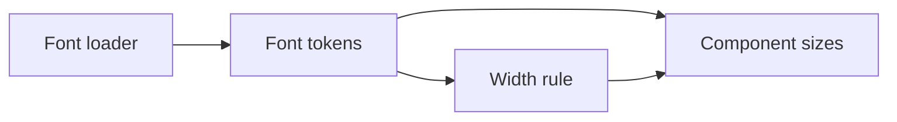
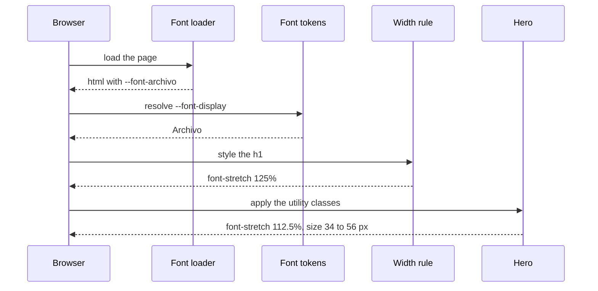

# Replace the site fonts with Archivo and Figtree

| | |
|---|---|
| Work | fix: the site uses Archivo for display text and Figtree for body text |
| Change | `add6663` on `main` (from `fix/replace-the-site-fonts-with-archivo-and-figtree`), 2026-11-07 |
| Evidence | `blueprint/history/fixes/replace-the-site-fonts-with-archivo-and-figtree.md` (spec), the commit message, and this conversation |
| Reader | A learner who can write basic code and is new to this stack |

This document obeys the rules of ASD-STE100 Simplified Technical
English. It is not a certified STE document.

## 1. Summary

Before this fix, the site used Barlow Condensed for headlines and Source Sans 3 for body text. Now it uses Archivo for headlines, labels, and big numbers, and Figtree for body text. The colors, the layout, and the motion did not change. Archivo is much wider than Barlow Condensed, so the fix also made most headlines smaller. The one idea to remember: a new font also means new sizes, because each font gives the same text a different width.

## 2. Why this work exists

The user wanted a font pair close to the fonts of the Arsenal website. That site uses two club fonts: Northbank for matchday titles and Chapman for body text (Recorded: the stylesheets of arsenal.com, read in this conversation). The club fonts have no public license. Thus a prototype tried free stand-ins on a new navy palette. The user kept the old palette but chose the new fonts, because the new pair looked cleaner (Recorded: this conversation).

## 3. Design

The design changes the font in one place and the size in each component.

| Part | Location | Job |
|---|---|---|
| Font loader | `apps/web/src/app/layout.tsx` | Downloads Archivo and Figtree at build time and puts a CSS variable for each font on the `html` element |
| Font tokens | `apps/web/src/app/globals.css` | Points `--font-sans` at Figtree, and `--font-display` and `--font-heading` at Archivo |
| Width rule | `apps/web/src/app/globals.css` | Sets the wide cut of Archivo on each headline and each display element |
| Component sizes | `apps/web/src/components/ask/*.tsx`, `apps/web/src/components/charts/*.tsx` | Make each display text smaller, and choose a narrower cut where the wide cut does not fit |

**`next/font`** is the font loader of Next.js. It downloads the font files at build time and serves them from the site, so the browser never calls Google Fonts.

A **variable font** is one font file that holds a range of styles along an **axis**. Archivo has a weight axis and a width axis (`wdth`). The width goes from 62% to 125% of the normal width. The CSS property `font-stretch` selects a point on that axis.

## 4. Workflow

Example input: a visitor opens the landing page, and the browser draws the hero headline "Two Arsenal eras."

1. The build calls `Archivo` with the `wdth` axis and the italic style. (`layout.tsx:10`)
2. The build calls `Figtree` with no extra axis. (`layout.tsx:17`)
3. The root layout puts both variables on `html`. (`layout.tsx:92`)
4. The token `--font-display` resolves to Archivo. (`globals.css:83`)
5. The base rule gives each `h1` the font of `--font-heading`. (`globals.css:287`)
6. The width rule gives each `h1` the value `font-stretch: 125%`. (`globals.css:291`)
7. The hero adds `font-stretch-semi-expanded`, which wins over the base rule. (`hero.tsx:213`)
8. The browser draws the headline at 112.5% width, 56 pixels at most.

Tailwind CSS puts its styles in **cascade layers**. A rule in the `utilities` layer always wins over a rule in the `base` layer. Thus the width rule sits in `base`, and a component can change the width with one utility class.

## 5. Decisions and tradeoffs

### 5.1 The site uses free stand-ins, not the club fonts

- **Choice:** Archivo stands in for Northbank, and Figtree stands in for Chapman. Both come from Google Fonts.
- **Alternatives:** Use Chapman and Northbank, or keep Barlow Condensed and Source Sans 3.
- **Reason:** Recorded: the club fonts have no license for this site, and the site says it is not affiliated with the club. Source: this conversation and `AGENTS.md`.
- **Cost:** The site looks close to the club style, but not the same.

### 5.2 One rule sets the wide cut for all display text

- **Choice:** One rule in `globals.css` sets `font-stretch: 125%` on `h1`, `h2`, `h3`, `.font-display`, and `.font-heading`.
- **Alternatives:** Add a width class to each of the 25 display elements.
- **Reason:** Recorded: the spec asks for "one CSS rule in `globals.css`, not a class on each component". The comment at `globals.css:289` records why the rule sits in the base layer.
- **Cost:** A new display element gets the wide cut by default. If it sits in a narrow box, its author must choose a narrower cut.

### 5.3 Large mixed-case headlines use the semi-wide cut

- **Choice:** The hero, the four section headlines, and the question title use 112.5% width.
- **Alternatives:** Keep 125% and make the text smaller.
- **Reason:** Recorded: at 125% and the old size, the hero took six lines in the screenshot of the user. At 112.5% and 56 pixels, it takes two lines at 1440 pixels. Source: this conversation and the measurement script.
- **Cost:** Two widths of one font now exist on the page.

### 5.4 Narrow boxes use the normal width

- **Choice:** The player names and values of the comparison chart, and the "03" and "26" badges of the hero, use 100% width.
- **Alternatives:** Make the boxes wider.
- **Reason:** Recorded: the values sit in fixed boxes of 44 and 64 pixels, and the red badge covered the "03" at 125%. Source: this conversation and the screenshots.
- **Cost:** These labels look less like the other display text.

### 5.5 Archivo loads with its width axis

- **Choice:** The loader requests `axes: ["wdth"]`.
- **Alternatives:** Load one static width.
- **Reason:** Inferred: `next/font` includes only the weight axis by default. Without `wdth`, `font-stretch` has no effect. Source: the `axes` section of the `next/font` docs.
- **Cost:** The font files are larger than files with one width.

## 6. Blast radius

### 6.1 This work needs

| Dependency | Used for | If it fails |
|---|---|---|
| Google Fonts, at build time | The font files | The build cannot get the files. This run did not test that failure |
| Browser support for `font-stretch` | The width axis | The browser shows the normal width, and the text is narrower than the design |

### 6.2 These things use this work

| Consumer | Uses | Found in |
|---|---|---|
| 25 display elements | `font-display`, `font-heading` | `apps/web/src/components/ask/`, `apps/web/src/components/charts/` |
| Each `h1`, `h2`, `h3` | The width rule | `apps/web/src/app/globals.css:291` |
| The body text | `--font-sans` | `apps/web/src/app/globals.css:267` |

The Open Graph and Twitter images do not use this work. They use the built-in font of the image generator.

### 6.3 If you change this work

| If you change | Then check |
|---|---|
| The width in the base rule | Each headline at 1440 and 390 pixels |
| A display size in a component | That the text stays inside its box at 390 pixels |
| The display font | All sizes again, because a new font has a new width |

### 6.4 How to remove this work

Revert `add6663`. The revert brings back Barlow Condensed, Source Sans 3, and the old sizes. No data or configuration stays behind. Then restart the dev server, as section 8 explains.

## 7. Code reading path

1. [`apps/web/src/app/layout.tsx:10`](../apps/web/src/app/layout.tsx#L10) - Look for: the `axes` option and the italic style.
2. [`apps/web/src/app/globals.css:82`](../apps/web/src/app/globals.css#L82) - Look for: the three font tokens.
3. [`apps/web/src/app/globals.css:289`](../apps/web/src/app/globals.css#L289) - Look for: the width rule and its comment on the base layer.
4. [`apps/web/src/components/ask/hero.tsx:213`](../apps/web/src/components/ask/hero.tsx#L213) - Look for: the `clamp` size and the semi-wide cut.
5. [`apps/web/src/components/charts/compare-bars.tsx:18`](../apps/web/src/components/charts/compare-bars.tsx#L18) - Look for: a fixed box that needs the normal width.
6. [`apps/web/src/components/ask/hero.tsx:232`](../apps/web/src/components/ask/hero.tsx#L232) - Look for: the overlapped badges at the normal width.

## 8. Known limits

- This run saw the landing page and the sample answer in a browser. It did not see a live answer, a live comparison chart, or the state cards, because the API did not run.
- A dev server that runs across this change can serve the old stylesheet. Then the old font variables do not exist, and the browser shows a serif font. The user saw this. A clean restart (`.next` removed) fixed it.
- The product plans in `project-requirement-docs/` still name Barlow Condensed and Source Sans 3. The project overview names the new fonts.

## 9. Self-test

1. Why does the width rule sit in the base layer and not in the utilities layer?
2. What happens if the loader does not request the `wdth` axis?
3. Why did most headlines become smaller when only the font changed?
4. What happens to a new `h2` inside a narrow box?
5. Why did the user see a serif font after the change?

Answers

1. A utility class always wins over a base rule. Thus a component can choose another width with one class. See section 4.
2. The font file has one width only, and `font-stretch` has no effect. See section 5.5.
3. Archivo is much wider than Barlow Condensed. Text at the old sizes took more lines. See sections 1 and 5.3.
4. It gets the wide cut and can overflow. Its author must add a narrower cut or a smaller size. See sections 5.2 and 6.3.
5. The dev server served the old stylesheet, which named font variables that the new layout no longer set. See section 8.

