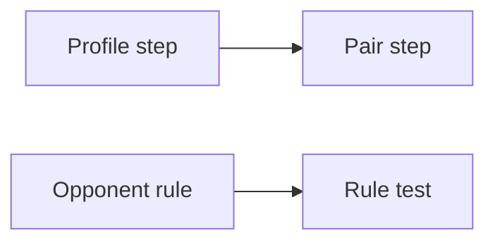

# Similarity opponent reason and season-wide speed

| | |
|---|---|
| Work | Fix: findings 34/F-04 and 34/F-05 of the player similarity scout |
| Change | `df163b6` on `main` (squash of `fix/similarity-opponent-reason-and-season-wide-speed`), 2026-11-10 |
| Evidence | `blueprint/history/fixes/similarity-opponent-reason-and-season-wide-speed.md` (fix spec with evidence, two closed findings, independent review receipt), the commit message, and the build conversation |
| Reader | A learner who can write basic code and is new to this stack |

This document obeys the rules of ASD-STE100 Simplified Technical
English. It is not a certified STE document.

## 1. Summary

This fix repairs two problems of `v_player_similarity`, which feature 34 added. First, the model gave a false reason when a 2003-04 opponent had no row. Second, a query with no player filter used about 70% of the 5 s statement timeout. The prompt now gives the true reason, and a new migration makes those queries about four times faster with the same rows. The one idea to remember: join one row for each player, not one row for each player and metric.

## 2. Why this work exists

An independent review of feature 34 found both problems. Source: archive, The problem.

- **F-04:** in 2003-04 the view holds Arsenal players only. A question about Wayne Rooney, then an Everton player, finds no row. The old prompt rule told the model to say that he "played fewer minutes", which is false. The verifier checks numbers only, so it cannot catch a false reason.
- **F-05:** a question such as "which two 2025-26 players were most alike?" has no filter on `player`. The view then made all 114,764 pairs through a join of one row for each metric, about 690,000 rows. This took 3.45 to 3.50 s against the 5 s timeout, and Neon can be slower.

## 3. Design

The fix changes one prompt rule and replaces the view. It adds no table, column, or dependency.

| Part | Location | Job |
|---|---|---|
| Profile step | `db/migrations/0013_player_similarity_speed.sql` | Puts the z-scores of each player into one array, in metric order. |
| Pair step | `db/migrations/0013_player_similarity_speed.sql` | Joins two profiles and computes the distance from the two arrays. |
| Opponent rule | `services/analyst/src/analyst/prompt.py` | Gives the true reason when a 2003-04 player of another club has no row. |
| Rule test | `services/analyst/tests/test_prompt.py` | Fails if the prompt loses the new sentences. |

An array is one value that holds a list. Here, one array holds the 8 or 6 z-scores of one player. The function `unnest` turns two arrays back into rows of pairs, so SQL can add up the squared differences.

`CREATE OR REPLACE VIEW` changes a view in place. It keeps the grants and the comments of the old view, but only when the columns keep their names, types, and order.

## 4. Workflow

Example input: `SELECT player, similar_player, distance FROM v_player_similarity WHERE season = '2025-26' ORDER BY distance LIMIT 3`.

1. The view computes the per-90 rates and the z-scores, as in 0012.
2. The profile step makes one row for each of the 339 players. ([0013:103](../db/migrations/0013_player_similarity_speed.sql#L103))
3. Each row holds the z-scores as a `float8` array, ordered by metric name. ([0013:113](../db/migrations/0013_player_similarity_speed.sql#L113))
4. The pair step joins the profiles of two different players in one season. ([0013:135](../db/migrations/0013_player_similarity_speed.sql#L135))
5. For each pair, `unnest` lines up the two arrays and sums the squared differences. ([0013:131](../db/migrations/0013_player_similarity_speed.sql#L131))
6. The rank and the 2 decimals work as in 0012.
7. The answer: Bernd Leno and Jordan Pickford at 0.14, in about 0.94 s.

## 5. Decisions and tradeoffs

### 5.1 One array for each player

- **Choice:** Join profiles (one row for each player), not metric rows.
- **Alternatives:** A materialized view that a loader refreshes, or a view comment that tells the model to always filter on `player`.
- **Reason:** Recorded: the profile join takes 0.94 s for a season-wide query and gives the same rows. Source: archive, The fix. Inferred: a materialized view needs a refresh after each data load and an owner that can refresh it. The plain view needs neither.
- **Cost:** The view still computes all pairs for such a query. It is fast enough for 339 players, but not for many thousands.

### 5.2 The general `unnest`, not one term for each position

- **Choice:** Compute the distance with `unnest` over the two arrays.
- **Alternatives:** A sum of 8 fixed terms, `(a[1] - b[1]) ^ 2 + ...`, which took 0.52 s.
- **Reason:** Recorded: the fixed terms would ignore a ninth metric if one is ever added. The general form is 3.7 times faster than 0012 and still general. Source: the build conversation.
- **Cost:** About 0.45 s slower than the fixed terms on the dev database.

### 5.3 `float8` for the arrays

- **Choice:** Cast each z-score to `float8` in the array.
- **Alternatives:** Keep `numeric`, as 0012 did.
- **Reason:** Recorded: with `numeric` arrays the same query took 1.6 s, and with `float8` 0.97 s. Source: the build conversation.
- **Cost:** A distance that falls exactly halfway between two values of 2 decimals can round differently from 0012 after a future data load. On the current data, all rows are equal (independent review, Remaining risk).

### 5.4 A new migration, not a change to 0012

- **Choice:** Add `0013` with `CREATE OR REPLACE VIEW`.
- **Alternatives:** Edit `0012`, which the dev database had already applied.
- **Reason:** Inferred: the migration runner applies each file once by name, so an edited 0012 never reaches a database that already has it.
- **Cost:** Two migrations describe one view, so a reader must look at 0013 for the current pair step.

### 5.5 Two reasons for an absent row

- **Choice:** In 2003-04, a player of another club has no row because the season compares Arsenal players only. In all other cases, he played fewer minutes.
- **Alternatives:** Remove the 2003-04 team filter, so that opponents get rows.
- **Reason:** Recorded: StatsBomb has only Arsenal's matches, so no opponent reaches 900 minutes, and the plan compares Arsenal players in 2003-04. Source: the feature 34 spec, Out of scope, and the 34/F-04 suggested fix.
- **Cost:** The model must choose the right reason from the season and the club.

## 6. Blast radius

### 6.1 This work needs

| Dependency | Used for | If it fails |
|---|---|---|
| The 0012 view and its grant | `CREATE OR REPLACE` keeps them | A column change would stop the migration. |
| `unnest` with two arrays | The distance | No fallback. It is standard PostgreSQL. |

### 6.2 These things use this work

| Consumer | Uses | Found in |
|---|---|---|
| The agent | `v_player_similarity`, same columns | `services/analyst/src/analyst/sql_guard.py` |
| Golden q33 and q34 | The same distances | `evals/golden.yaml` |
| The prompt test | The new sentences | [`test_prompt.py:70`](../services/analyst/tests/test_prompt.py#L70) |

### 6.3 If you change this work

| If you change | Then check |
|---|---|
| The metric order or names | Both arrays use `ORDER BY metric`, so the pairs stay aligned. |
| The column list | `CREATE OR REPLACE VIEW` refuses a change. A new view needs a drop and a new grant. |
| The 2003-04 team filter | The opponent sentence of the prompt rule. |

### 6.4 How to remove this work

1. Add a migration that restores the 0012 body with `CREATE OR REPLACE VIEW`.
2. Restore the old prompt sentence and remove the new test phrases.

## 7. Code reading path

1. [`0013_player_similarity_speed.sql:103`](../db/migrations/0013_player_similarity_speed.sql#L103) - Look for: one row for each player, with an array.
2. [`0013_player_similarity_speed.sql:117`](../db/migrations/0013_player_similarity_speed.sql#L117) - Look for: the pair join and the distance from two arrays.
3. [`prompt.py:72`](../services/analyst/src/analyst/prompt.py#L72) - Look for: the two reasons for an absent row.
4. [`test_prompt.py:70`](../services/analyst/tests/test_prompt.py#L70) - Look for: the phrases that the test requires.

## 8. Known limits

- Nobody timed the season-wide queries on Neon yet. The deploy step does this.
- A rare difference in the last decimal from 0012 is possible after a future data load (5.3).
- The view still computes all pairs for a query with no player filter.

## 9. Self-test

1. Why does a join of profiles make fewer rows than a join of metric rows?
2. What happens if the two arrays of a pair have different metric orders?
3. Why does the fix add 0013 and not change 0012?
4. What does the model say about Wayne Rooney in 2003-04, and why?
5. Why did the fix not use 8 fixed terms, which were faster?

Answers

1. The old join made one row for each pair and metric, about 690,000. The new join makes one row for each pair, 114,582 in 2025-26. See sections 2 and 5.1.
2. The distance would compare different metrics. Both arrays use `ORDER BY metric`, which prevents this. See section 6.3.
3. The runner applies each migration file once, so an edited 0012 never reaches a database that has it. See section 5.4.
4. That he has no row because 2003-04 compares Arsenal players only, and he played for Everton. See section 5.5.
5. The fixed terms would ignore a ninth metric if one is ever added. See section 5.2.

