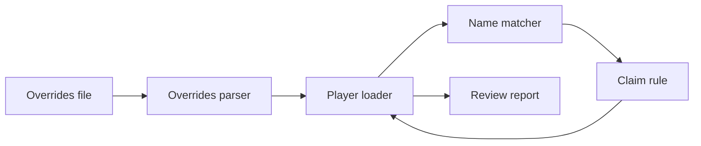
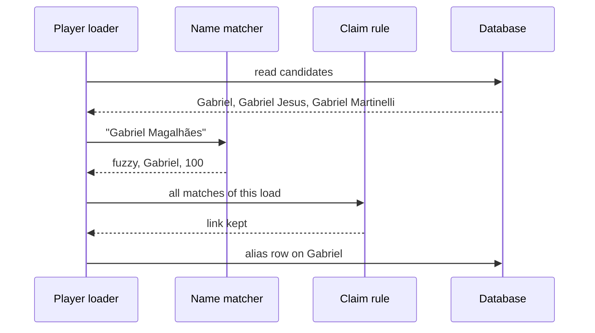

# 21 Entity resolution

| | |
| --- | --- |
| Work | Feature: one canonical ID for each source player and team, through one resolver in `ingest` |
| Change | `7529199` on `main` (squash of `552a4fc`, base `06c18af`), 2026-10-24 |
| Evidence | `blueprint/history/features/21-entity-resolution.md` (spec with seven steps, the completion record, and the closed findings 21/F-30 to 21/F-33. Local, not in Git). The commit message. The build conversation, with three audit passes. |
| Reader | A learner who can write basic code and is new to this stack |

This document obeys the rules of ASD-STE100 Simplified Technical
English. It is not a certified STE document.

## 1. Summary

This work gives the offline loaders one way to decide who a source player is.
A source record gets its player in a fixed order. First comes a hand-written
override, then the source's own ID, then the name in the same team and season. One file,
`ingest/overrides.yaml`, holds the overrides, the team spellings, and the fan
nicknames. On the data of today, no row changes, because no player is in two
sources yet.

The one idea to remember: the resolver links a record only when the link is
certain. If the link is not certain, the record becomes a new player and goes
to a review report. A wrong link would join the numbers of two players.

## 2. Why this work exists

Before this work, each source made its own players. StatsBomb made the players
of 2003-04, and Understat made the players of 2025-26. No player plays in both
seasons, so the two sources never met. The fan nicknames lived in
`ingest/aliases.yaml`, and two dicts in the code held the team spellings.

Feature 22 adds FPL, the Fantasy Premier League data. FPL is the first source
with its own names for players who already exist from Understat. Without a
resolver, "Gabriel dos Santos Magalhães" from FPL becomes a second Gabriel, and
his numbers split across two players. Recorded: build plan, the text above item
17 ("FPL is the first new source with its own player names").

The build plan also asks for tricky names. These are the three Gabriels of
Arsenal 2025-26, "Ødegaard" against "Odegaard", and Kolo Touré. Recorded: build
plan, item 21.

## 3. Design

The design keeps the decision about a name in pure functions. The loader reads
the database, calls those functions, and writes the result.

| Part | Location | Job |
|---|---|---|
| Overrides file | `ingest/overrides.yaml` | Holds the team spellings, the player overrides, and the fan nicknames |
| Overrides parser | `ingest/src/ingest/overrides.py` | Reads the file and names every problem in it at once |
| Name matcher | `ingest/src/ingest/resolve.py` (`normalize`, `match_name`) | Finds the candidate that a source name means, or says why there is none |
| Claim rule | `ingest/src/ingest/resolve.py` (`settle_claims`) | Makes sure that one player takes one record of a source |
| Player loader | `ingest/src/ingest/load.py` (`load_players`) | Applies the order, reads the candidates, and writes the alias rows |
| Review report | `ingest/src/ingest/resolve.py` (`render_report`), `command.py` (`review_line`) | Writes `ingest/review/<source>.md` after the commit |

A **candidate** is a player who can be the person behind a source record. The
candidate played for the same team in the same season. The candidate also has
no record yet from the source that the loader loads.

## 4. Workflow

Example input: the FPL record `10`, "Gabriel Magalhães", Arsenal, 2025-26, after
the Understat load of that season. The test
`test_a_second_source_links_by_name_to_the_player_of_the_first` uses this input.

1. `command.run` builds the rows and reads the player overrides. (`ingest/src/ingest/command.py:142`)
2. `load_season` opens one transaction and calls `load.load`. (`ingest/src/ingest/command.py:57`)
3. `load` writes the teams, then calls `load_players`. (`ingest/src/ingest/load.py:349`)
4. `check_overrides` finds no override for FPL record `10`. (`ingest/src/ingest/load.py:269`)
5. `name_candidates` reads the Arsenal 2025-26 players with no FPL record. (`ingest/src/ingest/load.py:271`)
6. `match_name` changes the name to "gabriel magalhaes" and scores each candidate. (`ingest/src/ingest/load.py:288`)
7. Gabriel scores 100 and Gabriel Jesus scores 70. The lead is 30, so the outcome is `fuzzy`.
8. `settle_claims` finds no other record that wants Gabriel, so the link stays. (`ingest/src/ingest/load.py:290`)
9. `load_players` adds the FPL alias row on Gabriel. It makes no new player. (`ingest/src/ingest/load.py:317`)
10. After the commit, `review_line` writes the report with one `fuzzy: linked` row. (`ingest/src/ingest/command.py:147`)

## 5. Decisions and tradeoffs

### 5.1 An override wins, then the source ID, then the name

- **Choice:** The loader applies the override first, then the source's own ID, then the name in the same team and season.
- **Alternatives:** Name first, with an override only to correct it. Or the source ID only, as before.
- **Reason:** Recorded: a person can see what no rule can see, so the override "always wins". The source ID makes a second run change nothing. Source: build plan item 21, spec "Resolution order".
- **Cost:** A person must write an override for each record that the rules get wrong.

### 5.2 A name links only with a score of 90 and a lead of 10

- **Choice:** An exact match after `normalize` links. Otherwise the best `token_set_ratio` score must be 90 or more and 10 more than the next candidate.
- **Alternatives:** The best score alone, or a lower cutoff.
- **Reason:** Recorded: "A wrong link would join the numbers of two players, so a close second sends the record to review instead." Source: comment in `resolve.py`.
- **Cost:** `token_set_ratio` gives 100 when one name holds all the words of another. Thus "Gabriel Martinelli Silva" ties two Gabriels and goes to review, not to a link.

`token_set_ratio` is a score from the rapidfuzz library. It compares the sets of
words in two names, so the order of the words does not change it.

### 5.3 A table of letters goes with the accent removal

- **Choice:** `normalize` maps letters like `ø`, `æ`, and `ß` before it removes the accents.
- **Alternatives:** The Unicode NFKD form alone.
- **Reason:** Recorded: "NFKD splits é into e and a combining mark, but these letters have no parts, so without the table Ødegaard would never equal Odegaard." Source: comment in `resolve.py`.
- **Cost:** A letter that is not in the table stays as it is. The table needs a new row for each new case.

### 5.4 Teams link by spelling only, never by a fuzzy score

- **Choice:** A team resolves through the spellings in `overrides.yaml`, then by its exact name. rapidfuzz only gives a hint in an error.
- **Alternatives:** A fuzzy match for teams, as for players.
- **Reason:** Recorded: there are 28 clubs, which include "Manchester City" and "Manchester United". An automatic fuzzy team link is a silent wrong join. Source: spec, Notes for the AI.
- **Cost:** A new spelling stops the football-data load until a person adds it to the file.

### 5.5 One player takes one record of a source

- **Choice:** `settle_claims` unlinks a name match to a player that another record already has. Among new records that want one free player, one exact match wins.
- **Alternatives:** The first record in the list wins.
- **Reason:** Recorded: two records on one player share the key of `player_match_stats`, so the second row overwrites the first. The audit showed a goal lost with no error. Source: finding 21/F-33.
- **Cost:** Two records that both fit one player become new players, and a person must decide.

### 5.6 A conflict stops the load and moves no rows

- **Choice:** An override that disagrees with a link in the database stops the load. The message says to reload into a fresh database.
- **Alternatives:** Move the rows of one player to the other.
- **Reason:** Recorded: "moving the rows of one player to another is a merge that a reload does better." Source: docstring of `check_overrides`.
- **Cost:** A late override needs a full reload of the database.

### 5.7 One file replaces `aliases.yaml` and the two team maps

- **Choice:** `ingest/overrides.yaml` has three sections: `teams`, `players`, and `nicknames`.
- **Alternatives:** Keep three places: the alias file and a dict in each loader.
- **Reason:** Recorded: the build plan asks to "move the item 19 team map and the fan nicknames into `overrides.yaml` and delete `aliases.yaml`". Source: build plan, item 21.
- **Cost:** Every loader now reads one shared file. A problem in one section stops every load.

## 6. Blast radius

### 6.1 This work needs

| Dependency | Used for | If it fails |
|---|---|---|
| `ingest/overrides.yaml` | Spellings, overrides, nicknames | Each command prints "Overrides file is not valid, nothing was loaded" |
| rapidfuzz | Name scores and the team hint | The `ingest` package does not import |
| `player_match_stats` rows of the first source | The candidates | No candidates, so each record becomes a new player |
| The `ingest/review/` folder | The report | The command prints a line that says the report was not written. The load stays committed. |

### 6.2 These things use this work

| Consumer | Uses | Found in |
|---|---|---|
| StatsBomb and Understat commands | `command.run`, `load.load` | `ingest/src/ingest/command.py:130` |
| Football-data loader | Team spellings | `ingest/src/ingest/footballdata.py:209` |
| Curated loader | Nicknames | `ingest/src/ingest/curated.py:206` |
| Analyst `resolve_player` | `player_aliases.source_name` | `services/analyst/src/analyst/tools.py:260` |
| FPL loader (feature 22) | `load_players` and the overrides | No consumers yet |

### 6.3 If you change this work

| If you change | Then check |
|---|---|
| `CUTOFF` or `LEAD` | The Gabriel cases in `test_resolve.py` |
| The candidate query | That the records of the source of the load stay out (`test_resolve_db.py`) |
| The `overrides.yaml` shape | `test_overrides.py`, and the test of the shipped file with 71 nicknames |
| The `manual` alias rows | The analyst finds players by these names |

### 6.4 How to remove this work

Revert `7529199`. The revert brings back `aliases.yaml` and the two team maps.
The database keeps its rows, because this work changed no row. Delete the local
`ingest/review/` folder by hand.

## 7. Code reading path

1. [`ingest/overrides.yaml:1`](../ingest/overrides.yaml#L1) - Look for: the three sections and the two forms of a player override.
2. [`ingest/src/ingest/resolve.py:81`](../ingest/src/ingest/resolve.py#L81) - Look for: the letter table before NFKD.
3. [`ingest/src/ingest/resolve.py:88`](../ingest/src/ingest/resolve.py#L88) - Look for: the exact step, then the cutoff and the lead.
4. [`ingest/src/ingest/resolve.py:116`](../ingest/src/ingest/resolve.py#L116) - Look for: why a taken player never links again.
5. [`ingest/src/ingest/load.py:145`](../ingest/src/ingest/load.py#L145) - Look for: the `NOT EXISTS` that keeps out the records of the source of the load.
6. [`ingest/src/ingest/load.py:177`](../ingest/src/ingest/load.py#L177) - Look for: the three stop rules for overrides.
7. [`ingest/src/ingest/load.py:244`](../ingest/src/ingest/load.py#L244) - Look for: match all records first, then settle, then write.
8. [`ingest/src/ingest/command.py:63`](../ingest/src/ingest/command.py#L63) - Look for: the report after the commit, never before it.
9. [`ingest/tests/test_resolve_db.py:62`](../ingest/tests/test_resolve_db.py#L62) - Look for: a second source in a small, real shape.

## 8. Known limits

- No source shares a player yet. Tests prove the name matcher, and real data does not prove it until feature 22.
- A one-word source name scores 100 against each candidate that holds that word. Only the lead rule stops a wrong link. Inferred from `token_set_ratio` and the test of "Gabriel Martinelli Silva".
- Teams have no source ID. The StatsBomb loader does not read the team spellings, because its names are the canonical names.
- A `separate` override cannot undo an old name link without a reload.
- Feature 22 risk: if FPL writes to `player_match_stats` on the Understat match rows, an FPL row can overwrite an Understat row. A table of its own avoids this. Source: the last audit pass.
- `ruff format --check` flags `project-requirement-docs/highbury-mvp-plan.md`. This work did not touch that file.

## 9. Self-test

1. Why does the record "Gabriel Martinelli Silva" become a new player and not Gabriel Martinelli?
2. What happens if two FPL records both match Gabriel, one exact and one fuzzy?
3. Why does "Ødegaard" need a table of letters, when "Touré" does not?
4. What happens if a new football-data season spells Manchester United as "Man Utd"?
5. Why does the loader not move rows when an override disagrees with the database?

Answers

1. The record holds all the words of "Gabriel" and of "Gabriel Martinelli", so both score 100. The lead is 0, so the outcome is `ambiguous`. See section 5.2.
2. The exact match wins and links to Gabriel. The fuzzy record becomes a new player and goes to review as `ambiguous`. See section 5.5.
3. NFKD splits "é" into "e" and a mark, but "Ø" has no parts. The table maps it to "O". See section 5.3.
4. The load stops. The error names "Manchester United" as the closest team, and a person adds the spelling. See section 5.4.
5. A move is a merge of two players, and a reload does that more safely. See section 5.6.

