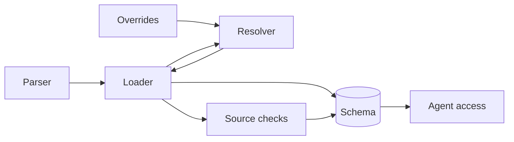
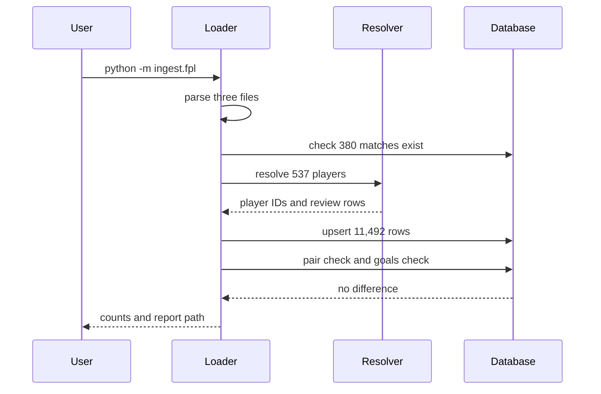

# 22 Ingest FPL 2025-26

| | |
| --- | --- |
| Work | Feature: the FPL numbers of every Premier League player in each 2025-26 match, linked to canonical players and to league matches |
| Change | `857ab9d` on `main` (squash of `6fceb30` and `d9b34e7`, base `730e3dc`), 2026-10-25 |
| Evidence | `blueprint/history/features/22-ingest-fpl-2025-26.md` (spec with seven steps, the source check notes, the user decisions, finding 22/F-30, and the independent review. Local, not in Git). The two commit messages. The build conversation. |
| Reader | A learner who can write basic code and is new to this stack |

This document obeys the rules of ASD-STE100 Simplified Technical
English. It is not a certified STE document.

## 1. Summary

This work adds a fourth source to the database: FPL, the Fantasy Premier League
game. A new command, `python -m ingest.fpl`, loads one row for each player in
each 2025-26 league match that he played. Each row holds clean sheets, saves,
bonus, BPS, cards, defensive contributions, FPL points, and price. The agent
reads these rows through a new view, `v_fpl_player_match`.

The one idea to remember: the loader proves its links against a second source.
In Arsenal's 38 matches, Understat and FPL must list the same players with the
same goals. If they do not, nothing goes into the database.

## 2. Why this work exists

Before this work, the database had player numbers for Arsenal's matches only.
Understat gave both teams of those 38 matches, and football-data.co.uk gave team
numbers for all 380 matches. No source gave player numbers for the other 342
matches, and no source gave saves, bonus, or price.

The live FPL API now serves 2026-27, so the 2025-26 season comes from a
community archive, `vaastav/Fantasy-Premier-League` on GitHub. Recorded: build
plan, item 22. The build plan also forbids FPL xG, because a third xG model
gives numbers that do not agree with Understat. Recorded: build plan, item 22.

FPL is the first source with its own names for players who already exist.
Feature 21 built the resolver for this reason. This work is its first real
test: 537 FPL players with minutes, and 407 of them already in the database.

## 3. Design

The design is one offline loader. It reads three files, links rows to the
matches and players in the database, and checks the result before it commits.

| Part | Location | Job |
|---|---|---|
| Schema | `db/migrations/0008_fpl.sql` | Make the table `fpl_player_match`, the view `v_fpl_player_match`, and the grants |
| Parser | `ingest/src/ingest/fpl.py` (`parse`) | Turn the three raw files into rows, with no I/O |
| Loader | `ingest/src/ingest/fpl.py` (`load_fpl`) | Link rows to matches and players, write them, and run the checks |
| Source checks | `ingest/src/ingest/fpl.py` (`check_pairs`, `check_goals`) | Compare FPL with Understat in Arsenal's matches |
| Resolver | `ingest/src/ingest/load.py` (`load_players`) | Give each FPL record a canonical player. Reused from feature 21, not changed |
| Overrides | `ingest/overrides.yaml` | Hold two team spellings and 17 player links that the resolver cannot make |
| Agent access | `sql_guard.py`, `tools.py`, `curated.py` | Let the agent read the view, see FPL seasons in player search, and find the catalog rows |

A **view** is a saved query that looks like a table. The agent reads views only,
so the view decides what the agent can see.

## 4. Workflow

Example input: `uv run --env-file .env python -m ingest.fpl` on the local
database, with the 17 overrides in place.

1. `main` calls `run`, which gives a task to `command.execute`. ([fpl.py:506](../ingest/src/ingest/fpl.py#L506))
2. The task calls `build`, which reads the team spellings from `overrides.yaml`. ([fpl.py:221](../ingest/src/ingest/fpl.py#L221))
3. `fetch_file` reads each raw file from `ingest/raw/fpl/`, or downloads it once. ([fpl.py:204](../ingest/src/ingest/fpl.py#L204))
4. `parse` drops 0-minute rows and keeps one copy of each exact repeat. ([fpl.py:156](../ingest/src/ingest/fpl.py#L156))
5. `load_season` opens one transaction for the whole load. ([fpl.py:471](../ingest/src/ingest/fpl.py#L471))
6. `check_prerequisites` requires 380 matches, 38 of them from Understat. ([fpl.py:236](../ingest/src/ingest/fpl.py#L236))
7. `load_fpl` links each fixture to one match by home team and away team. ([fpl.py:333](../ingest/src/ingest/fpl.py#L333))
8. `load.load_players` gives the 537 FPL players their canonical IDs. ([fpl.py:396](../ingest/src/ingest/fpl.py#L396))
9. One `executemany` upserts 11,492 rows into `fpl_player_match`. ([fpl.py:399](../ingest/src/ingest/fpl.py#L399))
10. `check_pairs` and `check_goals` compare FPL with Understat. ([fpl.py:436](../ingest/src/ingest/fpl.py#L436))
11. The transaction commits, and `run` writes `ingest/review/fpl.md`. ([fpl.py:495](../ingest/src/ingest/fpl.py#L495))

An **upsert** inserts a row, or updates the row that has the same key. Thus a
second run gives the same table, and the command is safe to run again.

## 5. Decisions and tradeoffs

### 5.1 FPL rows go into their own table

- **Choice:** a new table, `fpl_player_match`, with one row for each player in each match.
- **Alternatives:** add the FPL columns to `player_match_stats`.
- **Reason:** Recorded: Understat already writes minutes, goals, and assists into `player_match_stats` for Arsenal's matches, and the two sources must not mix. Source: the comment at the top of `0008_fpl.sql`.
- **Cost:** two tables hold minutes and goals for the same Arsenal matches. The view comments tell the agent which one to use.

### 5.2 The goals check is exact, with one named difference

- **Choice:** each player's goals in Arsenal's matches must be equal in both sources. `GOAL_DIFFERENCES` lists one difference.
- **Alternatives:** allow a +1 difference whenever Understat has an own goal in the match.
- **Reason:** Recorded: in Leeds 0-4 Arsenal, Understat gives a goal to Karl Darlow as an own goal, and FPL gives it to Noni Madueke. The user chose a named exception, so that any new difference still stops the load. Source: spec Notes, step 6 decisions.
- **Cost:** a later fix of that goal in either source makes the load fail until someone edits the list.

### 5.3 A pair check finds missed links of players who did not score

- **Choice:** in Arsenal's matches, each FPL row must have an Understat row of the same player, and the reverse.
- **Alternatives:** trust the goals check and the review report.
- **Reason:** Recorded: a dry run found 12 players, for example Ben White and Beto, whom the resolver did not link. None of them scored, so the goals check could not see them. The user asked for the check in the loader. Source: spec Notes, step 6.
- **Cost:** the check covers Arsenal's matches only. A missed link of a player who never met Arsenal stays invisible.

### 5.4 Overrides, not a looser cutoff

- **Choice:** 17 entries in `overrides.yaml` link the names that the resolver did not link.
- **Alternatives:** lower `CUTOFF` or `LEAD` in `resolve.py`.
- **Reason:** Recorded: a wrong link joins the numbers of two players, so a review row and an override are safer than a looser match. Source: spec, Notes for the AI.
- **Cost:** each new season of FPL data needs a person to read the report and write overrides.

### 5.5 Exact repeats in the archive are kept once

- **Choice:** the parser keeps one copy of a repeated row when every column is equal. Two different rows for one player and fixture still stop the load.
- **Alternatives:** stop on every repeat, as the first spec said.
- **Reason:** Recorded: the archive repeats 10 rows exactly, most of them Junior Kroupi in gameweeks 1 to 9. The user chose to keep one copy. Source: spec Notes, step 1 decisions.
- **Cost:** none seen. A repeat with one changed cell still stops the load.

### 5.6 A failed check still writes the review report

- **Choice:** when a check fails, the transaction rolls back, but `run` writes `ingest/review/fpl.md`.
- **Alternatives:** write the report only after a commit, as the other loaders do.
- **Reason:** Recorded: the report shows the name links behind the failure, and the user needs it to write the overrides. Source: the comment in `run`, and spec step 4.
- **Cost:** a report can describe a load that is not in the database. The error line says "nothing was loaded".

### 5.7 Player search reads FPL appearances too

- **Choice:** `resolve_player` reads seasons and teams from `player_match_stats` and `fpl_player_match`.
- **Alternatives:** leave the tool as it was.
- **Reason:** Recorded: the independent review found that the 130 players who exist only in FPL showed no season and no team. Two players named James Milner could not be told apart. The user chose to fix it before the merge. Source: finding 22/F-30.
- **Cost:** none seen. EXPLAIN shows index scans in both halves of the `UNION`.

### 5.8 The price is stored in millions with exact decimals

- **Choice:** `price` is `numeric(4,1)`, and the parser divides `value` by 10 as a `Decimal`.
- **Alternatives:** store the FPL `value` in tenths as an integer.
- **Reason:** Recorded: the spec asks for millions of pounds, and the code comment says "Decimal keeps 5.5 exact". Inferred: a price in millions needs no unit rule in the agent's SQL. Source: spec Data / contracts, `parse`.
- **Cost:** a later price with two decimals does not fit.

## 6. Blast radius

### 6.1 This work needs

| Dependency | Used for | If it fails |
|---|---|---|
| The vaastav archive on GitHub | The three raw files | `FetchError`: one line that names the file to save by hand in `ingest/raw/fpl/` |
| The Understat and football-data loads | The 380 matches and the players to link to | `SanityError` before any write: "Load understat and footballdata first" |
| `ingest/overrides.yaml` | Team spellings and player links | `OverridesError`, or a line that names an override with no such player |
| `load.load_players` | Player resolution | A change there changes every FPL link |
| Postgres as the `ingest` role | The writes | "Load failed, nothing was loaded", with the server message only |

### 6.2 These things use this work

| Consumer | Uses | Found in |
|---|---|---|
| `AGENT_VIEWS` | The view name, so `run_sql` accepts it and `get_schema` describes it | `services/analyst/src/analyst/sql_guard.py:24` |
| `resolve_player` | `fpl_player_match`, for seasons and teams | `services/analyst/src/analyst/tools.py:285` |
| `curated.CATALOG` | Two catalog rows that name the view | `ingest/src/ingest/curated.py:87` |
| The `ingest` test fixture | The table name, for `TRUNCATE` | `conftest.py` |

No web code and no system prompt rule use the new view yet. Item 23 adds the
FPL evals.

### 6.3 If you change this work

| If you change | Then check |
|---|---|
| A column of `fpl_player_match` | The view, its comments, `test_every_view_column_has_a_comment`, and the upsert in `load_fpl` |
| The view name | `AGENT_VIEWS`, the catalog notes, and the tests in `test_schema.py` and `test_roles.py` |
| The resolver in `load.py` | The 17 FPL overrides, the pair check, and the goals check on a fresh load |
| `GOAL_DIFFERENCES` | `test_the_madueke_goal_is_the_one_known_difference` and the `goals` view comment |

### 6.4 How to remove this work

1. Revert `857ab9d` on a new branch.
2. Add a migration that drops `v_fpl_player_match` and `fpl_player_match`. The migrations only go forward.
3. Delete the `fpl` rows of `player_aliases`, then the 130 players with no other alias.
4. Run `python -m ingest.curated` to remove the two catalog rows.

## 7. Code reading path

1. [`db/migrations/0008_fpl.sql:5`](../db/migrations/0008_fpl.sql#L5) - Look for: the table rules, and why FPL has its own table.
2. [`ingest/src/ingest/fpl.py:120`](../ingest/src/ingest/fpl.py#L120) - Look for: `parse` and its line-named errors.
3. [`ingest/src/ingest/fpl.py:333`](../ingest/src/ingest/fpl.py#L333) - Look for: how `load_fpl` reuses `load_players` without `load.load`.
4. [`ingest/src/ingest/fpl.py:265`](../ingest/src/ingest/fpl.py#L265) - Look for: the pair check, and what a row with no partner means.
5. [`ingest/src/ingest/fpl.py:300`](../ingest/src/ingest/fpl.py#L300) - Look for: the goals check and `GOAL_DIFFERENCES`.
6. [`ingest/src/ingest/fpl.py:483`](../ingest/src/ingest/fpl.py#L483) - Look for: the report after a failed check.
7. [`ingest/overrides.yaml:49`](../ingest/overrides.yaml#L49) - Look for: the 17 FPL links and their reasons.
8. [`services/analyst/src/analyst/tools.py:260`](../services/analyst/src/analyst/tools.py#L260) - Look for: the `UNION` that fixed 22/F-30.

## 8. Known limits

- Neon does not have migration `0008` or the FPL rows yet. The production API image does not have this code. Each step needs its own approval.
- A second run replaces `ingest/review/fpl.md` with "No records need review", because every record has its alias row. The first report survives only in the spec Notes.
- `GOAL_DIFFERENCES` uses the canonical name as its key. A rename of Noni Madueke breaks the exception.
- The checks cover Arsenal's matches only. Links of players who never met Arsenal have no second source.
- A changed player link needs a fresh database, because the upsert keeps the old rows.
- Inferred from `command.cached_text`: a download that is not a CSV stays in the cache, as open finding F-28 says for football-data.
- The FPL terms page did not load. The use of the data rests on the user's decision.

## 9. Self-test

1. Why does a player who did not score need the pair check?
2. What happens if FPL corrects the Madueke goal in the archive?
3. Why does the loader not call `load.load`?
4. What happens if someone runs `ingest.fpl` before `ingest.footballdata`?
5. Why did two James Milners stop the agent before step 7?

Answers

1. A missed link of a player with no goals gives 0 against 0, so the goals check passes. Only the pair check sees the row with no partner. See section 5.3.
2. FPL then has 2 goals for Madueke, and `GOAL_DIFFERENCES` expects 3. The load fails until someone removes the entry. See section 5.2.
3. `load.load` writes `player_match_stats`, where Understat rows live. The loader calls `load_players` only. See sections 3 and 5.1.
4. `check_prerequisites` finds 38 matches, not 380, and stops before any write. See sections 4 and 6.1.
5. `resolve_player` gave the FPL Milner no season and no team, so the agent could not choose. See section 5.7.

