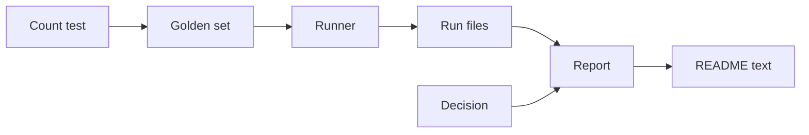
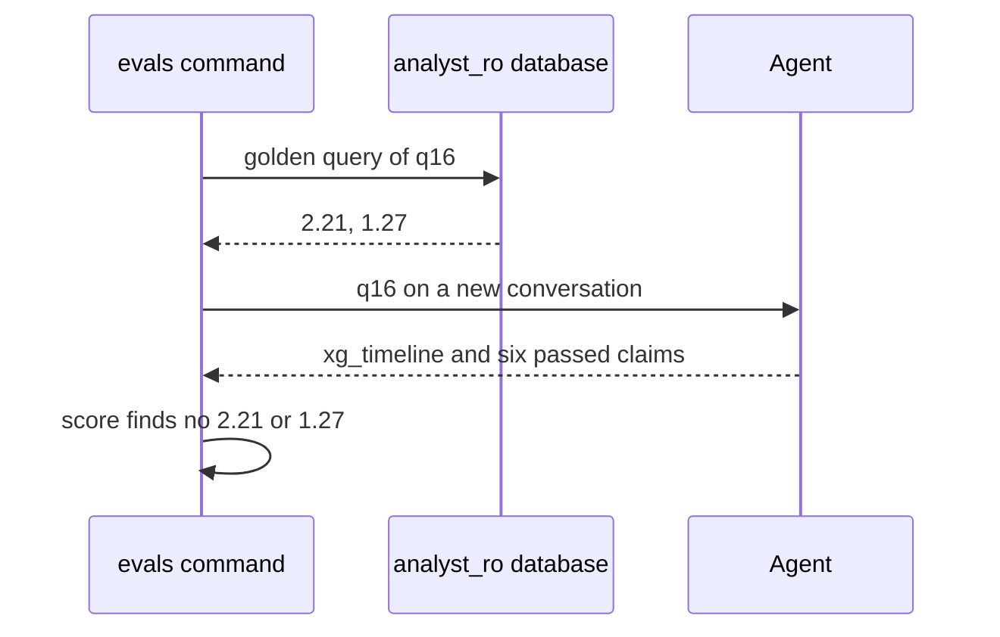

# 23 Evals refresh

| | |
| --- | --- |
| Work | Feature: nine new golden questions for the v1.1 charts and data, and a new paid run of the evals on both models |
| Change | `5c49fdc` on `main` (squash of `07325ba` from `feature/evals-refresh`), 2026-10-25 |
| Evidence | `blueprint/history/features/23-evals-refresh.md` (spec and completion record. Local, not in Git). The commit message. The build conversation, with the paid run and the classification of the failure. |
| Reader | A learner who can write basic code and is new to this stack |

This document obeys the rules of ASD-STE100 Simplified Technical
English. It is not a certified STE document.

## 1. Summary

This work adds nine golden questions to `evals/golden.yaml`, `q16` to `q24`. They
test the four things that v1.1 added: the xG timeline, the points pace, the
league data, and the FPL data. Then the work ran the evals again on both models,
two times each, for $2.13.

Flash answered 24 of 24 in both runs. Flash-Lite answered 23 of 24 in both
runs, and missed `q16` each time. Production stays on Flash.

The one idea to remember: a golden question tests the agent only when its
expected values are correct. Thus the work checked each new query on the real
data before it paid for a model call.

## 2. Why this work exists

Feature 16 made the evals with 15 questions about the MVP data. After that,
features 18 to 22 added two charts and two data sources. No golden question
asked about them. Thus the table in `evals/results.md` said nothing about the
newest parts of the agent.

The build plan asks for golden questions on the new charts and data, with
expected values from hand-written SQL. It also asks for a new run, with the
verified-claim rate in the table. The **verified-claim rate** is the share of
claims that pass the verifier. The evals use it because a number that the
verifier removes never reaches the visitor.

## 3. Design

This work adds data, not code. The eval runner of feature 16 reads the new
items with no change.

| Part | Location | Job |
| --- | --- | --- |
| Golden set | `evals/golden.yaml` | Holds 24 questions. Each answered item has the SQL that gives its expected values. |
| Count test | `services/analyst/tests/test_evals.py` | Checks that the golden set has the ids `q01` to `q24`. |
| Runner | `services/analyst/src/analyst/evals.py` | Asks each question through the agent and scores the answer. Not changed. |
| Run files | `evals/runs/` | Hold the raw result of each question, one file for each model and run. |
| Report | `evals/results.md` | The table that `render` writes from the run files. |
| Decision | `evals/models.yaml` | Holds the chosen model and the reason, with the numbers of this run. |
| README text | `README.md`, `AGENTS.md` | Show the result and the question count to people. |

The nine new questions cover each new area:

| Id | Area | Question, in short | Expected |
| --- | --- | --- | --- |
| `q16` | xG timeline, 2003-04 | Tottenham v Arsenal | 2.21, 1.27 |
| `q17` | xG timeline, 2025-26 | Arsenal v Manchester City | 0.72, 1.12 |
| `q18` | Points pace, two seasons | 2025-26 against the Invincibles | 90, 85 |
| `q19` | Points pace, one season | Arsenal in 2003-04, with the second team | 90, 79 |
| `q20` | League table | Arsenal's 2025-26 position and points | 1, 85 |
| `q21` | Team match stats | Arsenal's corners in 2003-04 | 202 |
| `q22` | FPL | Saka's FPL points and bonus | 157, 18 |
| `q23` | FPL | Raya's saves | 60 |
| `q24` | FPL, refusal | Henry's FPL points in 2003-04 | unavailable |

## 4. Workflow

Example input: `uv run --env-file .env evals`, with `q16` on Flash-Lite, run 1.

1. `main` loads the golden set and the model file. (`evals.py:634`)
2. `load_golden` checks the `q16` query with the SQL guard. (`evals.py:130`)
3. `golden_expected` runs the query as `analyst_ro` and keeps 2.21 and 1.27. (`evals.py:537`)
4. `run_model` asks each item in order. (`evals.py:605`)
5. `ask_item` asks `q16` on a new conversation. (`evals.py:514`)
6. `agent.ask` draws an `xg_timeline` and returns six passed claims. (`agent.py:261`)
7. `score` finds no passed claim near 2.21 or 1.27. (`evals.py:213`)
8. `run_model` writes the run file with `correct: false`. (`evals.py:605`)
9. `render` puts `q16` in the list of failed questions. (`evals.py:441`)

Thus an answer can pass the verifier and still fail the eval. The verifier checks
that each claim matches its own query. The eval checks that the answer holds the
numbers of the question.

## 5. Decisions and tradeoffs

### 5.1 The run used both models, not only the chosen model

- **Choice:** The work ran Flash and Flash-Lite, two runs each.
- **Alternatives:** Run Flash only, as the build plan says, and remove the old Flash-Lite run files.
- **Reason:** Recorded: `render` shows every model with a run file. Old 15-question Flash-Lite files next to new 24-question Flash files make an unfair table. The user chose both models on 2026-10-25. Source: spec, Open question 1, and the build conversation.
- **Cost:** About $0.36 more for Flash-Lite. The work also does more than the plan line asks.

### 5.2 Each new question is about Arsenal

- **Choice:** All nine questions ask about Arsenal, or about a rival in Arsenal's table.
- **Alternatives:** Questions about other clubs or their players, which the league and FPL data can also answer.
- **Reason:** Recorded: the scope rule of the prompt covers "Arsenal's 2003-04 and 2025-26 league seasons, their matches and their players". Source: spec, Notes for the AI.
- **Cost:** The evals do not test a question about another club's player. The correct status for such a question is not clear.

### 5.3 The expected values hold only the asked numbers

- **Choice:** An xG timeline item expects the two xG totals. A points pace item expects the points of each line.
- **Alternatives:** Also expect the goals, the shot counts, or the matches of each line.
- **Reason:** Inferred: the prompt rules at `prompt.py:39` and `prompt.py:42` name the totals that the claims take. A shorter list fails fewer correct answers. Source: the prompt and the spec table.
- **Cost:** An answer with wrong goal counts but correct totals still passes.

### 5.4 The work checked each query before the paid run

- **Choice:** Step 1 ran each new query on the local data and compared it with known facts.
- **Alternatives:** Let the paid run show a wrong golden value.
- **Reason:** Recorded: a golden fix needs a new full run of that model, because `--only` writes over the run file. Source: spec, Notes for the AI.
- **Cost:** The check of `q20` against the published table depends on the check of feature 19. This work did not read the published table again.

### 5.5 A failure goes into the record, not into a fix

- **Choice:** Step 3 sorted each failure into "golden item wrong" or "agent wrong". The agent failure of `q16` stays in `results.md`.
- **Alternatives:** Change the prompt in this work until Flash-Lite passes.
- **Reason:** Recorded: the spec puts changes to the agent, the prompt, and the tools out of scope. A fix is a later `/fix`. Source: spec, Out of scope.
- **Cost:** Flash-Lite keeps a known failure. The cause is not proved, because the run files keep counts and not claim values.

### 5.6 Flash stays the chosen model

- **Choice:** `models.yaml` keeps `gemini-3.8-flash`, although the rule proposes Flash-Lite.
- **Alternatives:** Change to Flash-Lite, which is about 6 times faster and 5 times cheaper.
- **Reason:** Recorded: Flash-Lite missed `q16` in both runs and failed the demo follow-up 2 times in 9 earlier tries. Flash failed neither. Source: `evals/models.yaml`, the decision reason.
- **Cost:** Each production answer costs about $0.037 and takes a median of 28.5 s.

## 6. Blast radius

### 6.1 This work needs

| Dependency | Used for | If it fails |
| --- | --- | --- |
| Local Postgres as `analyst_ro` | The expected values | `golden_expected` stops the evals before any model call. |
| `v_shots`, `v_matches` | `q16`, `q17` | If the match is not in the view, both cells are null, and the evals stop. If one team name is wrong, the item expects one value only. |
| `v_league_table`, `v_league_matches` | `q18` to `q21` | If the row is not there, the evals stop. A wrong name in one subquery of `q18` or `q19` removes one expected value, and nothing tells you. |
| `v_fpl_player_match` | `q22`, `q23` | If the player name is wrong, all cells are null, and the evals stop before any model call. |
| The prepaid Gemini key | Each model call | A `402` fails each question. Production uses the same key, so it stops too. |

### 6.2 These things use this work

| Consumer | Uses | Found in |
| --- | --- | --- |
| The evals command | `golden.yaml`, `models.yaml` | `services/analyst/src/analyst/evals.py:641` |
| The count test | The 24 ids | `services/analyst/tests/test_evals.py:67` |
| The query test | Each golden query on the seeded database | `services/analyst/tests/test_evals.py:87` |
| The README | The result of `results.md` | `README.md:46` |

The web app does not read the eval files. A search of `apps/web/src` found no
consumer.

### 6.3 If you change this work

| If you change | Then check |
| --- | --- |
| A golden item | Run that model again on all 24 questions. `--only` writes over the run file. |
| The number of items | The count test at `test_evals.py:67`, and the counts in `README.md` and `AGENTS.md`. |
| An item with `also_sql` | The assert of `["q02", "q10"]` in `test_evals.py:87`. |
| The data of a view | The expected values change at the next run, and old run files no longer agree. |
| The decision in `models.yaml` | Run `evals --report`, then the README text. |

### 6.4 How to remove this work

Revert `5c49fdc`. This brings back the 15 questions, the old run files, and the
old text. No table, migration, or config value stays behind. The spend of $2.13 does
not come back.

## 7. Code reading path

1. [`evals/golden.yaml:170`](../evals/golden.yaml#L170) - Look for: the xG timeline items, with one subquery that finds the match.
2. [`evals/golden.yaml:210`](../evals/golden.yaml#L210) - Look for: the second team found by `position = 2`, not by name.
3. [`evals/golden.yaml:261`](../evals/golden.yaml#L261) - Look for: a refusal item with no SQL.
4. [`services/analyst/src/analyst/evals.py:537`](../services/analyst/src/analyst/evals.py#L537) - Look for: the stop before any model call when a query fails.
5. [`services/analyst/src/analyst/evals.py:201`](../services/analyst/src/analyst/evals.py#L201) - Look for: the expected values that no passed claim holds.
6. [`services/analyst/src/analyst/evals.py:605`](../services/analyst/src/analyst/evals.py#L605) - Look for: the path of the run file, which `--only` writes over.
7. [`services/analyst/src/analyst/prompt.py:39`](../services/analyst/src/analyst/prompt.py#L39) - Look for: the claims that the two new charts must give.
8. [`evals/models.yaml:20`](../evals/models.yaml#L20) - Look for: the decision and the numbers of this run.

## 8. Known limits

- The run files keep counts, not claim values. Thus the cause of the `q16` failure is not proved. Inferred: Flash-Lite used the home match, with totals 1.73 and 0.84.
- `--only` writes over the run file of that model and run. One fixed question costs a full run.
- A Flash question costs $0.037, against $0.023 on 2026-10-14. Inferred: the prompt grew with the v1.1 rules and views. This cost also applies in production.
- The query test proves that each golden query runs, not that its values are correct. The check of the values happened by hand in step 1.
- `expected_values` keeps only the cells that hold a number (`evals.py:160`). If one subquery of an item gives null, the item expects fewer values, and nothing warns.
- The user said that Neon holds the loads of items 19 to 22. This work did not read Neon.
- The golden set has 24 questions. The first long plan asked for about 50.
- Defect seen during the debrief: `README.md:58` says 713 Python tests, but the suite has 927. The count was old before this work.
- Defect seen during the debrief: `ruff format --check .` flags a Python block in `project-requirement-docs/highbury-mvp-plan.md`. This work did not touch that file.

## 9. Self-test

1. Why can an answer pass the verifier and still fail the eval?
2. What happens if the match of `q16` is not in `v_matches`?
3. Why did the work run Flash-Lite again, when the plan said "the chosen model"?
4. What happens if you fix one golden item and run it with `--only`?
5. Why does Flash stay the chosen model, when the rule proposes Flash-Lite?

Answers

1. The verifier checks each claim against its own query. The eval checks that the claims hold the numbers of the question. See section 4.
2. Both cells are null, so `golden_expected` stops the evals before any model call. See section 6.1.
3. `render` shows every model with a run file. Old Flash-Lite files would make an unfair table. See section 5.1.
4. The run file of that model and run keeps only that question. The report then shows the other questions as "not run". See section 6.3.
5. Flash-Lite missed `q16` in both runs and failed the demo follow-up before. Flash failed neither. See section 5.6.

