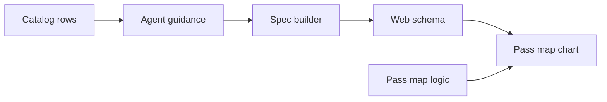
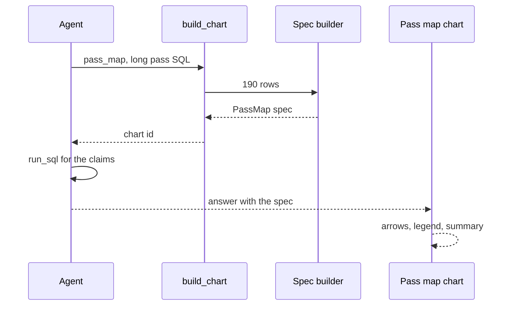

# 24 Pass map (2003-04)

| | |
|---|---|
| Work | Feature: a `pass_map` chart that draws the passes of one player as arrows on the pitch |
| Change | `a0d1aa5` on `main` (squash of `febd68b` from `feature/pass-map-2003-04`), 2026-10-31 |
| Evidence | `blueprint/history/features/24-pass-map-2003-04.md` (spec and completion record. Local, not in Git). The commit message. The build conversation, with the live check and its two repairs. No findings and no independent review. |
| Reader | A learner who can write basic code and is new to this stack |

This document obeys the rules of ASD-STE100 Simplified Technical
English. It is not a certified STE document.

## 1. Summary

This work adds a sixth chart type, `pass_map`. The chart shows the passes of one
player in 2003-04 as arrows, from the start point of each pass to its end point.
Solid red arrows are completed passes. Dashed grey arrows are incomplete passes.

The agent can now answer "Show Vieira's long passes in 2003-04" with a chart and
three checked claims: 190 passes, 129 completed, and 67.9%.

The one idea to remember: the chart and its claims read the same rows. Both SQL
examples use one shared filter, so the numbers in the answer match the arrows.

## 2. Why this work exists

Beta testers asked for heatmaps, pass maps, and more metrics. One tester shared
a picture of the long passes of a defender as an example. Source: the spec and
the v1.2 section of the build plan.

The data was already there. The view `v_passes` holds every pass of 2003-04 with
`x`, `y`, `end_x`, and `end_y`. But before this work, the only pass chart was the
`pass_network`. A pass network shows who passed to whom, but it does not show
where each pass went.

For 2025-26, no source has pass events. Thus the catalog now says that a 2025-26
pass map is not available, and it tells the agent what to offer instead.

## 3. Design

The design follows the path of every chart in this project. The service makes a
chart spec from SQL rows, and the web page draws the spec.

A **chart spec** is a JSON object that says what a chart shows, as data. The
service makes it and the web page decides how it looks.

| Part | Location | Job |
|---|---|---|
| Spec builder | `services/analyst/src/analyst/charts.py` | Turns the rows of one query into a `PassMap`, and refuses rows that are not passes of one player |
| Agent guidance | `services/analyst/src/analyst/prompt.py` | Tells the agent when to use the chart, what a long pass is, and where the claims come from |
| Catalog rows | `ingest/src/ingest/curated.py` | Says that a pass map is available for 2003-04 and not for 2025-26 |
| Web schema | `apps/web/src/lib/analyst-schema.ts` | Checks the spec when it arrives in the browser |
| Pass map logic | `apps/web/src/lib/pass-map.ts` | Pure functions for the kind, the length, the filter, the words, and the summary |
| Pass map chart | `apps/web/src/components/charts/pass-map.tsx` | Draws the arrows, the legend filter, and the tooltip |

## 4. Workflow

Example input: the question "Show Vieira's long passes in 2003-04".

1. The agent reads the pass map rule and the two Vieira examples. (`prompt.py:52`)
2. The agent calls `build_chart` with `pass_map` and the long pass query. (`tools.py:327`)
3. `build_chart` runs the SQL through `run_sql`, with its guard and row limit. (`tools.py:355`)
4. `charts.build` checks the type and the title. (`charts.py:506`)
5. `pass_map` checks the columns and parses each row as a `PassArrow`. (`charts.py:255`)
6. `pass_map` refuses a row of a second player. (`charts.py:255`)
7. The agent calls `run_sql` with the totals query for its three claims.
8. The verifier finds 190, 129, and 67.9 in the rows of that query.
9. The browser checks the spec with `chartSpecSchema`. (`ask-stream.ts:51`)
10. `ChartPanel` sends a `pass_map` spec to `PassMap`. (`chart-panel.tsx:34`)
11. `PassMap` draws 190 arrows and the summary. (`pass-map.tsx:162`)

## 5. Decisions and tradeoffs

### 5.1 One player in each pass map

- **Choice:** The builder refuses rows of more than one player.
- **Alternatives:** A team pass map with all passes of a match.
- **Reason:** Recorded: the spec puts team pass maps out of scope. Inferred: a reader cannot follow hundreds of arrows of many players. Source: the spec, and the 190-arrow screenshot of one player.
- **Cost:** A question about a team needs a pass network or a second chart.

### 5.2 A long pass is 35 or more on the pitch

- **Choice:** The agent measures the straight length, `sqrt((end_x - x)^2 + (end_y - y)^2)`, and keeps passes of 35 or more.
- **Alternatives:** A length in metres, or a "long ball" tag from the source.
- **Reason:** Recorded: StatsBomb uses yards, so 35 is about 32 m, the long-ball line of Opta. The user chose it. Source: the spec and the v1.2 memory note.
- **Cost:** A pass along the length and a pass across the width count the same.

### 5.3 One shared filter for the chart and its claims

- **Choice:** Both examples use one fragment, `VIEIRA_LONG_PASSES`. (`prompt.py:104`)
- **Alternatives:** Two queries that the agent writes separately.
- **Reason:** Recorded: the code comment says that the chart and the claims must count the same passes. The points pace and pass network examples do the same thing. Source: `prompt.py`.
- **Cost:** The examples name one real player, so the agent must change the name.

### 5.4 Two signals for the kind of a pass

- **Choice:** Completed passes are solid and red. Incomplete passes are dashed and grey. Each kind has its own arrowhead marker.
- **Alternatives:** Colour only, or one marker that takes the colour of its line.
- **Reason:** Recorded: the spec asks for colour and line style, so a reader who cannot see colour can tell the kinds apart. Recorded: a marker does not take the colour of its line in each browser. Source: the spec and the comment at `pass-map.tsx:44`.
- **Cost:** Two marker definitions in each chart.

### 5.5 The summary does not give the threshold

- **Choice:** The rule tells the agent to say "long passes" and not "35".
- **Alternatives:** A claim for the number 35.
- **Reason:** Recorded: in the live check, the summary said "35 units". No claim backed it, so the answer showed "Partially verified". Source: the build conversation.
- **Cost:** No live run tested the new rule text. The prompt test only proves that the rule is in the prompt.

## 6. Blast radius

### 6.1 This work needs

| Dependency | Used for | If it fails |
|---|---|---|
| `v_passes` | Every row of the chart | The query fails and the agent gets an error |
| The 500-row cap of `run_sql` | Chart size | A larger query gets the too-many-rows error, and the agent must narrow it |
| `Pitch` and `PitchTooltip` | The pitch and the tooltip | The chart does not draw |
| `nextIndex` in `shot-map.ts` | Arrow keys | Keyboard moves stop |

### 6.2 These things use this work

| Consumer | Uses | Found in |
|---|---|---|
| `ChartPanel` | `PassMap` | `apps/web/src/components/ask/chart-panel.tsx:34` |
| The CLI | `CHART_MARKS["pass_map"]` | `services/analyst/src/analyst/cli.py:19` |
| The MCP server | `pass_map` in the `chart_type` enum, from the `ChartType` annotation | `services/analyst/src/analyst/tools.py:327` |
| The evals | `ChartType` for a golden question | `services/analyst/src/analyst/evals.py:49` |

### 6.3 If you change this work

| If you change | Then check |
|---|---|
| The `PassArrow` fields | The Zod schema in `analyst-schema.ts`. It must mirror the Pydantic model |
| The values of `outcome` | `passKind` in `pass-map.ts`. Null means completed |
| The long pass rule | Both Vieira examples and the claims they back |
| The catalog rows | The catalog count in `test_curated.py` and the prompt tests |

### 6.4 How to remove this work

Revert `a0d1aa5`. Then run `ingest.curated` again, because the catalog table
keeps the `pass_maps` rows until the next load. No migration and no table change
are part of this work.

## 7. Code reading path

1. [`charts.py:113`](../services/analyst/src/analyst/charts.py#L113) - Look for: the `PassArrow` fields and the nullable `outcome`.
2. [`charts.py:255`](../services/analyst/src/analyst/charts.py#L255) - Look for: the one-player check.
3. [`prompt.py:52`](../services/analyst/src/analyst/prompt.py#L52) - Look for: the long pass rule.
4. [`prompt.py:104`](../services/analyst/src/analyst/prompt.py#L104) - Look for: the shared filter of both examples.
5. [`curated.py:79`](../ingest/src/ingest/curated.py#L79) - Look for: the two `pass_maps` catalog rows.
6. [`analyst-schema.ts:107`](../apps/web/src/lib/analyst-schema.ts#L107) - Look for: the Zod mirror of `PassArrow`.
7. [`pass-map.ts:39`](../apps/web/src/lib/pass-map.ts#L39) - Look for: the summary text.
8. [`pass-map.tsx:44`](../apps/web/src/components/charts/pass-map.tsx#L44) - Look for: one arrowhead marker for each kind.
9. [`pass-map.tsx:162`](../apps/web/src/components/charts/pass-map.tsx#L162) - Look for: the legend filter and the tab stop.

## 8. Known limits

- A dense map is hard to point at. The arrows overlap, so the mouse can hit a
  neighbour. The arrow keys reach every pass.
- The summary rounds the completed share to a whole number. Thus it can say 68%
  when the checked claim says 67.9%.
- A goalkeeper can have more than 500 long passes. Then the agent must narrow
  the query, for example to one match.
- No live question ran after the prompt change of section 5.5.
- The deploy is not done. Neon needs the catalog rows, and the API and the web
  page need a new release.

## 9. Self-test

1. Why do both Vieira examples use one SQL fragment?
2. What happens if the rows hold passes of two players?
3. Why are incomplete passes dashed and not only grey?
4. What happens if a question asks for a 2025-26 pass map?
5. Why did the first live answer show "Partially verified"?

Answers

1. The chart and its claims must count the same passes. See section 5.3.
2. The builder refuses the rows and tells the agent to filter on one player. See section 4.
3. A reader who cannot see colour must still tell the kinds apart. See section 5.4.
4. The catalog says that the data is not available, and the agent offers an alternative. See section 2.
5. The summary gave the number 35, and no claim backed it. See section 5.5.

