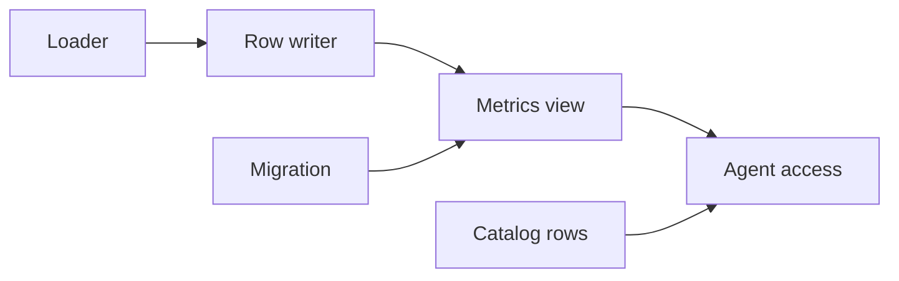
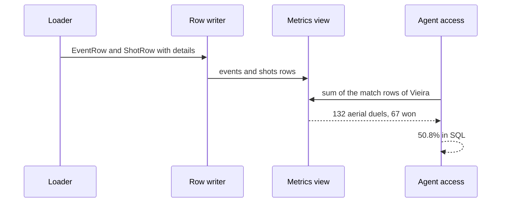

# 25 2003-04 on-ball events + advanced metrics

| | |
|---|---|
| Work | Feature: eight more StatsBomb event types, their details, and one view of five advanced metrics for each player and match of 2003-04 |
| Change | `7002d77` on `main` (squash of `cf15e42` from `feature/2003-04-on-ball-events-advanced-metrics`), 2026-10-31 |
| Evidence | `blueprint/history/features/25-2003-04-on-ball-events-advanced-metrics.md` (spec, completion record, and the passed independent review. Local, not in Git). The open finding F-01. The commit message. The build conversation, with the three definitions that the user chose. |
| Reader | A learner who can write basic code and is new to this stack |

This document obeys the rules of ASD-STE100 Simplified Technical
English. It is not a certified STE document.

## 1. Summary

This work gives the analyst five new metrics for 2003-04: chances created,
duels, aerial duels, pass accuracy, and long balls. The StatsBomb loader now
keeps eight more on-ball event types, about 47,000 events. A new view adds them
up for each player and match.

The agent can now answer "How many aerial duels did Vieira win in 2003-04?" with
three checked claims: 132 duels, 67 won, and 50.8%.

The one idea to remember: a metric is only as good as its definition. Thus the
user chose each definition before the build, and a test counts the same numbers
from the raw files with its own code.

## 2. Why this work exists

Beta testers asked for more metrics. Source: the v1.2 section of the build plan.

Before this work, the loader kept only four StatsBomb types: pass, carry,
pressure, and substitution. The raw cache held all the other on-ball events, but
the database did not. Also, the pass rows had no length, no pass type, and no
assist flags. Thus the agent could not count a duel or a key pass.

For 2025-26, no source has these events. Thus the catalog says that the five
metrics are not available for 2025-26. Item 27 adds the free 2025-26 metrics later.

## 3. Design

The design follows the data from the raw file to the agent. The loader keeps the
events, the database adds them up in a view, and the agent reads the view.

A **view** is a saved SQL query that looks like a table. This work uses a view so
that each metric has one definition, in one place, for the agent and the tests.

| Part | Location | Job |
|---|---|---|
| Migration | `db/migrations/0009_advanced_metrics.sql` | Adds the detail columns and the view, and lets `analyst_ro` read the view |
| Loader | `ingest/src/ingest/statsbomb.py` | Turns the eight new types and their details into rows |
| Row writer | `ingest/src/ingest/load.py` | Writes the new fields with an upsert |
| Metrics view | `v_player_match_advanced` in the migration | Adds up the events of each player and match |
| Agent access | `sql_guard.py` and `prompt.py` | Lets the agent read the view, and tells it how to make a season % |
| Catalog rows | `ingest/src/ingest/curated.py` | Says that the metrics are available for 2003-04 only |

An **upsert** is an insert that updates the row when its key already exists. The
loader uses it so that a second run changes no row count.

## 4. Workflow

Example input: the question "How many aerial duels did Vieira win in 2003-04?"

Before the question, the loader runs once:

1. `build_rows` reads each event of the 38 cached matches. (`statsbomb.py:255`)
2. A type in `EVENT_TYPES` becomes an `EventRow`. (`statsbomb.py:310`)
3. `event_row` sets `aerial_won` from the detail record. (`statsbomb.py:250`)
4. `shot_row` sets `aerial_won` on a shot. (`statsbomb.py:217`)
5. `load` upserts the shots and the events with the new columns. (`load.py:391`, `load.py:420`)

Then the agent answers:

1. The agent reads the rule on season % values. (`prompt.py:57`)
2. The guard accepts the view, because it is in `AGENT_VIEWS`. (`sql_guard.py:25`)
3. The view adds aerial wins from events and shots, plus aerial losses. (`0009_advanced_metrics.sql:14`)
4. The agent sums the match rows and makes the % in SQL.
5. The verifier finds 132, 67, and 50.8 in the rows of that query.

## 5. Decisions and tradeoffs

### 5.1 A duel is a tackle or an aerial duel

- **Choice:** `duels` counts tackle duels and aerial duels. A tackle is won when StatsBomb says `won`, `success in play`, or `success out`.
- **Alternatives:** An Opta-like count that also adds dribbles, times dribbled past, and 50/50s.
- **Reason:** Recorded: the user chose this option. It comes from the StatsBomb duel type, with no extra event types. Source: the build conversation, 2026-10-31.
- **Cost:** The number is lower than an Opta duel count, so a comparison with Opta figures is not fair.

### 5.2 Pass accuracy leaves out throw-ins

- **Choice:** `passes` and `long_balls` skip throw-ins. `chances_created` keeps them.
- **Alternatives:** Every pass, or open play only.
- **Reason:** Recorded: the user chose this option, because most providers leave throw-ins out of pass accuracy. Source: the build conversation. Recorded: the spec defines chances created as every pass with a shot assist or a goal assist. Source: the spec.
- **Cost:** The `passes` of this view differ from the row count of `v_passes` for the same player.

### 5.3 Aerial wins come from four event types

- **Choice:** An aerial win is the `aerial_won` flag on a pass, a clearance, a miscontrol, or a shot. A loss is a duel of type `aerial lost`.
- **Alternatives:** Count only the duel events.
- **Reason:** Inferred: StatsBomb gives no duel event to the winner of an aerial duel. The 1,552 duel events in the cache are all losses, and 59 wins are on shots. Source: the survey of the raw cache in the build conversation.
- **Cost:** The `shots` table needs its own `aerial_won` column.

### 5.4 Only a season with event data has rows

- **Choice:** The view keeps only seasons with `data_level = 'EVENT'`.
- **Alternatives:** Rows for 2025-26 with zeros.
- **Reason:** Recorded: a code comment says that zeros would be wrong for 2025-26. Source: `0009_advanced_metrics.sql:69`.
- **Cost:** A question about 2025-26 gets no rows, so the agent must read the catalog.

### 5.5 The raw-cache test skips without the cache

- **Choice:** The Henry and Vieira test skips with a reason when `ingest/raw/statsbomb/` is absent.
- **Alternatives:** Fail without the cache.
- **Reason:** Recorded: raw data is never committed, so a fresh clone has no cache. The user chose to skip. Source: the build conversation and `AGENTS.md`.
- **Cost:** On a fresh clone, no test compares the view with the source.

### 5.6 A season % comes from sums

- **Choice:** The prompt rule and the view comment say `round(100.0 * sum(won) / NULLIF(sum(total), 0), 1)`.
- **Alternatives:** The mean of the match % values.
- **Reason:** Inferred: the mean of match % values gives the same weight to a match with one aerial duel and a match with ten. Source: the rule text in `prompt.py:57`.
- **Cost:** The agent must write a longer query.

## 6. Blast radius

### 6.1 This work needs

| Dependency | Used for | If it fails |
|---|---|---|
| The StatsBomb raw cache | Every new event | The loader downloads the absent files again |
| `player_match_stats` | The rows of the view | A player with no stats row has no metrics row |
| Locations on the pitch | `x` and `y` of each event | The loader stops with `CoordinateError` |
| Neon after the deploy | The production data | The API reads a view that does not exist yet, and the query fails |

### 6.2 These things use this work

| Consumer | Uses | Found in |
|---|---|---|
| The SQL guard | `v_player_match_advanced` | `services/analyst/src/analyst/sql_guard.py:25` |
| The prompt | The rule and the example | `services/analyst/src/analyst/prompt.py:57` |
| The catalog | `ADVANCED_ROWS` | `ingest/src/ingest/curated.py:108` |
| Item 26, the heatmap | The new on-ball events | No consumers yet |

### 6.3 If you change this work

| If you change | Then check |
|---|---|
| `EVENT_TYPES` | `v_passes` and `v_substitutions`, which filter on `type` |
| A metric definition | The seeded test, the raw-cache test, and the catalog notes |
| The `EventRow` fields | The test fixtures, which build the row by position |
| The view columns | The prompt example and the view comments |

### 6.4 How to remove this work

Revert `7002d77`. Then drop the view and the seven columns in a new migration,
because the migrate command does not undo 0009. Run `ingest.curated` again to
remove the ten catalog rows. The extra events stay in `events` until a reload.

## 7. Code reading path

1. [`0009_advanced_metrics.sql:3`](../db/migrations/0009_advanced_metrics.sql#L3) - Look for: the six detail columns.
2. [`0009_advanced_metrics.sql:14`](../db/migrations/0009_advanced_metrics.sql#L14) - Look for: each `FILTER` clause, one for each definition.
3. [`statsbomb.py:48`](../ingest/src/ingest/statsbomb.py#L48) - Look for: the eight new types.
4. [`statsbomb.py:221`](../ingest/src/ingest/statsbomb.py#L221) - Look for: which details apply to which type.
5. [`load.py:94`](../ingest/src/ingest/load.py#L94) - Look for: the new fields with defaults at the end.
6. [`curated.py:51`](../ingest/src/ingest/curated.py#L51) - Look for: the five metrics and their notes.
7. [`prompt.py:57`](../services/analyst/src/analyst/prompt.py#L57) - Look for: the rule on season % values.
8. [`test_advanced_metrics.py:154`](../ingest/tests/test_advanced_metrics.py#L154) - Look for: the count from the raw JSON without the loader.

## 8. Known limits

- Finding F-01 (P3) is open. The comment that describes `CATALOG` now sits
  above `ADVANCED_ROWS` in `curated.py:48`.
- The duel count is not an Opta duel count. It leaves out dribbles and 50/50s.
- The deploy is not done. Neon needs migration 0009, a StatsBomb reload, and the
  catalog load, and then a new API image.
- No chart shows these metrics yet. The `compare_bars` chart can show them.

## 9. Self-test

1. Why does the view add aerial wins from the `shots` table?
2. What happens if a question asks for Saka's aerial duels in 2025-26?
3. Why does a throw-in count as a chance created but not as a pass?
4. What happens if the raw cache is absent when the tests run?
5. Why does the agent sum the counts before it makes a season %?

Answers

1. StatsBomb marks an aerial win on the event that won it, and 59 of these are shots. See section 5.3.
2. The view has no 2025-26 rows, and the catalog says the metric is not available. See section 5.4.
3. The user left throw-ins out of pass accuracy only, and the spec counts every pass that led to a shot. See section 5.2.
4. The raw-cache test skips with a reason, and the other tests still run. See section 5.5.
5. A mean of match % values gives a small match the same weight as a large one. See section 5.6.

