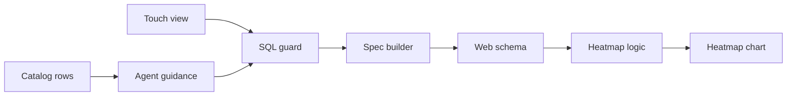
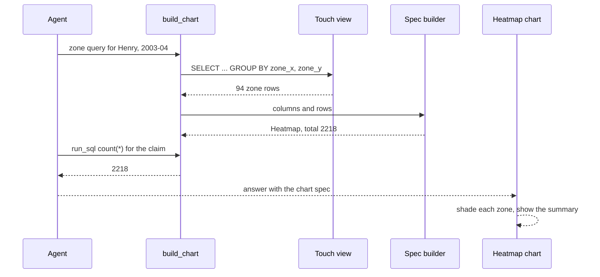

# 26 Touch heatmap (2003-04)

| | |
|---|---|
| Work | Feature: a `v_touches` view and a `heatmap` chart that counts the touches of one player in zones of the pitch |
| Change | `007bc5a` on `main` (squash of `9aeb004` from `feature/touch-heatmap-2003-04`), 2026-10-31 |
| Evidence | `blueprint/history/features/26-touch-heatmap-2003-04.md` (spec, completion record, and independent review receipt. Local, not in Git). `blueprint/context/findings.md` (F-02 and F-03). The commit message. The build conversation, with the live checks. |
| Reader | A learner who can write basic code and is new to this stack |

This document obeys the rules of ASD-STE100 Simplified Technical
English. It is not a certified STE document.

## 1. Summary

This work adds a seventh chart type, `heatmap`. The chart shows where one player
touched the ball in 2003-04. It divides the pitch into zones of 10 x 10 yards and
gives each zone a red shade. A darker zone has more touches.

The agent can now answer "Show Henry's touch heatmap in 2003-04" with a chart and
one checked claim: 2,218 touches.

The one idea to remember: the database counts the touches, not the chart. One
SQL query groups the touches into at most 96 zones, so a full season fits under
the row limit.

## 2. Why this work exists

Beta testers asked for player maps and more metrics. Item 24 added the pass map.
Item 25 added eight more StatsBomb event types, for example dribbles, duels, and
ball recoveries. Source: the v1.2 section of the build plan and the spec.

Before this work, no view collected the events where a player had the ball. The
events and the shots also lived in two tables. Thus an agent query for "all
touches" had to know every event type and join two tables.

For 2025-26, no source has events. The catalog now says that a 2025-26 heatmap
is not available, and it tells the agent to offer a shot map instead.

## 3. Design

The design adds one view to the database, then follows the path of every chart
in this project. The service makes a chart spec from SQL rows, and the web page
draws the spec.

A **chart spec** is a JSON object that says what a chart shows, as data. The
service makes it, and the web page decides how it looks.

A **touch** in this work is an event where the player plays or wins the ball.
The view counts passes, shots, dribbles, duels, clearances, interceptions, ball
recoveries, blocks, and miscontrols.

| Part | Location | Job |
|---|---|---|
| Touch view | `db/migrations/0010_touches.sql` | Gives one row for each touch of 2003-04, from the events and the shots |
| SQL guard | `services/analyst/src/analyst/sql_guard.py` | Lets the agent read `v_touches` |
| Spec builder | `services/analyst/src/analyst/charts.py` | Turns zone rows into a `Heatmap` and refuses rows that are not zones of one player |
| Agent guidance | `services/analyst/src/analyst/prompt.py` | Tells the agent how to bin the touches and where the claim comes from |
| Catalog rows | `ingest/src/ingest/curated.py` | Says that a heatmap is available for 2003-04 and not for 2025-26 |
| Web schema | `apps/web/src/lib/analyst-schema.ts` | Checks the spec when it arrives in the browser |
| Heatmap logic | `apps/web/src/lib/heatmap.ts` | Pure functions for the zone place, the shade, the share, and the summary |
| Heatmap chart | `apps/web/src/components/charts/heatmap.tsx` | Draws the zones, the scale key, the tooltip, and the summary |

## 4. Workflow

Example input: the question "Show Henry's touch heatmap in 2003-04".

1. The agent reads the catalog row `heatmaps` and the heatmap rule. (`prompt.py:57`)
2. The agent calls `build_chart` with the zone query of the example. (`tools.py:327`)
3. The guard checks the SQL, and `v_touches` gives Henry's touches. (`0010_touches.sql:5`)
4. The query groups the touches into 94 zone rows with a count each. (`prompt.py:203`)
5. The builder checks one player, one season, and no zone twice. (`charts.py:304`)
6. The builder adds up the counts into `total`, which is 2,218. (`charts.py:335`)
7. The agent runs `count(*)` with the same filter for the claim. (`prompt.py:208`)
8. The verifier finds 2218 in that result and passes the claim.
9. The browser checks the spec and draws one shaded rect for each zone. (`heatmap.tsx:107`)

## 5. Decisions and tradeoffs

### 5.1 The SQL bins the touches, not the chart

- **Choice:** The query groups the touches into zones of 10 x 10 yards, so a season gives 96 rows at most.
- **Alternatives:** Send one row for each touch and let the builder or the browser bin them.
- **Reason:** Recorded: a season of Henry's touches is about 2,200 rows, and the row limit is 500. Source: the spec, In scope.
- **Cost:** The grid does not change. A finer grid or a smooth heatmap needs a change to the contract.

### 5.2 Ball receipts, carries, and pressures are not touches

- **Choice:** The view leaves out pressures, carries, ball receipts, and substitutions.
- **Alternatives:** Count every on-ball event of item 25, ball receipts included.
- **Reason:** Recorded: a pressure has no ball, a carry moves a ball already touched, and ball receipts double the count to about 4,400. Source: the spec and the migration comment.
- **Cost:** A dispossession right after a receipt does not show as a touch, because the loader keeps no dispossession event.

### 5.3 The view holds 2003-04 only

- **Choice:** The view keeps only seasons with `data_level = 'EVENT'`.
- **Alternatives:** Let the view hold the shots of 2025-26 too.
- **Reason:** Recorded: the 2025-26 shots alone give a wrong touch count. Source: the comment at `0010_touches.sql:36`.
- **Cost:** A 2025-26 question gets no rows. The builder then gives a message that names the season.

### 5.4 The chart total and the claim come from the same filter

- **Choice:** Both SQL examples use one shared filter, `HENRY_TOUCHES`, and the builder sums the zone counts.
- **Alternatives:** Let the model add up the zone counts for the claim.
- **Reason:** Recorded: numbers in a claim come from SQL, never from the model. Source: the spec, Data / contracts.
- **Cost:** The agent makes two tool calls for one chart.

### 5.5 The zone values must be whole numbers

- **Choice:** The builder takes `zone_x` and `zone_y` only as integers, so the example casts `floor()` with `::int`.
- **Alternatives:** Accept a float such as `10.0` and round it.
- **Reason:** Inferred: the spec models are strict, so a float in an integer column is an error. Source: the `Spec` class in `charts.py` and the float case in `test_charts.py`.
- **Cost:** A query without the cast fails once. The error names the column, and the agent can correct it.

### 5.6 The shade has a floor and a ceiling

- **Choice:** The opacity goes from 0.15 to 0.85 of the brand red, relative to the busiest zone.
- **Alternatives:** A full scale from 0 to 1, or a palette of several colours.
- **Reason:** Recorded: the faintest zone must still show, and the busiest zone must not hide the pitch lines. Source: the comment at `heatmap.ts:11`.
- **Cost:** The scale key starts at the shade for 0 touches, but labels it with the fewest count. The review recorded this as F-02.

## 6. Blast radius

### 6.1 This work needs

| Dependency | Used for | If it fails |
|---|---|---|
| `events` and `shots` tables | The rows of the view | No touches. The builder refuses an empty result |
| `seasons.data_level` | The 2003-04 filter | If 2003-04 is not `EVENT`, the view is empty |
| `analyst_ro` grant | Agent access to the view | The SQL guard allows the view, but the query fails |
| Migration on Neon | Production access | Production has no `v_touches` until `ingest.migrate` runs |

### 6.2 These things use this work

| Consumer | Uses | Found in |
|---|---|---|
| SQL guard | `v_touches` | `services/analyst/src/analyst/sql_guard.py:26` |
| Agent prompt | Rule and two examples | `services/analyst/src/analyst/prompt.py:57` |
| `build_chart` and the MCP server | The `heatmap` chart type | `services/analyst/src/analyst/charts.py:559` |
| Command line | The `zones` count in the chart line | `services/analyst/src/analyst/cli.py` |
| Chart panel | The `Heatmap` component | `apps/web/src/components/ask/chart-panel.tsx:37` |

### 6.3 If you change this work

| If you change | Then check |
|---|---|
| The touch types in the view | The raw-file test at `test_advanced_metrics.py:224` and the view test at `test_schema.py:149` |
| The zone size | `ZONE_SIZE` in `charts.py`, `ZONES_X` in the web schema, `heatmap.ts`, and the prompt rule |
| The `Heatmap` spec | The Zod schema, because the browser refuses a spec that does not match |
| The test season level | `conftest.py:92`, because the heatmap example test needs an `EVENT` season |

### 6.4 How to remove this work

Revert `007bc5a`. Then drop the view with a new migration, because the migration
log on Neon keeps `0010_touches.sql`. Run `ingest.curated` to remove the two
`heatmaps` catalog rows. The events and shots stay unchanged.

## 7. Code reading path

1. [`db/migrations/0010_touches.sql:5`](../db/migrations/0010_touches.sql#L5) - Look for: the touch types and the `UNION ALL` of the shots.
2. [`db/migrations/0010_touches.sql:37`](../db/migrations/0010_touches.sql#L37) - Look for: the 2003-04 filter and the location filter.
3. [`services/analyst/src/analyst/prompt.py:57`](../services/analyst/src/analyst/prompt.py#L57) - Look for: how the rule bins the far edge into the last zone.
4. [`services/analyst/src/analyst/prompt.py:203`](../services/analyst/src/analyst/prompt.py#L203) - Look for: the two examples with one shared filter.
5. [`services/analyst/src/analyst/charts.py:304`](../services/analyst/src/analyst/charts.py#L304) - Look for: the checks for one player, one season, and unique zones.
6. [`apps/web/src/lib/heatmap.ts:22`](../apps/web/src/lib/heatmap.ts#L22) - Look for: how a data zone becomes a rect on a pitch that attacks upward.
7. [`apps/web/src/lib/heatmap.ts:66`](../apps/web/src/lib/heatmap.ts#L66) - Look for: the final third and the busiest zone in the summary.
8. [`apps/web/src/components/charts/heatmap.tsx:54`](../apps/web/src/components/charts/heatmap.tsx#L54) - Look for: the one tab stop that moves with the focus, and the focus rect.

## 8. Known limits

- F-02 (P3, open): the scale key labels its faintest shade with the fewest count, but that shade means 0 touches.
- F-03 (P3, open): no test reaches the check for two seasons, and its message gives no remedy.
- F-01 (P3, open): a comment in `curated.py` from item 25 sits above the wrong block.
- The arrow keys move through the zones in row order. Thus ArrowUp does not move up on the pitch.
- The touch definition leaves out ball receipts. The review left this as a product decision.
- Production needs `ingest.migrate` and `ingest.curated` on Neon, a new API image, and a web push. Each one needs approval.
- The API process does not reload code. During the live check, an old process said that no heatmap data exists, until a restart.

## 9. Self-test

1. Why does the SQL bin the touches, when the browser could do it?
2. What happens if the view also keeps the seasons with `data_level = 'SHOT'`?
3. Why does the claim come from a second query and not from the chart total?
4. What happens if the zone query leaves out the `::int` cast?
5. Why are ball receipts not touches in this work?

Answers

1. A season has about 2,200 touches, but the row limit is 500. Zones give 96 rows at most. See section 5.1.
2. The 2025-26 shots become touches, and the count is wrong for that season. See section 5.3.
3. Numbers in a claim must come from SQL. The shared filter makes both numbers the same. See section 5.4.
4. The builder refuses the float zone and names the column, and the agent corrects the query. See section 5.5.
5. A receipt comes before the pass or carry, so it doubles the count to about 4,400. See section 5.2.

