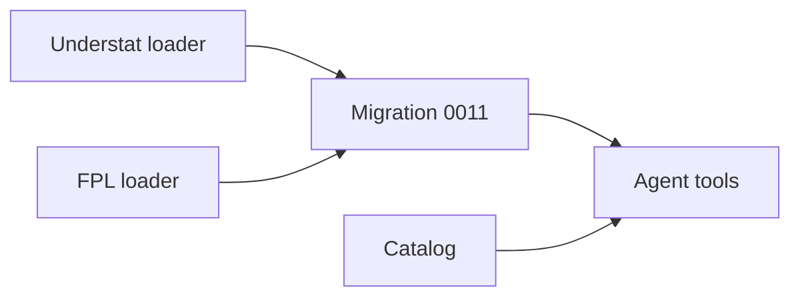
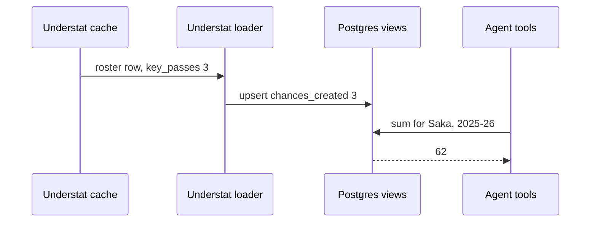

# 27 2025-26 free metrics

| | |
|---|---|
| Work | Feature: chances created and three FPL defensive counts for 2025-26, and catalog rows that say why the other metrics are not available |
| Change | `ba0e2cc` on `main` (squash of `feature/2025-26-free-metrics`), 2026-11-01 |
| Evidence | `blueprint/history/features/27-2025-26-free-metrics.md` (spec, the F-01 record, independent review), commit messages, and the build conversation |
| Reader | A learner who can write basic code and is new to this stack |

This document obeys the rules of ASD-STE100 Simplified Technical
English. It is not a certified STE document.

## 1. Summary

This work gives the 2025-26 season four metrics from data that the project
already caches. Chances created come from the Understat key passes of each
player in each match. Tackles, recoveries, and clearances-blocks-interceptions
(CBI) come from the FPL file. The data catalog now tells the agent which
2025-26 metrics exist, why the others do not, and what to offer in their place.
The one idea to remember: a free metric is a column that a source already
sends. Thus the work adds columns and notes, not a new source.

## 2. Why this work exists

Beta users asked for more metrics (build plan, v1.2 introduction). Feature 25
gave 2003-04 its advanced metrics from StatsBomb events. The 2025-26 season has
no open source with events. Thus a heatmap, a pass map, duels, aerials, pass accuracy,
and long balls are not available for that season. But Understat and FPL send
a few counts that the loaders did not keep. Before this work, the catalog
marked 2025-26 chances created as not available, and the agent declined a
question that the cached files can answer.

## 3. Design

The design adds columns at the two ends of the data path. The loaders write
them, and the views and the catalog show them to the agent.

| Part | Location | Job |
|---|---|---|
| Migration 0011 | `db/migrations/0011_free_metrics.sql` | Adds the four columns and shows them in three views, with a comment for the model on each column |
| Understat loader | `ingest/src/ingest/understat.py`, `ingest/src/ingest/load.py` | Reads `key_passes` from each roster row and writes it as `chances_created` |
| FPL loader | `ingest/src/ingest/fpl.py` | Reads the three counts from `merged_gw.csv`, rejects a bad cell, and writes them |
| Catalog | `ingest/src/ingest/curated.py` | Marks 2025-26 chances created as available and gives each declined metric a reason and an alternative |
| Agent tools | `services/analyst/src/analyst/tools.py` | Unchanged: `get_schema` and `get_data_catalog` read the new comments and rows |

A **data catalog** is a table of rows (season, metric, available, source,
notes). The agent reads it before a claim about one season, so a note in the
catalog is an instruction to the model.

## 4. Workflow

Example input: the Understat roster row of Bukayo Saka in one cached match
file, with `"key_passes": "3"`.

1. `fetch_season` reads the match file from `ingest/raw/understat/`. ([understat.py:94](../ingest/src/ingest/understat.py#L94))
2. `build_rows` passes each roster row of both teams to `stat_row`. ([understat.py:226](../ingest/src/ingest/understat.py#L226))
3. `stat_row` turns `key_passes` into the integer `chances_created`. ([understat.py:185](../ingest/src/ingest/understat.py#L185))
4. `load.load` upserts the row into `player_match_stats`. ([load.py:467](../ingest/src/ingest/load.py#L467))
5. `v_player_season` sums the column for Saka and 2025-26. ([0011_free_metrics.sql](../db/migrations/0011_free_metrics.sql))
6. The agent reads the column comment through `get_schema`. ([tools.py:202](../services/analyst/src/analyst/tools.py#L202))
7. The agent queries the sum with `run_sql` and gets 62.

An **upsert** is an insert that updates the row when its key already exists.
The loaders use it because the project rule is that each loader is safe to run
again.

## 5. Decisions and tradeoffs

### 5.1 The new column is null for 2003-04

- **Choice:** `player_match_stats.chances_created` holds Understat values only. The 2003-04 value stays in `v_player_match_advanced`.
- **Alternatives:** The StatsBomb loader also fills the column, so one view covers both seasons.
- **Reason:** Recorded: the spec puts 2003-04 values out of scope and points the column comment at the feature 25 view. Source: spec, Out of scope. Inferred: the StatsBomb loader stays unchanged, and each season keeps one source for the metric.
- **Cost:** A comparison of the two seasons needs a query over two views.

### 5.2 The FPL columns are nullable

- **Choice:** The three FPL columns allow null, but the loader always writes a value.
- **Alternatives:** `NOT NULL DEFAULT 0`.
- **Reason:** Recorded: rows loaded before the migration then read as not loaded, not as zero. Source: comment in `0011_free_metrics.sql` and spec step 1.
- **Cost:** The schema does not force a value. A test and a reload check do that work.

### 5.3 The views get the columns at the end

- **Choice:** `CREATE OR REPLACE VIEW` with the new columns as the last columns.
- **Alternatives:** Drop and create each view again.
- **Reason:** Recorded: Postgres allows a replaced view to add columns only at the end, and the replacement keeps the grants. Source: comment in `0011_free_metrics.sql`.
- **Cost:** The column order of each view shows the history of the schema.

### 5.4 Each declined metric keeps its old alternative

- **Choice:** Each 2025-26 advanced decline offers the 2003-04 value or the player's 2025-26 shots and xG. Duels also offer the FPL counts. Pass accuracy and long balls also offer chances created.
- **Alternatives:** Replace the shots-and-xG alternative with the new counts, as the first build did.
- **Reason:** Recorded: the spec said "keep each row's alternative", and the first independent review raised F-01 for the change. Tackles and CBI are no alternative for aerial duels. Source: archive, Findings, 27/F-01.
- **Cost:** The notes are longer, and the model reads more text in each prompt.

### 5.5 No second guard for a 2025-26 heatmap

- **Choice:** The decline rests on the catalog row and the empty-touches check in `charts.py`.
- **Alternatives:** A new season check in the heatmap tool.
- **Reason:** Recorded: the current checks already decline the request, and the spec says to prove the decline live only. Source: spec, Notes for the AI.
- **Cost:** The decline works only when the model reads the catalog first.

## 6. Blast radius

### 6.1 This work needs

| Dependency | Used for | If it fails |
|---|---|---|
| Understat cache or site | `key_passes` in each roster row | The loader stops, and no 2025-26 row changes |
| FPL archive file `merged_gw.csv` | The three counts | The loader names the absent column or the bad cell, and it writes nothing |
| Migration 0011 | The columns | Without it, the loaders fail on an unknown column |
| The reload order | Data that matches the catalog | If the catalog loads before the data, it says available while the rows are null |

### 6.2 These things use this work

| Consumer | Uses | Found in |
|---|---|---|
| SQL guard | The three views in the allowed list | [sql_guard.py:18](../services/analyst/src/analyst/sql_guard.py#L18) |
| `get_schema` | The new column comments | [tools.py:202](../services/analyst/src/analyst/tools.py#L202) |
| `get_data_catalog` and the system prompt | The catalog rows | [prompt.py:222](../services/analyst/src/analyst/prompt.py#L222) |
| The MCP server | The same five tools | `services/analyst/src/analyst/mcp_server.py` |

### 6.3 If you change this work

| If you change | Then check |
|---|---|
| The `COUNTS` tuple in `fpl.py` | The header check, the parser, and `test_fpl.py` |
| `NO_EVENTS` or `ADVANCED_ALTERNATIVES` | `test_curated.py` and the live decline of a 2025-26 heatmap |
| `player_match_stats` | The three views that read it: `v_player_match`, `v_player_season`, and `v_player_match_advanced` |

### 6.4 How to remove this work

Revert `ba0e2cc`. The project has no down migrations, so add a new migration.
It replaces the three views with their old column lists and drops the four
columns. Then load the catalog again. No raw file changes.

## 7. Code reading path

1. [`0011_free_metrics.sql`](../db/migrations/0011_free_metrics.sql) - Look for: the nullable columns and the comments for the model.
2. [`understat.py:174`](../ingest/src/ingest/understat.py#L174) - Look for: one roster row as one `StatRow`.
3. [`load.py:113`](../ingest/src/ingest/load.py#L113) - Look for: the default that keeps StatsBomb rows null.
4. [`fpl.py:49`](../ingest/src/ingest/fpl.py#L49) - Look for: one tuple that drives the header check, the parser, and the row fields.
5. [`curated.py:69`](../ingest/src/ingest/curated.py#L69) - Look for: one alternative for each declined metric.
6. [`test_understat.py:440`](../ingest/tests/test_understat.py#L440) - Look for: a test that counts the raw files with its own code.
7. [`test_curated.py:243`](../ingest/tests/test_curated.py#L243) - Look for: the test that keeps the F-01 repair in place.

## 8. Known limits

- Understat sends data for Arsenal's matches only. Thus only players who played in those 38 matches have chances created.
- Understat and StatsBomb define a key pass in their own ways. The catalog note tells the agent to say this caveat.
- The prompt has no SQL example for 2025-26 chances created. The catalog row and the column comment carry the metric. Feature 28 can add an example.
- At the time of this debrief, Neon has no reload and the API has no new image. Production does not have the metrics yet.

## 9. Self-test

1. Why is `v_player_season.chances_created` null for 2003-04?
2. What happens if the catalog loads on Neon before the Understat and FPL reloads?
3. Why do the FPL columns allow null when every loaded row has a value?
4. What happens if you add the CBI count to `defensive_contribution`?
5. Why does the aerial duels decline not offer the FPL tackles?

Answers

1. The Understat loader fills the column. The 2003-04 value stays in `v_player_match_advanced`. See section 5.1.
2. The catalog says chances created is available, but the rows are null. See section 6.1.
3. A null shows a row from before the migration as not loaded, not as zero. See section 5.2.
4. You count the same actions two times, because `defensive_contribution` already includes them. See section 3.
5. Tackles and CBI are not aerial duels, so they are no alternative. See section 5.4.

