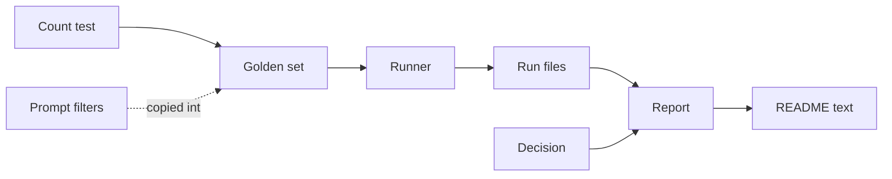
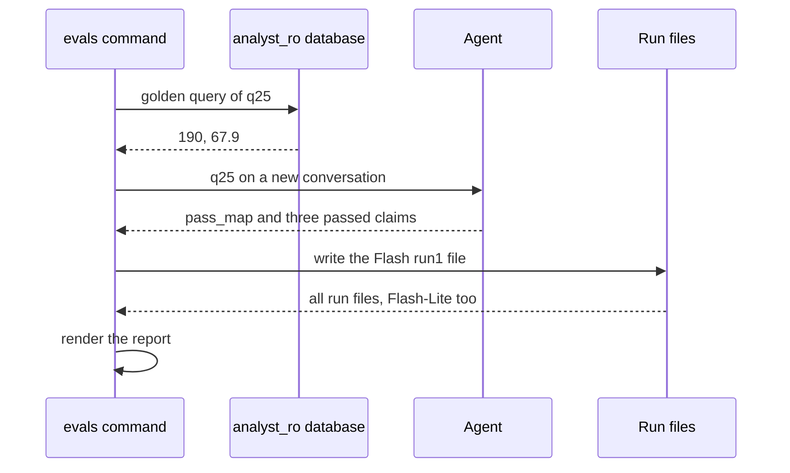

# 28 Evals refresh

| | |
| --- | --- |
| Work | Feature: eight new golden questions for the v1.2 maps and metrics, and a new paid run of the evals on the production model |
| Change | `180a28b` on `main` (squash of `4cb1f06` from `feature/evals-refresh`), 2026-11-01 |
| Evidence | `blueprint/history/features/28-evals-refresh.md` (spec and completion record. Local, not in Git). The commit message. The build conversation, with the choice of one model and one run. |
| Reader | A learner who can write basic code and is new to this stack |

This document obeys the rules of ASD-STE100 Simplified Technical
English. It is not a certified STE document.

## 1. Summary

This work adds eight golden questions to `evals/golden.yaml`, `q25` to `q32`. They
test the four things that v1.2 added: the pass map, the touch heatmap, the
2003-04 advanced metrics, and the 2025-26 free metrics. Then the work ran the
evals again on Flash only, one run, for $1.35.

Flash answered 32 of 32. Flash-Lite did not run again, so its column in
`evals/results.md` still shows the 24-question run of 2026-10-25.

The one idea to remember: the report reads every run file in `evals/runs/`.
Thus a cheaper run must also remove the old files that it does not replace.

## 2. Why this work exists

Feature 23 made the golden set 24 questions long. After that, features 24 to 27
added two charts, one view of advanced metrics, and new 2025-26 columns. No golden
question asked about them. Thus the table in `evals/results.md` said nothing about
the newest parts of the agent.

The build plan asks for golden questions on the new maps and metrics of both
seasons, with expected values from hand-written SQL. It also asks for a new run on
the chosen model. A **golden question** is a question with a known correct answer.
The evals use it because a model change or a prompt change can break an answer
with no other signal.

## 3. Design

This work adds data, not code. The eval runner of feature 16 reads the new items
with no change.

| Part | Location | Job |
| --- | --- | --- |
| Golden set | `evals/golden.yaml` | Holds 32 questions. Each answered item has the SQL that gives its expected values. |
| Count test | `services/analyst/tests/test_evals.py` | Checks that the golden set has the ids `q01` to `q32`. |
| Runner | `services/analyst/src/analyst/evals.py` | Asks each question through the agent and scores the answer. Not changed. |
| Prompt filters | `services/analyst/src/analyst/prompt.py` | Hold the SQL filters of the pass map and heatmap examples. Not changed. |
| Run files | `evals/runs/` | Hold the raw result of each question, one file for each model and run. |
| Report | `evals/results.md` | The table that `render` writes from the run files. |
| Decision | `evals/models.yaml` | Holds the chosen model and the reason, with the numbers of this run. |
| README text | `README.md`, `AGENTS.md` | Show the result and the question count to people. |

The eight new questions cover each new area:

| Id | Area | Question, in short | Expected |
| --- | --- | --- | --- |
| `q25` | Pass map, 2003-04 | Vieira's long passes | 190, 67.9 |
| `q26` | Heatmap, 2003-04 | Henry's touches | 2218 |
| `q27` | Heatmap, refusal | Saka's touches in 2025-26 | unavailable |
| `q28` | Advanced metrics, 2003-04 | Vieira's aerial duels won and % | 67, 50.8 |
| `q29` | Free metrics, 2025-26 | Saka's chances created | 62 |
| `q30` | FPL, 2025-26 | Rice's tackles | 69 |
| `q31` | Pass accuracy, refusal | Rice's pass completion in 2025-26 | unavailable |
| `q32` | Two providers | Henry's chances created against Saka's | 76, 62 |

Before the paid run, the work compared four values with earlier checks. The 190
passes and 67.9% agree with the live check of feature 24. The 2,218 touches agree
with feature 26. The 62 chances agree with a sum of `key_passes` in the cached
Understat files.

## 4. Workflow

Example input: `evals --model google_genai:gemini-3.8-flash --runs 1`, with `q25`.

1. `main` loads the golden set and the model file. (`evals.py:634`)
2. `load_golden` checks the `q25` query with the SQL guard. (`evals.py:130`)
3. `golden_expected` runs the query as `analyst_ro` and keeps 190 and 67.9. (`evals.py:537`)
4. `run_model` names the file `...-run1.json` for the one run. (`evals.py:617`)
5. `ask_item` asks `q25` on a new conversation. (`evals.py:514`)
6. `agent.ask` draws a `pass_map` and returns three passed claims. (`agent.py:252`)
7. `score` finds 190 and 67.9 in the passed claims. (`evals.py:213`)
8. `read_runs` reads every run file, also the two old Flash-Lite files. (`evals.py:497`)
9. `render` makes one column for each model with a run file. (`evals.py:443`)

Thus the Flash-Lite column stays in the report, with "not run" for `q25` to `q32`.
If the old Flash `run2` file stayed, step 8 would also read it. Then the Flash
numbers would mix 24 old questions with 32 new ones.

## 5. Decisions and tradeoffs

### 5.1 Only Flash ran, one time

- **Choice:** The work ran `gemini-3.8-flash` one time on 32 questions.
- **Alternatives:** Both models, two runs each, as in feature 23. Or Flash with two runs.
- **Reason:** Recorded: the user chose the production model only, then one run, to save cost. Source: the build conversation and spec, Open question 1.
- **Cost:** The Flash column has no range between runs. Flash-Lite has no result for the new questions.

### 5.2 The work deleted the old Flash run 2 file

- **Choice:** The work deleted `google-genai-gemini-3-8-flash-run2.json` before the run.
- **Alternatives:** Keep two runs, so that the runner writes over both files.
- **Reason:** Recorded: `read_runs` reads every file, and `--runs 1` writes only `run1`. The old file would mix two question sets. Source: `evals.py:497`, `evals.py:617`, and the build conversation.
- **Cost:** The old Flash run 2 is in Git history only.

### 5.3 The decision text labels the old Flash-Lite numbers

- **Choice:** `models.yaml` and the README say that the Flash-Lite numbers come from the 24-question run of 2026-10-25.
- **Alternatives:** Delete the Flash-Lite run files, so the report has one column and no rule line.
- **Reason:** Recorded: the spec keeps the Flash-Lite files and asks the text to say that the rule line is not a new comparison. Source: spec, step 3.
- **Cost:** The rule line in `results.md` proposes Flash only because Flash has more questions. A reader must read the decision text to see this.

### 5.4 The pass map question keeps the long-pass filter

- **Choice:** `q25` asks for Vieira's long passes, with the filter of `VIEIRA_LONG_PASSES`.
- **Alternatives:** A pass map of all passes of one player in a season.
- **Reason:** Recorded: a season of all passes passes the 500-row cap of `run_sql`, and the chart would then miss passes. Source: spec, Notes for the AI.
- **Cost:** The evals do not test a pass map of one match or a filter that the prompt does not show.

### 5.5 Two questions repeat the prompt examples

- **Choice:** `q25` and `q26` are the questions of the prompt examples for the pass map and the heatmap.
- **Alternatives:** Other players or other filters, to test that the agent can generalize.
- **Reason:** Recorded: they are the done-when questions of features 24 and 26. Source: spec, Notes for the AI.
- **Cost:** They prove that the agent follows the examples, not that it can adapt them.

### 5.6 The pass map item expects two values

- **Choice:** `q25` expects the pass count and the completion %.
- **Alternatives:** Also expect the 129 completed passes, which the prompt also asks the claims to give.
- **Reason:** Recorded: the done-when of feature 24 names the pass count and the completion %. A shorter list fails fewer correct answers. Source: the spec review in the build conversation.
- **Cost:** An answer with a wrong count of completed passes still passes.

### 5.7 The `q32` chart is not scored

- **Choice:** `q32` has `chart: null`. In the run, the agent drew `compare_bars`.
- **Alternatives:** Expect `compare_bars`, as `q02` does.
- **Reason:** Inferred: the question asks for two numbers and names no chart, so a plain answer is also correct. Source: the `q32` note and the spec table.
- **Cost:** The "Chart type matches" row does not count `q32`.

## 6. Blast radius

### 6.1 This work needs

| Dependency | Used for | If it fails |
| --- | --- | --- |
| Local Postgres as `analyst_ro` | The expected values | `golden_expected` stops the evals before any model call. |
| `v_passes`, `v_touches` | `q25`, `q26` | If the view has no row for the player, the count is 0 and the % is null. The item then expects the wrong values. |
| `v_player_match_advanced` | `q28`, `q32` | If the name is wrong, the cells are null. `q28` stops the evals. `q32` expects one value only, and nothing warns. |
| `v_player_season`, `v_fpl_player_match` | `q29`, `q30`, `q32` | If the name is wrong, the cells are null, and `q29` and `q30` stop the evals. |
| The prepaid Gemini key | Each model call | A `402` fails each question. Production uses the same key, so it stops too. |

### 6.2 These things use this work

| Consumer | Uses | Found in |
| --- | --- | --- |
| The evals command | `golden.yaml`, `models.yaml`, `runs/` | `services/analyst/src/analyst/evals.py:634` |
| The count test | The 32 ids | `services/analyst/tests/test_evals.py:67` |
| The query test | Each golden query on the seeded database | `services/analyst/tests/test_evals.py:87` |
| The README | The result of `results.md` | `README.md:59` |

The web app does not read the eval files. A search of `apps/web/src` found no
consumer.

### 6.3 If you change this work

| If you change | Then check |
| --- | --- |
| `VIEIRA_LONG_PASSES` or `HENRY_TOUCHES` in `prompt.py` | `q25` and `q26` copy these filters as text. Change both, or the claims and the expected values count different rows. |
| A golden item | Run that model again on all 32 questions. `--only` writes over the run file. |
| The number of runs | Delete the run files that the new run does not write over. |
| The number of items | The count test at `test_evals.py:67`, and the counts in `README.md` and `AGENTS.md`. |
| The decision in `models.yaml` | Run `evals --report`, then the README text. |

### 6.4 How to remove this work

Revert `180a28b`. This brings back the 24 questions, the two old Flash run files,
and the old text. No table, migration, or config value stays behind. The spend of
$1.35 does not come back.

## 7. Code reading path

1. [`evals/golden.yaml:267`](../evals/golden.yaml#L267) - Look for: the pass map item, with the filter of the prompt example.
2. [`services/analyst/src/analyst/prompt.py:115`](../services/analyst/src/analyst/prompt.py#L115) - Look for: the filter that `q25` copies.
3. [`evals/golden.yaml:295`](../evals/golden.yaml#L295) - Look for: a season % from sums, not the mean of the match values.
4. [`evals/golden.yaml:332`](../evals/golden.yaml#L332) - Look for: two providers in one item.
5. [`services/analyst/src/analyst/evals.py:617`](../services/analyst/src/analyst/evals.py#L617) - Look for: one file for each run number.
6. [`services/analyst/src/analyst/evals.py:497`](../services/analyst/src/analyst/evals.py#L497) - Look for: every file in `runs/`, with no filter.
7. [`services/analyst/src/analyst/evals.py:443`](../services/analyst/src/analyst/evals.py#L443) - Look for: one column for each model with a run file.
8. [`evals/models.yaml:22`](../evals/models.yaml#L22) - Look for: the label on the old Flash-Lite numbers.

## 8. Known limits

- Flash ran one time. A question that passes by chance looks the same as a question that always passes.
- Flash-Lite has no result for `q25` to `q32`. A future change of model needs a new run of Flash-Lite on all 32 questions.
- The `q32` note asks for a caveat on the two providers. The scorer does not check text, so nothing tests this caveat.
- `q25` and `q26` copy the prompt filters as text. No test checks that the two stay the same.
- `q32` cost $0.090 and used seven tool calls. Each other new question cost less than $0.06.
- The user said that Neon holds the loads of features 25 and 27. This work did not read Neon.
- Defect seen during the debrief: `README.md:76` says 944 Python tests, but the suite has 998. The count was old before this work.
- Defect seen during the debrief: `ruff format --check .` flags `project-requirement-docs/highbury-mvp-plan.md`. This work did not touch that file.

## 9. Self-test

1. Why did the work delete the old Flash run 2 file?
2. What happens if someone changes `VIEIRA_LONG_PASSES` and not `q25`?
3. Why does the rule line of `results.md` propose Flash, and why is that not a new comparison?
4. Why does `q25` ask for long passes and not for all passes?
5. What happens if the player name in `q30` is wrong?

Answers

1. `read_runs` reads every file, and one run writes only `run1`. The old file would mix 24 old questions into the Flash numbers. See section 5.2.
2. The claims and the expected values count different passes, so a correct answer can fail. See section 6.3.
3. Flash has 32 questions and Flash-Lite has 24, so Flash has more correct answers. See section 5.3.
4. All passes of a season pass the 500-row cap, and the chart would miss passes. See section 5.4.
5. The cells are null, so the evals stop before any model call. See section 6.1.

