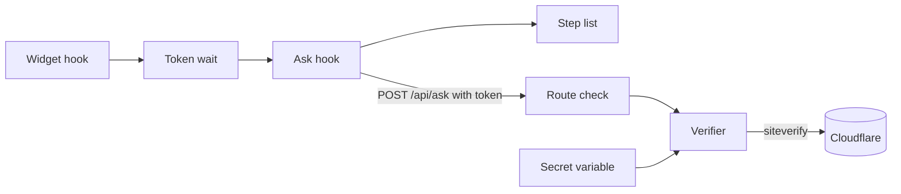
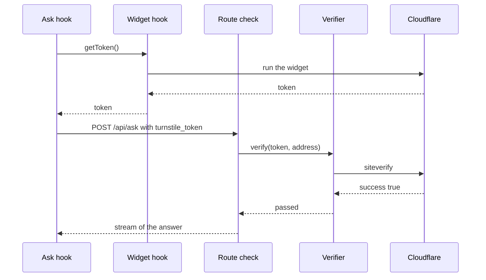

# 29 Bot check (Cloudflare Turnstile)

| | |
| --- | --- |
| Work | Feature: a Cloudflare Turnstile token for each question, which the API checks before any model call |
| Change | `9ef3f0a` on `main` (squash of `e5919c7` and `b3ac258` from `feature/bot-check-cloudflare-turnstile`), 2026-11-01 |
| Evidence | `blueprint/history/features/29-bot-check-cloudflare-turnstile.md` (spec, findings `29/F-01` and `29/F-02`, two independent reviews. Local, not in Git). The commit messages. The build conversation, with the user decisions on outages, suggestions, the widget mode, and `localhost`. |
| Reader | A learner who can write basic code and is new to this stack |

This document obeys the rules of ASD-STE100 Simplified Technical
English. It is not a certified STE document.

## 1. Summary

Before this work, a script could send questions to `POST /api/ask` with `curl` and spend the Gemini credits. Now each question must carry a Turnstile token. The page gets the token from a Cloudflare widget, and the API asks Cloudflare if the token is valid. The API calls the model only after Cloudflare says yes.

The one idea to remember: the token check sits between two older guards. It comes after the per-minute limit and before the daily caps. Thus a flood costs few Cloudflare calls, and a refused question counts nothing.

## 2. Why this work exists

Highbury opens to the public on 2026-11-02. A fix before this work added daily caps: 10 questions for each address and 250 for the site. But the API was still open to any HTTP client. A script with many addresses could use all 250 questions of a day, and the prepaid credits are the only spend backstop.

**Cloudflare Turnstile** is a free bot check. A widget in the page runs a challenge in the browser and gives a **token**, a short string that Cloudflare signs. The server sends the token and a secret key to Cloudflare's **siteverify** endpoint, and Cloudflare answers yes or no. This work uses Turnstile because the user chose it on 2026-11-01. A visitor sees nothing in most cases.

## 3. Design

The design has a server half and a browser half. The browser half gets a token, and the server half checks it.

| Part | Location | Job |
|---|---|---|
| Verifier | `services/analyst/src/analyst/turnstile.py` | Sends one token to siteverify and gives `passed`, `failed`, or `unavailable` |
| Route check | `services/analyst/src/analyst/api.py` | Refuses a question with no token, a bad token, or no answer from Cloudflare |
| Secret variable | `services/analyst/src/analyst/settings.py` | Reads `TURNSTILE_SECRET_KEY` as a `SecretStr` and stops the start when it is empty |
| Widget hook | `apps/web/src/hooks/use-turnstile.ts` | Renders one widget and gives a fresh token for each question |
| Token wait | `apps/web/src/lib/turnstile.ts` | Times one token: a sign after 2 s, a limit of 10 s, a pause for the checkbox |
| Ask hook | `apps/web/src/hooks/use-ask.ts` | Waits for the token, then sends it in the body of the question |
| Step list | `apps/web/src/components/ask/step-list.tsx` | Shows "Checking your browser." while the token is slow |

A `SecretStr` is a Pydantic type that hides its value when the program prints the object. This work uses it so that the secret never appears in a log or an error.

## 4. Workflow

Example input: a visitor types "Show me Thierry Henry's shots in 2003-04." and presses Ask.

1. The ask hook starts the turn and asks the widget hook for a token. (`use-ask.ts:50`)
2. The widget hook makes a new token wait and runs the widget. (`use-turnstile.ts:102`)
3. Cloudflare gives a token, and the callback settles the wait. (`use-turnstile.ts:76`)
4. The ask hook puts the token in the body as `turnstile_token`. (`use-ask.ts:63`)
5. The stream client posts the body to the API. (`ask-stream.ts:133`)
6. The route counts the request against the per-minute limit. (`api.py:681`)
7. The route refuses an empty token with 403 and no network call. (`api.py:694`)
8. The route sends the token and the address to the verifier. (`api.py:696`)
9. The verifier posts to siteverify with a 2 s connect and 3 s read limit. (`turnstile.py:26`)
10. With `passed`, the route takes a daily count and starts the turn. (`api.py:708`)

If the verdict is `failed`, the visitor gets 403 and a text about ad blockers. If the verdict is `unavailable`, the visitor gets 503 and "Try again in a few minutes".

## 5. Decisions and tradeoffs

### 5.1 Refuse the question when Cloudflare does not answer

- **Choice:** A timeout, a 5xx, or an unclear body from siteverify gives 503. The question does not go to the model.
- **Alternatives:** Answer the question and let the daily caps limit the spend.
- **Reason:** Recorded: the user chose this on 2026-11-01. An answer during an outage lets any made-up token through, and the widget in the browser usually fails in the same outage. Source: spec Decisions 1, the comment at `api.py:688`.
- **Cost:** During a Cloudflare outage, no visitor gets an answer.

### 5.2 Require a token for every question, a kept suggestion too

- **Choice:** Each `POST /api/ask` needs a token. A kept suggestion costs no model call, but it still needs one.
- **Alternatives:** Let a kept suggestion through with no token.
- **Reason:** Recorded: a kept answer makes a conversation, and the service keeps at most 200. A follow-up in that conversation calls the model. Source: spec Decisions 2.
- **Cost:** A visitor with a blocked widget cannot read even the free answers.

### 5.3 Check the token after the rate limit and before the daily caps

- **Choice:** The order in the route is: per-minute limit, token, daily caps, kept check, slot.
- **Alternatives:** Check the token first, or after the daily caps.
- **Reason:** Recorded: because the rate limit comes first, a flood of requests does not become a flood of siteverify calls. The token before the caps means that a refusal needs no `give_back`. Source: spec Notes for the AI, the comment at `api.py:688`.
- **Cost:** A bot with no token still uses its per-minute count.

### 5.4 Use a Managed widget that shows a checkbox only when needed

- **Choice:** The user set the widget to Managed in the Cloudflare dashboard. The page uses `appearance: "interaction-only"`. A flagged visitor sees a checkbox at the bottom of the screen. The 10 s limit pauses while the checkbox waits.
- **Alternatives:** An Invisible widget, which refuses a flagged visitor with no way to pass.
- **Reason:** Recorded: the user asked if the site stays easy to use. The answer found a dead end for visitors on a VPN or a privacy browser. Source: the build conversation, spec Decisions 3.
- **Cost:** The page has a fixed element, and the code must handle two more callbacks.

### 5.5 Send the token in the body, not in a header

- **Choice:** The token is the field `turnstile_token` of the JSON body.
- **Alternatives:** A header such as `X-Turnstile-Token`.
- **Reason:** Recorded: a new header needs a change to the CORS `allow_headers`, which stays `Content-Type`. Source: spec Data / contracts.
- **Cost:** The body limit must leave room for a token of up to 2048 characters.

### 5.6 Trust the hostname list of the widget, and do not check hostname or action

- **Choice:** The API checks only `success`. The widget allows only the two production hostnames. Local work uses Cloudflare's test keys.
- **Alternatives:** Check the `hostname` and `action` fields of the siteverify answer against an allow list.
- **Reason:** Recorded: with `localhost` on the widget, a token from any local page passed in production. The user removed `localhost` and chose the change with no code. Source: the build conversation, the Cloudflare guide for a widget that exists.
- **Cost:** A local run cannot test the real keys. The protection depends on the hostname list in the Cloudflare dashboard, not on the code.

### 5.7 Give the verifier a test seam

- **Choice:** `create_app` takes an optional `verify_token` function. With none, the app builds the real one from the secret.
- **Alternatives:** Patch `httpx` in each test.
- **Reason:** Recorded: the spec asked for a seam that replaces the network call. Source: spec step 2. A **test seam** is a place where a test can put a fake in place of a real part.
- **Cost:** The factory has one more parameter.

## 6. Blast radius

### 6.1 This work needs

| Dependency | Used for | If it fails |
|---|---|---|
| Cloudflare siteverify | The verdict on each token | Each question gets 503, "The bot check is not available" |
| The Turnstile script at `challenges.cloudflare.com` | The widget in the page | The page sends no token, and the visitor gets the 403 text at once |
| `TURNSTILE_SECRET_KEY` | The siteverify call | The API does not start: "TURNSTILE_SECRET_KEY is not set" |
| `NEXT_PUBLIC_TURNSTILE_SITE_KEY` | The widget | The page renders no widget, and each question gets 403 |
| `httpx` | The HTTP call to Cloudflare | The verdict is `unavailable`, and the question gets 503 |

### 6.2 These things use this work

| Consumer | Uses | Found in |
|---|---|---|
| The ask page | `useTurnstile` and the `checking` flag | `apps/web/src/components/ask/ask-page.tsx:28` |
| The stream client | `turnstile_token` in `AskBody` | `apps/web/src/lib/ask-stream.ts:133` |
| The API tests | `create_app(verify_token=...)` | `services/analyst/tests/test_api.py` |
| The ECS service | The SSM parameter `/highbury/TURNSTILE_SECRET_KEY` | `deploy/ecs/service.example.json:33` |

The `ask` CLI, the evals, and the MCP server call the agent directly. They do not use the route, so the bot check does not apply to them.

### 6.3 If you change this work

| If you change | Then check |
|---|---|
| The order of the checks in `ask` | The daily counts and slots of a refused question, and the test of a rate-limited request |
| The verdict names | `VerifyToken` in `api.py` and the parameter list of `test_turnstile.py` |
| The refusal texts | The tests of `ask-stream.test.ts`, which hold the same texts |
| The page's Content-Security-Policy (item 30) | It must allow `https://challenges.cloudflare.com` for script and frame |
| The widget hostnames in the dashboard | A token from a hostname on the list passes in production |

### 6.4 How to remove this work

1. Revert `9ef3f0a` on `main`.
2. Remove the `TURNSTILE_SECRET_KEY` entry from the ECS service, then deploy a new image.
3. Remove `NEXT_PUBLIC_TURNSTILE_SITE_KEY` from the Vercel project.
4. Delete the SSM parameter and the widget in the Cloudflare dashboard.

Without this work, the daily caps are the only guard against a script.

## 7. Code reading path

1. [`turnstile.py:26`](../services/analyst/src/analyst/turnstile.py#L26) - Look for: the three verdicts, and what counts as `unavailable`.
2. [`turnstile.py:15`](../services/analyst/src/analyst/turnstile.py#L15) - Look for: why two limits make about 5 s.
3. [`api.py:688`](../services/analyst/src/analyst/api.py#L688) - Look for: the order of the checks and the reasons in the comment.
4. [`api.py:622`](../services/analyst/src/analyst/api.py#L622) - Look for: the real verifier when a test gives no fake.
5. [`settings.py:45`](../services/analyst/src/analyst/settings.py#L45) - Look for: `SecretStr`, which keeps the secret out of a printed object.
6. [`turnstile.ts:18`](../apps/web/src/lib/turnstile.ts#L18) - Look for: one timer for the sign and one for the limit, and how pause works.
7. [`use-turnstile.ts:43`](../apps/web/src/hooks/use-turnstile.ts#L43) - Look for: the queue before the script loads, the reset after each token, and the `failed` flag.
8. [`use-ask.ts:49`](../apps/web/src/hooks/use-ask.ts#L49) - Look for: a stop while the check runs sends nothing.

## 8. Known limits

- httpx applies each time limit to each read, and the DNS lookup has no limit. A bad upstream can hold one thread for more than 5 s.
- If a flagged visitor presses Stop while the checkbox shows, the checkbox stays until the next question.
- `use-turnstile.ts` has no unit test. The project rule verifies hooks with lint, build, and the app in a browser.
- The live checks in production are not done yet. They are a `curl` question with no token, a token sent two times, and a question on the live page.
- This change closes the review findings `29/F-01` (a 10 s wait after a blocked script) and `29/F-02` (5 s for each phase).

## 9. Self-test

1. Why does the token check come after the per-minute limit?
2. What happens if Cloudflare's siteverify does not answer for 10 minutes?
3. Why does a kept suggestion need a token, although it costs no model call?
4. What happens if an ad blocker stops the Turnstile script when the page loads?
5. Why did the user remove `localhost` from the widget, and what do local runs use now?

Answers

1. A flood then costs few siteverify calls, because the rate limit refuses most requests first. See section 5.3.
2. Each question gets 503, and no question goes to the model. See section 5.1.
3. A kept answer makes a conversation, and a follow-up in it calls the model. See section 5.2.
4. The hook sets `failed`. Each question then goes out at once with no token and gets the 403 text. See section 6.1.
5. With `localhost` on the list, a token from any local page passed in production. Local runs use Cloudflare's test keys. See section 5.6.

